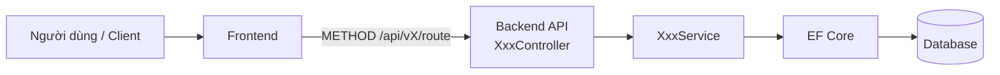
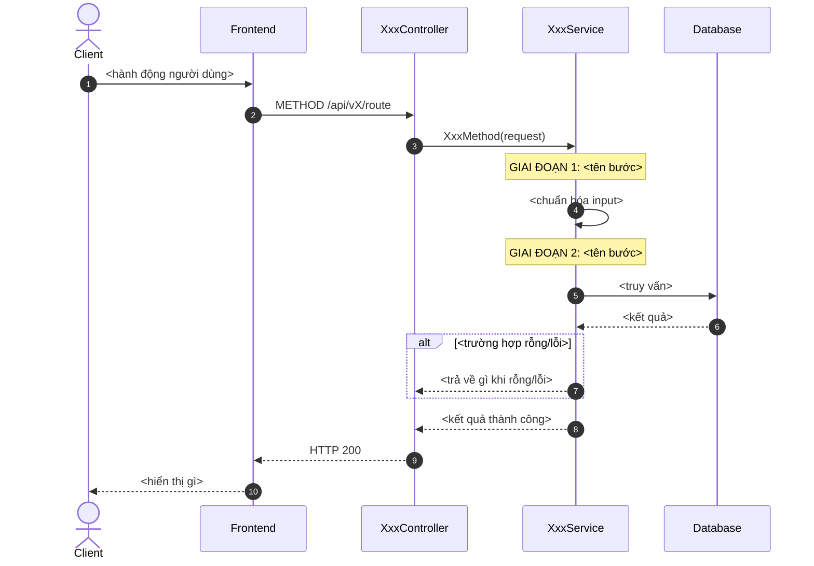
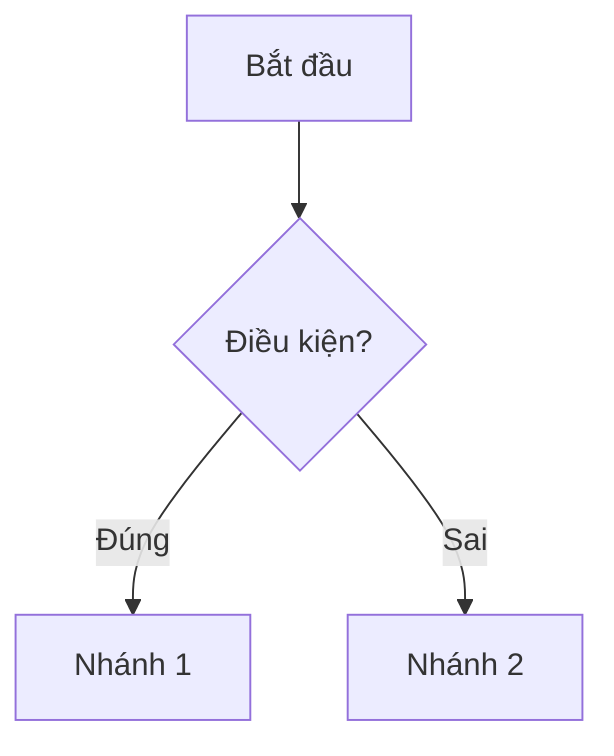
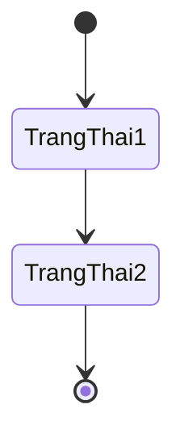
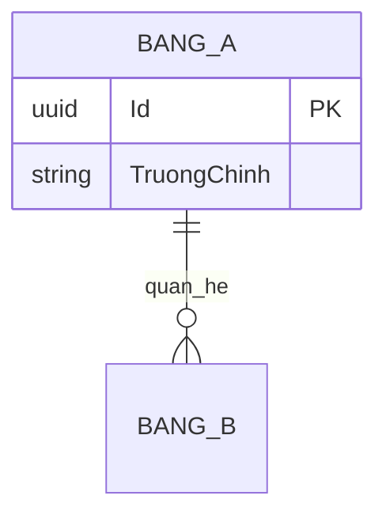

# TDD Writer — Viết Technical Design Document sau khi code xong

## Skill này dùng để làm gì

Đội của user dùng 2 loại tài liệu cố định, đi kèm nhau:

1. **TDD** (1 mẫu 4 bước) ghi lại **bối cảnh, kiến trúc, API contract, và tham chiếu**
   của một hàm/API sau khi đã code xong.
2. **UT — Unit Test Case** (1 mẫu ngắn hơn) ghi lại **từng kịch bản kiểm thử cụ thể**
   cho hàm/API đó — mỗi TDD thường có **nhiều** UT đi kèm, mỗi UT test 1 nhánh
   logic/1 edge case. Mã UT luôn gắn với mã TDD cha theo dạng `UT-XXX-NN` (XXX = số
   TDD, NN = số thứ tự UT trong TDD đó, bắt đầu từ 01), ví dụ TDD-004 sẽ có
   UT-004-01, UT-004-02, UT-004-03...

Mục đích chung: để người đọc sau (dev khác, hoặc chính user vài tháng sau) hiểu được
tính năng làm gì, luồng hoạt động ra sao, và **đã được test những trường hợp nào**,
mà không phải đọc lại toàn bộ code.

Khi được yêu cầu viết/cập nhật TDD hoặc UT, agent **không tự bịa cấu trúc riêng** —
luôn dùng đúng khung mẫu ở "Phần 1" (TDD) hoặc "Phần 2" (UT) bên dưới. Nếu tính
năng đã có code, phải đọc controller, service, DTO, entity, migration và test liên
quan để lấy thông tin chính xác. Nếu tài liệu được viết trước code, chỉ dùng những
quyết định đã được xác nhận trong Context/TDD; phần chưa được chốt phải ghi rõ là
chưa được chốt, không được tự điền cho đủ mẫu.

## Yêu cầu bắt buộc về khả năng đọc — ÁP DỤNG CHO TOÀN BỘ TÀI LIỆU

> ⚠️ **ĐÂY LÀ YÊU CẦU BẮT BUỘC, KHÔNG PHẢI GỢI Ý.** Vi phạm các quy tắc này coi như
> tài liệu chưa hoàn chỉnh. Áp dụng cho **TẤT CẢ** nội dung: TDD, UT, sơ đồ
> Mermaid, mô tả bằng lời, và mọi phần khác trong tài liệu.

---

### 1. ĐỘC GIẢ MỤC TIÊU

- Tài liệu phải viết cho **người không có kiến thức kỹ thuật** vẫn hiểu được 80% nội
  dung mà không cần tra glossary.
- Mỗi phần phải trả lời đủ 5 câu hỏi: **(1)** Vấn đề gì đang được giải quyết?
  **(2)** Điều kiện nào xảy ra? **(3)** Hệ thống làm gì? **(4)** Kết quả là gì?
  **(5)** Vì sao cần làm như vậy?

### 2. NGÔN NGỮ VÀ CÁCH DIỄN ĐẠT

- **Dùng tiếng Việt thông thường**, câu ngắn, chủ ngữ rõ ràng. Ưu tiên cách nói
  thân mật dễ hiểu thay vì thuật ngữ kỹ thuật.
- **Không dùng từ ngữ quá kỹ thuật** khi có cách nói dễ hiểu hơn. Ví dụ:
  - Thay vì "validate input" → nói "kiểm tra dữ liệu đầu vào có hợp lệ không"
  - Thay vì "return error" → nói "báo lỗi cho người dùng biết"
  - Thay vì "throw exception" → nói "hệ thống sẽ dừng xử lý và báo lỗi"
- **Không dùng từ viết tắt** khiến người đọc phải đoán. Nếu buộc phải dùng, giải
  thích ngay ở lần xuất hiện đầu tiên.
- **Không tóm tắt chung chung**. Cấm các cụm từ sau trong tài liệu:
  - "xử lý theo logic" → phải mô tả logic cụ thể là gì
  - "kiểm tra dữ liệu" → phải nêu kiểm tra dữ liệu nào, điều kiện ra sao
  - "trả kết quả phù hợp" → phải mô tả kết quả cụ thể là gì
  - "thực hiện như bình thường" → phải mô tả bước cụ thể
  - "sau đó" (không nói rõ thao tác gì) → phải nêu thao tác cụ thể
  - "tùy trường hợp" → phải liệt kê từng trường hợp cụ thể
- **Không rút gọn format** — giữ nguyên cấu trúc mẫu tài liệu, không bỏ bớt mục
  hoặc thay đổi thứ tự nếu không được phép.

### 3. THUẬT NGỮ KỸ THUẬT TỪ CODE

- **Chỉ giữ nguyên tên thực thể từ code** (tên bảng, tên trường trong database, tên
  API endpoint, tên lớp/trường trong code) vì đây là dữ liệu thật cần tra cứu.
- **Mọi thuật ngữ kỹ thuật khác phải diễn đạt lại** bằng tiếng Việt phổ thông.
  Ví dụ:
  - `soft delete` → phải viết đầy đủ là "đánh dấu bản ghi là đã xóa nhưng vẫn giữ
    lại dữ liệu trong cơ sở dữ liệu"
  - `HTTP 404` → phải viết là "lỗi không tìm thấy dữ liệu"
  - `API endpoint` → phải viết là "đường dẫn API" hoặc "liên kết gọi hệ thống"
  - `database query` → phải viết là "truy vấn cơ sở dữ liệu" hoặc "lấy dữ liệu từ bảng"
  - `JSON payload` → phải viết là "dữ liệu gửi đi theo định dạng JSON"
- **Quy tắc giải thích**: khi lần đầu dùng thuật ngữ kỹ thuật, phải viết kèm giải
  thích trong ngoặc đơn ngay sau nó: `"endpoint (đường dẫn API để client gọi)"`.

### 4. CHI TIẾT VÀ ĐỘ DÀI

- **Đủ chi tiết nhưng không lan man**: không bỏ qua điều kiện, nhánh, dữ liệu đầu
  vào, kết quả, lỗi hoặc ngoại lệ quan trọng.
- **Chỉ loại bỏ phần lặp lại** khi không làm thay đổi cách hiểu.
- **Không rút gọn đến mức người đọc phải mở code** hoặc tự suy diễn mới hiểu.
- Với mỗi nhánh if/else/switch trong code, phải có mô tả bằng lời đầy đủ trong TDD.

### 5. SƠ ĐỒ MERMAID (ÁP DỤNG CHO TẤT CẢ LOẠI)

- **Nhãn trong sơ đồ phải bằng tiếng Việt rõ nghĩa**, không dùng tên kỹ thuật
  thuần túy nếu có thể thay bằng cụm từ dễ hiểu.
  - ✅ `FE["Giao diện người dùng"]`
  - ✅ `SVC["Dịch vụ kiểm tra đơn hàng"]`
  - ❌ `SVC["OrderService.CheckOrder()"]`
- **Mỗi sơ đồ phải có phần mô tả bằng lời** ngay sau nó, giải thích tuần tự các
  bước diễn ra như thế nào — không chỉ có sơ đồ mà không có chú thích.
- **Thành phần hoặc thao tác kỹ thuật** trong sơ đồ phải có chú thích ngắn giải
  thích vai trò của nó.
- **Sequence Diagram cụ thể**: ngoài các bước gọi, phải có `Note over` giải thích
  rõ hệ thống đang làm gì ở mỗi giai đoạn, không chỉ ghi tên hàm.
- **Activity Diagram cụ thể**: mỗi nhánh điều kiện phải nêu rõ điều kiện cụ thể
  là gì và kết quả ra sao.

### 6. TDD — YÊU CẦU BỔ SUNG

- Giải thích đầy đủ bối cảnh, quy tắc nghiệp vụ, luồng xử lý, ví dụ API và các
  trạng thái lỗi.
- Mỗi nhánh quan trọng trong code phải có diễn giải bằng lời dễ hiểu, ngoài tên
  kỹ thuật chính xác cần giữ để tra cứu.
- Phần "Bối cảnh & Mục tiêu" phải viết như đang kể chuyện: tình huống ban đầu là
  gì, vấn đề xảy ra khi nào, hệ thống cần làm gì, kết quả cuối cùng ra sao.

### 7. UT — YÊU CẦU BỔ SUNG

- Mô tả đủ: **(1)** dữ liệu chuẩn bị trước, **(2)** thao tác kiểm tra, **(3)** kết
  quả mong đợi, **(4)** lý do vì sao kết quả đó đúng.
- Không chỉ liệt kê assertion hoặc mã lỗi; phải giải thích hành vi nghiệp vụ mà
  UT đang xác nhận.
- Người không chuyên kỹ thuật phải biết kịch bản này **đang kiểm tra cái gì** và
  **tại sao** nó quan trọng.

### 8. GIỮ ĐÚNG MẪU TÀI LIỆU

- Vẫn dùng đúng khung TDD/UT hiện có. Chỉ bổ sung phần giải thích cần thiết trong
  các mục của mẫu.
- Không tự thay đổi cấu trúc, không bỏ các mục bắt buộc, không đổi thứ tự các
  phần.

## Quy trình

1. **Xác định phạm vi tài liệu hóa**: 1 endpoint, 1 service method, hay 1 tính năng
   gồm nhiều endpoint liên quan? Đặt tên tính năng và mã tài liệu (`TDD-XXX`, số tăng
   dần theo tài liệu TDD gần nhất trong repo, tìm bằng cách grep các file `TDD-*.md`
   đã có nếu tồn tại).
2. **Xác định nguồn sự thật trước khi điền**:
   - Nếu đã có code: đọc controller (route, method), service (logic, business rules,
     các nhánh điều kiện), DTO/model (field), migration/entity (quan hệ dữ liệu), và
     test nếu có.
   - Nếu chưa có code: đọc Context, TDD, sơ đồ dữ liệu và các quyết định user đã xác
     nhận. Không biến nội dung dự kiến thành tên lớp, tên phương thức hoặc hợp đồng
     API đã tồn tại.
3. **Điền lần lượt 4 bước** theo đúng thứ tự trong Template TDD (Phần 1) — không bỏ
   trống các field bắt buộc (Author, Owner, Mã tài liệu, Endpoint, Request/Response
   mẫu). Các mục optional (Activity Diagram, State Diagram, API Contract bên ngoài)
   chỉ điền khi thực sự áp dụng — xem ghi chú "optional" ở từng mục.
4. **Diagram viết bằng Mermaid**, đặt trong code block ```mermaid``` để render được
   trực tiếp trên GitHub/GitLab/Notion.
5. **Viết các UT (Unit Test Case) đi kèm** theo Template UT (Phần 2) — soát lại từng
   ví dụ Request/Response, từng dòng "Mã lỗi" ở Bước 3 API và từng Business Rule ở
   Bước 1 của TDD vừa viết, mỗi mục quan trọng nên có ít nhất 1 UT tương ứng để xác
   nhận hành vi. Đánh số UT tăng dần: UT-XXX-01, UT-XXX-02...
6. **Lưu file**:
   - TDD: `TDD-XXX-ten-tinh-nang-kebab-case.md`, đặt trong `docs/tdd/` của repo.
   - UT: `UT-XXX-NN-ten-kich-ban-kebab-case.md`, đặt cùng cấp hoặc trong thư mục con
     `docs/tdd/ut/` (nếu chưa rõ, hỏi user muốn lưu ở đâu).
7. Nếu hàm/API này **tham chiếu tới hoặc bị tham chiếu bởi** một TDD khác đã tồn tại
   trong `docs/tdd/`, cập nhật chéo phần "Tham chiếu" ở cả hai file TDD, và đảm bảo
   TEST_LINKS của các UT trỏ đúng tới User Story/TDD liên quan.

## Phần 1 — Template TDD (copy toàn bộ khối dưới đây và điền vào)

````markdown
# TDD-XXX: <Tên tính năng>

## Thông tin tài liệu
- **Tiêu đề**: <câu mô tả 1 dòng, ví dụ "Lấy danh sách sản phẩm kèm số lượng bán khả dụng">
- **Ghi chú**: <1-3 câu giải thích chức năng này để làm gì, khi nào được gọi>

## Metadata quản trị tài liệu
| Trường | Giá trị |
|---|---|
| Mã tài liệu | TDD-XXX |
| Phiên bản | v0.1 |
| Author | <tên người code> |
| Reviewer | <tên người review, để trống nếu chưa có> |
| Approver | Chưa chỉ định |
| Owner | <tên người chịu trách nhiệm chức năng> |
| Cập nhật gần nhất | YYYY-MM-DD |

---

## BƯỚC 1 — Thông tin & Bối cảnh

### Thông tin tài liệu
- **Mã tài liệu**: TDD-XXX
- **Tính năng**: <tên tính năng, khác Tiêu đề ở trên — đây là tên ngắn dùng để tra cứu>
- **Tác giả**: <tự động lấy từ author code / git blame nếu có>
- **Người review**: 
- **Phiên bản**: v0
- **Cập nhật (YYYY-MM-DD)**: 
- **Story liên quan**: (US-xxx, STORY-xxx — mã ticket/backlog liên quan, nếu có)
  - 

### Business Rules
<liệt kê các quy tắc nghiệp vụ mà logic phải tuân theo — lấy trực tiếp từ code
validate/if-else trong service, không diễn giải lại khác đi>
- 

### Bối cảnh & Mục tiêu

**Vấn đề**
> <Vấn đề nghiệp vụ/kỹ thuật mà hàm/API này giải quyết là gì? Vì sao cần viết nó?
> Nêu rõ độ phức tạp hoặc điểm dễ sai nếu có, ví dụ: "SellableQuantity không phải
> Stock gốc mà phải tính dựa trên vật liệu CORE".>

**Mục tiêu**
<liệt kê từng gạch đầu dòng — mỗi dòng là 1 kết quả cụ thể, đo được, tương ứng 1:1
với 1 đoạn logic trong code>
- 

**Ngoài phạm vi** (Out of scope)
<những gì CỐ Ý không xử lý ở hàm/API này, để tránh hiểu nhầm — ví dụ: "Không tính
thành phần SUPPORT vào SellableQuantity", "Không xử lý variant con">
- 

---

## BƯỚC 2 — Kiến trúc & Sơ đồ

### Kiến trúc tổng quan (Architecture)
**Tiêu đề**: <ví dụ "Trình tự gọi API lấy sản phẩm này">
**Mô tả**: <mô tả bằng văn xuôi các thành phần tham gia và cách chúng ghép với nhau,
từ Frontend/Controller → Service → tầng tính toán (nếu có) → EF Core → DB>


**Ghi chú**: <thành phần nào KHÔNG có trong sơ đồ nhưng vẫn ảnh hưởng, ví dụ cache,
message queue, background job>

### Sequence Diagram
**Tiêu đề**: <ví dụ "Trình tự kiểm tra, tính toán và trả kết quả">
**Mô tả**: <luồng nhiều bên gọi qua lại theo thời gian>


**Ghi chú**: 

### Activity Diagram (optional — chỉ điền nếu logic có nhiều nhánh điều kiện phức tạp)
**Tiêu đề**: 
**Mô tả**: 


### State Diagram (optional — chỉ điền nếu entity chính có vòng đời trạng thái)
**Tiêu đề**: 
**Mô tả**: 


### Mô hình dữ liệu (Data Model / ERD)
**Tiêu đề**: 
**Mô tả**: <bảng nào liên quan, quan hệ ra sao — lấy từ entity/migration thật>


---

## BƯỚC 3 — API

### API Contract nội bộ

#### Endpoint #1
- **Method**: GET / POST / PUT / DELETE
- **Endpoint**: `/api/vX/...`
- **Tên endpoint**: <tên gợi nhớ, ví dụ "Danh sách hỗn hợp — sản phẩm thường + combo">
- **Mô tả**: <1 câu — endpoint này trả về gì>

**Ví dụ 1 — <happy path>** — HTTP `200`

Request:
```
GET /api/vX/route?param1=...&param2=...
```
Response:
```json
{
  "value": { "items": [ /* ... */ ] }
}
```
Error: <để trống nếu không có>

**Ví dụ 2 — <trường hợp rỗng>** — HTTP `200`

Request:
```
GET /api/vX/route?param1=...
```
Response:
```json
{ "value": { "items": [], "totalCount": 0 } }
```

**Ví dụ 3 — <edge case đặc biệt, ví dụ hết hàng / thiếu dữ liệu>** — HTTP `200`

Request:
```

```
Response:
```json

```

<thêm bao nhiêu ví dụ tùy vào số nhánh logic thật sự có trong code — mỗi nhánh
if/else quan trọng nên có 1 ví dụ tương ứng>

#### Mã lỗi
| Code | HTTP | Khi nào xảy ra |
|---|---|---|
| <ví dụ: "Không có công thức"> | 200/4xx | <điều kiện field, ví dụ SellableQuantity = 0, StockStatus = null, UnavailableReason = "no_formula"> |

### API Contract bên ngoài (optional — chỉ điền nếu hàm/API này gọi ra service/API của
bên thứ ba, ví dụ Nhanh.vn, cổng thanh toán, đối tác vận chuyển)
- **Endpoints sử dụng**: <method + URL của bên ngoài>
- **Field quan trọng**: <field nào từ response đối tác được dùng, ánh xạ sang field nội bộ>
- **Xử lý lỗi từ đối tác**: <mã lỗi/response bất thường của đối tác và cách mình xử lý>
- **Quirks / cạm bẫy**: <hành vi lạ, undocumented, rate limit, timezone khác... của bên đối tác mà dev sau cần biết trước>

---

## BƯỚC 4 — Tham chiếu

> Chú thích: 🔴 Tham chiếu đến (tài liệu này đọc/phụ thuộc) · ⚫ Trỏ vào tài liệu này
> (tài liệu khác phụ thuộc vào tài liệu này) · ⋯ Bị ảnh hưởng (thay đổi ở đây có thể
> làm tài liệu kia sai theo)

### 🔴 Tham chiếu đến
<liệt kê mã TDD/tài liệu khác mà chức năng này phụ thuộc vào, ví dụ dùng chung 1
service, 1 bảng dữ liệu>
- 

### ⚫ Trỏ vào tài liệu này
<TDD/tài liệu nào khác gọi tới hoặc dựa vào chức năng được mô tả ở đây>
- 

### ⋯ Bị ảnh hưởng
<nếu sửa logic ở đây thì chức năng/tài liệu nào khác có nguy cơ bị ảnh hưởng theo,
nên nhắc reviewer kiểm tra lại>
- 
````

## Hướng dẫn chọn loại sơ đồ Mermaid

| Mục | Loại Mermaid | Dùng khi |
|---|---|---|
| Kiến trúc tổng quan | `flowchart LR` | Muốn thấy các thành phần hệ thống ghép với nhau (Controller → Service → DB) |
| Sequence Diagram | `sequenceDiagram` | Muốn thấy **thứ tự theo thời gian** các lệnh gọi qua lại giữa nhiều bên — luôn nên có `autonumber` và các `Note over` đánh dấu từng giai đoạn xử lý trong service |
| Activity Diagram | `flowchart TD` (dùng `{}` cho điều kiện) | Logic có nhiều nhánh rẽ (if/else, switch) cần trực quan hóa |
| State Diagram | `stateDiagram-v2` | Entity chính có vòng đời nhiều trạng thái (draft → confirmed → shipped...) |
| Data Model | `erDiagram` | Cần thể hiện bảng và khóa quan hệ (PK/FK) giữa các entity |

## Nguyên tắc điền nội dung TDD (quan trọng)

- **TDD phải đọc được với người không chuyên kỹ thuật.** Diễn giải rõ từng business
  rule, điều kiện, hành động và kết quả; không thay mô tả bằng các cụm chung chung như
  "xử lý theo logic" hay "trả kết quả phù hợp".
- **Lấy sự thật từ code, không suy đoán.** Field, tên biến, response mẫu phải khớp
  chính xác với DTO/model thật trong code — copy tên field, không đổi tên "cho đẹp".
- **Mỗi nhánh logic quan trọng (if/else, switch-case) nên có ít nhất 1 ví dụ
  Request/Response tương ứng** trong "API Contract nội bộ" — đây là cách nhanh nhất
  để người đọc sau hiểu hết các trường hợp mà không cần đọc code.
- **"Mã lỗi" không nhất thiết là HTTP error** — trong mẫu gốc, các trạng thái đặc biệt
  (không có công thức, hết hàng...) vẫn trả HTTP 200 nhưng field `UnavailableReason`
  khác nhau. Ghi đúng theo cách hệ thống thật sự trả về, không mặc định là 4xx/5xx.
  Nếu hệ thống có dùng HTTP status lỗi thật (400/404/500...) thì ghi đúng status đó.
- **Business Rules ở Bước 1 khác Business Rules ẩn trong code**: chỉ liệt kê rule nào
  ảnh hưởng đến hành vi API (ví dụ công thức tính toán, điều kiện lọc), không liệt kê
  chi tiết implementation không cần thiết cho người đọc.
- **Bỏ trống có kiểm soát**: nếu 1 mục không áp dụng (ví dụ API không gọi bên ngoài),
  ghi rõ "Không áp dụng" thay vì xóa hẳn mục — giữ cấu trúc đồng nhất giữa các TDD để
  dễ tra cứu sau này.

---

## Phần 2 — Template Unit Test Case (UT)

Mỗi TDD (`TDD-XXX`) đi kèm **nhiều** UT, mỗi UT là 1 file/section riêng, mã theo dạng
`UT-XXX-NN` (NN bắt đầu từ `01`, tăng dần). Copy khối dưới đây cho **từng kịch bản
kiểm thử** — không gộp nhiều kịch bản vào 1 UT.

````markdown
# UT-XXX-NN: <Tên kịch bản kiểm thử, ví dụ "Combo Cha có biến thể lấy MIN variant">

## Thông tin tài liệu
- **Tiêu đề (bắt buộc)**: <trùng với tên kịch bản ở trên>
- **Ghi chú**: <ghi chú thêm nếu cần, có thể để trống>

## Metadata quản trị tài liệu
- **Mã tài liệu**: UT-XXX-NN
- **Phiên bản**: v0.1
- **Author (bắt buộc)**: <tên người viết test>
- **Reviewer**: <để trống nếu chưa có>
- **Approver**: Chưa chỉ định
- **Owner (bắt buộc)**: <người chịu trách nhiệm>
- **Cập nhật gần nhất**: YYYY-MM-DD

## Đơn vị kiểm thử
- **Module (bắt buộc)**: <tên module, ví dụ "PRODUCT - Lấy danh sách sản phẩm">
- **Unit under test (bắt buộc)**: <Nếu đã có code, ghi Class.Method thật, ví dụ
  ProductService.GetProductsV2. Nếu chưa có code, ghi tên luồng được kiểm tra và nói
  rõ tên lớp/phương thức chưa được chốt; tuyệt đối không tự đặt tên phương thức.>
- **Loại**: Happy | Branch | Boundary | Error | Quirk | Determinism
- **Precondition / Mock setup**:
  <mô tả chi tiết dữ liệu giả lập cần có trước khi chạy — liệt kê từng entity, field
  quan trọng, và quan hệ giữa chúng. Viết đủ để người khác dựng lại data y hệt, ví dụ:
  "parent-001 (ProductType="Sản Phẩm", ParentProductId=null); variant-001
  (ProductType="Combo", ParentProductId="parent-001") có ComboSpecification:
  mat-001 (Stock=100), Quantity=2 → max=50">
- **Input**:
  ```
  METHOD /api/vX/route?param=...
  ```
- **Expected output (bắt buộc)**:
  ```
  HTTP <status>
  <mô tả CHÍNH XÁC field nào = giá trị gì, kèm lý do ra giá trị đó — ví dụ:
  "SellableQuantity = 20 (min của variant con: 20 vs 50)". Nếu có điều kiện loại trừ
  (item nào KHÔNG xuất hiện và vì sao) thì ghi rõ luôn.>
  ```

## Phân loại và trách nhiệm
- **Suite**: SMOKE | REGRESSION | FULL
- **Priority**: P0 | P1 | P2 | P3
- **Owner**: <người chịu trách nhiệm test case — có thể trùng Owner ở Metadata>
- **Rationale (bắt buộc)**: <1 câu — test case này xác nhận đúng hành vi/quy tắc
  nghiệp vụ nào, ví dụ "Xác nhận cha combo có biến thể trả về MIN(SellableQuantity
  của các variant con)">

## TEST_LINKS
<Mỗi requirement/Business Rule mà UT này xác nhận viết thành 1 khối riêng bên dưới —
không gộp chung vào bảng — để copy từng khối lên form link tương ứng. Mã phải trỏ
đúng section cụ thể (AC-xx), không ghi chung chung "liên quan TDD-XXX".>

**Link 1**
- **Loại**: User Story
- **Mã**: STORY-xxx
- **Section**: AC-xx
- **Ghi chú**: 

**Link 2**
- **Loại**: TDD
- **Mã**: TDD-XXX
- **Section**: AC-xx
- **Ghi chú**: 

<thêm Link 3, 4... nếu UT này còn xác nhận thêm requirement/Business Rule khác>
````

### Ý nghĩa các "Loại" kiểm thử

| Loại | Khi nào dùng |
|---|---|
| Happy | Kịch bản chuẩn — input hợp lệ, đi đúng luồng chính, kết quả đúng như thiết kế |
| Branch | Test 1 nhánh rẽ cụ thể trong logic (if/else, switch-case) khác với luồng Happy |
| Boundary | Test giá trị biên — 0, rỗng, max, min, ngay ngưỡng chuyển trạng thái |
| Error | Input sai / thiếu / hệ thống gặp lỗi — xác nhận hệ thống trả đúng mã lỗi/HTTP status |
| Quirk | Hành vi đặc biệt, dễ hiểu nhầm, hoặc cạm bẫy đã biết của hệ thống (đã ghi ở
"Quirks / cạm bẫy" trong TDD) |
| Determinism | Xác nhận kết quả ổn định, lặp lại được — ví dụ thứ tự sort không đổi giữa
các lần gọi, không phụ thuộc thời điểm chạy |

### Nguyên tắc viết UT (quan trọng)

- **UT cũng phải dễ hiểu với người không chuyên kỹ thuật.** Mô tả đầy đủ dữ liệu ban
  đầu, thao tác kiểm tra, kết quả mong đợi và lý do; giải thích thuật ngữ kỹ thuật
  hoặc tên từ code ngay khi dùng, không chỉ ghi tắt kết quả kiểm tra.
- **1 UT = 1 kịch bản duy nhất.** Không gộp nhiều nguyên nhân lỗi hoặc nhiều nhánh
  độc lập vào cùng một UT. Một UT có thể kiểm tra nhiều field đầu ra nếu tất cả các
  field đó cùng chứng minh cho một hành vi duy nhất.
- **Tên UT phải nói rõ điều kiện và kết quả chính.** Tránh các tên chung chung như
  “trường hợp lỗi”, “kiểm tra API” hoặc “test dữ liệu”.
- **Map UT với chính TDD cha**: mỗi ví dụ Request/Response, mỗi dòng "Mã lỗi" và mỗi
  Business Rule quan trọng phải có ít nhất 1 UT tương ứng. Sau khi viết xong, đối
  chiếu toàn bộ mã Business Rule để phát hiện quy tắc chưa được bao phủ.
- **Suite/Priority phản ánh mức độ quan trọng**: luồng chính/rule cốt lõi → SMOKE +
  P1; các nhánh phụ, boundary hiếm gặp → REGRESSION/FULL + P2-P3.

### Bộ quy tắc UT dùng chung — bắt buộc áp dụng

Các quy tắc dưới đây được rút ra từ cách viết UT đã được chốt và phải dùng cho mọi
TDD về sau. Chỉ quy tắc trình bày và kiểm tra được dùng chung; không mang Business
Rule riêng của một tính năng sang tính năng khác.

#### 1. Viết đủ bối cảnh để người khác dựng lại tình huống

- `Ghi chú` phải nói ngắn gọn tình huống đang xảy ra và mục đích của UT.
- `Precondition / Mock setup` phải nêu rõ người thực hiện, trạng thái đăng nhập nếu
  có, từng bản ghi cần chuẩn bị, ID, field quan trọng, trạng thái và quan hệ giữa các
  bản ghi. Không bắt người đọc mở code hoặc TDD để đoán dữ liệu còn thiếu.
- Chỉ dùng giá trị kiểm thử cụ thể và giải thích vai trò của chúng. **Không dùng cụm
  “dữ liệu đại diện”** vì người đọc có thể hiểu nhầm đó là dữ liệu được phép thay
  tùy ý. Có thể dùng “giá trị kiểm thử cụ thể”, “bản ghi dùng trong tình huống này”
  hoặc mô tả trực tiếp giá trị và mục đích.
- Mọi dữ liệu không phải nguyên nhân của tình huống đang kiểm tra phải được xác định
  là hợp lệ. Nếu trạng thái của dữ liệu đó ảnh hưởng kết quả, phải ghi rõ trạng thái,
  không chỉ viết “các phần còn lại hợp lệ”.

#### 2. Ghi đầy đủ dữ liệu nhận vào

- Với API, `Input` phải có method, đường dẫn, path parameter, query parameter,
  header quan trọng và body đúng như hợp đồng. Với hàm nội bộ, ghi đủ mọi tham số
  nhận vào.
- Ngay sau ví dụ Input, liệt kê **toàn bộ field mà API/hàm có thể nhận** và nêu rõ:
  vị trí, bắt buộc hay tùy chọn, kiểu hoặc định dạng quan trọng, ý nghĩa, giá trị đang
  dùng trong UT và field nào không được phép xuất hiện.
- Không chỉ ghi field gây ra lỗi rồi bỏ qua các field hợp lệ còn lại. Người đọc phải
  nhìn được toàn bộ hợp đồng đầu vào trong chính file UT.
- Nếu nhiều field bị cấm có thể được gửi độc lập và mỗi field cần được bảo vệ riêng,
  viết một UT cho từng field. Không gộp tất cả field bị cấm vào một request rồi chỉ
  kiểm tra một lỗi chung.
- Dùng đúng tên field và cách viết hoa/thường từ code hoặc TDD. Không đổi tên cho dễ
  đọc; hãy giải thích ý nghĩa ở cột mô tả.

#### 3. Ghi đầy đủ dữ liệu trả ra

- Với kết quả thành công, ghi đủ lớp phản hồi bên ngoài và toàn bộ field công khai
  bên trong kết quả. Nếu hệ thống dùng mẫu chung, phải thể hiện đầy đủ các field như
  trạng thái thành công/thất bại, lỗi, mã theo dõi, thời điểm và `value` theo đúng
  hợp đồng thực tế.
- Với kết quả lỗi, ghi đủ mọi field của mẫu lỗi thực tế, ví dụ `title`, `status`,
  `detail`, `messageCode`, `errors`, `traceId`, `timestampUtc`. Nêu rõ field nào
  không xuất hiện trong kết quả lỗi.
- Với danh sách hoặc đối tượng lồng nhau, liệt kê đầy đủ field công khai ở từng cấp;
  không thay bằng `...` nếu chính field đó là nội dung cần xác nhận.
- Mỗi giá trị quan trọng phải kèm lý do vì sao nó có giá trị đó. Với field được kế
  thừa, tính toán, giữ nguyên hoặc tạo mới, phải nói rõ nguồn của giá trị.
- Nếu TDD chỉ chốt HTTP status và `messageCode` nhưng chưa chốt câu chữ `title` hoặc
  `detail`, dùng placeholder rõ nghĩa và ghi chú rằng câu chữ chưa cố định. Không tự
  sáng tác một câu rồi trình bày như hợp đồng bắt buộc.

#### 4. Nêu rõ tác động đến dữ liệu và hệ thống liên quan

- `Expected output` phải nói bảng/bản ghi nào được tạo, cập nhật hoặc giữ nguyên;
  các field lưu nguồn gốc, liên kết hoặc snapshot phải có giá trị gì và lấy từ đâu.
- Với trường hợp thất bại, ghi rõ không tạo hoặc không thay đổi dữ liệu nào. Nếu lỗi
  xảy ra trước bước gọi hệ thống bên ngoài, ghi rõ hệ thống bên ngoài không được gọi.
- Nếu nhiều bản ghi phải được lưu cùng nhau, xác nhận rõ hoặc tất cả cùng thành công,
  hoặc không bản ghi nào được giữ lại khi một bước thất bại.
- Không thêm tác động chưa được code, Context hoặc TDD xác nhận. Các phần ngoài phạm
  vi phải được loại khỏi danh sách UT hoặc ghi rõ thuộc tài liệu/hàm khác.

#### 5. Không tự bịa phần chưa được chốt

- Chỉ lấy tên lớp, tên phương thức, route, field, mã lỗi, HTTP status và quy tắc từ
  code hoặc tài liệu đã được xác nhận.
- Nếu chưa có code, `Unit under test` phải ghi tên luồng nghiệp vụ và nói rõ tên lớp/
  phương thức chưa được chốt. Không tự đặt tên nghe có vẻ hợp lý.
- Nếu có mâu thuẫn giữa code, Context, TDD và quyết định mới của user, dừng việc suy
  diễn; nêu chính xác điểm mâu thuẫn và chỉ sửa theo nguồn đã được user xác nhận.
- Không tạo UT cho quota, retry, background job hoặc hành vi của thành phần khác chỉ
  vì tài liệu có nhắc đến. Chỉ viết khi hành vi đó thật sự thuộc phạm vi của TDD/hàm
  đang kiểm tra hoặc user yêu cầu rõ.

#### 6. Giải thích lý do nghiệp vụ, không viết câu cho đủ mẫu

- `Rationale` phải nêu hậu quả cụ thể nếu hành vi bị sai: ví dụ gắn nhầm nguồn, tính
  sai tiền, lộ dữ liệu của người khác, dùng dữ liệu đã xóa, tạo bản ghi không đầy đủ
  hoặc khiến kết quả không thể truy lại.
- Không dùng câu chung chung như “để bảo đảm hệ thống hoạt động đúng”, “kết quả phải
  rõ ràng” hoặc “tài liệu xác nhận dữ liệu gửi vào và trả ra”.
- Phần cuối `Expected output` phải giải thích vì sao kết quả đó đúng trong bối cảnh
  của UT, nhưng không lặp nguyên văn `Rationale`.

#### 7. TEST_LINKS phải tra cứu được

- Luôn trỏ tới đúng TDD cha và ghi rõ từng mã Business Rule/Acceptance Criteria mà
  UT xác nhận. Không chỉ ghi “liên quan TDD-XXX”.
- Chỉ thêm User Story khi mã Story và section thực sự tồn tại hoặc đã được user xác
  nhận. Không tự bịa mã Story để điền cho đủ mẫu; nếu chưa có, ghi rõ “Chưa xác định”.
- Không dùng khoảng viết tắt khiến công cụ tìm kiếm không thấy từng mã, ví dụ tránh
  `BR-001-01 đến BR-001-05`; hãy liệt kê đủ từng mã.

#### 8. Tự kiểm tra trước khi bàn giao

- Kiểm tra mã trong tiêu đề, metadata và tên file khớp nhau; không có ID trùng.
- Kiểm tra mọi file giữ đủ các mục bắt buộc và đúng thứ tự của Template UT.
- Đối chiếu danh sách UT với toàn bộ Business Rule, ví dụ API, mã lỗi và field bị
  cấm trong TDD; báo rõ phần nào chưa có UT.
- Tìm và loại bỏ các câu bị cấm: “xử lý theo logic”, “trả kết quả phù hợp”, “thực
  hiện như bình thường”, “tùy trường hợp”, “dữ liệu đại diện”, hoặc câu tương tự khiến
  người đọc phải tự đoán.
- Kiểm tra không có UT nào vô tình mô tả hành vi ngoài phạm vi, tự đặt mã lỗi hoặc
  biến câu ví dụ chưa chốt thành yêu cầu bắt buộc.
