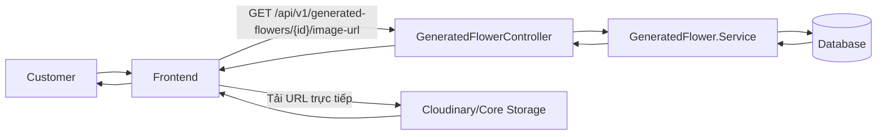
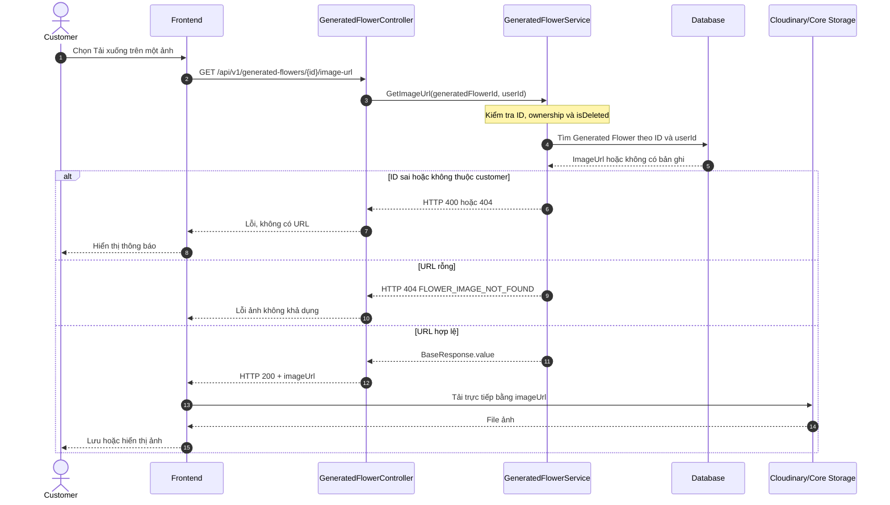
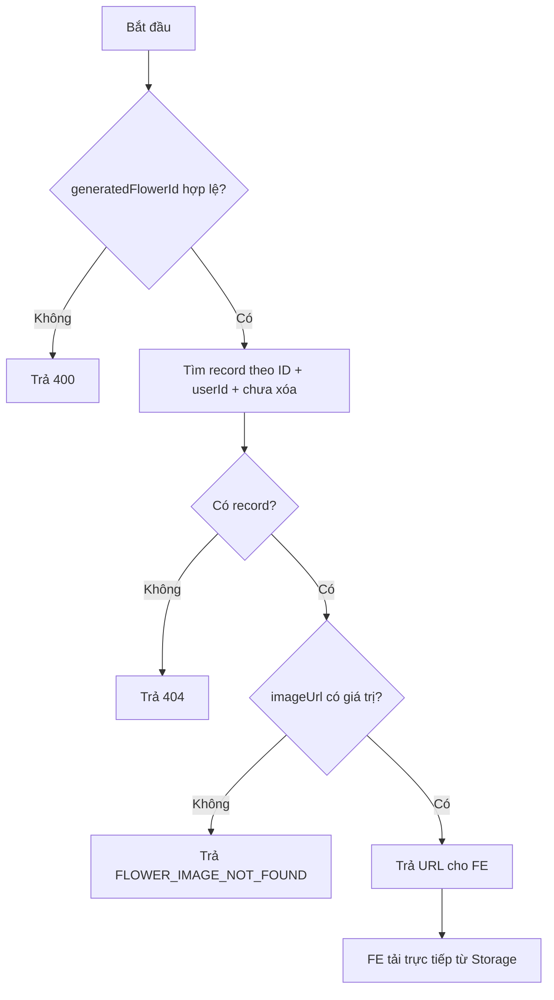
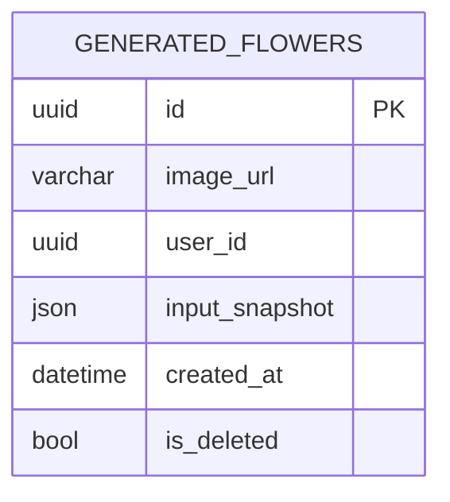

# TDD-029: Customer lấy URL ảnh mẫu hoa AI

## Thông tin tài liệu

- **Tiêu đề**: Customer lấy URL ảnh hoa AI đã tạo để hiển thị hoặc tải trực tiếp.
- **Ghi chú**: Backend chỉ kiểm tra quyền và trả `generated_flowers.image_url`; FE tải trực tiếp từ nền tảng lưu trữ.

## Metadata quản trị tài liệu

| Trường | Giá trị |
|---|---|
| Mã tài liệu | TDD-029 |
| Phiên bản | v0.1 |
| Author | Codex |
| Reviewer |  |
| Approver | Chưa chỉ định |
| Owner | Hoàng Thị Khánh Linh |
| Cập nhật gần nhất | 2026-09-07 |

---

## BƯỚC 1 — Thông tin & Bối cảnh

### Thông tin tài liệu

- **Mã tài liệu**: TDD-029
- **Tính năng**: Customer lấy URL ảnh mẫu hoa AI
- **Tác giả**: Codex
- **Người review**:
- **Phiên bản**: v0.1
- **Cập nhật (YYYY-MM-DD)**: 2026-09-07
- **Story liên quan**:
  - STORY-034

### Business Rules

- Customer phải đăng nhập; `userId` lấy từ JWT.
- `generatedFlowerId` phải là Guid khác rỗng.
- Chỉ lấy bản ghi `generated_flowers` chưa bị xóa và thuộc customer hiện tại.
- `image_url` phải có giá trị khác rỗng; nếu không có thì trả `FLOWER_IMAGE_NOT_FOUND`.
- Không cần join `client_histories`; ID và ownership đã có trong `generated_flowers`.
- Không kiểm tra lại trạng thái Combo/Mockup hiện tại; kết quả đã lưu vẫn được lấy URL.
- Không gọi AI, không trừ quota và không tạo History mới.
- Backend không tải binary, không chuẩn hóa PNG, không gắn lại logo và không tự đặt tên file.
- FE dùng URL nhận được để hiển thị hoặc tải trực tiếp từ Cloudinary/Core Storage.

### Bối cảnh & Mục tiêu

**Vấn đề**

> Customer cần tải lại cả ảnh AI mới và ảnh cũ từ màn hình lịch sử. Nếu Backend tải file rồi chuyển tiếp, băng thông và tải xử lý sẽ tăng không cần thiết.

**Mục tiêu**

- Trả đúng URL của ảnh thuộc customer.
- Ngăn truy cập URL của customer khác.
- Để FE/storage xử lý việc tải file, định dạng và tên file.

**Ngoài phạm vi**

- Không stream file hoặc proxy request đến storage.
- Không tạo presigned URL mới.
- Không kiểm tra số lần tải.
- Không thay đổi ảnh, logo, resolution hoặc định dạng.

---

## BƯỚC 2 — Kiến trúc & Sơ đồ

### Kiến trúc tổng quan

**Tiêu đề**: Backend trả URL, FE tải ảnh trực tiếp.

**Mô tả**: FE gửi ID ảnh; Service lọc theo ID, `userId` và `isDeleted`; sau khi có URL, FE gọi trực tiếp nền tảng lưu trữ.



### Sequence Diagram

**Tiêu đề**: Trình tự lấy URL và tải ảnh.



**Ghi chú**: Backend không nằm trên đường truyền file ảnh, nên nhiều customer tải cùng lúc không làm tăng tải stream tại API.

### Activity Diagram



### State Diagram

Không áp dụng. API không thay đổi trạng thái `generated_flowers`.

### Mô hình dữ liệu



---

## BƯỚC 3 — API

### Endpoint #1

- **Method**: GET
- **Endpoint**: `/api/v1/generated-flowers/{generatedFlowerId}/image-url`
- **Tên endpoint**: Lấy URL ảnh mẫu hoa AI
- **Mô tả**: Trả URL ảnh chính thức của một kết quả hoa AI thuộc customer hiện tại.

**Request**

```http
GET /api/v1/generated-flowers/f4000000-0000-0000-0000-000000000000/image-url
Authorization: Bearer <customer_token>
```

| Field | Vị trí | Kiểu | Bắt buộc | Mô tả |
|---|---|---|---:|---|
| `generatedFlowerId` | Route | Guid | Có | ID trong `generated_flowers`, khác `Guid.Empty`. |
| `Authorization` | Header | Bearer token | Có | Token của customer hiện tại. |

**Response — HTTP 200**

```json
{
  "isSuccess": true,
  "isFailed": false,
  "error": null,
  "traceId": null,
  "timestampUtc": "2026-09-07T10:00:00Z",
  "value": {
    "generatedFlowerId": "f4000000-0000-0000-0000-000000000000",
    "imageUrl": "https://res.cloudinary.com/demo/image/upload/flower-f04.png"
  }
}
```

FE dùng `value.imageUrl` để tải trực tiếp. Backend không trả binary và không cần trả nội dung file.

### IService

```csharp
public interface IService
{
    Task<Response.FlowerImageUrlResponse> GetImageUrl(
        Guid generatedFlowerId);
}
```

### Response

```csharp
public class FlowerImageUrlResponse
{
    public Guid GeneratedFlowerId { get; set; }
    public required string ImageUrl { get; set; }
}
```

### Service logic

```csharp
var userId = _currentUser.GetRequiredUserId();

var flower = await _dbContext.GeneratedFlowers
    .AsNoTracking()
    .Where(x =>
        x.Id == generatedFlowerId &&
        x.UserId == userId &&
        !x.IsDeleted)
    .Select(x => new { x.Id, x.ImageUrl })
    .FirstOrDefaultAsync();

if (flower == null || string.IsNullOrWhiteSpace(flower.ImageUrl))
{
    throw new NotFoundException("Không tìm thấy ảnh mẫu hoa");
}

return new Response.FlowerImageUrlResponse
{
    GeneratedFlowerId = flower.Id,
    ImageUrl = flower.ImageUrl
};
```

Controller bọc kết quả bằng `ApiResponseFactory.Base` để FE đọc tại `response.value`.

### Mã lỗi

| Code | HTTP | Khi nào xảy ra |
|---|---:|---|
| `UNAUTHORIZED` | 401 | Chưa đăng nhập hoặc token không hợp lệ. |
| `INVALID_GENERATED_FLOWER_ID` | 400 | ID rỗng hoặc không bind được thành Guid. |
| `FLOWER_IMAGE_NOT_FOUND` | 404 | Không có record thuộc customer hoặc `image_url` rỗng. |

### API Contract bên ngoài

Không áp dụng ở Backend. FE sử dụng `imageUrl` gọi trực tiếp Cloudinary/Core Storage; Backend không gọi storage.

---

## BƯỚC 4 — Tham chiếu

### 🔴 Tham chiếu đến

- `doc-us/STORY-034-Tai-anh-mau-hoa-sau-khi-AI-tao/STORY-034-Tai-anh-mau-hoa-sau-khi-AI-tao.md`
- `doc-us/STORY-034-Tai-anh-mau-hoa-sau-khi-AI-tao/ST-STORY-034-tai-xuong-mau-hoa-ai.md`
- `code-introduction/US-034/US-034-introduction.md`
- `docs (1)/AI_Flower_Context.md`
- `docs (1)/AI_DB_Diagram.md`

### ⚫ Trỏ vào tài liệu này

- TDD-028: Customer mở chi tiết kết quả hoa AI rồi có thể lấy URL ảnh.
- FE dùng URL này cho cả kết quả mới nhất và kết quả cũ trong lịch sử.

### ⋯ Bị ảnh hưởng

- Nếu đổi cách lưu `generated_flowers.image_url`, phải cập nhật Response và Service.
- Các ST cũ yêu cầu Backend stream PNG, đặt tên file hoặc kiểm tra storage cần được cập nhật theo quyết định mới: Backend chỉ trả URL, FE/storage xử lý tải file.
