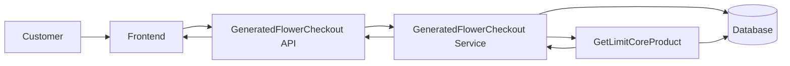
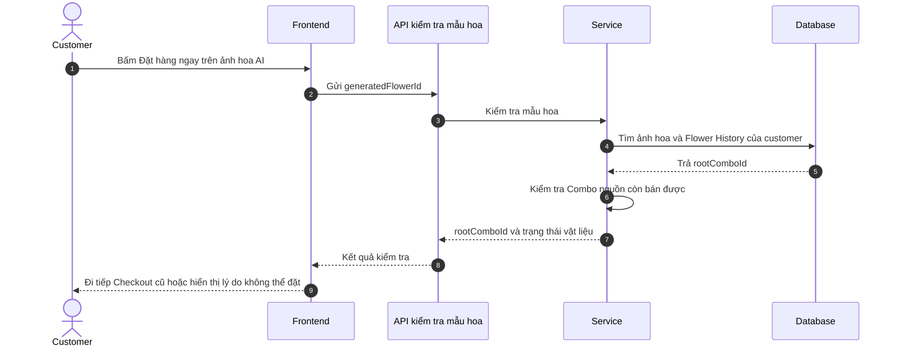
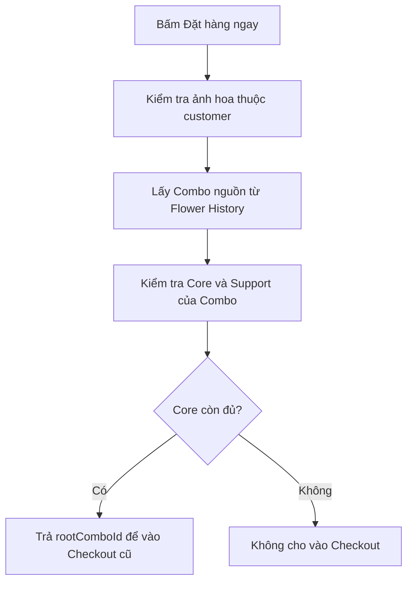
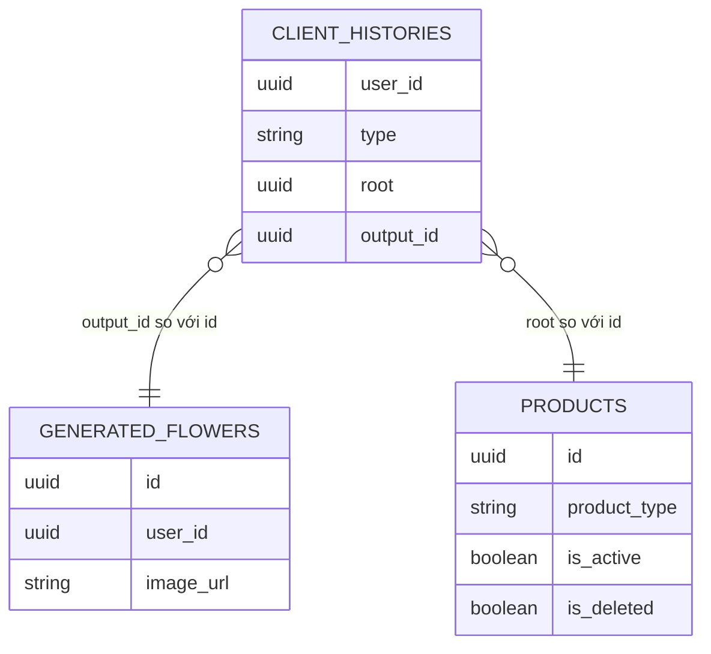

# TDD-033: Kiểm tra mẫu hoa AI trước Checkout

## Thông tin tài liệu

- **Tiêu đề**: Xác định Combo nguồn của một ảnh hoa AI và kiểm tra Combo còn có thể đặt hàng.
- **Ghi chú**: API này là cổng đi vào flow Checkout cũ khi customer chọn ảnh hoa AI. Nó không tạo Checkout, Order hoặc thanh toán.

## Metadata quản trị tài liệu

| Trường | Giá trị |
|---|---|
| Mã tài liệu | TDD-033 |
| Phiên bản | v0.1 |
| Author | Codex |
| Reviewer | |
| Approver | Chưa chỉ định |
| Owner | Hoàng Thị Khánh Linh |
| Cập nhật gần nhất | 2026-09-10 |

---

## BƯỚC 1 — Thông tin & Bối cảnh

### Thông tin tài liệu

- **Mã tài liệu**: TDD-033
- **Tính năng**: Kiểm tra mẫu hoa AI trước Checkout
- **Tác giả**: Codex
- **Người review**:
- **Phiên bản**: v0.1
- **Cập nhật (YYYY-MM-DD)**: 2026-09-10
- **Story liên quan**:
  - STORY-038
  - US-038

### Business Rules

- Customer phải đăng nhập; chỉ được dùng ảnh hoa AI thuộc chính mình.
- Ảnh hoa AI hợp lệ phải có Flower History của cùng customer, `type = flower` và `output_id` bằng `generatedFlowerId`.
- `root` trong Flower History là ID Combo nguồn. `root` khác `generatedFlowerId` vì một bên là Product/Combo, một bên là ảnh hoa AI.
- Kiểm tra khả năng bán của Combo nguồn bằng `GetLimitCoreProduct(rootComboId)`.
- Core còn hàng thì customer được đi tiếp flow Checkout cũ. Support thiếu không chặn, nhưng phải trả cờ `needsReplacement`.
- Ảnh hoa AI từng được dùng ở Order cũ vẫn được phép dùng lại nếu Combo nguồn hiện tại còn bán được.
- API chỉ kiểm tra và trả dữ liệu; không tạo Checkout, Order, payment, reserve tồn kho hay thay đổi History.

### Bối cảnh & Mục tiêu

**Vấn đề**

> Một ảnh hoa AI chỉ là hình ảnh đã được tạo từ một Combo. Khi customer muốn đặt ảnh đó, hệ thống phải tìm lại Combo nguồn và kiểm tra tồn kho hiện tại, thay vì dùng thông tin tồn kho ở thời điểm ảnh được tạo.

**Mục tiêu**

- Xác nhận customer có quyền dùng ảnh hoa AI đã chọn.
- Tìm đúng Combo nguồn qua Flower History.
- Trả `rootComboId` để FE tiếp tục flow Checkout cũ như khi customer chọn Combo bình thường.
- Báo Support cần thay thế mà không chặn customer.

**Ngoài phạm vi**

- Không thay thế flow Checkout, chọn thiệp, tính tổng tiền hoặc thanh toán hiện có.
- Không tạo Checkout tạm hay Order.
- Không reserve tồn kho; CreateOrder phải kiểm tra lại tồn kho ở thời điểm tạo Order.

---

## BƯỚC 2 — Kiến trúc & Sơ đồ

### Kiến trúc tổng quan

**Tiêu đề**: Kiểm tra ảnh hoa AI trước khi vào Checkout cũ.

**Mô tả**: Customer bấm Đặt hàng ngay trên một ảnh hoa AI. API tìm Combo nguồn của ảnh, dùng hàm kiểm tra Combo dùng chung, rồi trả Combo đó cho FE tiếp tục các bước Checkout hiện có.



**Ghi chú**: Sau khi API trả thành công, FE sử dụng `rootComboId` cho Checkout/order flow cũ. Không có dịch vụ thanh toán hay vận chuyển trong API này.

### Sequence Diagram

**Tiêu đề**: Customer đặt hàng từ ảnh hoa AI.

**Mô tả**: API chỉ xác nhận ảnh hoa có nguồn Combo còn bán được trước khi chuyển customer sang Checkout cũ.



**Ghi chú**: Core không đủ sẽ chặn. Support thiếu chỉ được đánh dấu để thông báo.

### Activity Diagram

**Tiêu đề**: Quyết định có thể đi tiếp Checkout hay không.



### State Diagram

Không áp dụng. API không tạo hay thay đổi trạng thái của ảnh hoa, Checkout hoặc Order.

### Mô hình dữ liệu

**Tiêu đề**: Ảnh hoa AI và Combo nguồn.

**Mô tả**: `output_id` nối Flower History với ảnh hoa AI; `root` giữ Combo nguồn. Đây là quan hệ nghiệp vụ do Service đối chiếu, không phải FK cứng.



---

## BƯỚC 3 — API

### API Contract nội bộ

#### Endpoint #1

- **Method**: GET
- **Endpoint**: `/api/v1/generated-flowers/{generatedFlowerId}/checkout-availability`
- **Tên endpoint**: Kiểm tra mẫu hoa AI trước Checkout
- **Mô tả**: Trả Combo nguồn và trạng thái vật liệu hiện tại của ảnh hoa AI thuộc customer.

**Response fields**

| Field | Ý nghĩa | Nguồn |
|---|---|---|
| `generatedFlowerId` | Ảnh hoa customer đã chọn | `generated_flowers.id` |
| `rootComboId` | Combo nguồn để đi vào flow cũ | `client_histories.root` |
| `sellableQuantityCombo` | Số Combo có thể bán theo Core | `GetLimitCoreProduct` |
| `materials` | Snapshot Core/Support hiện tại | `combo_specifications` + Product vật liệu |
| `materials[].needsReplacement` | Support cần Staff thay thế | `GetLimitCoreProduct` |

**Ví dụ 1 — Ảnh hoa hợp lệ, Core còn hàng** — HTTP `200`

Request:

```http
GET /api/v1/generated-flowers/f1000000-0000-0000-0000-000000000001/checkout-availability
Authorization: Bearer <customer-token>
```

Response:

```json
{
  "value": {
    "generatedFlowerId": "f1000000-0000-0000-0000-000000000001",
    "rootComboId": "c1000000-0000-0000-0000-000000000001",
    "sellableQuantityCombo": 2,
    "materials": [
      { "materialId": "m1000000-0000-0000-0000-000000000001", "quantity": 3, "isCore": true, "needsReplacement": false },
      { "materialId": "m2000000-0000-0000-0000-000000000001", "quantity": 1, "isCore": false, "needsReplacement": true }
    ]
  }
}
```

**Ví dụ 2 — Ảnh hoa của customer khác hoặc không có Flower History** — HTTP `404`

API không trả dữ liệu ảnh, Combo hay vật liệu. Customer không được đi tiếp Checkout.

**Ví dụ 3 — Combo nguồn không còn bán được hoặc Core hết hàng** — HTTP `400`

API không trả `rootComboId` để FE đi vào Checkout. Lịch sử ảnh hoa và các Order cũ không bị thay đổi.

#### Mã lỗi

| Code | HTTP | Khi nào xảy ra |
|---|---:|---|
| `NotFoundException` | 404 | Không có ảnh hoa thuộc customer hiện tại hoặc không có Flower History tương ứng. |
| `BadRequestException` | 400 | Flower History không xác định được `root`, Combo nguồn không còn khả dụng hoặc Core không đủ điều kiện đặt hàng. |
| `UNAUTHORIZED` | 401 | Customer chưa đăng nhập hoặc token không hợp lệ. |

### API Contract bên ngoài

Không áp dụng. API không gọi AI, Ahamove, cổng thanh toán hay hệ thống bên thứ ba.

---

## BƯỚC 4 — Tham chiếu

### 🔴 Tham chiếu đến

- `doc-us/STORY-038-Khoi-tao-Checkout-tu-mau-hoa/STORY-038-Khoi-tao-Checkout-tu-mau-hoa.md`
- `doc-us/STORY-038-Khoi-tao-Checkout-tu-mau-hoa/ST-STORY-038-khoi-tao-checkout-tu-mau-hoa.md`
- `code-introduction/US-038/US-038-introduction.md`
- `code-introduction/get-limit-cmbo.md`
- `docs/AI_Flower_Context.md`
- `docs/AI_DB_Diagram.md`

### ⚫ Trỏ vào tài liệu này

- Màn hình History Flower AI gọi API này trước khi chuyển customer sang flow Checkout cũ.
- US-039/CreateOrder dùng lại kiểm tra Combo ở thời điểm hoàn tất Order.

### ⋯ Bị ảnh hưởng

- `client_histories.root` phải được lưu và mapping đúng trong Entity Framework; thiếu `Root` thì không thể xác định Combo nguồn.
- Nếu thay đổi quy tắc Core/Support trong `GetLimitCoreProduct`, kết quả API này thay đổi theo.

