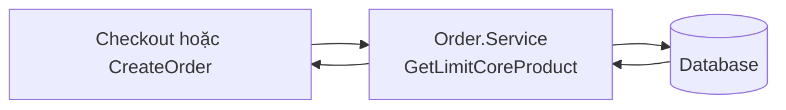
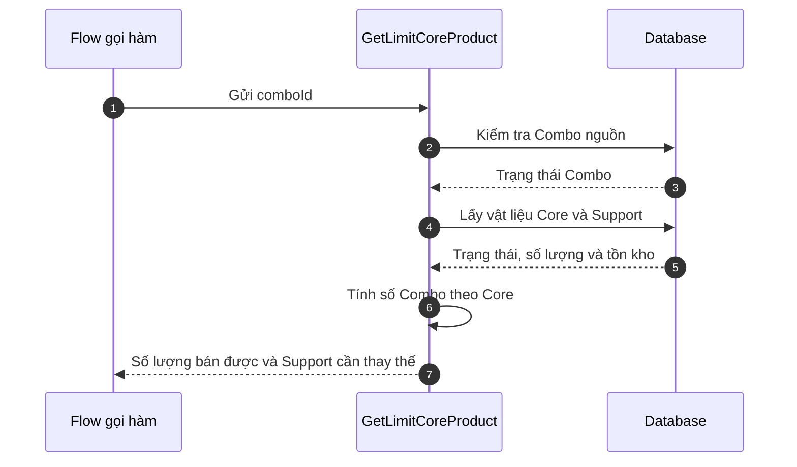
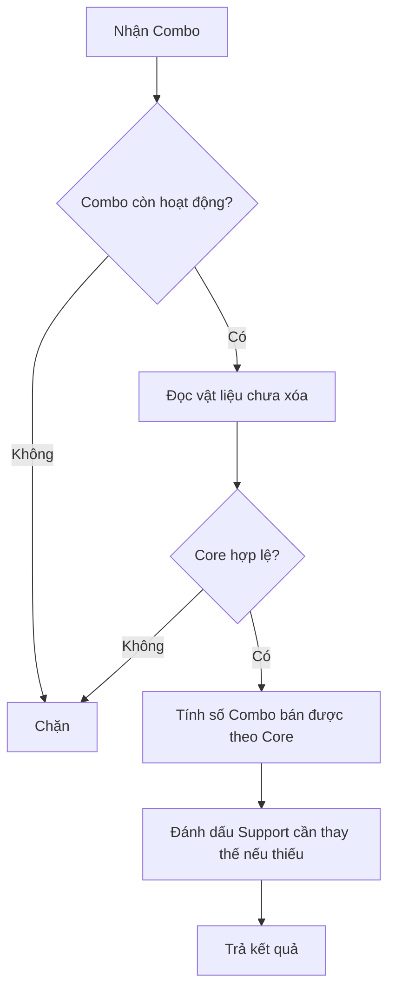
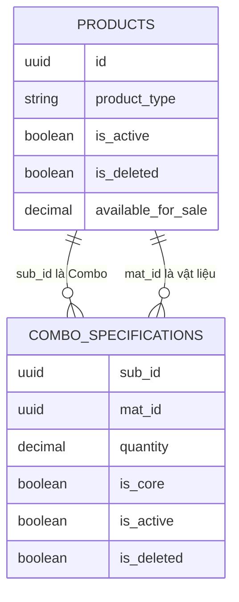

# TDD-034: Kiểm tra khả năng bán của Combo

## Thông tin tài liệu

- **Tiêu đề**: Kiểm tra Combo còn hợp lệ, tính số lượng bán được theo Core và đánh dấu Support cần thay thế.
- **Ghi chú**: Đây là hàm dùng chung cho flow đặt Combo bình thường, đặt từ ảnh hoa AI và CreateOrder.

## Metadata quản trị tài liệu

| Trường | Giá trị |
|---|---|
| Mã tài liệu | TDD-034 |
| Phiên bản | v0.1 |
| Author | Codex |
| Reviewer | |
| Approver | Chưa chỉ định |
| Owner | Hoàng Thị Khánh Linh |
| Cập nhật gần nhất | 2026-09-10 |

---

## BƯỚC 1 — Thông tin & Bối cảnh

### Thông tin tài liệu

- **Mã tài liệu**: TDD-034
- **Tính năng**: Kiểm tra khả năng bán của Combo
- **Tác giả**: Codex
- **Người review**:
- **Phiên bản**: v0.1
- **Cập nhật (YYYY-MM-DD)**: 2026-09-10
- **Story liên quan**:
  - STORY-038
  - US-038
  - STORY-039

### Business Rules

- `comboId` phải là Product còn hoạt động, chưa xóa và có `ProductType = Combo`.
- Chỉ đọc các `ComboSpecifications` chưa xóa của Combo; gồm cả Core và Support.
- Combo phải có ít nhất một Core. Mọi Core phải có specification active, material active/chưa xóa và `quantity > 0`.
- Số Combo bán được bằng số nhỏ nhất giữa các Core: `floor(availableForSale / quantity)`.
- Support không làm chặn Combo. Support không đủ điều kiện hoặc không đủ tồn kho được trả với `needsReplacement = true`.
- Hàm chỉ kiểm tra tồn kho hiện tại, không reserve hoặc trừ kho.

### Bối cảnh & Mục tiêu

**Vấn đề**

> Một Combo có nhiều vật liệu. Không thể chỉ nhìn tồn kho của một vật liệu hay của Combo; số lượng bán được phụ thuộc vào Core có khả năng tạo ra ít Combo nhất.

**Mục tiêu**

- Chặn Combo không còn hợp lệ trước khi Checkout/CreateOrder.
- Trả số lượng bán được đúng theo các vật liệu Core.
- Giữ checkout được đi tiếp khi chỉ Support có vấn đề.
- Trả đầy đủ trạng thái vật liệu để FE/Staff biết Support nào cần thay thế.

**Ngoài phạm vi**

- Không kiểm tra ownership của Flower/Card.
- Không tạo Checkout, Order, thanh toán hoặc liên hệ Staff.
- Không reserve tồn kho và không gọi Nhanh.vn/Ahamove.

---

## BƯỚC 2 — Kiến trúc & Sơ đồ

### Kiến trúc tổng quan

**Tiêu đề**: Hàm kiểm tra Combo dùng chung.

**Mô tả**: Bất kỳ flow nào đã có `comboId` đều gọi cùng một hàm. Hàm đọc Combo và các vật liệu, rồi trả số lượng bán được cùng cảnh báo Support.



**Ghi chú**: Caller tự quyết định bước tiếp theo. Ví dụ US-038 chỉ cho vào Checkout khi `sellableQuantityCombo >= 1`.

### Sequence Diagram

**Tiêu đề**: Kiểm tra Combo trước khi đặt.

**Mô tả**: Hệ thống kiểm tra Combo trước, sau đó phân biệt Core và Support để quyết định có thể đi tiếp hay chỉ cần cảnh báo.



**Ghi chú**: Hàm không trừ kho. CreateOrder phải kiểm tra lại khi thực sự tạo đơn.

### Activity Diagram

**Tiêu đề**: Phân biệt Core và Support.



### State Diagram

Không áp dụng. Hàm chỉ đọc dữ liệu hiện tại và không đổi trạng thái Combo hoặc vật liệu.

### Mô hình dữ liệu

**Tiêu đề**: Combo và vật liệu cấu thành.



---

## BƯỚC 3 — API

### API Contract nội bộ

#### Endpoint #1

- **Method**: GET
- **Endpoint**: `/api/v1/combos/{comboId}/availability`
- **Tên endpoint**: Kiểm tra khả năng bán của Combo
- **Mô tả**: Dùng khi customer chọn Combo bình thường trước Checkout; trả số Combo còn bán được theo Core và Support cần thay thế.

**Request**

```http
GET /api/v1/combos/c1000000-0000-0000-0000-000000000001/availability
Authorization: Bearer {customer-token}
```

`comboId` là route parameter; không cần request body.

**Response**

```csharp
public class LimitCoreProductResponse
{
    public decimal SellableQuantityCombo { get; set; }
    public List<LimitCoreMaterialResponse> Materials { get; set; }
}
```

API này gọi `Order.Service.GetLimitCoreProduct(comboId)`. API kiểm tra ảnh hoa AI ở TDD-033 cũng gọi trực tiếp cùng hàm này sau khi đã lấy được `rootComboId`.

**Ví dụ 1 — Core đủ, một Support thiếu**

```text
Combo C01 còn active.
Core M01: availableForSale = 10, quantity = 3  → bán được 3 Combo.
Core M02: availableForSale = 9, quantity = 2   → bán được 4 Combo.
Support M03: availableForSale = 0, quantity = 1.
```

```text
SellableQuantityCombo = 3, vì min(3, 4) = 3.
M03 vẫn có trong Materials và NeedsReplacement = true.
```

**Ví dụ 2 — Core không còn đủ tồn kho**

```text
Combo C01 hợp lệ.
Core M01: availableForSale = 2, quantity = 3 → bán được 0 Combo.
```

```text
SellableQuantityCombo = 0.
Caller không được mở Checkout hoặc tạo Order với Combo này.
```

**Ví dụ 3 — Combo hoặc Core không hợp lệ**

```text
Combo bị xóa/inactive/không phải Combo; hoặc không có Core;
hoặc Core có specification inactive, material inactive/đã xóa, quantity <= 0.
```

```text
Hàm throw BadRequestException vì Combo không thể dùng để đặt hàng.
```

#### Mã lỗi

| Code | HTTP khi được gọi qua API | Khi nào xảy ra |
|---|---:|---|
| `BadRequestException` | 400 | Combo nguồn không còn khả dụng hoặc Core không hợp lệ. |

### API Contract bên ngoài

Không áp dụng. Hàm chỉ đọc Product và ComboSpecification trong database hiện tại.

---

## BƯỚC 4 — Tham chiếu

### 🔴 Tham chiếu đến

- `code-introduction/get-limit-cmbo.md`
- `doc-us/STORY-038-Khoi-tao-Checkout-tu-mau-hoa/STORY-038-Khoi-tao-Checkout-tu-mau-hoa.md`
- `doc-us/STORY-038-Khoi-tao-Checkout-tu-mau-hoa/ST-STORY-038-khoi-tao-checkout-tu-mau-hoa.md`
- `docs/AI_Flower_Context.md`

### ⚫ Trỏ vào tài liệu này

- TDD-033 dùng hàm này sau khi xác định `rootComboId` của ảnh hoa AI.
- Checkout/order flow cũ gọi hàm này với Combo customer chọn trực tiếp.
- CreateOrder dùng lại hàm để kiểm tra lại tồn kho trước khi tạo Order.

### ⋯ Bị ảnh hưởng

- Nếu thay đổi ý nghĩa `IsCore`, `Quantity`, `AvailableForSale`, `IsActive` hoặc `IsDeleted`, phải xem lại công thức và UT.
- Response cần có `MaterialIsActive`, `MaterialIsDeleted` và `NeedsReplacement` như phiên bản dùng chung trong `get-limit-cmbo.md`.
