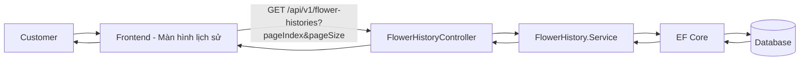
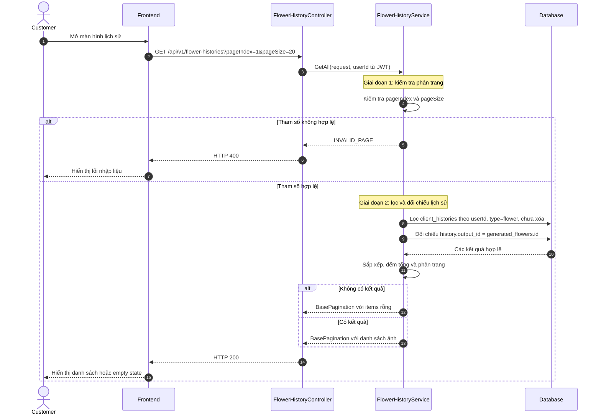
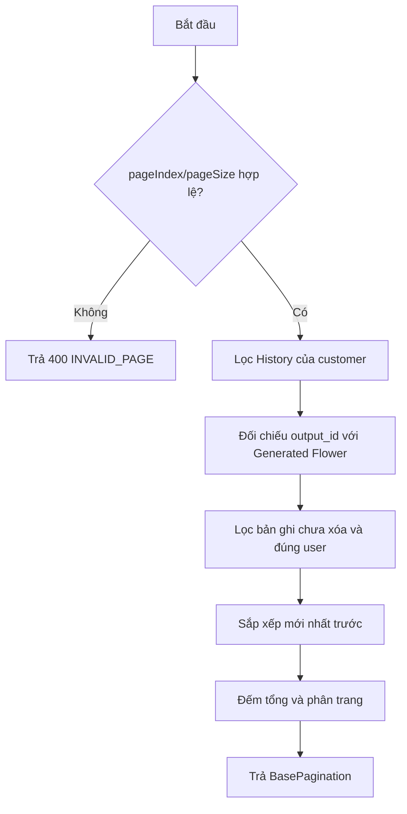
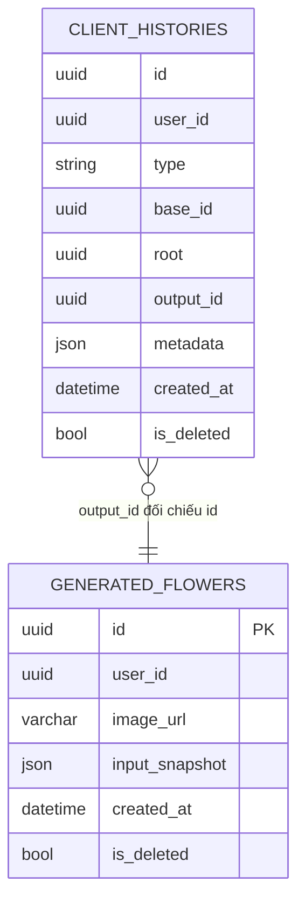

# TDD-028: Customer lấy toàn bộ lịch sử mẫu hoa Custom AI

## Thông tin tài liệu

- **Tiêu đề**: Lấy toàn bộ lịch sử mẫu hoa Custom AI của customer theo phân trang.
- **Ghi chú**: TDD này chỉ mô tả API thứ nhất của US-040. API lấy ba kết quả gần nhất và API xem chi tiết được mô tả ở tài liệu riêng.

## Metadata quản trị tài liệu

| Trường | Giá trị |
|---|---|
| Mã tài liệu | TDD-028 |
| Phiên bản | v0.1 |
| Author | Codex |
| Reviewer |  |
| Approver | Chưa chỉ định |
| Owner | Hoàng Thị Khánh Linh |
| Cập nhật gần nhất | 2026-09-07 |

---

## BƯỚC 1 — Thông tin & Bối cảnh

### Thông tin tài liệu

- **Mã tài liệu**: TDD-028
- **Tính năng**: Customer xem toàn bộ lịch sử hoa Custom AI
- **Tác giả**: Codex
- **Người review**:
- **Phiên bản**: v0.1
- **Cập nhật (YYYY-MM-DD)**: 2026-09-07
- **Story liên quan**:
  - STORY-040

### Business Rules

- Customer phải đăng nhập; `userId` lấy từ JWT, không nhận từ FE.
- Chỉ đọc `client_histories` của customer hiện tại, `type = flower`, chưa bị xóa.
- `client_histories.output_id` phải khớp `generated_flowers.id`.
- Chỉ trả Generated Flower đúng customer và chưa bị xóa.
- Mỗi lần generate thành công đã lưu một History và một Generated Flower; generate không có ảnh không xuất hiện trong danh sách.
- Sắp xếp `generatedAt` giảm dần; khi trùng thời gian dùng `generatedFlowerId` giảm dần để kết quả ổn định.
- Dùng phân trang server-side: `pageIndex >= 1`, `1 <= pageSize <= 100`.
- `client_histories.root` được trả ra dưới tên `comboId`; `base_id` chỉ là nguồn trực tiếp và có thể là Generated Flower của lần trước.
- `imageUrl` rỗng không làm lỗi toàn bộ danh sách; FE hiển thị ảnh không khả dụng.
- Không dùng `GroupBy`, không lưu draft/job và không kiểm tra trạng thái live của Combo/Mockup.

### Bối cảnh & Mục tiêu

**Vấn đề**

> Khi customer mở màn hình lịch sử, FE cần một API trả toàn bộ các ảnh hoa AI đã tạo thành công, đúng tài khoản, có phân trang và thứ tự mới nhất trước.

**Mục tiêu**

- Trả danh sách lịch sử hoa AI của customer hiện tại.
- Trả đúng thông tin tối thiểu để FE render: `generatedFlowerId`, `comboId`, `imageUrl`, `generatedAt`.
- Không tải binary ảnh và không tạo dữ liệu mới.

**Ngoài phạm vi**

- Không nhóm ảnh theo `root` hoặc theo phiên generate/regenerate; hai API đó được mô tả riêng trong `US-040-introduction.md`.
- Không generate, regenerate, tải ảnh hoặc gọi AI.
- Không hiển thị job đang chạy; schema hiện tại không lưu draft/job.

---

## BƯỚC 2 — Kiến trúc & Sơ đồ

### Kiến trúc tổng quan

**Tiêu đề**: Luồng lấy toàn bộ lịch sử hoa AI có phân trang.

**Mô tả**: FE gọi API danh sách; Controller chuyển request cho Service. Service lấy `userId` từ JWT, lọc History, đối chiếu `output_id` với Generated Flower, sắp xếp và phân trang trước khi trả response.



### Sequence Diagram

**Tiêu đề**: Trình tự lấy toàn bộ lịch sử hoa AI.



**Ghi chú**: Không kiểm tra Storage trong API này. Nếu một URL ảnh không còn dùng được, record vẫn được trả để FE hiển thị trạng thái ảnh không khả dụng.

### Activity Diagram



### State Diagram

Không áp dụng. API chỉ đọc dữ liệu đã lưu.

### Mô hình dữ liệu



Ghi chú: Đây là truy vấn ID đa hình theo thiết kế dynamic; không yêu cầu FK cứng.

---

## BƯỚC 3 — API

### Endpoint #1 — Lấy toàn bộ lịch sử

- **Method**: GET
- **Endpoint**: `/api/v1/flower-histories?pageIndex=1&pageSize=20`
- **Tên endpoint**: Lấy toàn bộ lịch sử hoa AI của customer
- **Mô tả**: Trả các kết quả hoa AI đã tạo thành công của customer hiện tại, mới nhất trước, có phân trang.

**Request**

```http
GET /api/v1/flower-histories?pageIndex=1&pageSize=20
Authorization: Bearer <customer_token>
```

| Field | Vị trí | Kiểu | Bắt buộc | Quy tắc |
|---|---|---|---:|---|
| `pageIndex` | Query | int | Không | Mặc định 1, phải >= 1. |
| `pageSize` | Query | int | Không | Mặc định 20, từ 1 đến 100. |
| `Authorization` | Header | Bearer token | Có | Token của customer hiện tại. |

**Response — HTTP 200**

```json
{
  "isSuccess": true,
  "isFailed": false,
  "error": null,
  "traceId": null,
  "timestampUtc": "2026-09-07T10:00:00Z",
  "value": {
    "items": [
      {
        "generatedFlowerId": "f4000000-0000-0000-0000-000000000000",
        "comboId": "c1000000-0000-0000-0000-000000000000",
        "imageUrl": "https://res.cloudinary.com/demo/f04.png",
        "generatedAt": "2026-09-05T11:00:00Z"
      },
      {
        "generatedFlowerId": "f3000000-0000-0000-0000-000000000000",
        "comboId": "c1000000-0000-0000-0000-000000000000",
        "imageUrl": "https://res.cloudinary.com/demo/f03.png",
        "generatedAt": "2026-09-05T10:00:00Z"
      }
    ],
    "pageIndex": 1,
    "pageSize": 20,
    "totalCount": 2,
    "hasNextPage": false,
    "hasPreviousPage": false
  }
}
```

Không có dữ liệu vẫn trả HTTP 200 với `items: []` và `totalCount: 0`.

### IService

```csharp
public interface IService
{
    Task<BasePaginationResponse> GetAll(
        Request.GetFlowerHistoriesRequest request);
}
```

### Request và Response

```csharp
public class GetFlowerHistoriesRequest
{
    public int PageIndex { get; set; } = 1;
    public int PageSize { get; set; } = 20;
}

public class FlowerHistoryItemResponse
{
    public Guid GeneratedFlowerId { get; set; }
    public Guid ComboId { get; set; }
    public string? ImageUrl { get; set; }
    public DateTime GeneratedAt { get; set; }
}
```

`GetAll` trả bằng `ApiResponseFactory.BasePagination`, nên FE đọc danh sách tại `response.value.items`.

### Service logic

```csharp
public async Task<BasePaginationResponse> GetAll(
    Request.GetFlowerHistoriesRequest request)
{
    if (request.PageIndex < 1 ||
        request.PageSize < 1 ||
        request.PageSize > 100)
    {
        throw new BadRequestException(
            "PageIndex phải từ 1 và PageSize phải từ 1 đến 100");
    }

    var userId = _currentUser.GetRequiredUserId();

    var histories = _dbContext.ClientHistories
        .AsNoTracking()
        .Where(x =>
            x.UserId == userId &&
            x.Type == GenerationType.Flower &&
            !x.IsDeleted);

    var flowers = _dbContext.GeneratedFlowers
        .AsNoTracking()
        .Where(x => x.UserId == userId && !x.IsDeleted);

    var query =
        from history in histories
        join flower in flowers
            on history.OutputId equals flower.Id
        select new Response.FlowerHistoryItemResponse
        {
            GeneratedFlowerId = flower.Id,
            ComboId = history.Root,
            ImageUrl = flower.ImageUrl,
            GeneratedAt = flower.CreatedAt
        };

    var totalCount = await query.CountAsync();

    var items = await query
        .OrderByDescending(x => x.GeneratedAt)
        .ThenByDescending(x => x.GeneratedFlowerId)
        .Skip((request.PageIndex - 1) * request.PageSize)
        .Take(request.PageSize)
        .ToListAsync();

    return ApiResponseFactory.BasePagination(
        items,
        request.PageIndex,
        request.PageSize,
        totalCount);
}
```

### Mã lỗi

| Code | HTTP | Khi nào xảy ra |
|---|---:|---|
| `UNAUTHORIZED` | 401 | Chưa đăng nhập hoặc token không hợp lệ. |
| `INVALID_PAGE` | 400 | `pageIndex < 1`, `pageSize < 1` hoặc `pageSize > 100`. |

### API Contract bên ngoài

Không áp dụng. API không gọi AI, User Service hoặc Storage.

---

## BƯỚC 4 — Tham chiếu

### 🔴 Tham chiếu đến

- `doc-us/STORY-040-Xem-lich-su-cac mau-hoa -Custom-AI-da-tao/STORY-040-Xem-lich-su-cac mau-hoa -Custom-AI-da-tao.md`
- `doc-us/STORY-040-Xem-lich-su-cac mau-hoa -Custom-AI-da-tao/ST-STORY-040-xem-lich-su-mau-hoa-custom-ai.md`
- `code-introduction/US-040/US-040-introduction.md` — API thứ nhất
- `docs (1)/AI_Flower_Context.md`
- `docs (1)/AI_DB_Diagram.md`

### ⚫ Trỏ vào tài liệu này

- Màn hình History gọi API này khi customer mở danh sách lịch sử.
- API lấy ba kết quả gần nhất và API xem chi tiết có thể dùng `generatedFlowerId` từ danh sách này.

### ⋯ Bị ảnh hưởng

- Nếu đổi tên `client_histories.type`, `base_id`, `root`, `output_id` hoặc schema `generated_flowers`, phải cập nhật query và response.
- Nếu BA yêu cầu lại trạng thái job/draft, cần bổ sung cơ chế lưu job riêng; cơ chế đó không thuộc API này.
