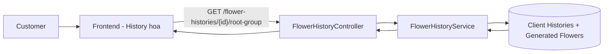
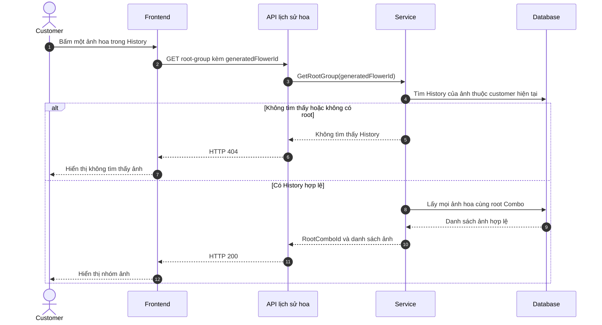
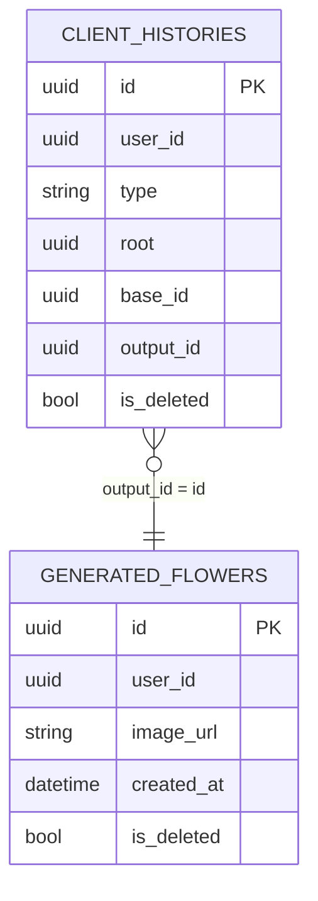

# TDD-035: Customer xem nhóm mẫu hoa cùng Combo nguồn

## Thông tin tài liệu

- **Tiêu đề**: Lấy toàn bộ mẫu hoa AI của customer có cùng Combo nguồn.
- **Ghi chú**: API được gọi khi customer bấm một ảnh hoa trong History. API trả mọi ảnh cùng `root` để FE tự nhóm theo ngày nếu cần.

## Metadata quản trị tài liệu

| Trường | Giá trị |
|---|---|
| Mã tài liệu | TDD-035 |
| Phiên bản | v0.1 |
| Author | Codex |
| Reviewer |  |
| Approver | Chưa chỉ định |
| Owner | Hoàng Thị Khánh Linh |
| Cập nhật gần nhất | 2026-09-10 |

---

## BƯỚC 1 — Thông tin & Bối cảnh

### Thông tin tài liệu

- **Mã tài liệu**: TDD-035
- **Tính năng**: Customer xem nhóm ảnh hoa theo Combo nguồn
- **Tác giả**: Codex
- **Người review**:
- **Phiên bản**: v0.1
- **Cập nhật (YYYY-MM-DD)**: 2026-09-10
- **Story liên quan**:
  - STORY-040

### Business Rules

- Customer phải đăng nhập; `userId` luôn lấy từ JWT.
- Ảnh customer chọn phải có `ClientHistory` của chính customer, `type = flower`, chưa bị xóa và có `root` hợp lệ.
- Chỉ trả History và Generated Flower cùng customer, chưa bị xóa.
- Nhóm được xác định bằng `root`: mọi ảnh có cùng `root` là cùng Combo nguồn, kể cả thuộc các phiên generate khác nhau.
- Kết quả sắp xếp mới nhất trước theo `generatedAt`; nếu trùng thời gian thì theo `generatedFlowerId` giảm dần.
- API trả `baseId` để FE biết ảnh được tạo trực tiếp từ đâu; FE có thể dùng `generatedAt` để tự nhóm theo ngày.
- URL ảnh rỗng không làm lỗi cả nhóm; record vẫn được trả.

### Bối cảnh & Mục tiêu

**Vấn đề**

> Danh sách History chỉ cho customer thấy từng ảnh riêng lẻ. Khi bấm một ảnh, FE cần biết tất cả ảnh đã được tạo từ cùng Combo nguồn để hiển thị thành một nhóm chung.

**Mục tiêu**

- Xác định Combo nguồn từ ảnh customer đã chọn.
- Trả đầy đủ các ảnh hợp lệ có cùng `root` của customer hiện tại.
- Không lẫn ảnh từ Combo khác, customer khác hoặc record đã xóa.

**Ngoài phạm vi**

- Không chia các ảnh thành từng phiên generate/regenerate; API TDD-036 đảm nhiệm việc đó.
- Không tạo, regenerate, tải binary ảnh, Checkout hoặc Order.
- Không kiểm tra Combo nguồn hiện còn bán được hay không.

---

## BƯỚC 2 — Kiến trúc & Sơ đồ

### Kiến trúc tổng quan

**Tiêu đề**: Luồng customer xem các ảnh có cùng Combo nguồn.

**Mô tả**: FE gửi ID ảnh customer vừa chọn. Service xác định `root` của ảnh đó, sau đó lấy toàn bộ ảnh hoa hợp lệ cùng `root` để trả về.



**Ghi chú**: Không gọi AI, Storage hoặc dịch vụ ngoài.

### Sequence Diagram

**Tiêu đề**: Customer xem nhóm ảnh cùng Combo nguồn.



### Activity Diagram

Không áp dụng. Luồng chỉ đọc dữ liệu và có một nhánh không tìm thấy History.

### State Diagram

Không áp dụng. API không thay đổi trạng thái dữ liệu.

### Mô hình dữ liệu



`root` là ID Combo nguồn chung; `base_id` là nguồn trực tiếp của lần generate đó.

---

## BƯỚC 3 — API

### API Contract nội bộ

#### Endpoint #1

- **Method**: GET
- **Endpoint**: `/api/v1/flower-histories/{generatedFlowerId}/root-group`
- **Tên endpoint**: Lấy nhóm ảnh cùng Combo nguồn
- **Mô tả**: Trả tất cả ảnh hoa AI hợp lệ của customer có cùng Combo nguồn với ảnh được chọn.

**Request**

```http
GET /api/v1/flower-histories/f2000000-0000-0000-0000-000000000002/root-group
Authorization: Bearer <customer_token>
```

| Field | Vị trí | Kiểu | Bắt buộc | Quy tắc |
|---|---|---|---:|---|
| `generatedFlowerId` | Path | Guid | Có | ID ảnh hoa customer đã chọn. |
| `Authorization` | Header | Bearer token | Có | Token của customer hiện tại. |

**Ví dụ 1 — Nhóm có nhiều ảnh và nhiều phiên** — HTTP `200`

Request:

```http
GET /api/v1/flower-histories/f2000000-0000-0000-0000-000000000002/root-group
Authorization: Bearer <customer_token>
```

Response:

```json
{
  "isSuccess": true,
  "isFailed": false,
  "error": null,
  "value": {
    "rootComboId": "ca000000-0000-0000-0000-000000000001",
    "items": [
      {
        "generatedFlowerId": "f4000000-0000-0000-0000-000000000004",
        "baseId": "ca000000-0000-0000-0000-000000000001",
        "imageUrl": "https://res.cloudinary.com/demo/gf4.png",
        "generatedAt": "2026-09-06T09:00:00Z"
      },
      {
        "generatedFlowerId": "f3000000-0000-0000-0000-000000000003",
        "baseId": "f2000000-0000-0000-0000-000000000002",
        "imageUrl": "https://res.cloudinary.com/demo/gf3.png",
        "generatedAt": "2026-09-05T11:00:00Z"
      },
      {
        "generatedFlowerId": "f2000000-0000-0000-0000-000000000002",
        "baseId": "f1000000-0000-0000-0000-000000000001",
        "imageUrl": "https://res.cloudinary.com/demo/gf2.png",
        "generatedAt": "2026-09-05T10:30:00Z"
      },
      {
        "generatedFlowerId": "f1000000-0000-0000-0000-000000000001",
        "baseId": "ca000000-0000-0000-0000-000000000001",
        "imageUrl": "https://res.cloudinary.com/demo/gf1.png",
        "generatedAt": "2026-09-05T10:00:00Z"
      }
    ]
  }
}
```

`GF1 → GF2 → GF3` là một phiên; `GF4` là phiên khác nhưng vẫn được trả vì cùng `rootComboId`.

**Ví dụ 2 — Ảnh không thuộc customer hiện tại hoặc không có History** — HTTP `404`

Request:

```http
GET /api/v1/flower-histories/f9000000-0000-0000-0000-000000000009/root-group
Authorization: Bearer <customer_token>
```

Response:

```json
{
  "title": "Not Found",
  "status": 404,
  "detail": "Không tìm thấy lịch sử mẫu hoa",
  "messageCode": "NOT_FOUND",
  "errors": null
}
```

### Mã lỗi

| Code | HTTP | Khi nào xảy ra |
|---|---:|---|
| `UNAUTHORIZED` | 401 | Customer chưa đăng nhập hoặc token không hợp lệ. |
| `NOT_FOUND` | 404 | Không có Flower History hợp lệ của customer cho `generatedFlowerId`, hoặc `root` rỗng. |

### API Contract bên ngoài

Không áp dụng.

---

## BƯỚC 4 — Tham chiếu

### 🔴 Tham chiếu đến

- `doc-us/STORY-040-Xem-lich-su-cac mau-hoa -Custom-AI-da-tao/STORY-040-Xem-lich-su-cac mau-hoa -Custom-AI-da-tao.md` — AC-006, AC-008, BR-095, BR-098, BR-100.
- `code-introduction/US-040/US-040-introduction.md` — API 2.
- `TDD-028-customer-xem-lich-su-hoa-custom-ai.md` — danh sách History ban đầu cung cấp `generatedFlowerId`.

### ⚫ Trỏ vào tài liệu này

- FE History hoa gọi endpoint khi customer bấm một ảnh để xem tất cả ảnh cùng Combo nguồn.

### ⋯ Bị ảnh hưởng

- Nếu thay đổi ý nghĩa hoặc cách lưu `client_histories.root`, phải kiểm tra lại query nhóm và response `rootComboId`.
