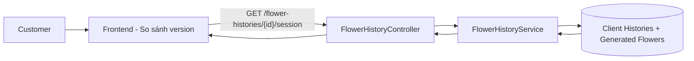
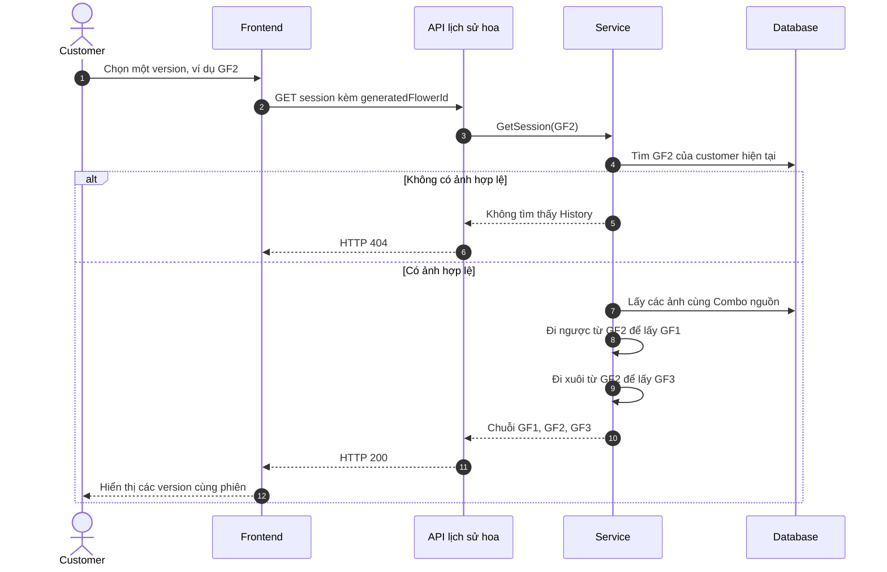
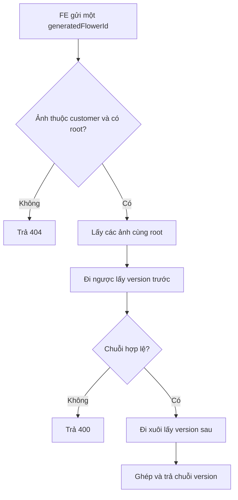
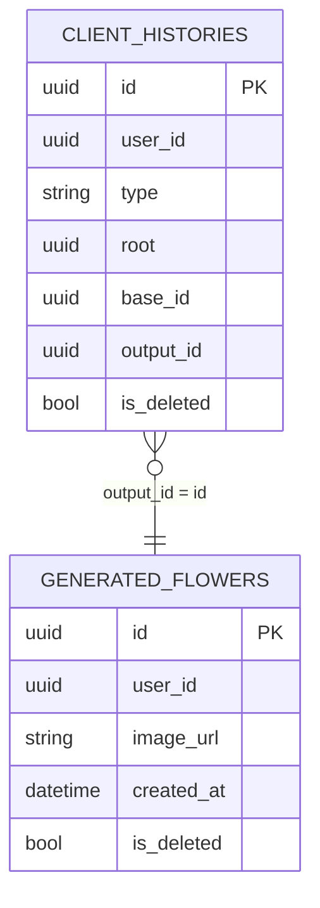

# TDD-036: Customer xem các version trong một phiên generate/regenerate hoa

## Thông tin tài liệu

- **Tiêu đề**: Lấy các version thuộc đúng một chuỗi generate/regenerate của customer.
- **Ghi chú**: API nhận một `generatedFlowerId` do FE chọn và trả các ảnh trước/sau ảnh đó trong cùng phiên, không lẫn phiên khác cùng Combo nguồn.

## Metadata quản trị tài liệu

| Trường | Giá trị |
|---|---|
| Mã tài liệu | TDD-036 |
| Phiên bản | v0.1 |
| Author | Codex |
| Reviewer |  |
| Approver | Chưa chỉ định |
| Owner | Hoàng Thị Khánh Linh |
| Cập nhật gần nhất | 2026-09-10 |

---

## BƯỚC 1 — Thông tin & Bối cảnh

### Thông tin tài liệu

- **Mã tài liệu**: TDD-036
- **Tính năng**: Customer xem một phiên generate/regenerate hoa
- **Tác giả**: Codex
- **Người review**:
- **Phiên bản**: v0.1
- **Cập nhật (YYYY-MM-DD)**: 2026-09-10
- **Story liên quan**:
  - STORY-040

### Business Rules

- Customer phải đăng nhập; `userId` lấy từ JWT.
- Ảnh FE chọn phải là Flower History và Generated Flower hợp lệ của chính customer, chưa bị xóa và có `root`.
- Generate đầu tiên lưu `baseId = root = comboId`.
- Mỗi lần regenerate lưu `baseId` là `generatedFlowerId` vừa tạo ngay trước đó; `root` vẫn là Combo nguồn.
- Regenerate chỉ đi từ ảnh mới nhất nên một ảnh có tối đa một ảnh kế tiếp; chuỗi là tuyến tính.
- API đi ngược từ ảnh FE chọn để lấy các version trước nó, rồi đi xuôi từ chính ảnh đó để lấy các version sau nó.
- Ảnh tạo mới trực tiếp từ Combo cùng `root` là phiên khác và không được trả chung.
- Nếu chuỗi bị đứt hoặc lặp, API báo dữ liệu không hợp lệ thay vì tự đoán.

### Bối cảnh & Mục tiêu

**Vấn đề**

> Một Combo có thể được generate ở nhiều thời điểm. Customer cần so sánh các lần regenerate thuộc đúng phiên mình đang xem, thay vì thấy lẫn các ảnh generate độc lập từ cùng Combo.

**Mục tiêu**

- Khi FE gửi bất kỳ ảnh trong chuỗi, trả đầy đủ chuỗi theo thứ tự cũ đến mới.
- Phân biệt `GF1 → GF2 → GF3` với `GF4` được tạo mới trực tiếp từ cùng Combo.
- Trả `baseId` để FE có thể hiển thị quan hệ trực tiếp giữa các version.

**Ngoài phạm vi**

- Không lấy toàn bộ ảnh cùng Combo nguồn; API TDD-035 đảm nhiệm mục đích đó.
- Không tạo/re-generate ảnh, không thay đổi History, Checkout hoặc Order.
- Không xử lý nhánh regenerate vì nghiệp vụ không cho phép tạo nhánh.

---

## BƯỚC 2 — Kiến trúc & Sơ đồ

### Kiến trúc tổng quan

**Tiêu đề**: Luồng customer xem một phiên generate/regenerate.

**Mô tả**: FE gửi ảnh customer đang chọn. Service lấy các ảnh cùng `root`, tìm ảnh đứng trước và sau ảnh đang chọn theo `baseId`, rồi ghép thành một chuỗi phiên hoàn chỉnh.



### Sequence Diagram

**Tiêu đề**: Customer xem chuỗi version của một phiên.



### Activity Diagram



### State Diagram

Không áp dụng. API chỉ đọc History đã có.

### Mô hình dữ liệu



Ví dụ một phiên: `CA → GF1 → GF2 → GF3`; một phiên khác: `CA → GF4`.

---

## BƯỚC 3 — API

### API Contract nội bộ

#### Endpoint #1

- **Method**: GET
- **Endpoint**: `/api/v1/flower-histories/{generatedFlowerId}/session`
- **Tên endpoint**: Lấy version trong một phiên generate/regenerate
- **Mô tả**: Trả các ảnh thuộc đúng chuỗi generate/regenerate chứa ảnh customer đã chọn.

**Request**

```http
GET /api/v1/flower-histories/f2000000-0000-0000-0000-000000000002/session
Authorization: Bearer <customer_token>
```

| Field | Vị trí | Kiểu | Bắt buộc | Quy tắc |
|---|---|---|---:|---|
| `generatedFlowerId` | Path | Guid | Có | ID ảnh nằm trong phiên cần xem. |
| `Authorization` | Header | Bearer token | Có | Token của customer hiện tại. |

**Ví dụ 1 — FE chọn version ở giữa chuỗi** — HTTP `200`

Request:

```http
GET /api/v1/flower-histories/f2000000-0000-0000-0000-000000000002/session
Authorization: Bearer <customer_token>
```

Response:

```json
{
  "isSuccess": true,
  "isFailed": false,
  "error": null,
  "value": {
    "rootComboId": "ca000000-0000-0000-0000-000000000001",
    "sessionStartGeneratedFlowerId": "f1000000-0000-0000-0000-000000000001",
    "items": [
      {
        "generatedFlowerId": "f1000000-0000-0000-0000-000000000001",
        "baseId": "ca000000-0000-0000-0000-000000000001",
        "imageUrl": "https://res.cloudinary.com/demo/gf1.png",
        "generatedAt": "2026-09-05T10:00:00Z"
      },
      {
        "generatedFlowerId": "f2000000-0000-0000-0000-000000000002",
        "baseId": "f1000000-0000-0000-0000-000000000001",
        "imageUrl": "https://res.cloudinary.com/demo/gf2.png",
        "generatedAt": "2026-09-05T10:30:00Z"
      },
      {
        "generatedFlowerId": "f3000000-0000-0000-0000-000000000003",
        "baseId": "f2000000-0000-0000-0000-000000000002",
        "imageUrl": "https://res.cloudinary.com/demo/gf3.png",
        "generatedAt": "2026-09-05T11:00:00Z"
      }
    ]
  }
}
```

`GF4(baseId = CA)` không xuất hiện vì đó là phiên generate mới từ Combo, không phải version tiếp theo của GF1/GF2/GF3.

**Ví dụ 2 — Chỉ có lần generate đầu tiên** — HTTP `200`

Request:

```http
GET /api/v1/flower-histories/f4000000-0000-0000-0000-000000000004/session
Authorization: Bearer <customer_token>
```

Response:

```json
{
  "isSuccess": true,
  "isFailed": false,
  "error": null,
  "value": {
    "rootComboId": "ca000000-0000-0000-0000-000000000001",
    "sessionStartGeneratedFlowerId": "f4000000-0000-0000-0000-000000000004",
    "items": [
      {
        "generatedFlowerId": "f4000000-0000-0000-0000-000000000004",
        "baseId": "ca000000-0000-0000-0000-000000000001",
        "imageUrl": "https://res.cloudinary.com/demo/gf4.png",
        "generatedAt": "2026-09-06T09:00:00Z"
      }
    ]
  }
}
```

**Ví dụ 3 — Ảnh không thuộc customer hiện tại hoặc không có History** — HTTP `404`

Request:

```http
GET /api/v1/flower-histories/f9000000-0000-0000-0000-000000000009/session
Authorization: Bearer <customer_token>
```

Response:

```json
{
  "title": "Not Found",
  "status": 404,
  "detail": "Không tìm thấy lịch sử mẫu hoa",
  "messageCode": "NOT_FOUND",
  "errors": null
}
```

**Ví dụ 4 — Chuỗi History bị đứt hoặc lặp** — HTTP `400`

Request:

```http
GET /api/v1/flower-histories/f2000000-0000-0000-0000-000000000002/session
Authorization: Bearer <customer_token>
```

Response:

```json
{
  "title": "Bad Request",
  "status": 400,
  "detail": "Chuỗi tạo mẫu hoa không hợp lệ",
  "messageCode": "BAD_REQUEST",
  "errors": null
}
```

### Mã lỗi

| Code | HTTP | Khi nào xảy ra |
|---|---:|---|
| `UNAUTHORIZED` | 401 | Customer chưa đăng nhập hoặc token không hợp lệ. |
| `NOT_FOUND` | 404 | `generatedFlowerId` không có History/Flower hợp lệ của customer, hoặc `root` rỗng. |
| `BAD_REQUEST` | 400 | Không tìm được ảnh trước cần thiết hoặc chuỗi có ID lặp. |

### API Contract bên ngoài

Không áp dụng.

---

## BƯỚC 4 — Tham chiếu

### 🔴 Tham chiếu đến

- `doc-us/STORY-040-Xem-lich-su-cac mau-hoa -Custom-AI-da-tao/STORY-040-Xem-lich-su-cac mau-hoa -Custom-AI-da-tao.md` — AC-006, AC-008, BR-095, BR-100.
- `code-introduction/US-040/US-040-introduction.md` — API 3 và quy ước `root`, `baseId`, `outputId`.
- `TDD-035-customer-xem-nhom-hoa-cung-combo-nguon.md` — cùng dùng `root` để xác định Combo nguồn.

### ⚫ Trỏ vào tài liệu này

- FE màn so sánh version gọi endpoint này sau khi customer chọn một ảnh trong nhóm.

### ⋯ Bị ảnh hưởng

- Nếu thay đổi cách lưu `baseId` khi regenerate, phải kiểm tra lại toàn bộ logic lấy phiên.
- Nếu nghiệp vụ cho phép regenerate thành nhiều nhánh, thiết kế tuyến tính này không còn phù hợp.
