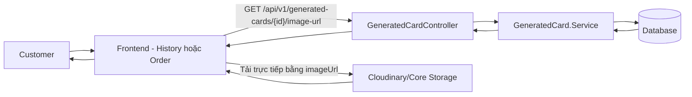
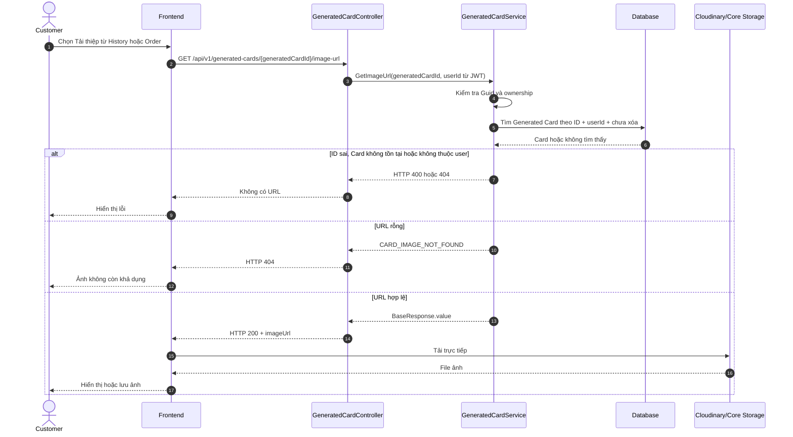
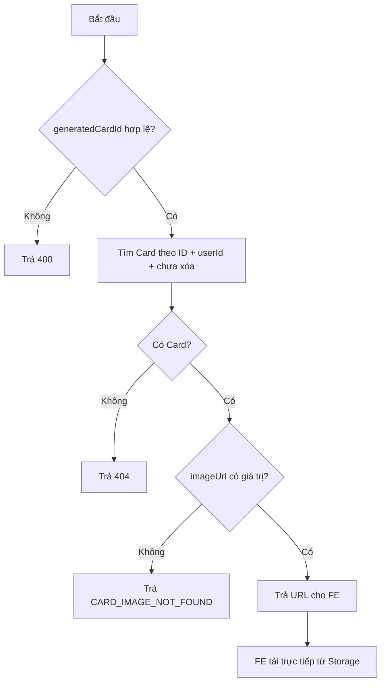
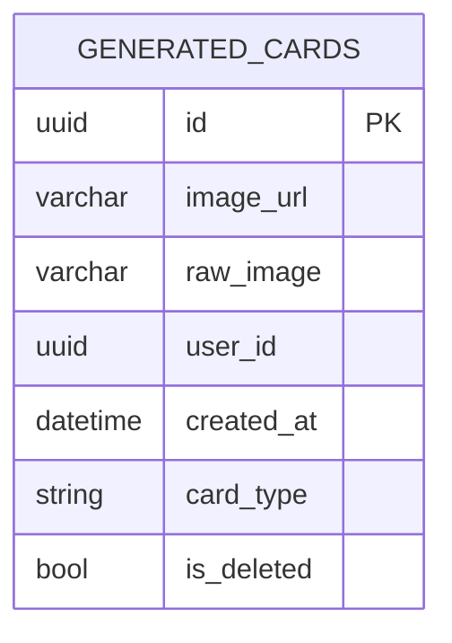

# TDD-031: Customer lấy URL ảnh thiệp đã tạo

## Thông tin tài liệu

- **Tiêu đề**: Customer lấy URL ảnh thiệp để FE tải trực tiếp.
- **Ghi chú**: Backend kiểm tra ownership và trả `generated_cards.image_url`; không stream file và không cần `orderId`.

## Metadata quản trị tài liệu

| Trường | Giá trị |
|---|---|
| Mã tài liệu | TDD-031 |
| Phiên bản | v0.1 |
| Author | Codex |
| Reviewer |  |
| Approver | Chưa chỉ định |
| Owner | Hoàng Thị Khánh Linh |
| Cập nhật gần nhất | 2026-09-07 |

---

## BƯỚC 1 — Thông tin & Bối cảnh

### Thông tin tài liệu

- **Mã tài liệu**: TDD-031
- **Tính năng**: Customer lấy URL ảnh thiệp đã tạo
- **Tác giả**: Codex
- **Người review**:
- **Phiên bản**: v0.1
- **Cập nhật (YYYY-MM-DD)**: 2026-09-07
- **Story liên quan**:
  - STORY-041

### Business Rules

- Customer phải đăng nhập; `userId` lấy từ JWT.
- `generatedCardId` phải là Guid khác rỗng.
- Chỉ trả Card chưa bị xóa và thuộc customer hiện tại.
- `generated_cards.image_url` phải có giá trị; nếu rỗng thì trả lỗi ảnh không khả dụng.
- Cùng một API dùng cho thiệp mở từ History hoặc từ Order; FE chỉ cần gửi `generatedCardId`.
- Không cần `orderId`, không join Order hoặc `OrderDetails` và không kiểm tra liên kết Order ở API này.
- Không gọi AI, không tạo History/Card mới, không trừ quota và không thay đổi Order.
- Backend không tải binary, không chuẩn hóa PNG, không đặt tên file và không kiểm tra Storage; FE tải trực tiếp bằng URL.
- Thiệp được tải lại nhiều lần nếu URL còn tồn tại.

### Bối cảnh & Mục tiêu

**Vấn đề**

> Customer có thể mở cùng một thiệp từ History hoặc từ Order. Nếu Backend tải file rồi gửi lại, API sẽ chịu thêm tải không cần thiết. Chỉ cần trả URL đã lưu để FE tải trực tiếp.

**Mục tiêu**

- Trả đúng URL ảnh của Card thuộc customer.
- Dùng một contract cho cả History và Order.
- Ngăn customer lấy URL của Card thuộc tài khoản khác.

**Ngoài phạm vi**

- Không trả file binary hoặc stream.
- Không tạo presigned URL mới.
- Không kiểm tra liên kết Card–Order.
- Không đổi định dạng, logo, resolution hoặc tên file.
- Không khôi phục URL đã mất.

---

## BƯỚC 2 — Kiến trúc & Sơ đồ

### Kiến trúc tổng quan

**Tiêu đề**: Backend trả URL, FE tải ảnh thiệp trực tiếp.

**Mô tả**: FE lấy `generatedCardId` từ History hoặc Order, gọi API. Service lọc Card theo ID, user và trạng thái xóa; sau đó FE dùng URL trả về để tải từ Storage.



### Sequence Diagram

**Tiêu đề**: Trình tự lấy URL ảnh thiệp.



**Ghi chú**: Không có nhánh kiểm tra `orderId`; Order chỉ là nguồn để FE lấy `generatedCardId`.

### Activity Diagram



### State Diagram

Không áp dụng. API không thay đổi Card, History hoặc Order.

### Mô hình dữ liệu



---

## BƯỚC 3 — API

### Endpoint #1

- **Method**: GET
- **Endpoint**: `/api/v1/generated-cards/{generatedCardId}/image-url`
- **Tên endpoint**: Lấy URL ảnh thiệp
- **Mô tả**: Trả URL ảnh thiệp đã tạo thuộc customer hiện tại.

**Request**

```http
GET /api/v1/generated-cards/ca000000-0000-0000-0000-000000000001/image-url
Authorization: Bearer <customer_token>
```

| Field | Vị trí | Kiểu | Bắt buộc | Mô tả |
|---|---|---|---:|---|
| `generatedCardId` | Route | Guid | Có | ID trong `generated_cards`, khác `Guid.Empty`. |
| `Authorization` | Header | Bearer token | Có | Token của customer hiện tại. |

`orderId` không nằm trong request.

**Response — HTTP 200**

```json
{
  "isSuccess": true,
  "isFailed": false,
  "error": null,
  "traceId": null,
  "timestampUtc": "2026-09-07T10:00:00Z",
  "value": {
    "generatedCardId": "ca000000-0000-0000-0000-000000000001",
    "imageUrl": "https://res.cloudinary.com/demo/card-01.png"
  }
}
```

FE dùng `response.value.imageUrl` để tải trực tiếp từ Storage.

### IService

```csharp
public interface IService
{
    Task<Response.CardImageUrlResponse> GetImageUrl(
        Guid generatedCardId);
}
```

### Response

```csharp
public class CardImageUrlResponse
{
    public Guid GeneratedCardId { get; set; }
    public required string ImageUrl { get; set; }
}
```

### Service logic

```csharp
public async Task<Response.CardImageUrlResponse> GetImageUrl(
    Guid generatedCardId)
{
    if (generatedCardId == Guid.Empty)
    {
        throw new BadRequestException(
            "Generated card id không hợp lệ.");
    }

    var userId = _currentUserService.GetRequiredUserId();

    var card = await _dbContext.GeneratedCards
        .AsNoTracking()
        .Where(x =>
            x.Id == generatedCardId &&
            x.UserId == userId &&
            !x.IsDeleted)
        .Select(x => new
        {
            x.Id,
            x.ImageUrl
        })
        .FirstOrDefaultAsync();

    if (card == null || string.IsNullOrWhiteSpace(card.ImageUrl))
    {
        throw new NotFoundException("Không tìm thấy ảnh thiệp.");
    }

    return new Response.CardImageUrlResponse
    {
        GeneratedCardId = card.Id,
        ImageUrl = card.ImageUrl
    };
}
```

Controller bọc kết quả bằng `ApiResponseFactory.Base`; FE đọc dữ liệu tại `response.value`.

### Mã lỗi

| Code | HTTP | Khi nào xảy ra |
|---|---:|---|
| `UNAUTHORIZED` | 401 | Chưa đăng nhập hoặc token không hợp lệ. |
| `INVALID_GENERATED_CARD_ID` | 400 | ID rỗng hoặc không bind được thành Guid. |
| `CARD_IMAGE_NOT_FOUND` | 404 | Card không tồn tại, đã xóa, không thuộc customer hoặc `image_url` rỗng. |

### API Contract bên ngoài

Không áp dụng ở Backend. FE dùng `imageUrl` để gọi trực tiếp Cloudinary/Core Storage.

---

## BƯỚC 4 — Tham chiếu

### 🔴 Tham chiếu đến

- `doc-us/STORY-041-Tai-xuong-thiep-da-tao/STORY-041-Tai-xuong-thiep-da-tao.md`
- `doc-us/STORY-041-Tai-xuong-thiep-da-tao/ST-STORY-041-tai-xuong-thiep-ai.md`
- `code-introduction/US-041/US-041-introduction.md`
- `docs (1)/AI_Card_Context.md`
- `docs (1)/AI_DB_Diagram.md`

### ⚫ Trỏ vào tài liệu này

- TDD-030 cung cấp `generatedCardId` từ History.
- Màn hình Order cũng dùng API này sau khi lấy `generatedCardId` trong OrderDetails.

### ⋯ Bị ảnh hưởng

- Nếu đổi tên hoặc cách lưu `generated_cards.image_url`, phải cập nhật Response và Service.
- Các ST cũ yêu cầu Order-specific filename, stream PNG hoặc kiểm tra liên kết Card–Order cần được cập nhật theo quyết định mới: API này chỉ nhận Card ID và trả URL.
