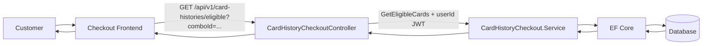
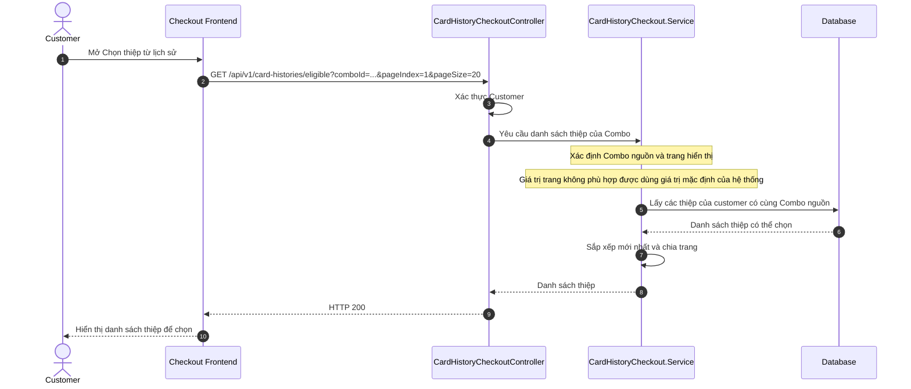
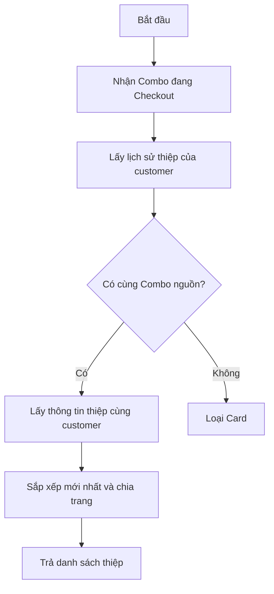
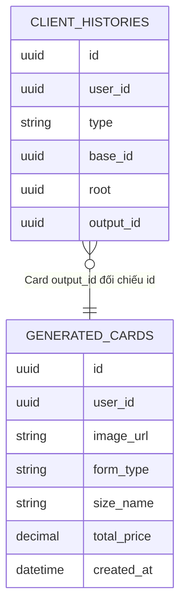

# TDD-032: Customer lấy thiệp History hợp lệ theo Combo cho Checkout

## Thông tin tài liệu

- **Tiêu đề**: Lấy danh sách thiệp History thuộc Combo đang Checkout của customer.
- **Ghi chú**: Endpoint chỉ đọc dữ liệu để FE chọn thiệp trong state Checkout. Endpoint không tạo Checkout, không gắn thiệp vào Checkout, không gọi AI và không tạo liên kết Order.

## Metadata quản trị tài liệu

| Trường | Giá trị |
|---|---|
| Mã tài liệu | TDD-032 |
| Phiên bản | v0.2 |
| Author | Codex |
| Reviewer | |
| Approver | Chưa chỉ định |
| Owner | Hoàng Thị Khánh Linh |
| Cập nhật gần nhất | 2026-09-09 |

---

## BƯỚC 1 — Thông tin & Bối cảnh

### Thông tin tài liệu

- **Mã tài liệu**: TDD-032
- **Tính năng**: Customer chọn thiệp History theo Combo cho Checkout
- **Tác giả**: Codex
- **Người review**:
- **Phiên bản**: v0.2
- **Cập nhật (YYYY-MM-DD)**: 2026-09-09
- **Story liên quan**:
  - STORY-042
  - US-042
  - STORY-039

### Business Rules

- Customer phải đăng nhập; `userId` chỉ lấy từ JWT, không nhận từ query string.
- `comboId` là Combo nguồn mà customer đang Checkout.
- Chỉ lấy History Card của customer hiện tại, gắn với Generated Card cùng owner và có `imageUrl` đã lưu.
- Card hợp lệ khi có cùng `root` với `comboId`. `root` là Combo/Product nguồn ban đầu của một chuỗi tạo thiệp.
- Quy tắc này bao gồm thiệp tạo trực tiếp, thiệp tạo từ hoa và thiệp được tạo lại từ chúng.
- Card thuộc Combo khác hoặc customer khác không được xuất hiện. Card đã dùng cho Order khác vẫn được hiển thị.
- Template nguồn inactive hoặc soft-delete không chặn Card History đã tạo; endpoint không query Template live.
- Endpoint không gọi storage để kiểm tra file. FE xử lý lỗi tải ảnh; US-039 xác thực lại ownership, Combo nguồn và ảnh trước khi tạo Order.
- Danh sách hiển thị thiệp mới tạo trước. Số trang và số lượng mỗi trang không phù hợp sẽ được hệ thống đưa về giá trị mặc định trước khi lấy dữ liệu.
- Endpoint chỉ đọc: không gọi AI, không tạo/sửa `client_histories`, `generated_cards`, Checkout, Order hay quota.

### Bối cảnh & Mục tiêu

**Vấn đề**

> Một Card History có thể tạo trực tiếp từ Combo hoặc từ Generated Flower của Combo. Vì vậy cần một thông tin chung để nhận biết chúng cùng bắt đầu từ Combo nào; thông tin đó là `root`.

**Mục tiêu**

- Nhận `comboId` và phân trang từ FE để lấy thiệp được phép chọn cho Combo đang Checkout.
- Lấy đầy đủ mọi Card bắt đầu từ Combo đó, kể cả khi customer đã tạo lại Card hoặc Flower.
- Giới hạn mọi truy vấn theo owner trong JWT để không lộ History của customer khác.
- Trả snapshot Card đủ cho UI chọn thiệp, mới nhất trước và không nhân bản bản ghi.
- Không ghi dữ liệu; bước xác nhận cuối cùng được thực hiện tại US-039.

**Ngoài phạm vi**

- Không lưu, thay, gỡ hoặc xác nhận Card trong Checkout; FE chỉ giữ lựa chọn tạm thời.
- Không tạo Order hoặc liên kết `OrderDetails.GeneratedCardIds`.
- Không gọi AI, regenerate, recreate, copy ảnh hoặc trừ quota.
- Không truy vấn Template/Config live hoặc kiểm tra file bằng request tới storage.
- Không trả Card History `type = handmade_card` trong contract US-042 hiện tại.

---

## BƯỚC 2 — Kiến trúc & Sơ đồ

### Kiến trúc tổng quan

**Tiêu đề**: Luồng Customer lấy Card History phù hợp với Combo Checkout.

**Mô tả**: Customer mở danh sách thiệp khi đang Checkout một Combo. Hệ thống nhận biết Combo nguồn của từng thiệp, chỉ lấy các thiệp của customer đó, sắp xếp từ mới đến cũ rồi trả theo từng trang.



**Ghi chú**: Không gọi AI, Storage, Checkout Service hoặc Order Service. Customer chọn thiệp trong state FE; US-039 kiểm tra lại trước khi tạo Order.

### Sequence Diagram

**Tiêu đề**: Lấy thiệp History theo Combo nguồn.

**Mô tả**: Hệ thống so sánh Combo nguồn đã lưu trong lịch sử thiệp với Combo customer đang Checkout. Nhờ vậy thiệp tạo trực tiếp, thiệp tạo từ hoa và thiệp tạo lại đều được lấy đúng nhóm.



**Ghi chú**: `root` là Combo/Product nguồn ban đầu. Vì vậy một thiệp tạo từ hoa hay được tạo lại vẫn được xem là thuộc đúng Combo mà customer đang Checkout.

### Activity Diagram

**Tiêu đề**: Lấy thiệp thuộc Combo nguồn.

**Mô tả**: Hệ thống dùng Combo nguồn đã lưu cùng lịch sử thiệp để gom các thiệp liên quan. Các thiệp của Combo khác hoặc của customer khác sẽ không xuất hiện.



### State Diagram

Không áp dụng. Endpoint chỉ đọc Card History và không thay đổi trạng thái Checkout hoặc Card.

### Mô hình dữ liệu

**Tiêu đề**: Lineage Combo/Product → Card History.

**Mô tả**: `base_id`, `root` và `output_id` là tham chiếu đa hình do Service quản lý; không có FK cứng. `base_id` là nguồn trực tiếp, `root` là Product/Combo nguồn ban đầu, còn Card được nối với Generated Card qua `output_id`. Vì vậy Card từ Flower hoặc regenerate vẫn có cùng `root` với Combo ban đầu.



---

## BƯỚC 3 — API

### API Contract nội bộ

#### Endpoint #1

- **Method**: GET
- **Endpoint**: `/api/v1/card-histories/eligible?comboId={comboId}&pageIndex={pageIndex}&pageSize={pageSize}`
- **Tên endpoint**: Lấy Card History hợp lệ theo Combo cho Checkout
- **Mô tả**: Trả các Card History thuộc customer hiện tại có `root` bằng Combo/Product nguồn đang Checkout, mới nhất trước.

**Request**

| Field | Vị trí | Kiểu | Bắt buộc | Mô tả |
|---|---|---|---:|---|
| `comboId` | Query | Guid | Có | ID Combo nguồn đang Checkout. |
| `pageIndex` | Query | int | Không | Trang muốn xem; mặc định là trang đầu tiên. Giá trị không phù hợp được chuẩn hóa theo mặc định của hệ thống. |
| `pageSize` | Query | int | Không | Số thiệp trên một trang; giá trị không phù hợp được chuẩn hóa theo mặc định của hệ thống. |
| `Authorization` | Header | Bearer token | Có | Token của customer; owner được lấy từ JWT. |

**Response item**

| Field | Kiểu | Mô tả | Nguồn dữ liệu đã đối chiếu trong `docs` |
|---|---|---|---|
| `generatedCardId` | Guid | ID của Generated Card được chọn tiếp ở FE/US-039. | `generated_cards.id` |
| `imageUrl` | string/null | URL ảnh đã lưu của thiệp. | `generated_cards.image_url` |
| `formType` | enum | Hình thức Card đã snapshot. | `generated_cards.form_type` |
| `sizeName` | string/null | Nhãn Size đã snapshot. | `generated_cards.size_name` |
| `senderName` | string/null | Người gửi đã snapshot. | `generated_cards.sender_name` |
| `receiverName` | string/null | Người nhận đã snapshot. | `generated_cards.receiver_name` |
| `messageContent` | string/null | Nội dung thiệp đã snapshot. | `generated_cards.message_content` |
| `snapshotPrice` | decimal/null | Giá snapshot, chỉ để FE tham khảo. | `generated_cards.total_price` |
| `generatedAt` | datetime | Thời điểm tạo Card. | `generated_cards.created_at` |

**Lưu ý về dữ liệu có thể trả**

- `root`, `base_id` và `output_id` chỉ dùng nội bộ để xác định nguồn thiệp; `docs/AI_DB_Diagram.md` quy định không trả `root` trong response công khai.
- Docs có `generated_cards.image_url`, nhưng không có `fileStatus` hoặc cờ xác nhận file ảnh còn tồn tại trên Storage. Vì vậy endpoint danh sách chỉ có thể dựa vào URL ảnh đã lưu; nếu US yêu cầu kiểm tra ảnh còn khả dụng theo thời gian thực thì cần bổ sung dữ liệu hoặc một bước kiểm tra Storage riêng trước khi chốt hành vi đó.

**Ví dụ 1 — Card trực tiếp, từ Flower và regenerate cùng Combo** — HTTP `200`

Request:

```http
GET /api/v1/card-histories/eligible?comboId=c1000000-0000-0000-0000-000000000001&pageIndex=1&pageSize=20
Authorization: Bearer <customer_token>
```

Response:

```json
{
  "isSuccess": true,
  "isFailed": false,
  "error": null,
  "value": {
    "items": [
      {
        "generatedCardId": "ca000000-0000-0000-0000-000000000002",
        "imageUrl": "https://res.cloudinary.com/demo/card-from-flower.png",
        "formType": "calligraphy",
        "sizeName": "10 x 15",
        "senderName": "Minh",
        "receiverName": "Lan",
        "messageContent": "Chúc mừng sinh nhật",
        "snapshotPrice": 30000,
        "generatedAt": "2026-09-05T11:00:00Z"
      },
      {
        "generatedCardId": "ca000000-0000-0000-0000-000000000001",
        "imageUrl": "https://res.cloudinary.com/demo/card-direct.png",
        "formType": "calligraphy",
        "sizeName": "10 x 15",
        "senderName": "An",
        "receiverName": "Bình",
        "messageContent": "Chúc bạn vui vẻ",
        "snapshotPrice": 25000,
        "generatedAt": "2026-09-05T10:30:00Z"
      }
    ],
    "pageIndex": 1,
    "pageSize": 20,
    "totalCount": 2,
    "hasNextPage": false,
    "hasPreviousPage": false
  }
}
```

**Ví dụ 2 — Không có Card phù hợp với Combo** — HTTP `200`

Request:

```http
GET /api/v1/card-histories/eligible?comboId=c1000000-0000-0000-0000-000000000099&pageIndex=1&pageSize=20
Authorization: Bearer <customer_token>
```

Response:

```json
{
  "isSuccess": true,
  "isFailed": false,
  "error": null,
  "value": {
    "items": [],
    "pageIndex": 1,
    "pageSize": 20,
    "totalCount": 0,
    "hasNextPage": false,
    "hasPreviousPage": false
  }
}
```

#### Mã lỗi

| Code | HTTP | Khi nào xảy ra |
|---|---:|---|
| `UNAUTHORIZED` | 401 | Chưa đăng nhập hoặc token không hợp lệ. |

### API Contract bên ngoài

Không áp dụng. Endpoint không gọi AI, Storage, Checkout Service, Order Service hoặc User Service. FE tự tải ảnh theo `imageUrl`; US-039 thực hiện kiểm tra cuối cùng trước khi tạo Order.

---

## BƯỚC 4 — Tham chiếu

### 🔴 Tham chiếu đến

- `doc-us/STORY-042-Chon-thiep-tu-History-cho-Checkout/STORY-042-Chon-thiep-tu-History-cho-Checkout.md`
- `doc-us/STORY-042-Chon-thiep-tu-History-cho-Checkout/ST-STORY-042-chon-thiep-tu-lich-su-cho-checkout.md`
- `code-introduction/US-042/US-042-introduction.md`
- `docs/AI_Card_Context.md`
- `docs/AI_Flower_Context.md`
- `docs/AI_DB_Diagram.md`

### ⚫ Trỏ vào tài liệu này

- Màn hình Checkout gọi endpoint khi customer mở chức năng “Chọn thiệp từ lịch sử”.
- US-039 nhận `generatedCardId` đã chọn và phải kiểm tra lại ownership, lineage Combo và ảnh trước khi tạo Order.

### ⋯ Bị ảnh hưởng

- `client_histories.root` là điều kiện lineage của endpoint. Trước khi triển khai phải có cột `root`, mapping Entity Framework, migration/backfill dữ liệu cũ và mọi luồng generate/regenerate/recreate phải gán/kế thừa đúng root Product/Combo nguồn ban đầu.
- Nếu đổi semantics của `client_histories.root`, `output_id`, `type` hoặc quy tắc kế thừa lineage khi regenerate, phải cập nhật filter Card và UT.
- Nếu Card HandMade được phép chọn trong Checkout, phải mở rộng filter `type = card` và bổ sung UT tương ứng.
