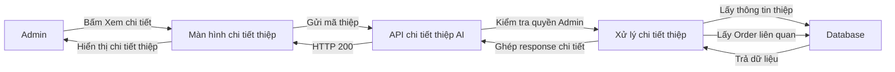
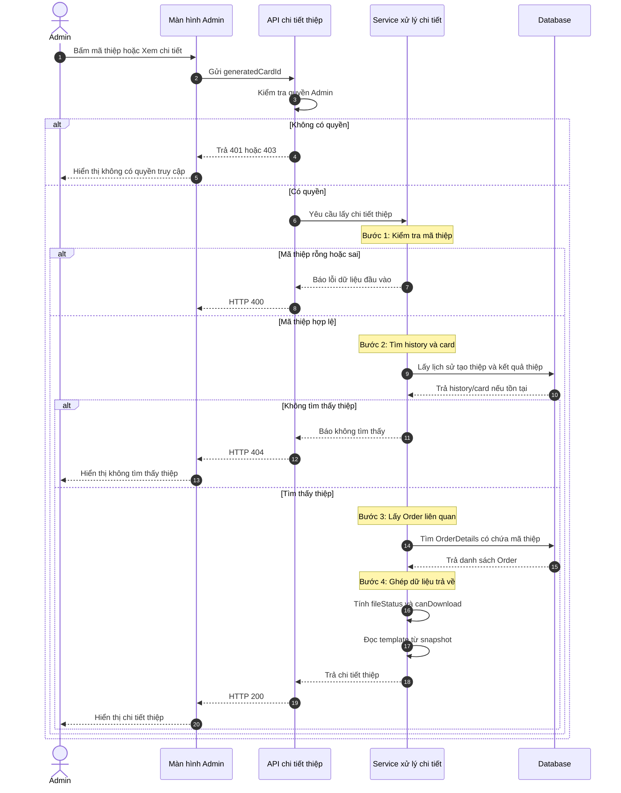
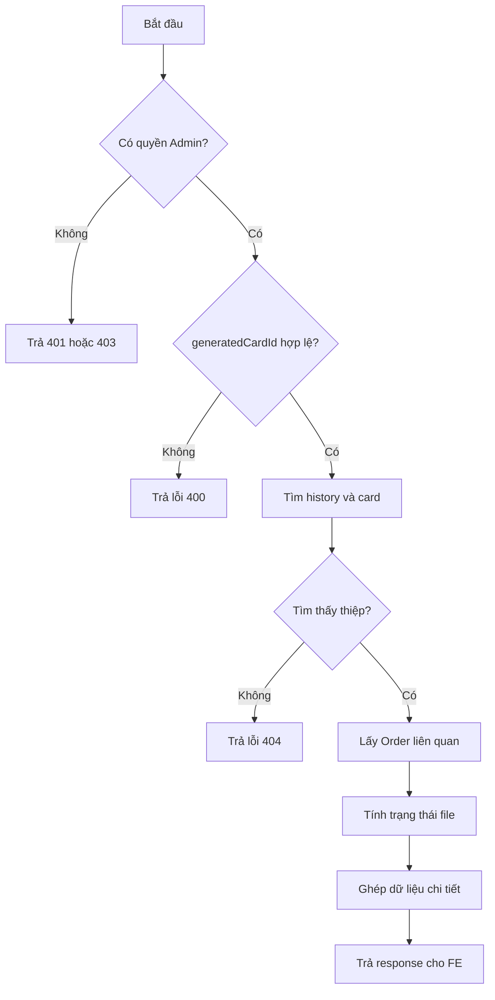
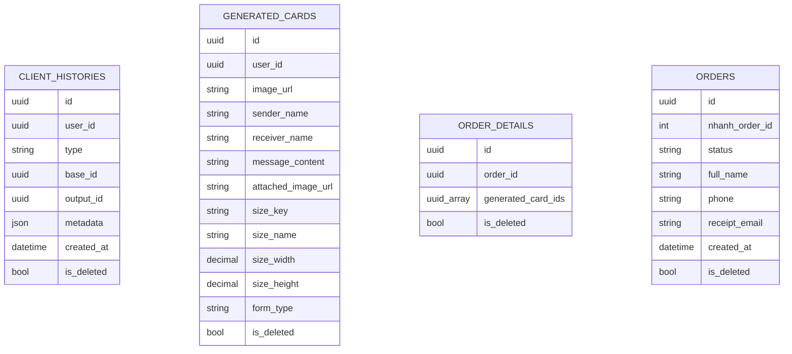

# TDD-024: Admin xem chi tiết thiệp AI

## Thông tin tài liệu

- **Tiêu đề**: Admin xem chi tiết một thiệp AI đã tạo.
- **Ghi chú**: Tài liệu này mô tả API chi tiết thiệp AI cho Admin. API chỉ đọc dữ liệu để Admin kiểm tra ảnh, thông tin thiệp và các Order liên quan; không sửa thiệp, không tải file.

## Metadata quản trị tài liệu

| Trường | Giá trị |
|---|---|
| Mã tài liệu | TDD-024 |
| Phiên bản | v0.1 |
| Author | Codex |
| Reviewer |  |
| Approver | Chưa chỉ định |
| Owner | Hoàng Thị Khánh Linh |
| Cập nhật gần nhất | 2026-09-07 |

---

## BƯỚC 1 — Thông tin & Bối cảnh

### Thông tin tài liệu

- **Mã tài liệu**: TDD-024
- **Tính năng**: Admin xem chi tiết thiệp AI
- **Tác giả**: Codex
- **Người review**:
- **Phiên bản**: v0.1
- **Cập nhật (YYYY-MM-DD)**: 2026-09-07
- **Story liên quan**:
  - STORY-043

### Business Rules

- Chỉ tài khoản Admin/có quyền mới được xem chi tiết thiệp AI.
- Chỉ trả chi tiết khi `generatedCardId` tồn tại và có lịch sử `client_histories.type = card`.
- Dữ liệu chi tiết thiệp lấy từ `generated_cards` và snapshot trong `client_histories.metadata`.
- Template hiển thị theo snapshot lúc tạo thiệp, không đọc live từ template hiện tại.
- Sender, receiver, lời chúc, ảnh đính kèm, size và hình thức lấy từ record `generated_cards`.
- Danh sách Order liên quan lấy qua `order_details.generated_card_ids`.
- Nếu thiệp liên kết nhiều Order thì trả đầy đủ danh sách Order.
- Chi tiết thiệp trả giá của chính `generated_cards` và thông tin Order liên quan ở mức tối thiểu.
- Danh sách Order liên quan chỉ cần `orderId`, `status`, `totalFee`.
- Nếu `imageUrl` rỗng/null thì `fileStatus = unavailable` và `canDownload = false`.
- Nếu ảnh lỗi khi FE tải từ storage, FE hiển thị trạng thái không khả dụng; BE không gọi AI tạo lại.

### Bối cảnh & Mục tiêu

**Vấn đề**

> Từ danh sách thiệp AI ở US-044, Admin cần bấm vào một thiệp để xem đầy đủ thông tin tạo thiệp. Một thiệp có thể chưa gắn Order, gắn một Order hoặc nhiều Order. API cần trả đủ dữ liệu của thiệp và trả thêm thông tin Order liên quan ở mức tối thiểu.

**Mục tiêu**

- Trả chi tiết đúng thiệp theo `generatedCardId`.
- Trả thông tin ảnh, người gửi, người nhận, lời chúc, template, size, hình thức và ngày tạo.
- Trả trạng thái file để FE biết có cho tải ảnh hay không.
- Trả toàn bộ Order liên kết với thiệp.
- Trả thêm thông tin Order liên quan gồm `orderId`, `status`, `totalFee`.
- Chặn request không có quyền.

**Ngoài phạm vi**

- Không tạo mới hoặc regenerate thiệp.
- Không cập nhật Order.
- Không tải file ảnh: dùng US-046.
- Không gọi Cloudinary/storage để kiểm tra file.
- Không lấy bill snapshot chi tiết của Order.

---

## BƯỚC 2 — Kiến trúc & Sơ đồ

### Kiến trúc tổng quan

**Tiêu đề**: Luồng Admin mở chi tiết thiệp AI.

**Mô tả**: Admin bấm “Xem chi tiết” từ danh sách. FE gửi mã thiệp cho BE. BE kiểm tra quyền, lấy history/card tương ứng, lấy các Order đang dùng thiệp đó rồi trả dữ liệu cho FE render trang chi tiết.



**Ghi chú**: API chỉ trả dữ liệu để xem. Nút tải ảnh trên FE dùng `canDownload`; thao tác tải thật thuộc US-046.

### Sequence Diagram

**Tiêu đề**: Trình tự lấy chi tiết thiệp AI.

**Mô tả**: Sơ đồ này mô tả từng bước từ lúc Admin bấm xem chi tiết đến khi FE hiển thị màn hình chi tiết.



**Ghi chú**: Chi tiết thiệp trả giá của chính generated card và `totalFee` của Order liên quan. API không trả bill snapshot chi tiết của Order.

### Activity Diagram

**Tiêu đề**: Các nhánh xử lý chính của API chi tiết.

**Mô tả**: API có các nhánh chính: kiểm tra quyền, kiểm tra id, tìm dữ liệu, lấy Order liên quan và trả response.



### State Diagram

Không áp dụng. US-043 chỉ đọc chi tiết, không làm thay đổi trạng thái entity.

### Mô hình dữ liệu

**Tiêu đề**: Các bảng được dùng để lấy chi tiết thiệp AI.

**Mô tả**: `client_histories` xác định lịch sử tạo thiệp. `generated_cards` chứa kết quả thiệp. `order_details` và `orders` giúp tìm các Order đang dùng thiệp này.



Ghi chú: DB tổng thiết kế dynamic. API đọc theo `client_histories.output_id = generated_cards.id` và tìm Order qua `order_details.generated_card_ids`.

---

## BƯỚC 3 — API

### API Contract nội bộ

#### Endpoint #1

- **Method**: GET
- **Endpoint**: `/api/v1/admin/generated-cards/{generatedCardId}`
- **Tên endpoint**: Admin xem chi tiết thiệp AI
- **Mô tả**: Trả chi tiết một thiệp AI, gồm ảnh, thông tin nhập trên thiệp, template snapshot, trạng thái file và các Order liên quan.

**Route parameter**

| Field | Kiểu | Bắt buộc | Mô tả |
|---|---|---:|---|
| `generatedCardId` | Guid | Có | Id của record trong `generated_cards`. |

**Response field**

Response toàn cục dùng `BaseResponse`. FE đọc toàn bộ chi tiết thiệp tại `value`.

| Field | Mô tả |
|---|---|
| `historyId` | Id của lịch sử tạo thiệp. |
| `generatedCardId` | Id của thiệp AI. |
| `content` | Nội dung/prompt hoặc nội dung kết quả lưu trong card. |
| `imageUrl` | Link ảnh thiệp. |
| `rawImage` | Ảnh raw nếu hệ thống có lưu. |
| `userId` | Id user sở hữu thiệp. |
| `createdAt` | Thời điểm tạo card/history. |
| `cardType` | Loại generated card. |
| `formType` | Hình thức thiệp. |
| `sizeKey` | Mã size. |
| `senderName` | Người gửi. |
| `receiverName` | Người nhận. |
| `messageContent` | Lời chúc. |
| `attachedImageUrl` | Ảnh người dùng đính kèm nếu có. |
| `sizeName` | Tên size. |
| `sizeWidth` | Chiều rộng size nếu có. |
| `sizeHeight` | Chiều cao size nếu có. |
| `sizeBasePrice` | Giá gốc theo size tại thời điểm tạo. |
| `sizeMaxWords` | Số từ tối đa của size tại thời điểm tạo. |
| `wordCount` | Số từ của lời chúc. |
| `wordConfigSnapshot` | Snapshot cấu hình tính phụ phí theo số từ nếu có. |
| `basePrice` | Giá nền của thiệp. |
| `extraPrice` | Phụ phí phát sinh. |
| `totalPrice` | Tổng giá thiệp. |
| `fileStatus` | `available` nếu có ảnh, `unavailable` nếu không có ảnh. |
| `canDownload` | FE dùng để bật/tắt nút tải ảnh. |
| `templateName` | Tên template từ snapshot. |
| `orders` | Danh sách Order đang dùng thiệp này, gồm `orderId`, `status`, `totalFee`. |

**Ví dụ 1 — Xem chi tiết thành công** — HTTP `200`

Request:

```http
GET /api/v1/admin/generated-cards/ca000000-0000-0000-0000-000000000001
Authorization: Bearer <admin_token>
```

Response:

```json
{
  "isSuccess": true,
  "isFailed": false,
  "error": null,
  "value": {
    "historyId": "1f2c0000-0000-0000-0000-000000000001",
  "generatedCardId": "ca000000-0000-0000-0000-000000000001",
  "content": "Thiệp sinh nhật phong cách cổ điển",
  "imageUrl": "https://res.cloudinary.com/demo/card-01.png",
  "rawImage": null,
  "userId": "10000000-0000-0000-0000-000000000001",
  "createdAt": "2026-09-05T10:30:00Z",
  "cardType": "AI",
  "formType": "Calligraphy",
  "sizeKey": "10x15",
  "senderName": "Minh",
  "receiverName": "Lan",
  "messageContent": "Chúc mừng sinh nhật",
  "attachedImageUrl": null,
  "sizeName": "10 x 15",
  "sizeWidth": 10,
  "sizeHeight": 15,
  "sizeBasePrice": 20000,
  "sizeMaxWords": 30,
  "wordCount": 4,
  "wordConfigSnapshot": null,
  "basePrice": 20000,
  "extraPrice": 0,
  "totalPrice": 20000,
  "fileStatus": "available",
  "canDownload": true,
  "templateName": "Cổ điển",
    "orders": [
      {
        "orderId": "0a000000-0000-0000-0000-000000000001",
        "status": "Paid",
        "totalFee": 520000
      }
    ]
  }
}
```

Error: Không có.

**Ví dụ 2 — Thiệp có nhiều Order liên quan** — HTTP `200`

Request:

```http
GET /api/v1/admin/generated-cards/ca000000-0000-0000-0000-000000000002
Authorization: Bearer <admin_token>
```

Response:

```json
{
  "isSuccess": true,
  "isFailed": false,
  "error": null,
  "value": {
  "historyId": "1f2c0000-0000-0000-0000-000000000002",
  "generatedCardId": "ca000000-0000-0000-0000-000000000002",
  "content": "Thiệp chúc mừng phong cách hiện đại",
  "imageUrl": "https://res.cloudinary.com/demo/card-02.png",
  "rawImage": null,
  "userId": "10000000-0000-0000-0000-000000000001",
  "createdAt": "2026-09-05T10:30:00Z",
  "cardType": "AI",
  "formType": "Printed",
  "sizeKey": "10x15",
  "senderName": "Minh",
  "receiverName": "Lan",
  "messageContent": "Chúc bạn luôn hạnh phúc",
  "attachedImageUrl": null,
  "sizeName": "10 x 15",
  "sizeWidth": 10,
  "sizeHeight": 15,
  "sizeBasePrice": 20000,
  "sizeMaxWords": 30,
  "wordCount": 5,
  "wordConfigSnapshot": null,
  "basePrice": 20000,
  "extraPrice": 0,
  "totalPrice": 20000,
  "fileStatus": "available",
  "canDownload": true,
  "templateName": "Hiện đại",
    "orders": [
      {
        "orderId": "0a000000-0000-0000-0000-000000000010",
        "status": "Paid",
        "totalFee": 520000
      },
      {
        "orderId": "0a000000-0000-0000-0000-000000000011",
        "status": "Paid",
        "totalFee": 760000
      }
    ]
  }
}
```

**Ví dụ 3 — File ảnh không khả dụng** — HTTP `200`

Request:

```http
GET /api/v1/admin/generated-cards/ca000000-0000-0000-0000-000000000003
Authorization: Bearer <admin_token>
```

Response:

```json
{
  "isSuccess": true,
  "isFailed": false,
  "error": null,
  "value": {
    "historyId": "1f2c0000-0000-0000-0000-000000000003",
  "generatedCardId": "ca000000-0000-0000-0000-000000000003",
  "content": "Thiệp sinh nhật phong cách cổ điển",
  "imageUrl": null,
  "rawImage": null,
  "userId": "10000000-0000-0000-0000-000000000001",
  "createdAt": "2026-09-05T10:30:00Z",
  "cardType": "AI",
  "formType": "Calligraphy",
  "sizeKey": "10x15",
  "senderName": "Minh",
  "receiverName": "Lan",
  "messageContent": "Chúc mừng sinh nhật",
  "attachedImageUrl": null,
  "sizeName": "10 x 15",
  "sizeWidth": 10,
  "sizeHeight": 15,
  "sizeBasePrice": 20000,
  "sizeMaxWords": 30,
  "wordCount": 4,
  "wordConfigSnapshot": null,
  "basePrice": 20000,
  "extraPrice": 0,
  "totalPrice": 20000,
  "fileStatus": "unavailable",
  "canDownload": false,
  "templateName": "Cổ điển",
    "orders": []
  }
}
```

#### Mã lỗi

| Code | HTTP | Khi nào xảy ra |
|---|---:|---|
| `UNAUTHORIZED` | 401 | Request chưa đăng nhập. |
| `FORBIDDEN` | 403 | Tài khoản không có quyền Admin/xem AI Custom → Thiệp. |
| `INVALID_GENERATED_CARD_ID` | 400 | `generatedCardId` rỗng hoặc không hợp lệ. |
| `GENERATED_CARD_NOT_FOUND` | 404 | Không tìm thấy thiệp AI tương ứng hoặc history không phải type `card`. |

### API Contract bên ngoài

Không áp dụng. API này không gọi Nhanh.vn, Cloudinary hoặc dịch vụ bên thứ ba.

---

## BƯỚC 4 — Tham chiếu

### 🔴 Tham chiếu đến

- `doc-us/STORY-043-Admin-xem-chi-tiet-thiep-AI/STORY-043-Admin-xem-chi-tiet-thiep-AI.md`
- `doc-us/STORY-043-Admin-xem-chi-tiet-thiep-AI/ST-STORY-043-admin-xem-chi-tiet-thiep-ai.md`
- `code-introduction/US-043/US-043-introduction.md`
- `code-introduction/US-044/US-044-introduction.md`

### ⚫ Trỏ vào tài liệu này

- US-044: Admin xem danh sách thiệp AI, bấm item để mở chi tiết.
- US-046: Admin tải ảnh thiệp AI, dùng `generatedCardId` và `canDownload`.

### ⋯ Bị ảnh hưởng

- Nếu đổi cách lưu `generated_card_ids` trong `order_details`, cần kiểm tra lại danh sách Order liên quan.
- Nếu đổi snapshot template trong `client_histories.metadata`, cần kiểm tra lại `templateName`.
