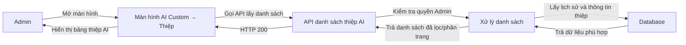
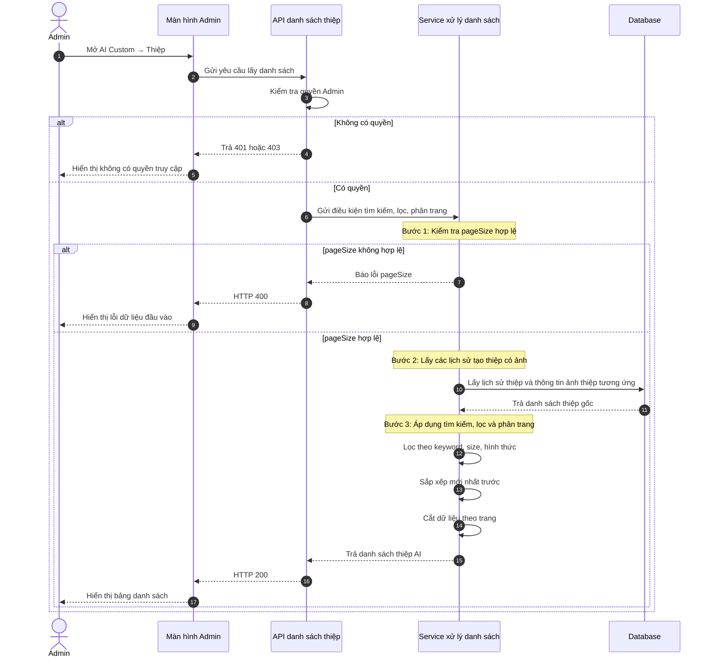
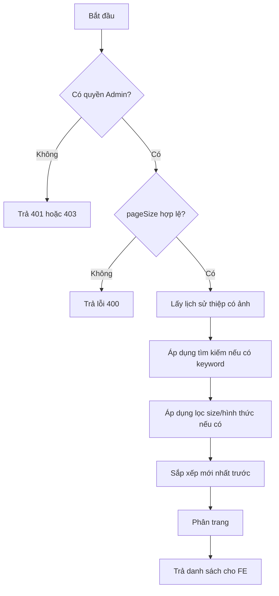
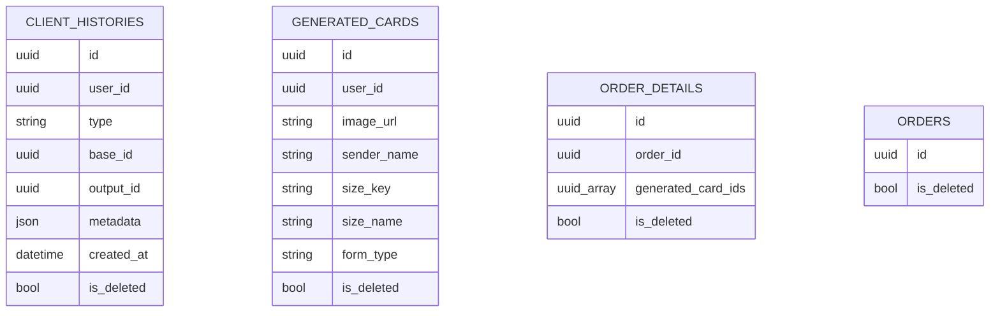

# TDD-023: Admin xem danh sách thiệp AI

## Thông tin tài liệu

- **Tiêu đề**: Admin xem danh sách thiệp AI đã tạo.
- **Ghi chú**: Tài liệu này mô tả API danh sách thiệp AI cho màn hình Admin. API chỉ dùng để xem, tìm kiếm, lọc và phân trang; không tạo mới, không tải file.

## Metadata quản trị tài liệu

| Trường | Giá trị |
|---|---|
| Mã tài liệu | TDD-023 |
| Phiên bản | v0.1 |
| Author | Codex |
| Reviewer |  |
| Approver | Chưa chỉ định |
| Owner | Hoàng Thị Khánh Linh |
| Cập nhật gần nhất | 2026-09-07 |

---

## BƯỚC 1 — Thông tin & Bối cảnh

### Thông tin tài liệu

- **Mã tài liệu**: TDD-023
- **Tính năng**: Admin xem danh sách thiệp AI
- **Tác giả**: Codex
- **Người review**:
- **Phiên bản**: v0.1
- **Cập nhật (YYYY-MM-DD)**: 2026-09-07
- **Story liên quan**:
  - STORY-044

### Business Rules

- Chỉ tài khoản Admin/có quyền mới được xem danh sách thiệp AI.
- Mỗi lịch sử tạo thiệp hợp lệ hiển thị thành 1 item.
- Nếu một thiệp được gắn với nhiều Order thì vẫn chỉ hiển thị 1 lần trong danh sách.
- Danh sách được sắp xếp theo ngày tạo mới nhất trước.
- Danh sách trả đầy đủ field hiện có của `generated_cards` để Admin có đủ context khi xem list.
- Danh sách không trả bill snapshot của Order.
- Nếu ảnh không tải được ở FE, FE hiển thị placeholder; BE không gọi AI tạo lại ảnh.
- Admin có thể tìm kiếm theo mã thiệp, mã Order hoặc tên người gửi.
- Admin có thể lọc theo size và hình thức thiệp.
- API phải phân trang ở BE.

### Bối cảnh & Mục tiêu

**Vấn đề**

> Admin cần một màn hình để xem toàn bộ thiệp AI đã được tạo trong hệ thống. Dữ liệu thiệp nằm ở lịch sử tạo AI và bảng kết quả thiệp. Một thiệp cũng có thể đã được gắn vào Order, nên API cần hỗ trợ tìm kiếm theo Order nhưng không làm danh sách bị lặp dòng.

**Mục tiêu**

- Trả danh sách thiệp AI hợp lệ cho Admin.
- Hỗ trợ tìm kiếm nhanh theo tên người gửi, mã thiệp hoặc mã Order.
- Hỗ trợ lọc theo size và hình thức.
- Hỗ trợ phân trang với page size hợp lệ.
- Không làm duplicate item khi một thiệp liên kết nhiều Order.
- Trả đầy đủ thông tin hiện có của `generated_cards`.
- Không trả bill snapshot của Order.

**Ngoài phạm vi**

- Không xem danh sách Order liên quan: dùng US-043.
- Không tải ảnh thiệp: dùng US-046.
- Không xử lý tạo/regenerate thiệp.
- Không kiểm tra ảnh thật sự còn tồn tại trên Cloudinary/storage.
- Không gọi API bên thứ ba.

---

## BƯỚC 2 — Kiến trúc & Sơ đồ

### Kiến trúc tổng quan

**Tiêu đề**: Luồng Admin mở màn hình danh sách thiệp AI.

**Mô tả**: Admin mở màn hình danh sách. FE gọi API danh sách. BE kiểm tra quyền, lấy dữ liệu lịch sử tạo thiệp, ghép với thông tin thiệp đã tạo, áp dụng tìm kiếm/lọc/phân trang rồi trả về cho FE render bảng.



**Ghi chú**: API chỉ trả link ảnh (`imageUrl`). Nếu ảnh lỗi khi hiển thị, FE tự thay bằng placeholder.

### Sequence Diagram

**Tiêu đề**: Trình tự lấy danh sách thiệp AI cho Admin.

**Mô tả**: Sơ đồ này mô tả thứ tự xử lý từ lúc Admin mở màn hình đến khi FE hiển thị danh sách.



**Ghi chú**: Tìm kiếm theo Order chỉ dùng để lọc danh sách, không làm một thiệp bị nhân bản thành nhiều dòng.

### Activity Diagram

**Tiêu đề**: Các nhánh xử lý chính của API danh sách.

**Mô tả**: API có các nhánh chính: kiểm tra quyền, kiểm tra page size, lấy dữ liệu, áp dụng điều kiện, trả kết quả.



### State Diagram

Không áp dụng. US-044 chỉ đọc danh sách, không làm thay đổi trạng thái entity.

### Mô hình dữ liệu

**Tiêu đề**: Các bảng được dùng để lấy danh sách thiệp AI.

**Mô tả**: `client_histories` cho biết lịch sử nào là lịch sử tạo thiệp. `generated_cards` chứa ảnh và thông tin thiệp. `order_details` và `orders` chỉ dùng khi Admin tìm kiếm theo mã Order.



Ghi chú: Sơ đồ trên chỉ thể hiện cách API đọc dữ liệu. DB tổng của dự án vẫn đi theo hướng dynamic, không cần FK cứng.

---

## BƯỚC 3 — API

### API Contract nội bộ

#### Endpoint #1

- **Method**: GET
- **Endpoint**: `/api/v1/admin/generated-cards`
- **Tên endpoint**: Admin xem danh sách thiệp AI
- **Mô tả**: Trả danh sách thiệp AI đã tạo cho Admin. FE dùng API này khi mở màn hình, tìm kiếm, lọc hoặc đổi trang.

**Request query**

| Field | Kiểu | Bắt buộc | Mô tả |
|---|---|---:|---|
| `pageIndex` | int | Không | Trang cần lấy. Nếu không truyền thì mặc định là `1`. |
| `pageSize` | int | Không | Số item mỗi trang. Chỉ nhận `5, 10, 20, 30, 40, 50`. |
| `keyword` | string | Không | Tìm theo mã thiệp, mã Order hoặc tên người gửi. |
| `sizeKey` | string | Không | Lọc theo size thiệp. |
| `formType` | string | Không | Lọc theo hình thức thiệp. |

**Response item**

Response toàn cục dùng `BasePaginationResponse`. FE đọc danh sách tại `value.items`; thông tin phân trang nằm cùng cấp trong `value`.

| Field | Mô tả |
|---|---|
| `historyId` | Id của lịch sử tạo thiệp. |
| `generatedCardId` | Id của thiệp AI đã tạo. |
| `content` | Nội dung/prompt hoặc nội dung kết quả lưu trong card. |
| `imageUrl` | Link ảnh thiệp để FE preview/lightbox. |
| `rawImage` | Ảnh raw nếu hệ thống có lưu. |
| `userId` | Id user sở hữu thiệp. |
| `createdAt` | Thời điểm tạo card/history. |
| `cardType` | Loại generated card. |
| `formType` | Hình thức thiệp. |
| `sizeKey` | Mã size. |
| `senderName` | Người gửi. |
| `receiverName` | Người nhận. |
| `messageContent` | Lời chúc. |
| `attachedImageUrl` | Ảnh người dùng đính kèm nếu có. |
| `sizeName` | Tên size hiển thị. |
| `sizeWidth` | Chiều rộng size. |
| `sizeHeight` | Chiều cao size. |
| `sizeBasePrice` | Giá gốc theo size tại thời điểm tạo. |
| `sizeMaxWords` | Số từ tối đa của size tại thời điểm tạo. |
| `wordCount` | Số từ của lời chúc. |
| `wordConfigSnapshot` | Snapshot cấu hình tính phụ phí theo số từ nếu có. |
| `basePrice` | Giá nền của thiệp. |
| `extraPrice` | Phụ phí phát sinh. |
| `totalPrice` | Tổng giá thiệp. |
| `templateName` | Tên template lấy từ snapshot trong `client_histories.metadata`. |

**Ví dụ 1 — Lấy danh sách mặc định** — HTTP `200`

Request:

```http
GET /api/v1/admin/generated-cards?pageIndex=1&pageSize=10
Authorization: Bearer <admin_token>
```

Response:

```json
{
  "isSuccess": true,
  "isFailed": false,
  "error": null,
  "value": {
    "items": [
      {
        "historyId": "11111111-1111-1111-1111-111111111111",
        "generatedCardId": "22222222-2222-2222-2222-222222222222",
        "content": "Thiệp sinh nhật phong cách cổ điển",
        "imageUrl": "https://res.cloudinary.com/demo/card.png",
        "rawImage": null,
        "userId": "33333333-3333-3333-3333-333333333333",
        "createdAt": "2026-08-22T08:15:00Z",
        "cardType": "AI",
        "formType": "Calligraphy",
        "sizeKey": "10x15",
        "senderName": "Nguyễn Văn A",
        "receiverName": "Lan",
        "messageContent": "Chúc mừng sinh nhật",
        "attachedImageUrl": null,
        "sizeName": "10 x 15",
        "sizeWidth": 10,
        "sizeHeight": 15,
        "sizeBasePrice": 20000,
        "sizeMaxWords": 30,
        "wordCount": 4,
        "wordConfigSnapshot": null,
        "basePrice": 20000,
        "extraPrice": 0,
        "totalPrice": 20000,
        "templateName": "Modern Pink"
      }
    ],
    "pageIndex": 1,
    "pageSize": 10,
    "totalCount": 1,
    "hasNextPage": false,
    "hasPreviousPage": false
  }
}
```

Error: Không có.

**Ví dụ 2 — Không có dữ liệu phù hợp** — HTTP `200`

Request:

```http
GET /api/v1/admin/generated-cards?pageIndex=1&pageSize=10&keyword=not-found
Authorization: Bearer <admin_token>
```

Response:

```json
{
  "isSuccess": true,
  "isFailed": false,
  "error": null,
  "value": {
    "items": [],
    "pageIndex": 1,
    "pageSize": 10,
    "totalCount": 0,
    "hasNextPage": false,
    "hasPreviousPage": false
  }
}
```

**Ví dụ 3 — Tìm kiếm theo mã thiệp** — HTTP `200`

Request:

```http
GET /api/v1/admin/generated-cards?pageIndex=1&pageSize=10&keyword=22222222-2222-2222-2222-222222222222
Authorization: Bearer <admin_token>
```

Response:

```json
{
  "isSuccess": true,
  "isFailed": false,
  "error": null,
  "value": {
    "items": [
      {
        "historyId": "11111111-1111-1111-1111-111111111111",
        "generatedCardId": "22222222-2222-2222-2222-222222222222",
        "content": "Thiệp sinh nhật phong cách cổ điển",
        "imageUrl": "https://res.cloudinary.com/demo/card.png",
        "rawImage": null,
        "userId": "33333333-3333-3333-3333-333333333333",
        "createdAt": "2026-08-22T08:15:00Z",
        "cardType": "AI",
        "formType": "Calligraphy",
        "sizeKey": "10x15",
        "senderName": "Nguyễn Văn A",
        "receiverName": "Lan",
        "messageContent": "Chúc mừng sinh nhật",
        "attachedImageUrl": null,
        "sizeName": "10 x 15",
        "sizeWidth": 10,
        "sizeHeight": 15,
        "sizeBasePrice": 20000,
        "sizeMaxWords": 30,
        "wordCount": 4,
        "wordConfigSnapshot": null,
        "basePrice": 20000,
        "extraPrice": 0,
        "totalPrice": 20000,
        "templateName": "Modern Pink"
      }
    ],
    "pageIndex": 1,
    "pageSize": 10,
    "totalCount": 1,
    "hasNextPage": false,
    "hasPreviousPage": false
  }
}
```

**Ví dụ 4 — Lọc theo size và hình thức** — HTTP `200`

Request:

```http
GET /api/v1/admin/generated-cards?pageIndex=1&pageSize=10&sizeKey=10x15&formType=Calligraphy
Authorization: Bearer <admin_token>
```

Response:

```json
{
  "isSuccess": true,
  "isFailed": false,
  "error": null,
  "value": {
    "items": [
      {
        "historyId": "11111111-1111-1111-1111-111111111111",
        "generatedCardId": "22222222-2222-2222-2222-222222222222",
        "content": "Thiệp sinh nhật phong cách cổ điển",
        "imageUrl": "https://res.cloudinary.com/demo/card.png",
        "rawImage": null,
        "userId": "33333333-3333-3333-3333-333333333333",
        "createdAt": "2026-08-22T08:15:00Z",
        "cardType": "AI",
        "formType": "Calligraphy",
        "sizeKey": "10x15",
        "senderName": "Nguyễn Văn A",
        "receiverName": "Lan",
        "messageContent": "Chúc mừng sinh nhật",
        "attachedImageUrl": null,
        "sizeName": "10 x 15",
        "sizeWidth": 10,
        "sizeHeight": 15,
        "sizeBasePrice": 20000,
        "sizeMaxWords": 30,
        "wordCount": 4,
        "wordConfigSnapshot": null,
        "basePrice": 20000,
        "extraPrice": 0,
        "totalPrice": 20000,
        "templateName": "Modern Pink"
      }
    ],
    "pageIndex": 1,
    "pageSize": 10,
    "totalCount": 1,
    "hasNextPage": false,
    "hasPreviousPage": false
  }
}
```

#### Mã lỗi

| Code | HTTP | Khi nào xảy ra |
|---|---:|---|
| `UNAUTHORIZED` | 401 | Request chưa đăng nhập. |
| `FORBIDDEN` | 403 | Tài khoản không có quyền Admin/xem AI Custom → Thiệp. |
| `INVALID_PAGE_SIZE` | 400 | `pageSize` không thuộc các giá trị `5, 10, 20, 30, 40, 50`. |

### API Contract bên ngoài

Không áp dụng. API này không gọi Nhanh.vn, Cloudinary hoặc dịch vụ bên thứ ba.

---

## BƯỚC 4 — Tham chiếu

### 🔴 Tham chiếu đến

- `doc-us/STORY-044-Admin-xem-danh-sach-thiep-AI/STORY-044-Admin-xem-danh-sach-thiep-AI.md`
- `doc-us/STORY-044-Admin-xem-danh-sach-thiep-AI/ST-STORY-044-admin-xem-danh-sach-lich-su-thiep-ai.md`
- `code-introduction/US-044/US-044-introduction.md`

### ⚫ Trỏ vào tài liệu này

- US-043: Admin xem chi tiết thiệp AI.
- US-046: Admin tải ảnh thiệp AI.

### ⋯ Bị ảnh hưởng

- Nếu đổi cách lưu `generated_card_ids` trong `order_details`, cần kiểm tra lại search theo mã Order.
- Nếu đổi nơi snapshot template, cần kiểm tra lại field `templateName`.
- Nếu đổi enum/type của `client_histories.type`, cần kiểm tra lại điều kiện lấy lịch sử thiệp.
