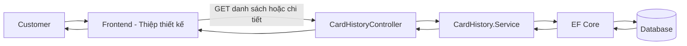
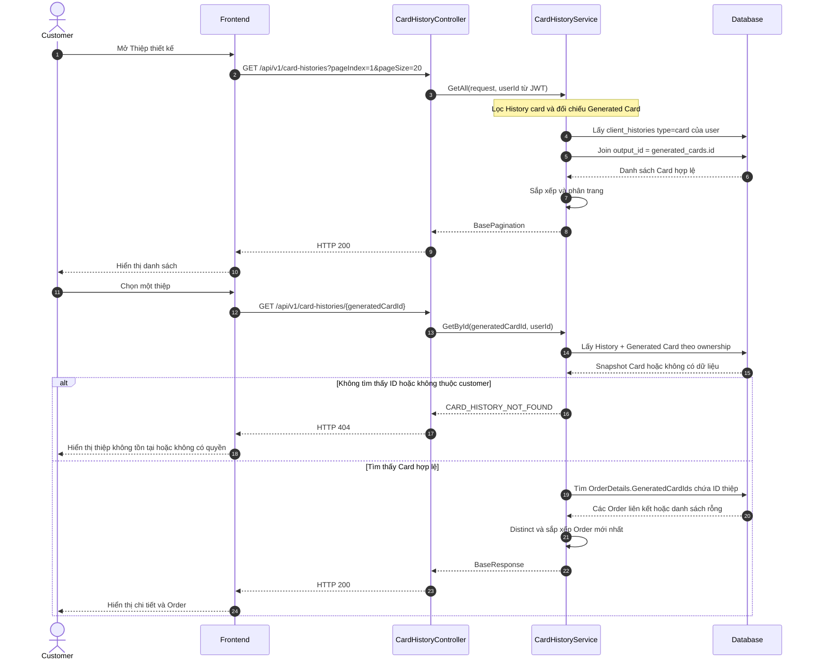
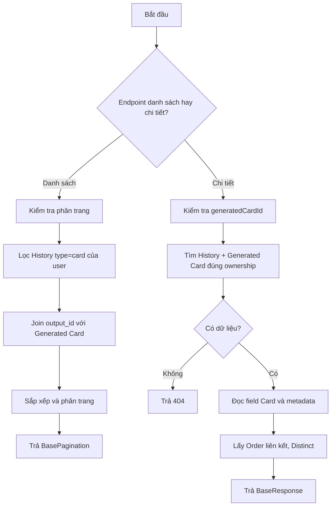
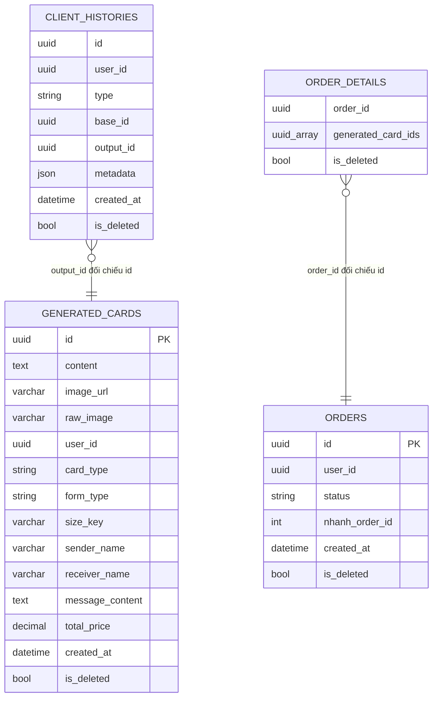

# TDD-030: Customer xem lịch sử thiệp đã tạo

## Thông tin tài liệu

- **Tiêu đề**: Customer xem danh sách và chi tiết các thiệp đã tạo thành công.
- **Ghi chú**: Danh sách và chi tiết đều truy vấn từ `client_histories` và `generated_cards`; chi tiết trả thêm các Order đã sử dụng thiệp.

## Metadata quản trị tài liệu

| Trường | Giá trị |
|---|---|
| Mã tài liệu | TDD-030 |
| Phiên bản | v0.1 |
| Author | Codex |
| Reviewer |  |
| Approver | Chưa chỉ định |
| Owner | Hoàng Thị Khánh Linh |
| Cập nhật gần nhất | 2026-09-07 |

---

## BƯỚC 1 — Thông tin & Bối cảnh

### Thông tin tài liệu

- **Mã tài liệu**: TDD-030
- **Tính năng**: Customer xem lịch sử thiệp đã tạo
- **Tác giả**: Codex
- **Người review**:
- **Phiên bản**: v0.1
- **Cập nhật (YYYY-MM-DD)**: 2026-09-07
- **Story liên quan**:
  - STORY-045

### Business Rules

- Customer phải đăng nhập; `userId` lấy từ JWT.
- Danh sách lọc `client_histories.type = card`, đúng `userId` và chưa bị xóa.
- `client_histories.output_id` được đối chiếu với `generated_cards.id`; Card cũng phải đúng user và chưa bị xóa.
- Một History item đại diện cho một Generated Card, không nhân bản theo số Order.
- Danh sách sắp xếp `generatedAt` giảm dần; khi trùng thời gian dùng `generatedCardId` giảm dần.
- Thiệp chưa có Order vẫn xuất hiện.
- Chi tiết lấy `sourceId = client_histories.base_id`; đây là ID nguồn đa hình, không mặc định là Combo.
- Chi tiết lấy toàn bộ thông tin Card đã snapshot trong `generated_cards`; không đọc lại Template/Size/Config live để thay đổi lịch sử.
- Order liên kết được tìm bằng `OrderDetails.GeneratedCardIds`, chỉ lấy Order/Detail chưa xóa, cùng customer và loại trùng.
- Order không có liên kết thì trả `orders: []`; trạng thái Order không làm mất History.
- Không dùng đệ quy hoặc GroupBy `base_id`; không tạo History mới khi xem lại.

### Bối cảnh & Mục tiêu

**Vấn đề**

> Customer cần xem lại các thiệp đã tạo, mở chi tiết một thiệp và biết thiệp đó đã được sử dụng trong những Order nào.

**Mục tiêu**

- Trả danh sách thiệp có phân trang để FE hiển thị bảng History.
- Trả đầy đủ thông tin Card và danh sách Order liên quan khi customer mở chi tiết.
- Bảo đảm ownership, không lộ ảnh hoặc metadata của customer khác.

**Ngoài phạm vi**

- Không generate, regenerate, tải ảnh hoặc chọn thiệp cho Checkout.
- Không tạo liên kết Thiệp–Order mới.
- Không sửa hoặc xóa History, Card hay Order.
- Không lấy thông tin hồ sơ mở rộng từ User Service.

---

## BƯỚC 2 — Kiến trúc & Sơ đồ

### Kiến trúc tổng quan

**Tiêu đề**: Luồng customer đọc danh sách và chi tiết thiệp.

**Mô tả**: FE gọi API danh sách khi mở History và gọi API chi tiết khi customer chọn một thiệp. Service đọc snapshot Card và truy vấn Order liên kết chỉ ở API chi tiết.



### Sequence Diagram

**Tiêu đề**: Trình tự xem danh sách và mở chi tiết thiệp.



**Ghi chú**: API danh sách không join OrderDetails để tránh nhân bản một thiệp khi thiệp được dùng cho nhiều Order.

### Activity Diagram



### State Diagram

Không áp dụng. Đây là hai API chỉ đọc.

### Mô hình dữ liệu



Ghi chú: Các liên kết polymorphic được truy vấn bằng ID dynamic; không cần FK cứng giữa `client_histories` và Generated Card.

---

## BƯỚC 3 — API

Response thành công dùng wrapper hiện tại: `BasePaginationResponse` cho danh sách và `BaseResponse` cho chi tiết. FE đọc dữ liệu tại `response.value`.

### Endpoint #1 — Danh sách History thiệp

- **Method**: GET
- **Endpoint**: `/api/v1/card-histories?pageIndex=1&pageSize=20`
- **Tên endpoint**: Lấy danh sách thiệp đã tạo
- **Mô tả**: Trả các Generated Card thuộc customer, mới nhất trước, có phân trang.

**Request**

```http
GET /api/v1/card-histories?pageIndex=1&pageSize=20
Authorization: Bearer <customer_token>
```

| Field | Vị trí | Kiểu | Bắt buộc | Quy tắc |
|---|---|---|---:|---|
| `pageIndex` | Query | int | Không | Mặc định 1, phải >= 1. |
| `pageSize` | Query | int | Không | Mặc định 20, từ 1 đến 100. |
| `Authorization` | Header | Bearer token | Có | Token của customer. |

**Response — HTTP 200**

```json
{
  "isSuccess": true,
  "isFailed": false,
  "error": null,
  "traceId": null,
  "timestampUtc": "2026-09-07T10:00:00Z",
  "value": {
    "items": [
      {
        "generatedCardId": "ca000000-0000-0000-0000-000000000001",
        "imageUrl": "https://res.cloudinary.com/demo/card-01.png",
        "formType": "calligraphy",
        "sizeName": "10x15",
        "sizeWidth": 10,
        "sizeHeight": 15,
        "generatedAt": "2026-09-05T10:30:00Z"
      }
    ],
    "pageIndex": 1,
    "pageSize": 20,
    "totalCount": 1,
    "hasNextPage": false,
    "hasPreviousPage": false
  }
}
```

**IService**

```csharp
Task<BasePaginationResponse> GetAll(
    Request.PaginationRequest request);
```

Không có History thì trả HTTP 200 với `items: []`.

### Endpoint #2 — Chi tiết một thiệp History

- **Method**: GET
- **Endpoint**: `/api/v1/card-histories/{generatedCardId}`
- **Tên endpoint**: Xem chi tiết thiệp đã tạo
- **Mô tả**: Trả các field snapshot của Generated Card và các Order đã sử dụng thiệp.

**Request**

```http
GET /api/v1/card-histories/ca000000-0000-0000-0000-000000000001
Authorization: Bearer <customer_token>
```

**Response — HTTP 200**

```json
{
  "isSuccess": true,
  "isFailed": false,
  "error": null,
  "traceId": null,
  "timestampUtc": "2026-09-07T10:00:00Z",
  "value": {
    "generatedCardId": "ca000000-0000-0000-0000-000000000001",
    "sourceId": "c1000000-0000-0000-0000-000000000000",
    "historyMetadata": "{\"schemaVersion\":2,\"cardTemplate\":{...}}",
    "content": "Chúc mừng sinh nhật",
    "imageUrl": "https://res.cloudinary.com/demo/card-01.png",
    "formType": "calligraphy",
    "sizeKey": "size_A",
    "senderName": "An",
    "receiverName": "Bình",
    "messageContent": "Chúc mừng sinh nhật",
    "attachedImageUrl": null,
    "sizeName": "10x15",
    "sizeWidth": 10,
    "sizeHeight": 15,
    "sizeBasePrice": 100000,
    "sizeMaxWords": 100,
    "wordCount": 4,
    "wordConfigSnapshot": "{\"minWords\":1,\"maxWords\":100}",
    "basePrice": 100000,
    "extraPrice": 0,
    "totalPrice": 100000,
    "generatedAt": "2026-09-05T10:30:00Z",
    "orders": [
      {
        "orderId": "0a000000-0000-0000-0000-000000000001",
        "nhanhOrderId": 123456,
        "status": "Paid",
        "createdAt": "2026-09-05T11:00:00Z"
      }
    ]
  }
}
```

Thiệp chưa liên kết Order trả `orders: []`. Một thiệp liên kết nhiều Order chỉ xuất hiện một lần trong danh sách và có nhiều phần tử trong `orders` ở chi tiết.

**IService**

```csharp
Task<Response.CardHistoryDetailResponse> GetById(
    Guid generatedCardId);
```

### DTO chính

```csharp
public class PaginationRequest
{
    public int PageIndex { get; set; } = 1;
    public int PageSize { get; set; } = 20;
}

public class CardHistoryItemResponse
{
    public Guid GeneratedCardId { get; set; }
    public string? ImageUrl { get; set; }
    public FormType FormType { get; set; }
    public string? SizeName { get; set; }
    public decimal? SizeWidth { get; set; }
    public decimal? SizeHeight { get; set; }
    public DateTime GeneratedAt { get; set; }
}
```

### Mã lỗi

| Code | HTTP | Khi nào xảy ra |
|---|---:|---|
| `UNAUTHORIZED` | 401 | Chưa đăng nhập hoặc token không hợp lệ. |
| `INVALID_PAGE` | 400 | `pageIndex < 1`, `pageSize < 1` hoặc `pageSize > 100`. |
| `INVALID_GENERATED_CARD_ID` | 400 | ID thiệp rỗng hoặc không bind được thành Guid. |
| `CARD_HISTORY_NOT_FOUND` | 404 | Thiệp không tồn tại, đã xóa hoặc không thuộc customer. |

### API Contract bên ngoài

Không áp dụng. Hai API không gọi AI, User Service hoặc Storage.

---

## BƯỚC 4 — Tham chiếu

### 🔴 Tham chiếu đến

- `doc-us/STORY-045-Xem lịch su-cac-thiep-da-tao/STORY-045-Xem lịch su-cac-thiep-da-tao.md`
- `doc-us/STORY-045-Xem lịch su-cac-thiep-da-tao/ST-STORY-045-khach-hang-xem-history-thiep-thiet-ke-v2.md`
- `code-introduction/US-045/US-045-introduction.md`
- `docs (1)/AI_Card_Context.md`
- `docs (1)/AI_DB_Diagram.md`

### ⚫ Trỏ vào tài liệu này

- US-041 dùng `generatedCardId` trả từ TDD-030 để lấy URL ảnh.
- Màn hình “Thiệp thiết kế” gọi Endpoint #1 khi mở trang và Endpoint #2 khi customer chọn một thiệp.

### ⋯ Bị ảnh hưởng

- Nếu đổi tên `client_histories.type/output_id`, `generated_cards` hoặc `OrderDetails.GeneratedCardIds`, phải cập nhật cả hai API.
- Nếu thay đổi schema snapshot Card, phải cập nhật mapper chi tiết.
