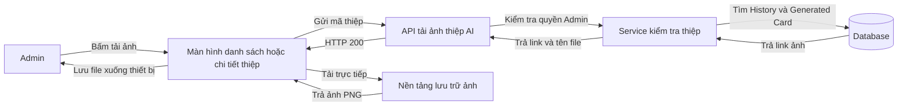
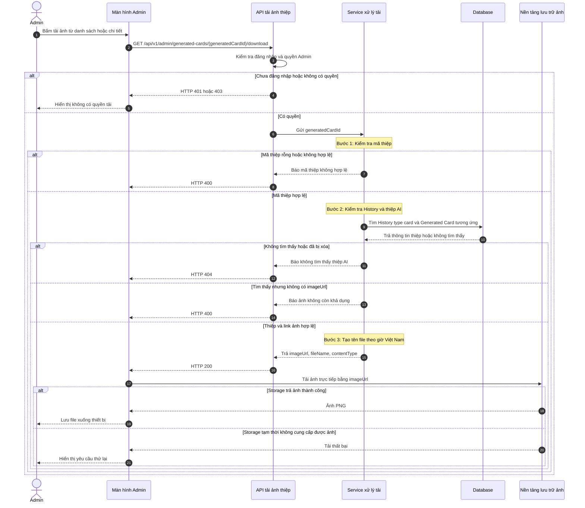
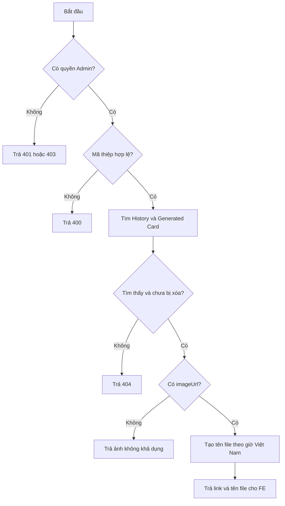
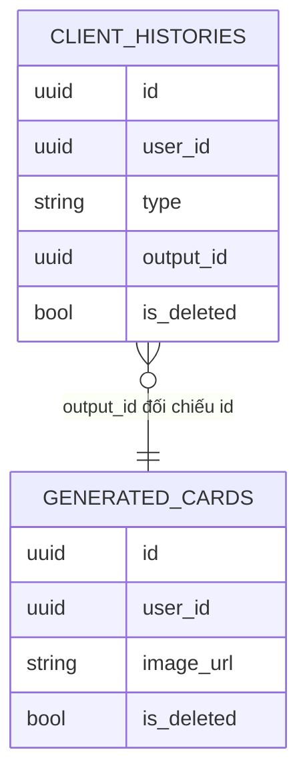

# TDD-025: Admin tải xuống thiệp AI

## Thông tin tài liệu

- **Tiêu đề**: Admin lấy thông tin tải xuống ảnh thiệp AI.
- **Ghi chú**: FE gọi API từ danh sách thiệp hoặc trang chi tiết thiệp. BE xác thực quyền và dữ liệu, sau đó trả link ảnh cùng tên file để FE tải trực tiếp từ storage.

## Metadata quản trị tài liệu

| Trường | Giá trị |
|---|---|
| Mã tài liệu | TDD-025 |
| Phiên bản | v0.1 |
| Author | Codex |
| Reviewer |  |
| Approver | Chưa chỉ định |
| Owner | Hoàng Thị Khánh Linh |
| Cập nhật gần nhất | 2026-09-07 |

---

## BƯỚC 1 — Thông tin & Bối cảnh

### Thông tin tài liệu

- **Mã tài liệu**: TDD-025
- **Tính năng**: Admin tải ảnh thiệp AI
- **Tác giả**: Codex
- **Người review**:
- **Phiên bản**: v0.1
- **Cập nhật (YYYY-MM-DD)**: 2026-09-07
- **Story liên quan**:
  - STORY-046

### Business Rules

- Chỉ tài khoản Admin có quyền mới được lấy thông tin tải ảnh thiệp AI.
- `generatedCardId` phải là một `Guid` hợp lệ và khác `Guid.Empty`.
- Thiệp phải tồn tại, chưa bị xóa logic và có `client_histories.type = card` hợp lệ trỏ tới thiệp qua `output_id`.
- History và Generated Card phải thuộc cùng một người dùng: `history.user_id = generated_card.user_id`.
- Ảnh tải xuống là chính `generated_cards.image_url`; BE không gọi AI, không chỉnh sửa ảnh và không tạo ảnh mới.
- Nếu `image_url` null, rỗng hoặc chỉ có khoảng trắng thì không trả link tải.
- BE trả `imageUrl`, `fileName` và `contentType`; FE dùng link để tải trực tiếp từ storage, không stream binary qua BE.
- Tên file có dạng `thiep_[generatedCardId]_[yyyyMMdd_HHmmss].png`, dùng thời gian tại múi giờ Việt Nam.
- Mã thiệp là `Guid`, vì vậy phần mã trong tên file không chứa ký tự không an toàn.
- Admin được tải lại nhiều lần. Mỗi lần tải đều kiểm tra lại quyền, History và Generated Card.
- Tải ảnh không tạo `generated_cards`, không tạo `client_histories`, không gọi AI, không thay đổi Order và không trừ quota.
- Việc thiệp có hoặc không liên kết với Order không ảnh hưởng kết quả tải.

### Bối cảnh & Mục tiêu

**Vấn đề**

> Admin cần tải ảnh thiệp AI từ màn hình danh sách hoặc chi tiết. Backend phải đảm bảo đúng quyền và đúng thiệp trước khi cung cấp thông tin tải, đồng thời tránh gánh lưu lượng file ảnh.

**Mục tiêu**

- Kiểm tra quyền Admin tại mỗi request.
- Xác định đúng History và Generated Card theo `generatedCardId`.
- Trả đúng link ảnh đã lưu, tên file PNG an toàn và loại nội dung.
- Cho FE tải trực tiếp từ storage.
- Không phát sinh dữ liệu mới hoặc thay đổi quota.

**Ngoài phạm vi**

- Không stream binary ảnh qua BE.
- Không kiểm tra nội dung file thực tế tại storage trong service này.
- Không gọi AI hoặc tạo lại ảnh khi ảnh không khả dụng.
- Không tạo, sửa hoặc xóa History.
- Không thay đổi Order.
- Không áp dụng cho chức năng tải ảnh của Customer trong STORY-041.

---

## BƯỚC 2 — Kiến trúc & Sơ đồ

### Kiến trúc tổng quan

**Tiêu đề**: Luồng Admin lấy link tải ảnh thiệp AI.

**Mô tả**: Admin bấm tải tại danh sách hoặc chi tiết. FE gọi Backend để kiểm tra quyền và dữ liệu thiệp. Backend trả link cùng tên file; FE tải ảnh trực tiếp từ storage.



**Ghi chú**: Backend không nhận rồi truyền tiếp nội dung ảnh, nhờ đó giảm tải khi có nhiều lượt tải đồng thời.

### Sequence Diagram

**Tiêu đề**: Trình tự kiểm tra và trả thông tin tải thiệp AI.

**Mô tả**: Sơ đồ mô tả từ lúc Admin bấm tải đến khi FE nhận link và tải ảnh trực tiếp.



**Ghi chú**: Lỗi phát sinh sau khi FE dùng link truy cập storage thuộc luồng tải trực tiếp của FE/storage. Khi thử lại, FE gọi lại API để BE kiểm tra quyền và dữ liệu từ đầu.

### Activity Diagram

**Tiêu đề**: Các nhánh kiểm tra trước khi trả link tải.

**Mô tả**: API chỉ trả thông tin tải khi người gọi có quyền, mã thiệp hợp lệ, History và Generated Card còn tồn tại, đồng thời có `imageUrl`.



### State Diagram

Không áp dụng. Chức năng chỉ đọc dữ liệu và không thay đổi trạng thái thiệp.

### Mô hình dữ liệu

**Tiêu đề**: Dữ liệu dùng để xác định ảnh thiệp AI.

**Mô tả**: `client_histories.output_id` được đối chiếu với `generated_cards.id`. Đây là cách truy vấn dynamic, không yêu cầu FK cứng.



---

## BƯỚC 3 — API

### API Contract nội bộ

#### Endpoint #1

- **Method**: GET
- **Endpoint**: `/api/v1/admin/generated-cards/{generatedCardId}/download`
- **Tên endpoint**: Admin lấy link tải ảnh thiệp AI
- **Mô tả**: Kiểm tra quyền và dữ liệu thiệp AI, sau đó trả link ảnh cùng tên file để FE tải trực tiếp từ storage.

**Request**

| Field | Vị trí | Kiểu | Bắt buộc | Mô tả |
|---|---|---|---:|---|
| `generatedCardId` | Route | Guid | Có | ID của `generated_cards`, phải khác `Guid.Empty`. |
| `Authorization` | Header | Bearer token | Có | Token của Admin có quyền tải thiệp AI. |

**Response**

Response toàn cục dùng `BaseResponse`. FE đọc dữ liệu tải tại `value`.

| Field | Kiểu | Mô tả |
|---|---|---|
| `generatedCardId` | Guid | ID thiệp AI được yêu cầu tải. |
| `imageUrl` | string | Link ảnh chính thức đang lưu tại `generated_cards.image_url`. |
| `fileName` | string | Tên file theo định dạng `thiep_[generatedCardId]_[yyyyMMdd_HHmmss].png`. |
| `contentType` | string | Luôn là `image/png`. |

**Ví dụ 1 — Lấy thông tin tải thành công** — HTTP `200`

Request:

```http
GET /api/v1/admin/generated-cards/ca000000-0000-0000-0000-000000000001/download
Authorization: Bearer <admin_token>
```

Response:

```json
{
  "isSuccess": true,
  "isFailed": false,
  "error": null,
  "value": {
    "generatedCardId": "ca000000-0000-0000-0000-000000000001",
    "imageUrl": "https://res.cloudinary.com/demo/card-01.png",
    "fileName": "thiep_ca00000000000000000000000000000001_20260907_143000.png",
    "contentType": "image/png"
  }
}
```

**Ví dụ 2 — Không tìm thấy thiệp AI hợp lệ** — HTTP `404`

Request:

```http
GET /api/v1/admin/generated-cards/ffffffff-ffff-ffff-ffff-ffffffffffff/download
Authorization: Bearer <admin_token>
```

Response:

```json
{
  "title": "Not Found",
  "status": 404,
  "detail": "Không tìm thấy thiệp AI.",
  "messageCode": "GENERATED_CARD_NOT_FOUND",
  "errors": null,
  "traceId": null,
  "timestampUtc": "2026-09-07T07:30:00Z"
}
```

**Ví dụ 3 — Ảnh không còn khả dụng** — HTTP `400`

Request:

```http
GET /api/v1/admin/generated-cards/ca000000-0000-0000-0000-000000000002/download
Authorization: Bearer <admin_token>
```

Response:

```json
{
  "title": "Bad Request",
  "status": 400,
  "detail": "Ảnh thiệp không còn khả dụng.",
  "messageCode": "CARD_IMAGE_UNAVAILABLE",
  "errors": null,
  "traceId": null,
  "timestampUtc": "2026-09-07T07:30:00Z"
}
```

#### Mã lỗi

| Code | HTTP | Khi nào xảy ra |
|---|---:|---|
| `INVALID_GENERATED_CARD_ID` | 400 | `generatedCardId = Guid.Empty` hoặc route không thể bind thành Guid. |
| `UNAUTHORIZED` | 401 | Request chưa đăng nhập hoặc token không hợp lệ. |
| `FORBIDDEN` | 403 | Tài khoản không có quyền Admin/tải thiệp AI. |
| `GENERATED_CARD_NOT_FOUND` | 404 | Không có cặp History type `card` và Generated Card hợp lệ, hoặc dữ liệu đã bị xóa logic. |
| `CARD_IMAGE_UNAVAILABLE` | 400 | Generated Card tồn tại nhưng `image_url` null, rỗng hoặc chỉ có khoảng trắng. |

### API Contract bên ngoài

Không áp dụng tại Backend. Sau khi nhận `imageUrl`, FE tải ảnh trực tiếp từ nền tảng lưu trữ. BE không gọi API storage và không stream file trong endpoint này.

---

## BƯỚC 4 — Tham chiếu

### 🔴 Tham chiếu đến

- `doc-us/STORY-046-admin-tai-xuong-thiep-ai/STORY-046-admin-tai-xuong-thiep-ai.md`
- `doc-us/STORY-046-admin-tai-xuong-thiep-ai/ST-STORY-046-admin-tai-xuong-thiep-ai.md`
- `code-introduction/US-046/US-046-introduction.md`
- TDD-023: Admin xem danh sách thiệp AI.
- TDD-024: Admin xem chi tiết thiệp AI.

### ⚫ Trỏ vào tài liệu này

- Màn hình danh sách thiệp AI gọi endpoint này khi Admin tải từ menu item.
- Màn hình chi tiết thiệp AI gọi endpoint này khi Admin bấm nút tải.

### ⋯ Bị ảnh hưởng

- Nếu thay đổi cách lưu `generated_cards.image_url`, cần cập nhật cách trả `imageUrl`.
- Nếu thay đổi enum/type của `client_histories.type`, cần cập nhật điều kiện nhận diện thiệp AI.
- Nếu chuyển sang signed URL hoặc private storage, cần cập nhật response và contract với FE.
- Nếu thay đổi quy tắc tên file hoặc múi giờ, cần cập nhật `fileName` và các UT tương ứng.
