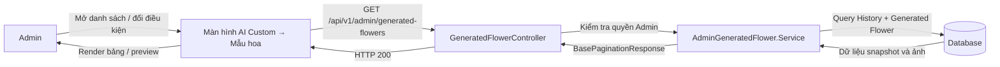
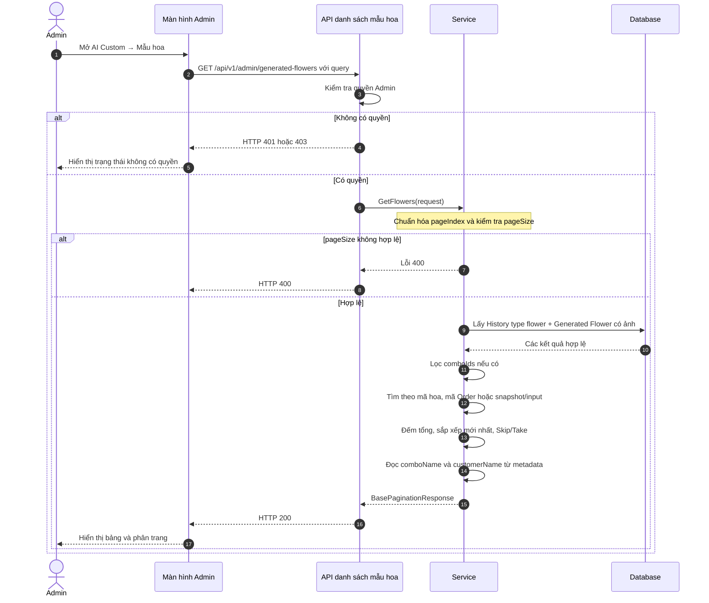
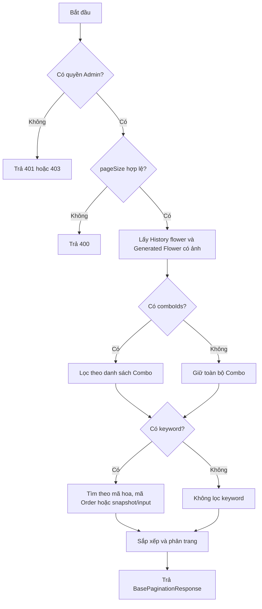
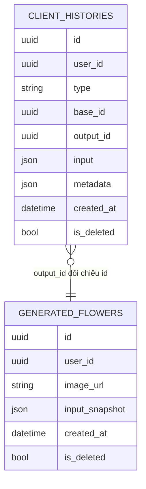

# TDD-026: Admin xem danh sách mẫu hoa Custom AI

## Thông tin tài liệu

- **Tiêu đề**: Admin xem danh sách các mẫu hoa Custom AI đã tạo.
- **Ghi chú**: API phục vụ màn hình AI Custom → Mẫu hoa, hỗ trợ tìm kiếm, lọc Combo và phân trang. API chỉ đọc dữ liệu, không tạo hoặc thay đổi mẫu hoa.

## Metadata quản trị tài liệu

| Trường | Giá trị |
|---|---|
| Mã tài liệu | TDD-026 |
| Phiên bản | v0.1 |
| Author | Codex |
| Reviewer |  |
| Approver | Chưa chỉ định |
| Owner | Hoàng Thị Khánh Linh |
| Cập nhật gần nhất | 2026-09-07 |

---

## BƯỚC 1 — Thông tin & Bối cảnh

### Thông tin tài liệu

- **Mã tài liệu**: TDD-026
- **Tính năng**: Admin xem danh sách mẫu hoa Custom AI
- **Tác giả**: Codex
- **Người review**:
- **Phiên bản**: v0.1
- **Cập nhật (YYYY-MM-DD)**: 2026-09-07
- **Story liên quan**:
  - STORY-047

### Business Rules

- Chỉ Admin có quyền quản lý AI Custom được gọi API.
- Chỉ lấy `client_histories.type = flower`, History và Generated Flower chưa bị xóa logic.
- Ghép History với Generated Flower bằng `history.output_id = flower.id`; `user_id` của hai bản ghi phải khớp.
- Chỉ hiển thị kết quả có `generated_flowers.image_url` khác null/rỗng.
- Mỗi kết quả AI hợp lệ hiển thị đúng một item, không bị nhân bản bởi Order liên kết.
- Sắp xếp theo `client_histories.created_at` giảm dần.
- `comboId` lấy từ `client_histories.base_id`; `generatedFlowerId` lấy từ `output_id`.
- `comboName` lấy từ snapshot `client_histories.metadata.product.name`.
- `customerName` lấy từ snapshot `client_histories.metadata.user_input.name`, là tên người nhập khi tạo hoa, không phải tên account từ User Service.
- Tìm kiếm theo mã Generated Flower, mã Order hoặc nội dung snapshot/input của History.
- Lọc được một hoặc nhiều Combo bằng `comboIds`.
- `pageSize` chỉ nhận `5, 10, 20, 30, 40, 50`; mặc định là `10`.
- Danh sách không trả giá hoặc bill; giá được xem ở Chi tiết Order.
- Không gọi AI, không tạo History mới và không thay đổi Order/quota.

### Bối cảnh & Mục tiêu

**Vấn đề**

> Admin cần xem nhanh các ảnh mẫu hoa Custom AI. Dữ liệu kết quả nằm ở `generated_flowers`, còn nguồn Combo và tên người nhập nằm trong snapshot của `client_histories`. API phải tìm kiếm và phân trang mà không làm một kết quả bị lặp vì liên kết Order.

**Mục tiêu**

- Trả danh sách mẫu hoa AI hợp lệ theo thứ tự mới nhất.
- Tìm theo mã hoa, mã Order hoặc tên người nhập.
- Lọc theo một hoặc nhiều Combo.
- Trả đúng cấu trúc phân trang `BasePaginationResponse`.
- Đưa đủ dữ liệu để FE hiển thị bảng, preview và mở Chi tiết US-048.

**Ngoài phạm vi**

- Không trả Core, Support, Mockup hoặc yêu cầu chi tiết; các dữ liệu này thuộc US-048.
- Không trả giá/bill.
- Không kiểm tra trạng thái Combo, tồn kho hoặc Mockup hiện tại.
- Không tải binary ảnh qua BE.
- Không generate, regenerate, sửa hoặc xóa mẫu hoa.

---

## BƯỚC 2 — Kiến trúc & Sơ đồ

### Kiến trúc tổng quan

**Tiêu đề**: Luồng Admin lấy danh sách mẫu hoa Custom AI.

**Mô tả**: FE gửi điều kiện tìm kiếm, lọc và phân trang. Service kiểm tra quyền ở Controller, truy vấn History và Generated Flower, áp dụng điều kiện rồi trả `BasePaginationResponse`.



**Ghi chú**: Order chỉ được kiểm tra khi keyword là mã Order; không join Order vào projection nên không tạo duplicate item.

### Sequence Diagram

**Tiêu đề**: Trình tự tìm kiếm, lọc và phân trang danh sách mẫu hoa.



**Ghi chú**: Nếu không có kết quả, API vẫn trả HTTP 200 với `value.items = []` và `totalCount = 0`.

### Activity Diagram



### State Diagram

Không áp dụng. API chỉ đọc dữ liệu, không thay đổi trạng thái mẫu hoa.

### Mô hình dữ liệu

**Tiêu đề**: Dữ liệu dùng cho danh sách mẫu hoa.



Ghi chú: Quan hệ trên là cách API đối chiếu ID dynamic, không yêu cầu FK cứng trong DB tổng.

---

## BƯỚC 3 — API

### API Contract nội bộ

#### Endpoint #1

- **Method**: GET
- **Endpoint**: `/api/v1/admin/generated-flowers`
- **Tên endpoint**: Admin xem danh sách mẫu hoa Custom AI
- **Mô tả**: Trả danh sách mẫu hoa AI có tìm kiếm, lọc Combo và phân trang phía server.

**Request query**

| Field | Kiểu | Bắt buộc | Mô tả |
|---|---|---:|---|
| `pageIndex` | int | Không | Trang cần lấy; giá trị nhỏ hơn hoặc bằng 0 được đưa về `1`. |
| `pageSize` | int | Không | Số item mỗi trang; chỉ nhận `5, 10, 20, 30, 40, 50`, mặc định `10`. |
| `keyword` | string | Không | Mã Generated Flower, mã Order hoặc tên/nội dung trong snapshot/input. |
| `comboIds` | Guid[] | Không | Một hoặc nhiều Combo; ID rỗng bị loại và ID trùng được gộp. |

**Response item**

Response toàn cục dùng `BasePaginationResponse`. FE đọc danh sách tại `value.items`.

| Field | Mô tả |
|---|---|
| `historyId` | ID History của lần tạo hoa. |
| `generatedFlowerId` | ID kết quả trong `generated_flowers`. |
| `customerId` | ID user sở hữu kết quả. |
| `comboId` | `client_histories.base_id`. |
| `comboName` | Tên Combo từ snapshot `metadata.product.name`. |
| `customerName` | Tên người nhập khi tạo hoa từ `metadata.user_input.name`. |
| `imageUrl` | Link ảnh kết quả để FE preview/lightbox. |
| `createdAt` | Thời điểm tạo History. |

**Ví dụ 1 — Danh sách mặc định** — HTTP `200`

Request:

```http
GET /api/v1/admin/generated-flowers?pageIndex=1&pageSize=10
Authorization: Bearer <admin_token>
```

Response:

```json
{
  "isSuccess": true,
  "isFailed": false,
  "error": null,
  "value": {
    "items": [
      {
        "historyId": "1f2c0000-0000-0000-0000-000000000001",
        "generatedFlowerId": "fa000000-0000-0000-0000-000000000001",
        "customerId": "10000000-0000-0000-0000-000000000001",
        "comboId": "c1000000-0000-0000-0000-000000000001",
        "comboName": "Combo sinh nhật",
        "imageUrl": "https://res.cloudinary.com/demo/flower-01.png",
        "createdAt": "2026-09-05T10:30:00Z"
      }
    ],
    "pageIndex": 1,
    "pageSize": 10,
    "totalCount": 1,
    "hasNextPage": false,
    "hasPreviousPage": false
  }
}
```

**Ví dụ 2 — Lọc theo nhiều Combo** — HTTP `200`

Request:

```http
GET /api/v1/admin/generated-flowers?pageIndex=1&pageSize=10&comboIds=c1000000-0000-0000-0000-000000000001&comboIds=c1000000-0000-0000-0000-000000000002
Authorization: Bearer <admin_token>
```

Response:

```json
{
  "isSuccess": true,
  "isFailed": false,
  "error": null,
  "value": {
    "items": [
      {
        "historyId": "1f2c0000-0000-0000-0000-000000000001",
        "generatedFlowerId": "fa000000-0000-0000-0000-000000000001",
        "customerId": "10000000-0000-0000-0000-000000000001",
        "comboId": "c1000000-0000-0000-0000-000000000001",
        "comboName": "Combo sinh nhật",
        "imageUrl": "https://res.cloudinary.com/demo/flower-01.png",
        "createdAt": "2026-09-05T10:30:00Z"
      },
      {
        "historyId": "1f2c0000-0000-0000-0000-000000000001",
        "generatedFlowerId": "fa000000-0000-0000-0000-000000000001",
        "customerId": "10000000-0000-0000-0000-000000000001",
        "comboId": "c1000000-0000-0000-0000-000000000001",
        "comboName": "Combo sinh nhật",
        "imageUrl": "https://res.cloudinary.com/demo/flower-01.png",
        "createdAt": "2026-09-05T10:30:00Z"
      }
    ],
    "pageIndex": 1,
    "pageSize": 10,
    "totalCount": 1,
    "hasNextPage": false,
    "hasPreviousPage": false
  }
}
```

**Ví dụ 3 — Không có kết quả** — HTTP `200`

Request:

```http
GET /api/v1/admin/generated-flowers?pageIndex=1&pageSize=10&keyword=khong-ton-tai
Authorization: Bearer <admin_token>
```

Response:

```json
{
  "isSuccess": true,
  "isFailed": false,
  "error": null,
  "value": {
    "items": [],
    "pageIndex": 1,
    "pageSize": 10,
    "totalCount": 0,
    "hasNextPage": false,
    "hasPreviousPage": false
  }
}
```

#### Mã lỗi

| Code | HTTP | Khi nào xảy ra |
|---|---:|---|
| `UNAUTHORIZED` | 401 | Request chưa đăng nhập hoặc token không hợp lệ. |
| `FORBIDDEN` | 403 | Tài khoản không có quyền quản lý AI Custom. |
| `INVALID_PAGE_SIZE` | 400 | `pageSize` không thuộc `5, 10, 20, 30, 40, 50`. |

### API Contract bên ngoài

Không áp dụng. API chỉ đọc Database; FE dùng `imageUrl` để preview từ storage.

---

## BƯỚC 4 — Tham chiếu

### 🔴 Tham chiếu đến

- `doc-us/STORY-047-admin-xem-danh-sach-mau-hoa-custom-ai/STORY-047-admin-xem-danh-sach-mau-hoa-custom-ai.md`
- `doc-us/STORY-047-admin-xem-danh-sach-mau-hoa-custom-ai/ST-STORY-047-admin-xem-danh-sach-mau-hoa-custom-ai.md`
- `code-introduction/US-047/US-047-introduction.md`
- Context hoa Custom AI trong `docs (1)/AI_Flower_Context.md`.

### ⚫ Trỏ vào tài liệu này

- TDD-027: Admin xem chi tiết mẫu hoa Custom AI.
- Màn hình danh sách gọi TDD-027 khi Admin bấm mã hoặc Xem chi tiết.

### ⋯ Bị ảnh hưởng

- Nếu đổi schema snapshot `metadata.product` hoặc `metadata.user_input`, cần cập nhật mapping tên Combo/tên người nhập.
- Nếu đổi `client_histories.type`, `base_id` hoặc `output_id`, cần cập nhật truy vấn danh sách.
- Nếu đổi wrapper phân trang, FE và UT phải cập nhật theo `BasePaginationResponse`.

