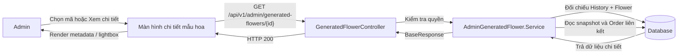
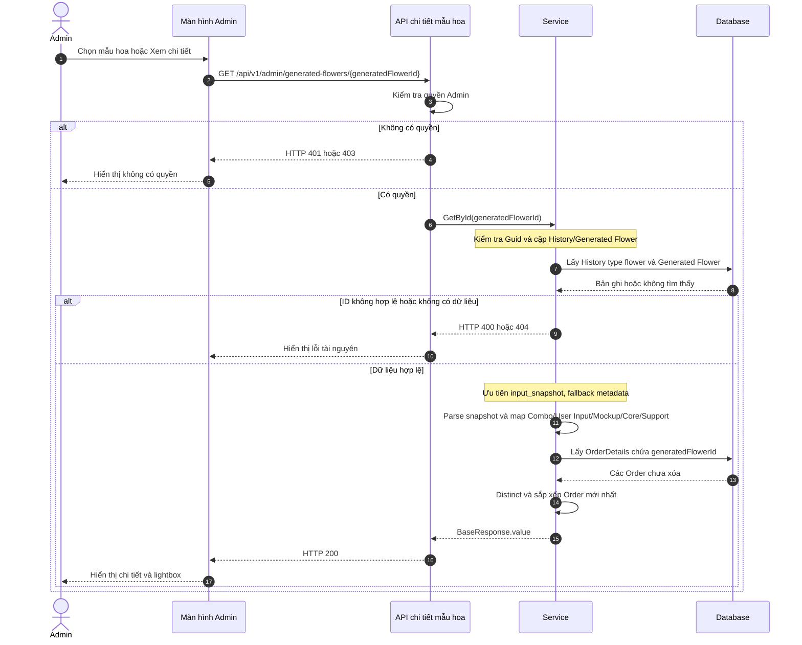
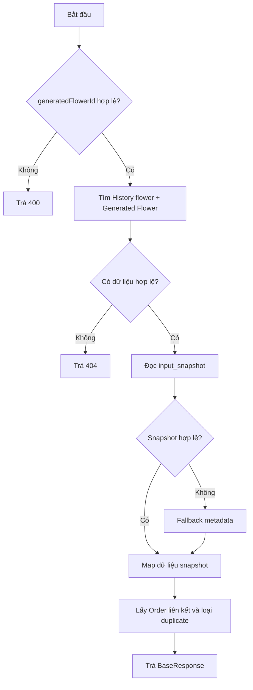
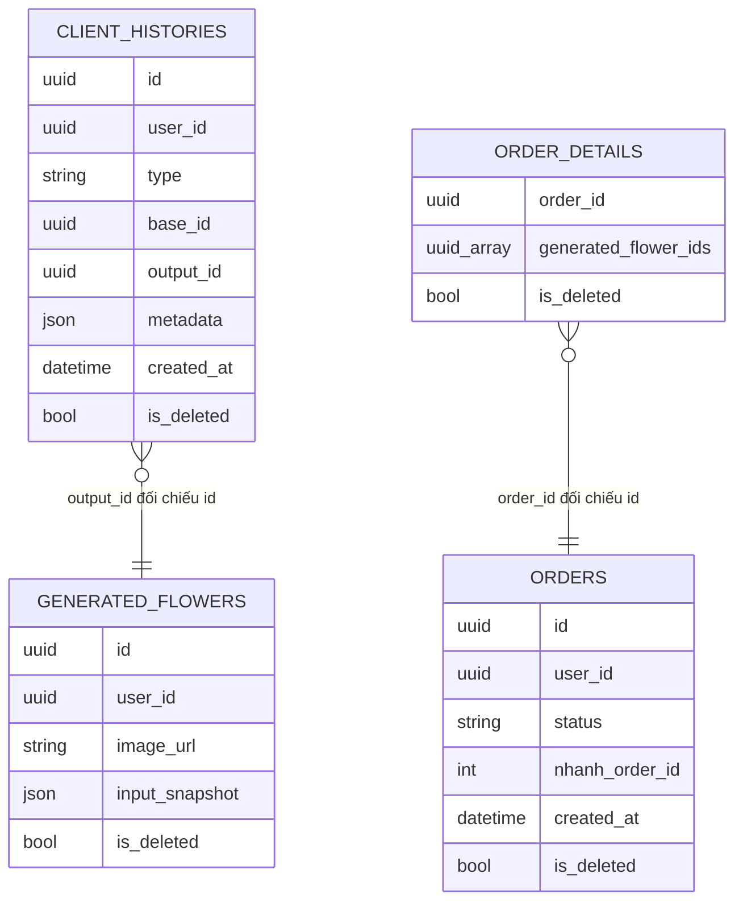

# TDD-027: Admin xem chi tiết mẫu hoa Custom AI

## Thông tin tài liệu

- **Tiêu đề**: Admin xem chi tiết một mẫu hoa Custom AI.
- **Ghi chú**: API lấy ảnh kết quả, dữ liệu Combo/Core/Support/Mockup và yêu cầu từ snapshot, cùng các Order liên kết. Không trả giá hoặc bill.

## Metadata quản trị tài liệu

| Trường | Giá trị |
|---|---|
| Mã tài liệu | TDD-027 |
| Phiên bản | v0.1 |
| Author | Codex |
| Reviewer |  |
| Approver | Chưa chỉ định |
| Owner | Hoàng Thị Khánh Linh |
| Cập nhật gần nhất | 2026-09-07 |

---

## BƯỚC 1 — Thông tin & Bối cảnh

### Thông tin tài liệu

- **Mã tài liệu**: TDD-027
- **Tính năng**: Admin xem chi tiết mẫu hoa Custom AI
- **Tác giả**: Codex
- **Người review**:
- **Phiên bản**: v0.1
- **Cập nhật (YYYY-MM-DD)**: 2026-09-07
- **Story liên quan**:
  - STORY-048

### Business Rules

- Chỉ Admin có quyền quản lý AI Custom được gọi API.
- `generatedFlowerId` phải khác `Guid.Empty`.
- Chỉ lấy History `type = flower`, History và Generated Flower chưa bị xóa, `output_id` đúng ID yêu cầu và `user_id` khớp.
- `comboId` lấy từ `client_histories.base_id`; không suy ra từ trạng thái Product hiện tại.
- Snapshot được đọc ưu tiên từ `generated_flowers.input_snapshot`; nếu không có hoặc JSON lỗi thì fallback sang `client_histories.metadata`.
- Combo, Core, Support, Mockup và User Input lấy từ snapshot; không query live để thay đổi dữ liệu lịch sử.
- `customerName` là tên trong User Input snapshot, không phải tên account từ User Service.
- `fileStatus = available` khi `imageUrl` có giá trị; ngược lại là `unavailable`. Ảnh lỗi không làm mất metadata.
- Order liên kết được lấy qua `OrderDetails.GeneratedFlowerIds`, chỉ lấy Order/Detail chưa xóa, cùng user và không trùng.
- Order sắp xếp mới nhất trước và chỉ trả `orderId`, `nhanhOrderId`, `status`, `createdAt`.
- Không trả giá, bill snapshot hoặc trạng thái Combo/Mockup hiện tại.
- Không gọi AI, không tạo History mới và không thay đổi Order.

### Bối cảnh & Mục tiêu

**Vấn đề**

> Admin cần xem đầy đủ nguồn gốc và dữ liệu đã dùng để tạo một mẫu hoa. Product, Mockup hoặc tồn kho có thể đã thay đổi sau thời điểm generate, nên chi tiết phải dùng snapshot bất biến thay vì dữ liệu live.

**Mục tiêu**

- Trả đúng mẫu hoa theo `generatedFlowerId`.
- Hiển thị ảnh và trạng thái file.
- Hiển thị Combo, User Input, Mockup, Core, Support tại thời điểm tạo.
- Trả đầy đủ Order liên kết mà không lặp.
- Giữ response ở `BaseResponse.value` và không đưa giá/bill vào chi tiết.

**Ngoài phạm vi**

- Không generate, regenerate hoặc chỉnh sửa mẫu hoa.
- Không kiểm tra lại tồn kho, active hoặc soft-delete của Combo/Mockup hiện tại.
- Không trả giá/bill.
- Không tải binary ảnh qua BE.
- Không lấy thông tin hồ sơ mở rộng từ User Service.

---

## BƯỚC 2 — Kiến trúc & Sơ đồ

### Kiến trúc tổng quan

**Tiêu đề**: Luồng Admin mở chi tiết mẫu hoa Custom AI.

**Mô tả**: FE gửi ID Flower. Service đối chiếu History với Generated Flower, đọc snapshot, truy vấn Order liên kết và trả `BaseResponse` để FE render chi tiết/lightbox.



**Ghi chú**: FE dùng `imageUrl` và `mockup.imageUrl` để mở lightbox; API không tạo ảnh mới.

### Sequence Diagram

**Tiêu đề**: Trình tự lấy snapshot và Order liên kết của mẫu hoa.



**Ghi chú**: Nếu `imageUrl` rỗng, vẫn trả HTTP 200 và metadata; FE chỉ hiển thị lỗi tại vùng ảnh.

### Activity Diagram



### State Diagram

Không áp dụng. API chỉ đọc History, Generated Flower và Order.

### Mô hình dữ liệu



Ghi chú: Đây là quan hệ truy vấn bằng ID dynamic; DB tổng không yêu cầu FK cứng giữa các bảng polymorphic.

---

## BƯỚC 3 — API

### API Contract nội bộ

#### Endpoint #1

- **Method**: GET
- **Endpoint**: `/api/v1/admin/generated-flowers/{generatedFlowerId}`
- **Tên endpoint**: Admin xem chi tiết mẫu hoa Custom AI
- **Mô tả**: Trả ảnh, snapshot nguồn, User Input, Mockup, Core/Support và các Order liên kết của một mẫu hoa.

**Request**

| Field | Vị trí | Kiểu | Bắt buộc | Mô tả |
|---|---|---|---:|---|
| `generatedFlowerId` | Route | Guid | Có | ID trong `generated_flowers`, phải khác `Guid.Empty`. |
| `Authorization` | Header | Bearer token | Có | Token Admin có quyền quản lý AI Custom. |

**Response**

Response toàn cục dùng `BaseResponse`. FE đọc chi tiết tại `value`.

| Field | Mô tả |
|---|---|
| `historyId` | ID History của lần tạo hoa. |
| `generatedFlowerId` | ID kết quả hoa AI. |
| `customerId` | ID user sở hữu kết quả. |
| `customerName` | Tên trong User Input snapshot. |
| `comboId` | `client_histories.base_id`. |
| `comboName` | Tên Combo từ snapshot. |
| `comboImageUrl` | Ảnh Combo từ snapshot nếu có. |
| `imageUrl` | Ảnh kết quả hoa AI. |
| `fileStatus` | `available` hoặc `unavailable`. |
| `userInput` | `name`, `occasion`, `style`, `budget`, `note`. |
| `mockup` | `id`, `name`, `imageUrl` từ snapshot. |
| `coreMaterials` | Danh sách Core gồm `materialId`, `name`, `quantity`. |
| `supportMaterials` | Danh sách Support gồm `materialId`, `name`, `quantity`. |
| `createdAt` | Thời điểm tạo History. |
| `orders` | Danh sách Order gồm `orderId`, `nhanhOrderId`, `status`, `createdAt`. |

**Ví dụ 1 — Chi tiết đầy đủ** — HTTP `200`

Request:

```http
GET /api/v1/admin/generated-flowers/fa000000-0000-0000-0000-000000000001
Authorization: Bearer <admin_token>
```

Response:

```json
{
  "isSuccess": true,
  "isFailed": false,
  "error": null,
  "value": {
    "historyId": "1f2c0000-0000-0000-0000-000000000001",
    "generatedFlowerId": "fa000000-0000-0000-0000-000000000001",
    "customerId": "10000000-0000-0000-0000-000000000001",
    "customerName": "Nguyễn Văn A",
    "comboId": "c1000000-0000-0000-0000-000000000001",
    "comboName": "Combo sinh nhật",
    "comboImageUrl": "https://res.cloudinary.com/demo/combo.png",
    "imageUrl": "https://res.cloudinary.com/demo/flower-ai.png",
    "fileStatus": "available",
    "userInput": {
      "name": "Nguyễn Văn A",
      "occasion": "sinh_nhat",
      "style": "tone nhe",
      "budget": 500000,
      "note": "Bố cục tròn"
    },
    "mockup": {
      "id": "0b000000-0000-0000-0000-000000000001",
      "name": "Phòng khách",
      "imageUrl": "https://res.cloudinary.com/demo/mockup.png"
    },
    "coreMaterials": [
      {
        "materialId": "m1000000-0000-0000-0000-000000000001",
        "name": "Hoa hồng",
        "quantity": 3
      }
    ],
    "supportMaterials": [],
    "createdAt": "2026-09-05T10:30:00Z",
    "orders": [
      {
        "orderId": "0a000000-0000-0000-0000-000000000001",
        "status": "Paid",
        "createdAt": "2026-09-05T11:00:00Z"
      }
    ]
  }
}
```

**Ví dụ 2 — Có nhiều Order liên kết** — HTTP `200`

Request:

```http
GET /api/v1/admin/generated-flowers/fa000000-0000-0000-0000-000000000002
Authorization: Bearer <admin_token>
```

Response: giống cấu trúc Ví dụ 1; `value.orders` chứa đầy đủ các Order khác nhau, không lặp Order.

**Ví dụ 3 — Ảnh không khả dụng nhưng snapshot còn** — HTTP `200`

Request:

```http
GET /api/v1/admin/generated-flowers/fa000000-0000-0000-0000-000000000003
Authorization: Bearer <admin_token>
```

Response:

```json
{
  "isSuccess": true,
  "isFailed": false,
  "error": null,
  "value": {
    "historyId": "1f2c0000-0000-0000-0000-000000000003",
    "generatedFlowerId": "fa000000-0000-0000-0000-000000000003",
    "customerId": "10000000-0000-0000-0000-000000000001",
    "customerName": "Nguyễn Văn A",
    "comboId": "c1000000-0000-0000-0000-000000000001",
    "comboName": "Combo sinh nhật",
    "comboImageUrl": "https://res.cloudinary.com/demo/combo.png",
    "imageUrl": null,
    "fileStatus": "unavailable",
    "userInput": {
      "name": "Nguyễn Văn A",
      "occasion": "sinh_nhat",
      "style": "tone nhe",
      "budget": 500000,
      "note": "Bố cục tròn"
    },
    "mockup": {
      "id": "0b000000-0000-0000-0000-000000000001",
      "name": "Phòng khách",
      "imageUrl": "https://res.cloudinary.com/demo/mockup.png"
    },
    "coreMaterials": [
      {
        "materialId": "m1000000-0000-0000-0000-000000000001",
        "name": "Hoa hồng",
        "quantity": 3
      }
    ],
    "supportMaterials": [],
    "createdAt": "2026-09-05T10:30:00Z",
    "orders": []
  }
}
```

#### Mã lỗi

| Code | HTTP | Khi nào xảy ra |
|---|---:|---|
| `UNAUTHORIZED` | 401 | Request chưa đăng nhập hoặc token không hợp lệ. |
| `FORBIDDEN` | 403 | Tài khoản không có quyền quản lý AI Custom. |
| `INVALID_GENERATED_FLOWER_ID` | 400 | ID rỗng hoặc không bind được thành Guid. |
| `GENERATED_FLOWER_NOT_FOUND` | 404 | Không tìm thấy cặp History flower và Generated Flower hợp lệ. |

### API Contract bên ngoài

Không áp dụng. API không gọi User Service, AI Module, Nhanh.vn hoặc storage; FE dùng các URL snapshot để hiển thị ảnh.

---

## BƯỚC 4 — Tham chiếu

### 🔴 Tham chiếu đến

- `doc-us/STORY-048-admin-xem-chi-tiet-mau-hoa-custom-ai/STORY-048-admin-xem-chi-tiet-mau-hoa-custom-ai.md`
- `doc-us/STORY-048-admin-xem-chi-tiet-mau-hoa-custom-ai/ST-STORY-048-admin-xem-chi-tiet-lich-su-mau-hoa-custom-ai.md`
- `code-introduction/US-048/US-048-introduction.md`
- `docs (1)/AI_Flower_Context.md`.

### ⚫ Trỏ vào tài liệu này

- TDD-026: Danh sách mẫu hoa Custom AI mở API chi tiết.
- Màn hình danh sách gọi API này khi Admin chọn mã hoặc Xem chi tiết.

### ⋯ Bị ảnh hưởng

- Nếu đổi schema `generated_flowers.input_snapshot` hoặc `client_histories.metadata`, cần cập nhật parser/fallback.
- Nếu đổi `OrderDetails.GeneratedFlowerIds`, cần cập nhật truy vấn Order liên kết.
- Nếu đổi response wrapper, FE phải đọc lại `value`.
