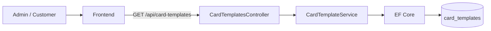
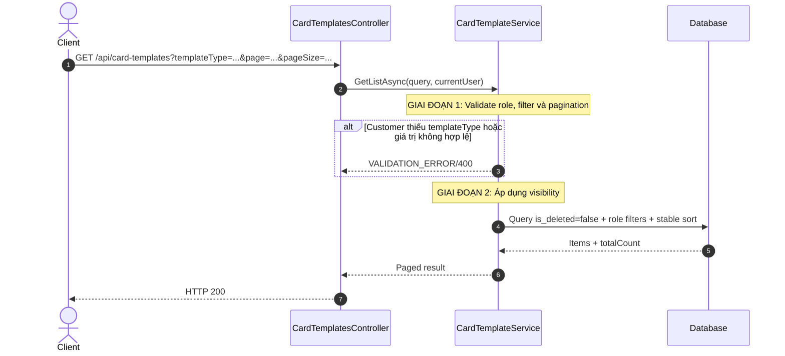
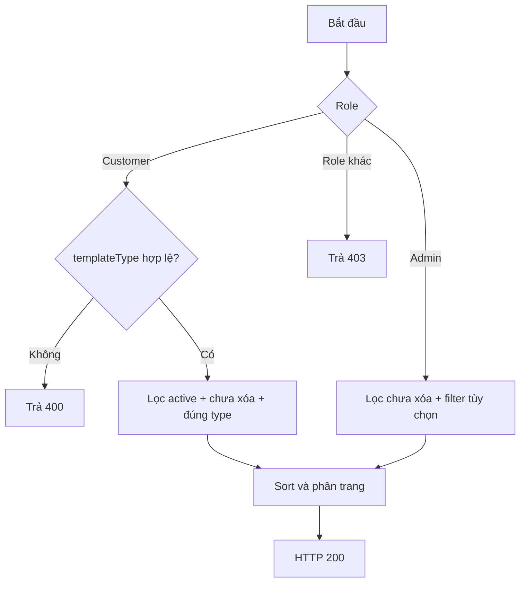
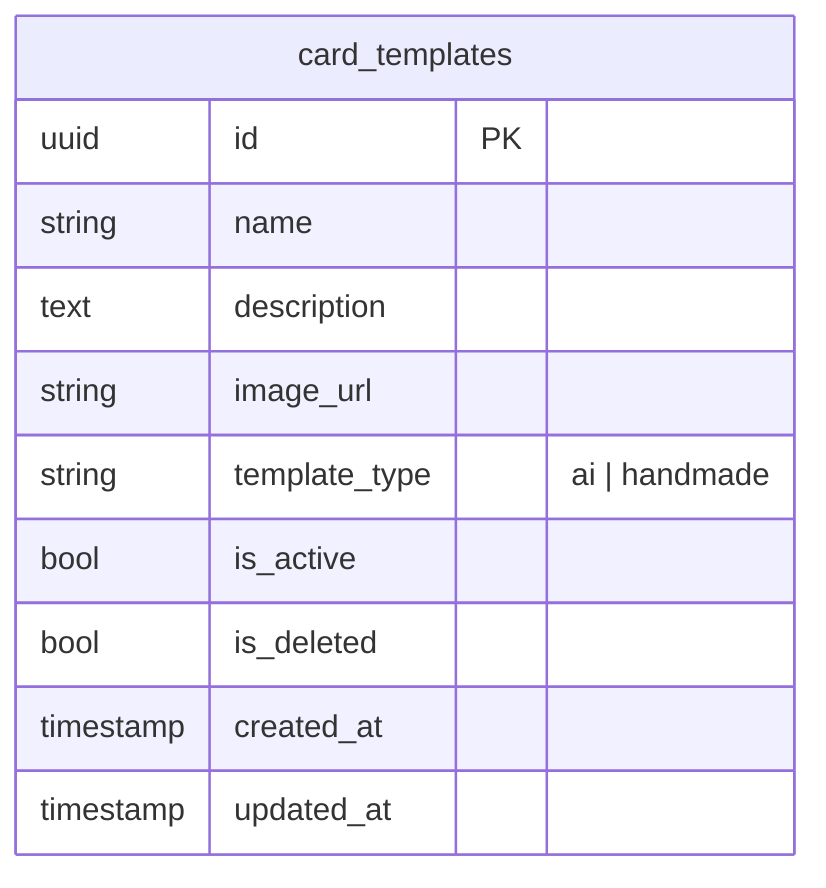

# TDD-022: Lấy danh sách Card Template

## Thông tin tài liệu
- **Tiêu đề**: Lấy danh sách Card Template theo loại và quyền người dùng
- **Ghi chú**: API phục vụ Admin quản lý Template và Customer chọn Template cho Card AI hoặc HandMade. Đây là thiết kế mục tiêu vì code Card Template chưa tồn tại.

## Metadata quản trị tài liệu
| Trường | Giá trị |
|---|---|
| Mã tài liệu | TDD-022 |
| Phiên bản | v0.2 |
| Author | Nguyễn Tùng Dương |
| Reviewer | Tân Trần |
| Approver | Chưa chỉ định |
| Owner | Nguyễn Tùng Dương |
| Cập nhật gần nhất | 2026-09-07 |

---

## BƯỚC 1 — Thông tin & Bối cảnh

### Thông tin tài liệu
- **Mã tài liệu**: TDD-022
- **Tính năng**: Danh sách Card Template
- **Tác giả**: Nguyễn Tùng Dương
- **Người review**: Tân Trần
- **Phiên bản**: v0.2
- **Cập nhật (YYYY-MM-DD)**: 2026-09-07
- **Story liên quan**:
  - STORY-035 — Tạo thiệp thiết kế
  - Chưa có Story riêng cho CRUD Card Template

### Business Rules
- **BR-018-01**: Endpoint yêu cầu đăng nhập; chỉ role Admin hoặc Customer được phép truy cập.
- **BR-018-02**: Chỉ lấy record có column `is_deleted=false`; Template đã soft-delete không xuất hiện với bất kỳ role nào.
- **BR-018-03**: Customer chỉ nhận Template `isActive=true` và bắt buộc truyền `templateType=ai|handmade` để không trộn hai màn chọn Template.
- **BR-018-04**: Admin thấy cả Active và Inactive; `isActive` là filter tùy chọn.
- **BR-018-05**: `templateType` là string lowercase. Admin có thể bỏ filter để xem cả hai loại; nếu truyền chỉ nhận `ai` hoặc `handmade`.
- **BR-018-06**: Hỗ trợ tìm kiếm `search` theo tên sau khi trim, không phân biệt hoa thường.
- **BR-018-07**: Hỗ trợ phân trang `page>=1`; `pageSize` thuộc `5,10,20,30,40,50`, mặc định `page=1`, `pageSize=10`.
- **BR-018-08**: Sắp xếp ổn định theo column `created_at DESC`, sau đó `id DESC`.
- **BR-018-09**: Kết quả rỗng vẫn trả HTTP 200 với `items=[]` và `totalCount=0`.
- **BR-018-10**: Response không trả Template khác loại được yêu cầu; màn AI dùng `templateType=ai`, màn HandMade dùng `templateType=handmade`.

### Bối cảnh & Mục tiêu

**Vấn đề**
> Admin cần xem toàn bộ Template để quản lý, trong khi Customer chỉ được thấy Template đang hoạt động và đúng loại của flow Card đang sử dụng.

**Mục tiêu**
- Cung cấp một API danh sách dùng chung theo role.
- Phân tách chính xác Template AI và HandMade.
- Đảm bảo pagination và sort ổn định.
- Không làm lộ Template inactive hoặc đã xóa cho Customer.

**Ngoài phạm vi** (Out of scope)
- Tạo, cập nhật hoặc xóa Card Template.
- Tạo Card AI/HandMade từ Template được chọn.
- Checkout và Order.

---

## BƯỚC 2 — Kiến trúc & Sơ đồ

### Kiến trúc tổng quan (Architecture)
**Tiêu đề**: Trình tự lấy danh sách Card Template
**Mô tả**: Frontend gửi filter và pagination; Controller xác thực quyền; Service áp dụng rule theo role; Repository/EF Core truy vấn `card_templates`.



**Ghi chú**: Không có cache hoặc API bên thứ ba trong thiết kế hiện tại.

### Sequence Diagram
**Tiêu đề**: Lọc Template theo role và `templateType`
**Mô tả**: Customer bị ép filter Active và phải chọn loại; Admin có thể xem cả hai trạng thái và loại.



**Ghi chú**: Filter Customer truyền cho `isActive` không được nới lỏng rule `isActive=true`.

### Activity Diagram
**Tiêu đề**: Quyết định visibility theo role
**Mô tả**: Mỗi role có tập dữ liệu nhìn thấy khác nhau.



### State Diagram

- **Không áp dụng**: Endpoint chỉ đọc dữ liệu và không chuyển trạng thái Card Template.

### Mô hình dữ liệu (Data Model / ERD)
**Tiêu đề**: Bảng Card Template dùng cho truy vấn danh sách
**Mô tả**: Danh sách đọc trực tiếp từ `card_templates`; column `template_type` là string bắt buộc và bất biến.

**Quy ước**: ERD bên dưới dùng đúng tên table/column PostgreSQL dạng `snake_case`; field query và response dùng `camelCase`.



---

## BƯỚC 3 — API

### API Contract nội bộ

#### Endpoint #1
- **Method**: GET
- **Endpoint**: `/api/card-templates`
- **Tên endpoint**: Lấy danh sách Card Template
- **Mô tả**: Trả danh sách Card Template theo role, loại, trạng thái, tìm kiếm và pagination.

**Query Parameters**

| Field | Type | Required | Mô tả |
|---|---|---:|---|
| `templateType` | string | Customer: Có; Admin: Không | `ai` hoặc `handmade` |
| `isActive` | boolean | Không | Chỉ có hiệu lực với Admin |
| `search` | string | Không | Tìm theo tên sau khi trim |
| `page` | integer | Không | Mặc định 1 |
| `pageSize` | integer | Không | Mặc định 10; nhận 5/10/20/30/40/50 |

**Ví dụ 1 — Customer lấy Template HandMade** — HTTP `200`

```http
GET /api/card-templates?templateType=handmade&page=1&pageSize=10
```

```json
{
  "value": {
    "items": [
      {
        "id": "template-hm-001",
        "name": "Thiệp sinh nhật viết tay",
        "description": "Mẫu thiệp có sẵn",
        "imageUrl": "https://storage.example.com/card-templates/hm-001.png",
        "templateType": "handmade",
        "isActive": true,
        "createdAt": "2026-09-04T08:00:00Z",
        "updatedAt": "2026-09-04T08:00:00Z"
      }
    ],
    "page": 1,
    "pageSize": 10,
    "totalCount": 1
  }
}
```

**Ví dụ 2 — Admin lọc Template AI inactive** — HTTP `200`

```http
GET /api/card-templates?templateType=ai&isActive=false&page=1&pageSize=20
```

Response giữ cùng schema và chỉ chứa `templateType="ai"`, `isActive=false`.

**Ví dụ 3 — Danh sách rỗng** — HTTP `200`

```json
{
  "value": {
    "items": [],
    "page": 1,
    "pageSize": 10,
    "totalCount": 0
  }
}
```

**Ví dụ 4 — Customer không truyền loại Template** — HTTP `400`

```json
{
  "messageCode": "VALIDATION_ERROR",
  "message": "templateType là bắt buộc đối với khách hàng."
}
```

#### Mã lỗi
| Code | HTTP | Khi nào xảy ra |
|---|---:|---|
| `VALIDATION_ERROR` | 400 | `templateType`, `page`, `pageSize` hoặc filter không hợp lệ |
| `UNAUTHORIZED` | 401 | Chưa đăng nhập hoặc tài khoản không hoạt động |
| `FORBIDDEN` | 403 | Role không phải Admin hoặc Customer |
| `INTERNAL_SERVER_ERROR` | 500 | Không thể truy vấn dữ liệu |

### API Contract bên ngoài

- **Không áp dụng**: Endpoint không gọi API bên thứ ba.

---

## BƯỚC 4 — Tham chiếu

### 🔴 Tham chiếu đến
- AI_Card_Context — Quy tắc phân loại `ai|handmade` và visibility cho flow Card.
- AI_DB_Diagram — Schema `card_templates`.

### ⚫ Trỏ vào tài liệu này
- TDD-006 — Chọn Template AI khi tạo Card.
- TDD-021 — Chọn Template HandMade.
- TDD-023 — Lấy chi tiết Card Template.

### ⋯ Bị ảnh hưởng
- TDD-006, TDD-007 và TDD-021 nếu thay đổi filter, trạng thái hoặc giá trị `templateType`.
