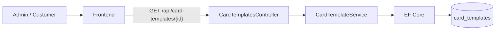
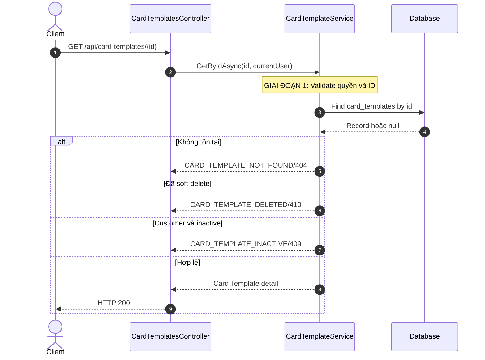
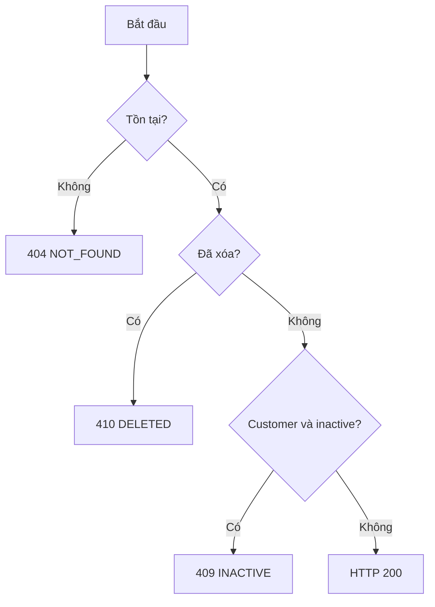
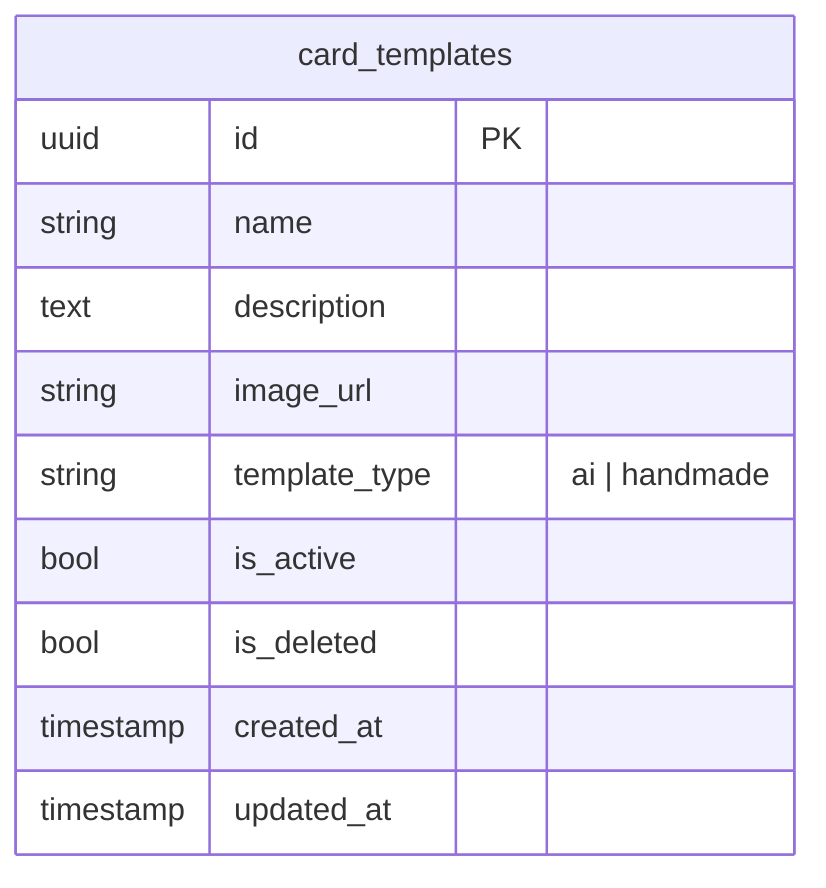

# TDD-023: Lấy chi tiết Card Template

## Thông tin tài liệu
- **Tiêu đề**: Lấy chi tiết một Card Template theo quyền người dùng
- **Ghi chú**: API trả đầy đủ dữ liệu Template để Admin quản lý hoặc Customer xem trước trước khi tạo Card. Đây là thiết kế mục tiêu vì code Card Template chưa tồn tại.

## Metadata quản trị tài liệu
| Trường | Giá trị |
|---|---|
| Mã tài liệu | TDD-023 |
| Phiên bản | v0.2 |
| Author | Nguyễn Tùng Dương |
| Reviewer | Tân Trần |
| Approver | Chưa chỉ định |
| Owner | Nguyễn Tùng Dương |
| Cập nhật gần nhất | 2026-09-07 |

---

## BƯỚC 1 — Thông tin & Bối cảnh

### Thông tin tài liệu
- **Mã tài liệu**: TDD-023
- **Tính năng**: Chi tiết Card Template
- **Tác giả**: Nguyễn Tùng Dương
- **Người review**: Tân Trần
- **Phiên bản**: v0.2
- **Cập nhật (YYYY-MM-DD)**: 2026-09-07
- **Story liên quan**:
  - STORY-035 — Tạo thiệp thiết kế
  - Chưa có Story riêng cho CRUD Card Template

### Business Rules
- **BR-019-01**: Endpoint yêu cầu đăng nhập; chỉ Admin hoặc Customer được truy cập.
- **BR-019-02**: ID không tồn tại trả `CARD_TEMPLATE_NOT_FOUND/404`.
- **BR-019-03**: Template có column `is_deleted=true` trả `CARD_TEMPLATE_DELETED/410` cho mọi role.
- **BR-019-04**: Admin được xem Template Active hoặc Inactive chưa xóa.
- **BR-019-05**: Customer chỉ được xem Template `isActive=true`; Template inactive trả `CARD_TEMPLATE_INACTIVE/409`.
- **BR-019-06**: Response trả đầy đủ `id`, `name`, `description`, `imageUrl`, `templateType`, trạng thái và timestamps.
- **BR-019-07**: `templateType` được trả nguyên dạng lowercase `ai|handmade` từ column `template_type`.

### Bối cảnh & Mục tiêu

**Vấn đề**
> Danh sách chỉ phục vụ chọn nhanh; Admin và Customer cần một contract chi tiết nhất quán nhưng vẫn phải tuân thủ visibility theo role.

**Mục tiêu**
- Trả đúng một Card Template theo ID.
- Bảo vệ Template deleted/inactive khỏi flow Customer.
- Cung cấp dữ liệu đầy đủ để hiển thị preview và form quản trị.

**Ngoài phạm vi** (Out of scope)
- Chỉnh sửa trạng thái hoặc nội dung Template.
- Tạo Card từ Template.
- Trả lịch sử Generated Card đã sử dụng Template.

---

## BƯỚC 2 — Kiến trúc & Sơ đồ

### Kiến trúc tổng quan (Architecture)
**Tiêu đề**: Trình tự lấy chi tiết Card Template
**Mô tả**: Controller nhận ID và phiên đăng nhập; Service load record rồi áp dụng visibility theo role.



**Ghi chú**: Không tải lại file ảnh; response chỉ trả `imageUrl` đã lưu.

### Sequence Diagram
**Tiêu đề**: Kiểm tra tồn tại, soft-delete và trạng thái
**Mô tả**: Thứ tự lỗi cố định giúp các flow Card dùng chung taxonomy.



**Ghi chú**: Admin không bị chặn bởi `isActive=false`.

### Activity Diagram
**Tiêu đề**: Quyết định trả chi tiết Template
**Mô tả**: Thứ tự not-found → deleted → inactive được dùng thống nhất.



### State Diagram

- **Không áp dụng**: Endpoint chỉ đọc và không làm thay đổi vòng đời Template.

### Mô hình dữ liệu (Data Model / ERD)
**Tiêu đề**: Card Template detail
**Mô tả**: API đọc một record trong `card_templates`.

**Quy ước**: ERD bên dưới dùng đúng tên table/column PostgreSQL dạng `snake_case`; field response dùng `camelCase`.



---

## BƯỚC 3 — API

### API Contract nội bộ

#### Endpoint #1
- **Method**: GET
- **Endpoint**: `/api/card-templates/{id}`
- **Tên endpoint**: Lấy chi tiết Card Template
- **Mô tả**: Trả đầy đủ thông tin của một Template mà người dùng hiện tại được phép xem.

**Ví dụ 1 — Lấy chi tiết thành công** — HTTP `200`

```http
GET /api/card-templates/template-hm-001
```

```json
{
  "value": {
    "id": "template-hm-001",
    "name": "Thiệp sinh nhật viết tay",
    "description": "Mẫu thiệp có sẵn",
    "imageUrl": "https://storage.example.com/card-templates/hm-001.png",
    "templateType": "handmade",
    "isActive": true,
    "isDeleted": false,
    "createdAt": "2026-09-04T08:00:00Z",
    "updatedAt": "2026-09-04T08:00:00Z"
  }
}
```

**Ví dụ 2 — Template không tồn tại** — HTTP `404`

```json
{
  "messageCode": "CARD_TEMPLATE_NOT_FOUND",
  "message": "Không tìm thấy mẫu thiệp."
}
```

**Ví dụ 3 — Template đã xóa mềm** — HTTP `410`

```json
{
  "messageCode": "CARD_TEMPLATE_DELETED",
  "message": "Mẫu thiệp đã bị xóa."
}
```

**Ví dụ 4 — Customer xem Template inactive** — HTTP `409`

```json
{
  "messageCode": "CARD_TEMPLATE_INACTIVE",
  "message": "Mẫu thiệp đang bị ngưng hoạt động."
}
```

#### Mã lỗi
| Code | HTTP | Khi nào xảy ra |
|---|---:|---|
| `VALIDATION_ERROR` | 400 | ID không đúng định dạng |
| `UNAUTHORIZED` | 401 | Chưa đăng nhập hoặc tài khoản không hoạt động |
| `FORBIDDEN` | 403 | Role không được phép truy cập |
| `CARD_TEMPLATE_NOT_FOUND` | 404 | Không có Template theo ID |
| `CARD_TEMPLATE_DELETED` | 410 | Template đã soft-delete |
| `CARD_TEMPLATE_INACTIVE` | 409 | Customer truy cập Template inactive |
| `INTERNAL_SERVER_ERROR` | 500 | Không thể truy vấn dữ liệu |

### API Contract bên ngoài

- **Không áp dụng**: Endpoint không gọi API bên thứ ba.

---

## BƯỚC 4 — Tham chiếu

### 🔴 Tham chiếu đến
- TDD-022 — Cùng visibility/filter của danh sách Card Template.
- AI_DB_Diagram — Schema `card_templates`.

### ⚫ Trỏ vào tài liệu này
- TDD-025 — Form Admin tải dữ liệu trước khi cập nhật.

### ⋯ Bị ảnh hưởng
- TDD-006, TDD-007 và TDD-021 nếu thay đổi taxonomy trạng thái Template.
