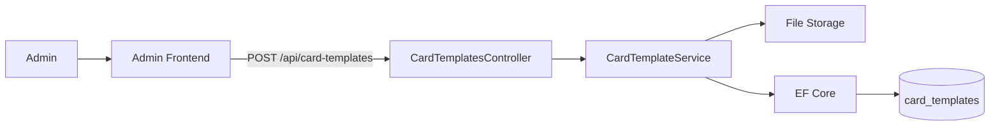
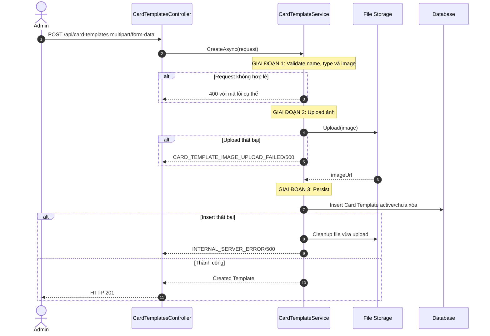
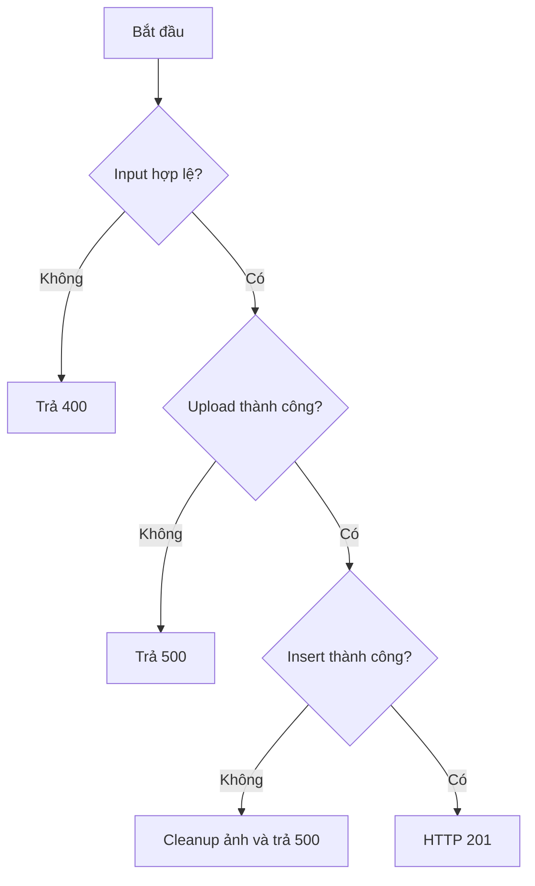
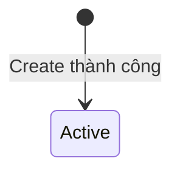
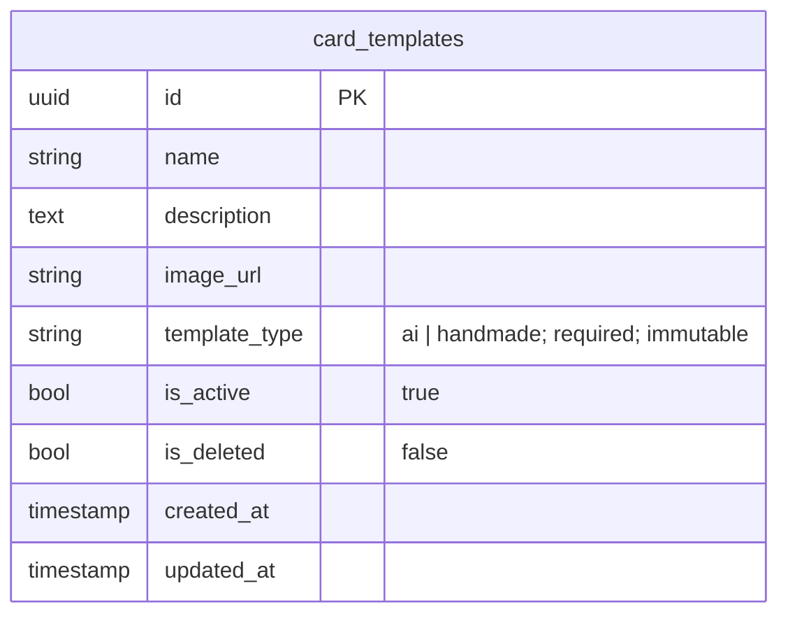

# TDD-024: Tạo Card Template

## Thông tin tài liệu
- **Tiêu đề**: Admin tạo Card Template AI hoặc HandMade
- **Ghi chú**: API tạo Template mới, upload ảnh và lưu discriminator `templateType`. Đây là thiết kế mục tiêu vì code Card Template chưa tồn tại.

## Metadata quản trị tài liệu
| Trường | Giá trị |
|---|---|
| Mã tài liệu | TDD-024 |
| Phiên bản | v0.2 |
| Author | Nguyễn Tùng Dương |
| Reviewer | Tân Trần |
| Approver | Chưa chỉ định |
| Owner | Nguyễn Tùng Dương |
| Cập nhật gần nhất | 2026-09-07 |

---

## BƯỚC 1 — Thông tin & Bối cảnh

### Thông tin tài liệu
- **Mã tài liệu**: TDD-024
- **Tính năng**: Tạo Card Template
- **Tác giả**: Nguyễn Tùng Dương
- **Người review**: Tân Trần
- **Phiên bản**: v0.2
- **Cập nhật (YYYY-MM-DD)**: 2026-09-07
- **Story liên quan**:
  - STORY-035 — Tạo thiệp thiết kế
  - Chưa có Story riêng cho CRUD Card Template

### Business Rules
- **BR-020-01**: Chỉ Admin đã đăng nhập và có tài khoản hoạt động được gọi API.
- **BR-020-02**: `name` bắt buộc, trim trước khi lưu và không được chỉ chứa khoảng trắng.
- **BR-020-03**: `description` là tùy chọn.
- **BR-020-04**: `templateType` bắt buộc, là string lowercase và chỉ nhận `ai` hoặc `handmade`.
- **BR-020-05**: Ảnh bắt buộc, chỉ chấp nhận PNG/JPG và dung lượng tối đa 10 MB.
- **BR-020-06**: Hệ thống upload ảnh thành công trước khi insert DB và chỉ lưu URL vào column `image_url`.
- **BR-020-07**: Template mới mặc định `isActive=true`, `isDeleted=false`; client không được truyền hai field này trong Create.
- **BR-020-08**: `templateType` được lưu trực tiếp vào column `template_type`; Card Template không có field `metadata`.
- **BR-020-09**: Nếu upload thành công nhưng insert DB thất bại, service phải xóa file vừa upload hoặc đưa vào cơ chế cleanup để không tạo orphan file.
- **BR-020-10**: Không áp dụng uniqueness theo `name`; nhiều Template có thể trùng tên nhưng có ID riêng.

### Bối cảnh & Mục tiêu

**Vấn đề**
> Admin cần quản lý chung Template phục vụ AI và mẫu thiệp HandMade, đồng thời hệ thống phải phân loại chúng bằng một field ổn định.

**Mục tiêu**
- Tạo Template với tên, mô tả và ảnh hợp lệ.
- Lưu `templateType` lowercase, bắt buộc.
- Thiết lập trạng thái mặc định nhất quán.
- Không để lại file rác khi persistence thất bại.

**Ngoài phạm vi** (Out of scope)
- Thay đổi Template sau khi tạo.
- Tạo Card AI/HandMade.
- Tạo thumbnail hoặc xử lý ảnh nâng cao.
- Unit Test.

---

## BƯỚC 2 — Kiến trúc & Sơ đồ

### Kiến trúc tổng quan (Architecture)
**Tiêu đề**: Trình tự tạo Card Template
**Mô tả**: Controller nhận multipart request; Service validate dữ liệu, upload ảnh qua File Storage rồi lưu record bằng EF Core.



**Ghi chú**: File Storage là abstraction nội bộ; nhà cung cấp storage cụ thể chưa được chốt trong codebase.

### Sequence Diagram
**Tiêu đề**: Validate, upload và persist Template
**Mô tả**: DB chỉ được ghi sau khi validation và upload thành công.



**Ghi chú**: Không gọi AI hoặc System Prompt trong CRUD Template.

### Activity Diagram
**Tiêu đề**: Quyết định tạo Template
**Mô tả**: Chỉ persist sau khi tất cả input và ảnh hợp lệ.



### State Diagram
**Tiêu đề**: Trạng thái khởi tạo Card Template
**Mô tả**: Create luôn tạo record Active và chưa xóa.



### Mô hình dữ liệu (Data Model / ERD)
**Tiêu đề**: Record Card Template mới
**Mô tả**: Column `template_type` là string bắt buộc; dữ liệu cũ được backfill `ai` theo AI_DB_Diagram.

**Quy ước**: ERD bên dưới dùng đúng tên table/column PostgreSQL dạng `snake_case`; field request và response dùng `camelCase`.



---

## BƯỚC 3 — API

### API Contract nội bộ

#### Endpoint #1
- **Method**: POST
- **Endpoint**: `/api/card-templates`
- **Tên endpoint**: Tạo Card Template
- **Mô tả**: Admin upload ảnh và tạo Template AI hoặc HandMade.

**Request Body — `multipart/form-data`**

| Field | Type | Required | Mô tả |
|---|---|---:|---|
| `name` | string | Có | Tên sau khi trim không được rỗng |
| `description` | string | Không | Mô tả Template |
| `templateType` | string | Có | Lowercase `ai` hoặc `handmade` |
| `image` | file | Có | PNG/JPG, tối đa 10 MB |

**Ví dụ 1 — Tạo Template HandMade thành công** — HTTP `201`

```http
POST /api/card-templates
Content-Type: multipart/form-data

name: Thiệp sinh nhật viết tay
description: Mẫu thiệp có sẵn do Admin thiết kế
templateType: handmade
image: [hm-birthday.png]
```

```json
{
  "value": {
    "id": "template-hm-001",
    "name": "Thiệp sinh nhật viết tay",
    "description": "Mẫu thiệp có sẵn do Admin thiết kế",
    "imageUrl": "https://storage.example.com/card-templates/hm-birthday.png",
    "templateType": "handmade",
    "isActive": true,
    "isDeleted": false,
    "createdAt": "2026-09-04T08:00:00Z",
    "updatedAt": "2026-09-04T08:00:00Z"
  }
}
```

**Ví dụ 2 — `templateType` không hợp lệ** — HTTP `400`

```json
{
  "messageCode": "CARD_TEMPLATE_TYPE_INVALID",
  "message": "templateType chỉ nhận giá trị lowercase ai hoặc handmade."
}
```

**Ví dụ 3 — Thiếu ảnh** — HTTP `400`

```json
{
  "messageCode": "CARD_TEMPLATE_IMAGE_REQUIRED",
  "message": "Ảnh mẫu thiệp là bắt buộc."
}
```

#### Mã lỗi
| Code | HTTP | Khi nào xảy ra |
|---|---:|---|
| `VALIDATION_ERROR` | 400 | Tên rỗng hoặc request field không hợp lệ |
| `CARD_TEMPLATE_TYPE_INVALID` | 400 | Type khác lowercase `ai|handmade` |
| `CARD_TEMPLATE_IMAGE_REQUIRED` | 400 | Không truyền ảnh |
| `CARD_TEMPLATE_IMAGE_TYPE_INVALID` | 400 | Ảnh không phải PNG/JPG |
| `CARD_TEMPLATE_IMAGE_TOO_LARGE` | 400 | Ảnh lớn hơn 10 MB |
| `UNAUTHORIZED` | 401 | Admin chưa đăng nhập hoặc tài khoản không hoạt động |
| `FORBIDDEN` | 403 | Người gọi không có role Admin |
| `CARD_TEMPLATE_IMAGE_UPLOAD_FAILED` | 500 | Storage không upload được ảnh |
| `INTERNAL_SERVER_ERROR` | 500 | Không insert được record |

### API Contract bên ngoài

- **Không áp dụng**: File Storage được xem là abstraction nội bộ; chưa có contract nhà cung cấp bên thứ ba.

---

## BƯỚC 4 — Tham chiếu

### 🔴 Tham chiếu đến
- AI_Card_Context — Quy tắc `templateType` và hai flow Card.
- AI_DB_Diagram — Schema, backfill và ràng buộc discriminator.

### ⚫ Trỏ vào tài liệu này
- TDD-022 — Template mới xuất hiện trong danh sách theo filter.
- TDD-025 — Cập nhật Template đã tạo.
- TDD-026 — Xóa mềm Template.

### ⋯ Bị ảnh hưởng
- TDD-006 và TDD-021 nếu thay đổi giá trị `templateType`, ảnh hoặc trạng thái mặc định.
