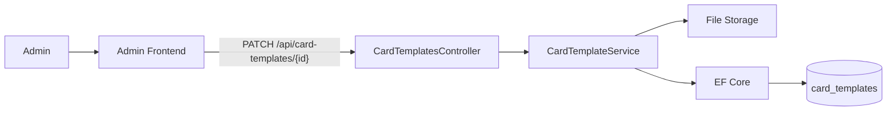
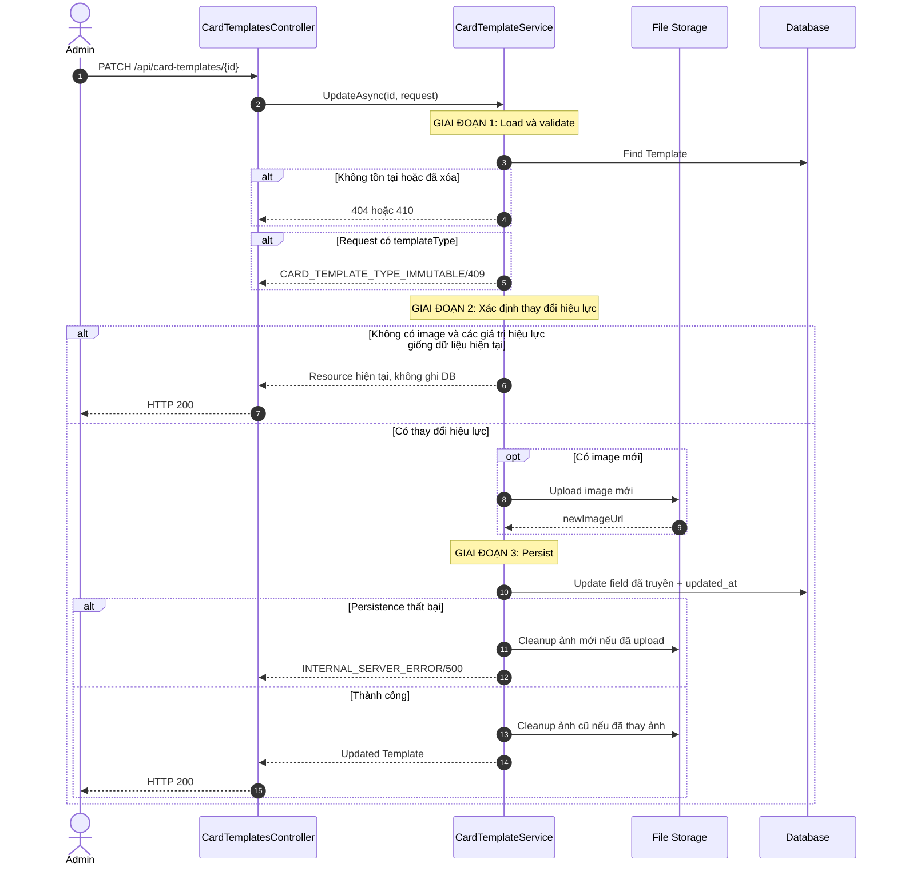
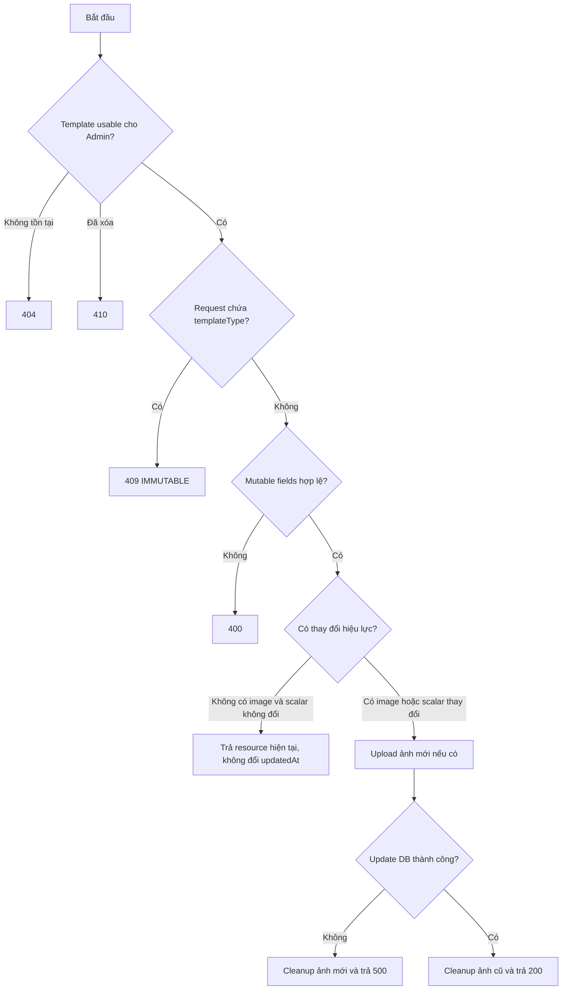
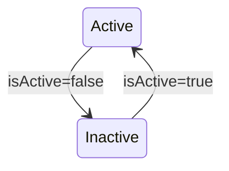
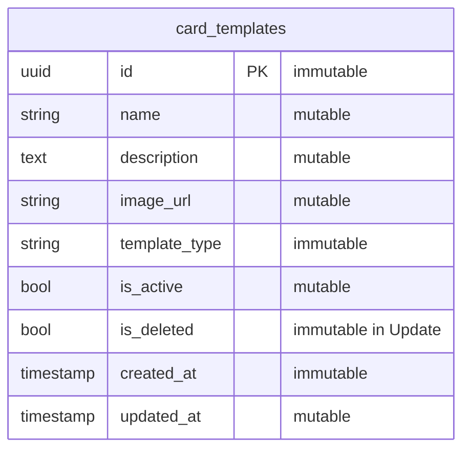

# TDD-025: Cập nhật Card Template

## Thông tin tài liệu
- **Tiêu đề**: Admin cập nhật nội dung, ảnh hoặc trạng thái Card Template
- **Ghi chú**: API partial update Template nhưng giữ `templateType` bất biến. Đây là thiết kế mục tiêu vì code Card Template chưa tồn tại.

## Metadata quản trị tài liệu
| Trường | Giá trị |
|---|---|
| Mã tài liệu | TDD-025 |
| Phiên bản | v0.2 |
| Author | Nguyễn Tùng Dương |
| Reviewer | Tân Trần |
| Approver | Chưa chỉ định |
| Owner | Nguyễn Tùng Dương |
| Cập nhật gần nhất | 2026-09-07 |

---

## BƯỚC 1 — Thông tin & Bối cảnh

### Thông tin tài liệu
- **Mã tài liệu**: TDD-025
- **Tính năng**: Cập nhật Card Template
- **Tác giả**: Nguyễn Tùng Dương
- **Người review**: Tân Trần
- **Phiên bản**: v0.2
- **Cập nhật (YYYY-MM-DD)**: 2026-09-07
- **Story liên quan**:
  - Chưa có Story riêng cho CRUD Card Template

### Business Rules
- **BR-021-01**: Chỉ Admin đã đăng nhập và có tài khoản hoạt động được gọi API.
- **BR-021-02**: Template không tồn tại trả `CARD_TEMPLATE_NOT_FOUND/404`; đã soft-delete trả `CARD_TEMPLATE_DELETED/410`.
- **BR-021-03**: Request cho phép cập nhật `name`, `description`, `image`, `isActive` và phải chứa ít nhất một field trong nhóm này. Field không xuất hiện trong request phải giữ nguyên giá trị hiện tại; không được gán `null` hoặc giá trị mặc định ngoài ý muốn.
- **BR-021-04**: `templateType` không thuộc Update request. Nếu client truyền field này, kể cả cùng giá trị hiện tại, trả `CARD_TEMPLATE_TYPE_IMMUTABLE/409`.
- **BR-021-05**: `name` nếu truyền phải trim và không được rỗng. `description` nếu truyền được trim; chuỗi rỗng hoặc chỉ có khoảng trắng đặt `description=null`.
- **BR-021-06**: Ảnh mới nếu truyền chỉ nhận PNG/JPG, tối đa 10 MB. Không truyền ảnh thì giữ nguyên `imageUrl`; không hỗ trợ xóa ảnh khỏi Template.
- **BR-021-07**: Nếu thay ảnh, upload ảnh mới trước; chỉ xóa ảnh cũ sau khi DB update thành công.
- **BR-021-08**: Nếu upload ảnh mới thành công nhưng DB update thất bại, cleanup ảnh mới và giữ nguyên record/ảnh cũ.
- **BR-021-09**: `isActive=false` làm Template biến mất khỏi danh sách Customer và không được chọn cho Create/Regenerate mới; snapshot lịch sử vẫn sử dụng được theo policy của TDD-007.
- **BR-021-10**: Cập nhật column `updated_at` bằng UTC khi persistence thực sự thay đổi dữ liệu; không đổi `created_at`, `id`, `template_type` hoặc `is_deleted`.
- **BR-021-11**: Nếu request không có `image` và mọi giá trị hiệu lực của `name`, `description`, `isActive` đều giống dữ liệu hiện tại, trả HTTP 200 với resource hiện tại, không ghi DB và không đổi `updatedAt`. `image` được truyền luôn được xem là yêu cầu thay ảnh.
- **BR-021-12**: Request DTO/binder phải biểu diễn được sự vắng mặt của field; riêng `isActive` phải nullable để phân biệt “không truyền” với `false`, còn `description` phải kiểm tra sự hiện diện của key trong form để phân biệt “không truyền” với chuỗi rỗng dùng để xóa. Chưa áp dụng optimistic concurrency; cập nhật đồng thời dùng last-write-wins trên các field được truyền.

### Bối cảnh & Mục tiêu

**Vấn đề**
> Admin cần chỉnh nội dung, ảnh và khả năng sử dụng của Template, nhưng việc đổi loại AI/HandMade sau khi Template đã được dùng sẽ làm sai snapshot và luồng nghiệp vụ.

**Mục tiêu**
- Cho phép cập nhật các field có thể thay đổi.
- Giữ `templateType` bất biến.
- Thay ảnh an toàn, không mất ảnh cũ khi persistence lỗi.
- Giữ snapshot lịch sử không bị ảnh hưởng bởi dữ liệu live mới.

**Ngoài phạm vi** (Out of scope)
- Khôi phục Template đã soft-delete.
- Thay đổi `templateType`.
- Cập nhật Generated Card hoặc history đã tồn tại.
- Unit Test.

---

## BƯỚC 2 — Kiến trúc & Sơ đồ

### Kiến trúc tổng quan (Architecture)
**Tiêu đề**: Trình tự cập nhật Card Template
**Mô tả**: Service load record, validate patch, upload ảnh mới nếu có, update DB rồi mới cleanup ảnh cũ.



**Ghi chú**: Snapshot trong Generated Card/history không được update theo Template live.

### Sequence Diagram
**Tiêu đề**: Cập nhật Template và thay ảnh an toàn
**Mô tả**: Ảnh cũ chỉ bị cleanup sau khi DB đã trỏ tới URL mới thành công.



**Ghi chú**: Cleanup ảnh cũ thất bại không rollback DB; file cũ được đưa vào cơ chế cleanup lại.

### Activity Diagram
**Tiêu đề**: Quyết định cập nhật Template
**Mô tả**: `templateType` bị chặn trước upload và persistence.



### State Diagram
**Tiêu đề**: Chuyển trạng thái Active/Inactive
**Mô tả**: Update chỉ chuyển giữa Active và Inactive; Deleted không thể cập nhật.



### Mô hình dữ liệu (Data Model / ERD)
**Tiêu đề**: Mutable và immutable fields của Card Template
**Mô tả**: `template_type`, `id`, `created_at`, `is_deleted` không được Update thay đổi.

**Quy ước**: ERD bên dưới dùng đúng tên table/column PostgreSQL dạng `snake_case`; field request và response dùng `camelCase`.



---

## BƯỚC 3 — API

### API Contract nội bộ

#### Endpoint #1
- **Method**: PATCH
- **Endpoint**: `/api/card-templates/{id}`
- **Tên endpoint**: Cập nhật Card Template
- **Mô tả**: Admin cập nhật một phần các field mutable của Template; field không truyền giữ nguyên và không cho đổi `templateType`.

**Request Body — `multipart/form-data`**

| Field | Type | Required | Mô tả |
|---|---|---:|---|
| `name` | string | Không | Nếu truyền, trim và không rỗng |
| `description` | string | Không | Nếu truyền, trim; rỗng/blank đặt `null`; không truyền thì giữ nguyên |
| `image` | file | Không | PNG/JPG, tối đa 10 MB |
| `isActive` | boolean | Không | Bật/tắt khả năng dùng cho flow mới; DTO dùng nullable boolean |
| `templateType` | — | Không cho phép | Discriminator bất biến |

**Ví dụ 1 — Cập nhật tên, ảnh và trạng thái** — HTTP `200`

```http
PATCH /api/card-templates/template-hm-001
Content-Type: multipart/form-data

name: Thiệp sinh nhật viết tay mới
isActive: false
image: [hm-birthday-v2.png]
```

```json
{
  "value": {
    "id": "template-hm-001",
    "name": "Thiệp sinh nhật viết tay mới",
    "description": "Mẫu thiệp có sẵn do Admin thiết kế",
    "imageUrl": "https://storage.example.com/card-templates/hm-birthday-v2.png",
    "templateType": "handmade",
    "isActive": false,
    "isDeleted": false,
    "createdAt": "2026-09-04T08:00:00Z",
    "updatedAt": "2026-09-04T09:00:00Z"
  }
}
```

Các field không truyền, gồm `description`, được lấy từ record hiện tại và không bị gán `null`.

**Ví dụ 2 — Cố đổi `templateType`** — HTTP `409`

```json
{
  "messageCode": "CARD_TEMPLATE_TYPE_IMMUTABLE",
  "message": "Không được thay đổi templateType của mẫu thiệp đã tạo."
}
```

**Ví dụ 3 — Request không có field cập nhật** — HTTP `400`

```json
{
  "messageCode": "VALIDATION_ERROR",
  "message": "Cần truyền ít nhất một field được phép cập nhật."
}
```

**Ví dụ 4 — Template đã xóa** — HTTP `410`

```json
{
  "messageCode": "CARD_TEMPLATE_DELETED",
  "message": "Mẫu thiệp đã bị xóa và không thể cập nhật."
}
```

#### Mã lỗi
| Code | HTTP | Khi nào xảy ra |
|---|---:|---|
| `VALIDATION_ERROR` | 400 | Không có field cập nhật, tên rỗng hoặc input sai |
| `CARD_TEMPLATE_IMAGE_TYPE_INVALID` | 400 | Ảnh mới không phải PNG/JPG |
| `CARD_TEMPLATE_IMAGE_TOO_LARGE` | 400 | Ảnh mới lớn hơn 10 MB |
| `UNAUTHORIZED` | 401 | Admin chưa đăng nhập hoặc tài khoản không hoạt động |
| `FORBIDDEN` | 403 | Người gọi không có role Admin |
| `CARD_TEMPLATE_NOT_FOUND` | 404 | Template không tồn tại |
| `CARD_TEMPLATE_DELETED` | 410 | Template đã soft-delete |
| `CARD_TEMPLATE_TYPE_IMMUTABLE` | 409 | Request truyền `templateType` |
| `CARD_TEMPLATE_IMAGE_UPLOAD_FAILED` | 500 | Không upload được ảnh mới |
| `INTERNAL_SERVER_ERROR` | 500 | Không cập nhật được DB |

### API Contract bên ngoài

- **Không áp dụng**: File Storage là abstraction nội bộ; chưa có contract đối tác cụ thể.

---

## BƯỚC 4 — Tham chiếu

### 🔴 Tham chiếu đến
- TDD-023 — Chi tiết Template và taxonomy not-found/deleted.
- TDD-024 — Validation name và image.
- AI_Card_Context — Template type bất biến và snapshot policy.

### ⚫ Trỏ vào tài liệu này
- TDD-022 — Visibility danh sách thay đổi theo `isActive`.
- TDD-006, TDD-007, TDD-021 — Admission validation của flow Card.

### ⋯ Bị ảnh hưởng
- TDD-006 và TDD-021 khi thay đổi ảnh/trạng thái Template dùng cho request mới.
- TDD-007 không bị trạng thái live của Template nguồn làm hỏng snapshot cũ.
