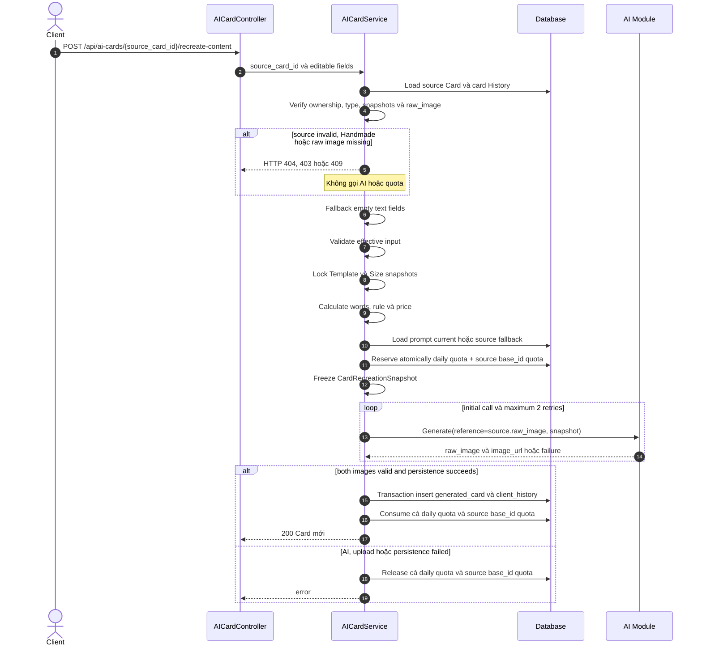

# TDD-027: Tạo lại thiệp AI, giữ thiết kế gốc và thay nội dung

## Thông tin tài liệu

| Trường | Giá trị |
|---|---|
| Mã tài liệu | TDD-027 |
| Tính năng | Tạo phiên bản Card AI mới từ History, dùng ảnh gốc làm tham chiếu |
| Phiên bản | v1.1 |
| Author | Nguyễn Tùng Dương |
| Reviewer | Tân Trần |
| Owner | Nguyễn Tùng Dương |
| Cập nhật gần nhất | 2026-09-07 |
| Priority | Must |

---

## BƯỚC 1 — Bối cảnh, mục tiêu và phạm vi

Khách hàng chọn một Card AI trong lịch sử vì muốn giữ phong cách/thiết kế của thiệp đó, nhưng thay thông tin cá nhân hóa. Hệ thống tạo **một Card AI mới**, dùng ảnh chưa chèn chữ của Card nguồn (`raw_image`) làm ảnh tham chiếu cho AI. AI phải trả cả ảnh gốc mới và ảnh đã chèn chữ; hai ảnh đều được lưu.

TDD này là flow độc lập với TDD-007. TDD-007 giữ nguyên nội dung và cho đổi Template; TDD-027 khóa Template/Size của Card nguồn và cho sửa nội dung cùng các thuộc tính còn lại.

### Mục tiêu

- Chỉ cho phép tạo lại từ Card AI thuộc History của chính khách hàng.
- Khóa Template và Size theo snapshot Card nguồn, không query/validate trạng thái live của hai dependency này.
- Cho client sửa `sender_name`, `receiver_name`, `message_content`, `form_type` và `attached_image_url`; trường không truyền/null/rỗng/chỉ chứa khoảng trắng dùng lại giá trị từ Card nguồn.
- Validate các giá trị hiệu lực và tính word count, calligraphy rule, giá, snapshot như flow tạo Card AI mới (TDD-006).
- Dùng `raw_image` của Card nguồn làm ảnh tham chiếu. Card nguồn thiếu `raw_image` bị chặn bằng lỗi nghiệp vụ riêng.
- Giữ cùng quy tắc quota, reserve atomic, tối đa một lần gọi đầu + hai retry, và release quota khi AI/persistence thất bại.
- Ghi History mới với `base_id` **kế thừa base_id gốc của History Card được chọn**; không biến `base_id` thành ID của generated card.

### Ngoài phạm vi

- Thay đổi flow Order/Checkout; request tạo lại không kiểm tra Product/Mockup nguồn để chặn.
- Định lượng hoặc cam kết tỷ lệ giống thiết kế (ví dụ 90%); đó là trách nhiệm prompt/model của AI Module.
- Chỉnh sửa Card nguồn.
- Unit Test artifacts: TDD này không tạo thư mục `ut` theo phạm vi đã chốt.

---

## BƯỚC 2 — Quy tắc nghiệp vụ

### 2.1 Dữ liệu và tương thích

- **BR-023-01:** Bổ sung cột `generated_cards.raw_image varchar null`, lưu URL ảnh gốc do AI sinh ra trước bước chèn chữ. `image_url` tiếp tục là URL ảnh hoàn chỉnh có chữ. Cột nullable chỉ để tương thích record cũ; mọi Card AI tạo mới thành công sau khi triển khai phải có cả `raw_image` và `image_url` hợp lệ.
- **BR-023-02:** AI Module trả một cặp kết quả bất khả phân: `raw_image` và `image_url`. Một attempt chỉ thành công khi cả hai ảnh hợp lệ và được upload/lưu thành công. Không được persist Card/History với chỉ một ảnh.
- **BR-023-03:** `raw_image` được trả trong DTO Card/API response cho owner để UI có thể dùng khi cần; API list/history không được làm lộ ảnh của user khác.

### 2.2 Admission và nguồn Card

- **BR-023-04:** Endpoint yêu cầu đăng nhập. `source_card_id` là `generated_cards.id`, được lấy từ `client_histories.output_id` của item Card mà người dùng chọn.
- **BR-023-05:** Source phải tồn tại, có `generated_cards.card_type="ai"`, thuộc user hiện tại và có đúng History của user với `type="card"`, `output_id=source_card_id`, snapshot đủ dùng. Source HandMade trả `HANDMADE_CARD_RECREATE_NOT_SUPPORTED/409`.
- **BR-023-06:** Source Card không có `raw_image` hoặc URL ảnh không usable trả `CARD_SOURCE_RAW_IMAGE_MISSING/409`, trước quota và trước AI. Không fallback sang `image_url` đã chèn chữ.
- **BR-023-07:** `base_id` của History mới bằng `base_id` của History nguồn. `output_id` bằng ID Card mới. `input.source_card_id` và `metadata.recreated_from_card_id` lưu ID Card đã chọn để biểu diễn quan hệ trực tiếp.
- **BR-023-08:** Không validate live Product, Generated Flower, Template nguồn hoặc Size nguồn. Trạng thái inactive/soft-delete của Template/Size/Product/Mockup sau khi Card nguồn đã được tạo không chặn flow này.

### 2.3 Các trường được khóa và trường được chỉnh sửa

- **BR-023-09:** Client không được gửi `card_template_id`, `size`, `size_key`, `product_id`, hoặc `generated_flower_id`. Nếu gửi bất kỳ field nào, trả `RECREATE_LOCKED_FIELD_NOT_ALLOWED/400`. Template snapshot và toàn bộ Size snapshot bắt buộc lấy từ Card/History nguồn.
- **BR-023-10:** Client có thể gửi `sender_name`, `receiver_name`, `message_content`, `form_type`, `attached_image_url`. Với ba trường text, field không có mặt, `null`, `""`, hoặc sau trim không còn ký tự đều dùng giá trị tương ứng của Card nguồn. Giá trị không rỗng sau fallback được validate như TDD-006: sender/receiver tối đa 20 từ; message theo giới hạn Size snapshot.
- **BR-023-11:** `form_type` không truyền/null dùng nguồn; giá trị khác chỉ nhận `go_may` hoặc `calligraphy`. `attached_image_url` không truyền dùng nguồn, `null` nghĩa là chủ động bỏ ảnh đính kèm, và URL không rỗng phải thỏa validation upload/URL của Card Create.
- **BR-023-12:** Size snapshot nguồn quyết định `size_key`, `size_name`, `size_width`, `size_height`, `size_base_price`, `size_max_words`. Hệ thống không load Config size live.
- **BR-023-13:** Sau khi resolve các trường hiệu lực, hệ thống tính lại `word_count`; với `calligraphy`, validate Config Calligraphy live và áp dụng rule hiện hành để tạo `word_config_snapshot`, `extra_price`, `base_price`, `total_price` theo cùng quy tắc Card Create. Với `go_may`, `extra_price=0`; giá mới không sao chép từ Card nguồn.
- **BR-023-14:** Nếu Card nguồn không chứa dữ liệu snapshot tối thiểu cần để validate/tính giá theo BR-023-10 đến BR-023-13, trả `CARD_SOURCE_HISTORY_INVALID/409`.

### 2.4 Snapshot, AI, quota và persistence

- **BR-023-15:** Sau admission, service tạo immutable `CardRecreationSnapshot`: source Card/History ID và raw-image reference (URL/object key/version/hash nếu có), Template snapshot nguồn, Size snapshot nguồn, input hiệu lực, Calligraphy/pricing snapshot mới, full system prompt hiện hành, và `validated_at` UTC.
- **BR-023-16:** System prompt áp dụng đúng policy Card Create: prompt hiện hành type `card` phải tồn tại và có content hợp lệ. Không fallback sang prompt Card nguồn; thiếu/rỗng/không hợp lệ trả `SYSTEM_PROMPT_INVALID/409`.
- **BR-023-17:** Sau dependency validation và trước AI, reserve atomically quota Card theo ngày (10 lượt/user/ngày) và quota theo `base_id` nguồn (3 lượt/user/base_id/ngày). `base_id` kế thừa có thể là `products.id` hoặc `generated_flowers.id`; cả hai dùng chung quota và quy tắc. Không reserve được toàn bộ thì không giữ slot nào, không gọi AI và trả `FORBIDDEN/403`.
- **BR-023-18:** Mỗi request được gọi AI một lần đầu và tối đa hai retry. Mọi attempt dùng đúng cùng `CardRecreationSnapshot`, gồm cùng raw-image source, template/size snapshots và input hiệu lực; không revalidate/tải lại dependency giữa các retry.
- **BR-023-19:** AI Module nhận raw-image reference như image-to-image reference cùng prompt và thông tin chèn chữ, sau đó trả `{ raw_image, image_url }`. Mục tiêu giữ đặc trưng thiết kế là chỉ dẫn cho AI Module, không phải điều kiện xác nhận định lượng ở service.
- **BR-023-20:** AI thất bại sau retry, một ảnh trả về thiếu/invalid, upload bất cứ ảnh nào thất bại, hoặc transaction persistence thất bại: release toàn bộ quota slot; không tạo `generated_cards` hay `client_histories`.
- **BR-023-21:** Transaction thành công phải tạo đồng thời một `generated_cards(card_type="ai")` mới có `raw_image` và `image_url`, cùng một `client_histories(type="card")` mới. Sau đó consume đúng các quota slot đã reserve. Không ghi đè/xóa Card hoặc History nguồn.
- **BR-023-22:** Result mới không tự gắn Checkout/Order. Các điều kiện Order không thuộc admission flow này.

---

## BƯỚC 3 — Luồng và kiến trúc



### Thứ tự xử lý bắt buộc

`auth/request-shape → source Card + History + ownership/type → raw_image → lấy base_id kế thừa làm quota source key → resolve/fallback editable fields → validate input → lock Template/Size snapshot → calculate Calligraphy/pricing → system prompt current → reserve atomically daily quota + source base_id quota → immutable snapshot → AI/retry → transaction Card+History → consume cả hai quota`.

Không được kiểm Template/Size live ở bất kỳ vị trí nào của thứ tự trên.

---

## BƯỚC 4 — API contract

### Endpoint

`POST /api/ai-cards/{source_card_id}/recreate-content`

`source_card_id` là ID của `generated_cards` trong `client_histories.output_id`, không phải History ID.

### Request body

| Field | Type | Required | Quy tắc |
|---|---|---:|---|
| `sender_name` | string/null | Không | Null/rỗng/blank dùng source; nếu có giá trị thì validate tối đa 20 từ |
| `receiver_name` | string/null | Không | Null/rỗng/blank dùng source; nếu có giá trị thì validate tối đa 20 từ |
| `message_content` | string/null | Không | Null/rỗng/blank dùng source; sau fallback validate theo Size snapshot |
| `form_type` | `go_may`/`calligraphy`/null | Không | Null/không truyền dùng source; giá trị khác bị từ chối |
| `attached_image_url` | string/null | Không | Không truyền dùng source; `null` bỏ ảnh nguồn; URL không rỗng áp dụng validation của Card Create |

Các field bị khóa: `card_template_id`, `size`, `size_key`, `product_id`, `generated_flower_id`.

```http
POST /api/ai-cards/550e8400-e29b-41d4-a716-446655440001/recreate-content
Content-Type: application/json

{
  "sender_name": "Minh Anh",
  "receiver_name": "Ngọc Lan",
  "message_content": "Chúc bạn luôn rạng rỡ và hạnh phúc.",
  "form_type": "go_may",
  "attached_image_url": null
}
```

`attached_image_url: null` trong ví dụ chủ động bỏ ảnh đính kèm của Card nguồn. Nếu không gửi field này, hệ thống dùng lại ảnh nguồn.

### Response thành công — HTTP 200

```json
{
  "value": {
    "id": "880e8400-e29b-41d4-a716-446655440099",
    "card_type": "ai",
    "image_url": "https://storage.example.com/cards/880e8400-final.png",
    "raw_image": "https://storage.example.com/cards/880e8400-raw.png",
    "sender_name": "Minh Anh",
    "receiver_name": "Ngọc Lan",
    "message_content": "Chúc bạn luôn rạng rỡ và hạnh phúc.",
    "form_type": "go_may",
    "size_key": "size_A",
    "size_name": "A",
    "base_price": 100000,
    "extra_price": 0,
    "total_price": 100000,
    "created_at": "2026-09-05T10:00:00Z"
  }
}
```

### Errors

| Code | HTTP | Điều kiện |
|---|---:|---|
| `UNAUTHORIZED` | 401 | Chưa đăng nhập |
| `CARD_NOT_FOUND` | 404 | `source_card_id` không tồn tại hoặc không có Card History hợp lệ |
| `ACCESS_DENIED` | 403 | Card/History nguồn không thuộc user hiện tại |
| `HANDMADE_CARD_RECREATE_NOT_SUPPORTED` | 409 | Source không phải Card AI |
| `CARD_SOURCE_RAW_IMAGE_MISSING` | 409 | Card nguồn legacy/invalid không có raw image usable |
| `CARD_SOURCE_HISTORY_INVALID` | 409 | Source thiếu Template/Size snapshot hoặc dữ liệu cần để recreate |
| `RECREATE_LOCKED_FIELD_NOT_ALLOWED` | 400 | Request cố truyền Template/Size/nguồn hoa |
| `VALIDATION_ERROR` | 400 | Nội dung, form type, ảnh đính kèm, word count hoặc rule calligraphy không hợp lệ |
| `FORBIDDEN` | 403 | Hết quota 10 lượt/user/ngày hoặc quota 3 lượt/user/`base_id` nguồn/ngày |
| `INTERNAL_SERVER_ERROR` | 500 | AI, upload ảnh hoặc persistence thất bại sau retry |

---

## BƯỚC 5 — Persistence và History

### `generated_cards`

```text
raw_image varchar nullable
  - URL ảnh gốc AI sinh trước khi chèn chữ
  - Card AI mới: bắt buộc có giá trị khi persist
  - Card cũ: có thể null; không đủ điều kiện dùng làm source của TDD-027

image_url varchar
  - URL ảnh hoàn chỉnh sau chèn chữ
```

### `client_histories` mới

```json
{
  "input": {
    "operation": "recreate_content",
    "source_card_id": "550e8400-e29b-41d4-a716-446655440001",
    "sender_name": "Minh Anh",
    "receiver_name": "Ngọc Lan",
    "message_content": "Chúc bạn luôn rạng rỡ và hạnh phúc.",
    "form_type": "go_may",
    "attached_image_url": null
  },
  "metadata": {
    "schema_version": 2,
    "operation": "recreate_content",
    "recreated_from_card_id": "550e8400-e29b-41d4-a716-446655440001",
    "reference_raw_image": { "url": "https://storage.example.com/cards/source-raw.png" },
    "card_template": { "source": "source_card_snapshot" },
    "size_config": { "source": "source_card_snapshot" },
    "pricing": { "source": "recalculated" },
    "system_prompt_source": "current"
  },
  "type": "card",
  "base_id": "<base_id của History nguồn>",
  "output_id": "<ID generated_card mới>"
}
```

`base_id` luôn kế thừa từ History nguồn, kể cả recreate nhiều tầng. Mỗi tầng lưu Card trực tiếp được chọn tại `input.source_card_id` và `metadata.recreated_from_card_id`.

---

## BƯỚC 6 — Tham chiếu và tác động

- TDD-006: dùng validation nội dung, tính Calligraphy/pricing, quota và retry của Card Create.
- TDD-007: không bị thay thế; khác contract và khác quyền chỉnh sửa.
- `AI_Card_Context.md`, `AI_DB_Diagram.md` và `AI_CUSTOMIZE_DB.dbdiagram`: đã đồng bộ schema `generated_cards.raw_image` và flow TDD-027; implementation vẫn cần migration/database mapping tương ứng.
- AI Module: contract phải hỗ trợ image-reference input và output gồm hai ảnh.
