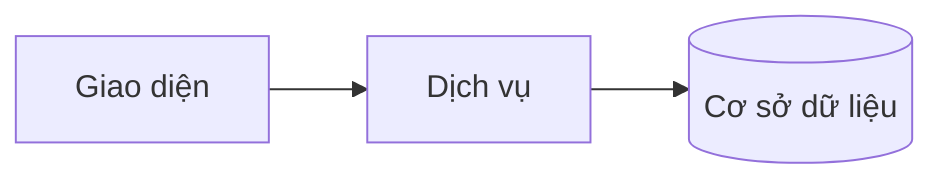
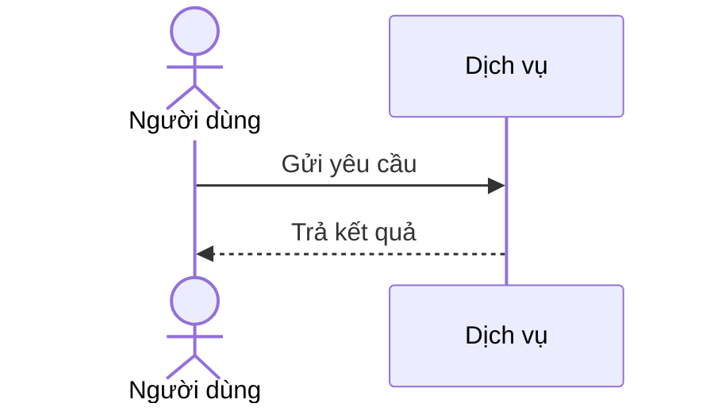
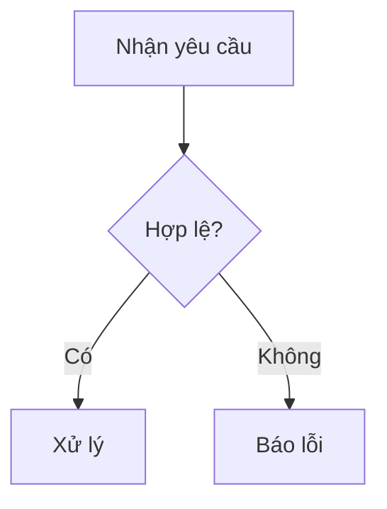
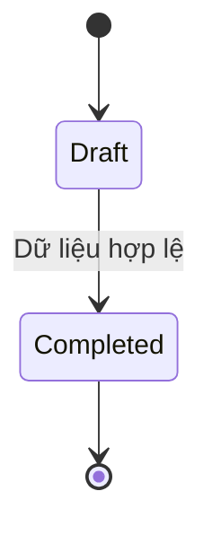
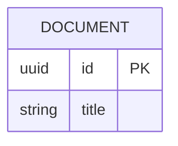

# TDD Writer — TDD và Unit Test theo mẫu import hiện hành

## Mục tiêu

Tạo tài liệu TDD và Unit Test (UT) có thể đọc, kiểm tra và nhập vào hệ thống mà:

- đúng tuyệt đối cấu trúc mẫu hiện hành;
- phản ánh code, hợp đồng và quyết định có thật, không suy đoán;
- người không chuyên kỹ thuật vẫn hiểu được vấn đề, điều kiện, hành động, kết quả và lý do;
- TDD mô tả đủ quy tắc, nhánh xử lý, API, dữ liệu và tác động liên quan;
- UT bao phủ có truy vết các quy tắc và nhánh quan trọng của TDD;
- không tuyên bố tài liệu đã hoàn tất, đã import, đã phê duyệt hoặc test đã chạy khi chưa có bằng chứng.

Mẫu mới trong skill này quyết định cấu trúc và khả năng import. Các quy tắc chất lượng cũ vẫn bắt buộc và được áp dụng bên trong cấu trúc mới.

## Các nguồn phải đối chiếu

Trước khi viết, đối chiếu đầy đủ các nguồn có liên quan:

- quyết định mới nhất người dùng xác nhận rõ cho công việc hiện tại;
- code và cấu hình đang chạy: controller, service, DTO/model, entity, migration, validator, middleware, serializer, mapper, integration và test liên quan;
- Context, Story, Business Rule, Use Case, TDD, sơ đồ dữ liệu và hợp đồng đã được xác nhận;
- nội dung hợp lệ đang có trong file cần cập nhật;
- mẫu trong skill này chỉ là cấu trúc; ví dụ và placeholder không phải dữ kiện dự án.

Không mặc định code hay tài liệu được ưu tiên khi chúng mâu thuẫn. Nêu chính xác nguồn nào nói gì và hỏi người dùng; chỉ áp dụng cách xử lý đã được người dùng xác nhận. Giữ placeholder ở phần chưa xác định, không điền cho đủ mẫu.

## Quy tắc bất biến

### Không bịa và không mở rộng phạm vi

- Chỉ dùng requirement, quy tắc, số liệu, route, field, schema, mã lỗi, HTTP status, tên lớp/phương thức, người phụ trách, nguồn tham khảo và kết quả kiểm thử có căn cứ.
- Phân biệt rõ thiết kế đề xuất với implementation đã kiểm chứng.
- Nếu chưa có code, ghi tên luồng nghiệp vụ và nói rõ tên lớp/phương thức chưa được chốt; không tự đặt tên nghe có vẻ hợp lý.
- Không tạo thêm quota, retry, background job, rollback, audit, notification hoặc hành vi của thành phần khác chỉ vì chúng thường xuất hiện trong hệ thống tương tự.
- Chỉ sửa nội dung được yêu cầu. Không xóa, ghi đè hoặc đổi nghĩa nội dung hợp lệ ngoài phạm vi thay đổi.

### Khả năng đọc áp dụng cho toàn bộ tài liệu

Viết để người không có kiến thức kỹ thuật vẫn hiểu được phần lớn tài liệu mà không phải mở code. Mỗi phần liên quan đến hành vi phải giúp người đọc trả lời:

1. Vấn đề gì đang được giải quyết?
2. Điều kiện hoặc dữ liệu nào làm tình huống xảy ra?
3. Hệ thống làm gì?
4. Kết quả và tác động là gì?
5. Vì sao kết quả đó đúng hoặc cần thiết?

Dùng tiếng Việt thông thường, câu ngắn, chủ ngữ rõ ràng. Giữ nguyên tên thật cần tra cứu từ code như bảng, field, route, class và method, rồi giải thích ý nghĩa ở lần xuất hiện đầu. Ví dụ: soft delete phải được giải thích là “đánh dấu bản ghi đã xóa nhưng vẫn giữ dữ liệu trong cơ sở dữ liệu”.

Không dùng câu khiến người đọc phải tự đoán, gồm nhưng không giới hạn:

- “xử lý theo logic”;
- “kiểm tra dữ liệu” mà không nói field và điều kiện;
- “trả kết quả phù hợp”;
- “thực hiện như bình thường”;
- “sau đó” mà không nói thao tác;
- “tùy trường hợp” mà không liệt kê trường hợp;
- “dữ liệu đại diện”.

### Giữ nguyên mẫu

- Giữ nguyên comment hướng dẫn, tên/cấp/thứ tự heading, nhãn in đậm, tiền tố bullet, cấu trúc danh sách, tên/thứ tự/số cột bảng và cú pháp code fence.
- Không dịch, đổi tên, gộp hoặc thêm mục ngoài cấu trúc mẫu.
- Chỉ lặp khối luồng, API hoặc liên kết theo đúng khuôn khi có căn cứ.
- Chỉ xóa phần API hoặc sơ đồ không dùng khi mẫu TDD cho phép và đã xác định chắc chắn phần đó không áp dụng. Không để một mục sơ đồ rỗng.
- Xuất Markdown UTF-8, mỗi file đúng một tài liệu; không bọc toàn bộ tài liệu đầu ra trong code fence và không chèn lời dẫn ngoài mẫu.

### Bảo toàn chi tiết hành vi

- Không bỏ qua điều kiện, nhánh, dữ liệu đầu vào, kết quả, lỗi, ngoại lệ hoặc tác động quan trọng.
- Mỗi nhánh if/else/switch ảnh hưởng hành vi công khai phải có diễn giải bằng lời trong TDD. Mỗi nhánh quan trọng nên có ví dụ API và ít nhất một UT tương ứng.
- Chỉ loại bỏ nội dung lặp khi không làm thay đổi cách hiểu.
- Không rút gọn đến mức người đọc phải mở code hoặc tự suy diễn mới hiểu.

## Quy trình làm việc

1. Đọc toàn bộ mẫu, comment hướng dẫn, file cần sửa và tài liệu nguồn trước khi viết.
2. Xác định phạm vi: một method, endpoint hay tính năng gồm nhiều endpoint liên quan.
3. Nếu đã có code, đọc controller, service, DTO/model, entity/migration, validator, mapper, integration và test liên quan. Nếu chưa có code, chỉ dùng Context, TDD, Story, Business Rule và quyết định đã xác nhận.
4. Lập đối chiếu nội bộ giữa nguồn và nội dung cần điền: quy tắc, nhánh, input, output, lỗi, tác động dữ liệu, external call và tham chiếu. Không bắt buộc đưa đối chiếu này vào tài liệu.
5. Điền đúng mẫu. Giữ placeholder cho dữ kiện còn thiếu và hỏi người dùng khi dữ kiện đó là điều kiện bắt buộc để hoàn thiện.
6. Với TDD, đối chiếu mọi Business Rule, nhánh, ví dụ API và mã lỗi. Với UT, mỗi file chỉ chứa một test và một dòng dữ liệu; tạo nhiều file khi có nhiều kịch bản.
7. Trước khi bàn giao, kiểm tra cấu trúc, giới hạn import, mã/tham chiếu, độ phủ và các câu mơ hồ bị cấm. Báo rõ mục chưa đủ thông tin.

## Mẫu TDD bắt buộc

Khi tạo mới, copy toàn bộ nội dung trong khối sau, bao gồm comment, rồi chỉ thay nội dung theo nguồn. Nội dung ví dụ không phải dữ kiện dự án.

````markdown
<!-- HƯỚNG DẪN CHO AI KHI ĐIỀN HOẶC CHỈNH SỬA MẪU
- Đọc toàn bộ mẫu, các comment hướng dẫn và tài liệu nguồn được cung cấp trước khi viết. Tuân thủ các quy tắc nghiệp vụ, điều kiện, ngoại lệ và giới hạn đã được xác nhận.
- Không bịa, tự chế hoặc suy đoán thành sự thật: yêu cầu, quy tắc, số liệu, API, schema, mã lỗi, nguồn tham khảo, người phụ trách và kết quả kiểm thử phải có căn cứ. Nội dung ví dụ trong mẫu không phải dữ kiện của dự án.
- Khi thiếu thông tin hoặc các nguồn mâu thuẫn, hỏi người dùng để làm rõ; giữ nguyên placeholder ở phần chưa xác định. Không tự chọn đáp án, lấp chỗ trống hay tuyên bố tài liệu đã hoàn tất.
- Chỉ thay nội dung cần điền hoặc được yêu cầu sửa. Không tự mở rộng phạm vi, sửa nghĩa quy tắc, bỏ điều kiện/ngoại lệ, xoá hay ghi đè nội dung hợp lệ đã có.
- Giữ nguyên tên, cấp và thứ tự heading, nhãn in đậm, tiền tố bullet, cấu trúc danh sách, tên/thứ tự/số cột bảng và cú pháp code fence. Không dịch, đổi tên, gộp hoặc thêm mục ngoài cấu trúc mẫu.
- Chỉ lặp khối luồng, AC hoặc API theo đúng khuôn khi có căn cứ; chỉ bỏ phần tuỳ chọn khi hướng dẫn riêng của mẫu cho phép và đã xác định không áp dụng.
- Mã tham chiếu và section phải trỏ tới tài liệu có thật đã được cung cấp hoặc kiểm chứng. Không giữ mã ví dụ như tham chiếu thật và không tự tạo tài liệu liên quan để hợp thức hoá liên kết.
- Giữ các comment hướng dẫn trong file. Xuất Markdown UTF-8, mỗi file một tài liệu; không bọc toàn bộ file trong code fence, không chèn lời dẫn hay giải thích ngoài mẫu.
- Trước khi bàn giao, đối chiếu nội dung với nguồn, kiểm tra cấu trúc, giá trị cho phép, giới hạn độ dài và tính nhất quán của mã/tham chiếu. Báo rõ phần chưa đủ thông tin; không tuyên bố đã chạy test hoặc import khi chưa thực hiện.
-->

<!-- Thay mã TDD-001 và nội dung ví dụ; giữ nguyên heading và nhãn in đậm.
Sơ đồ dùng mermaid, plantuml hoặc URL. Giữ heading Architecture, Sequence Diagram, Activity Diagram, State Diagram, Data Model.
Ví dụ API phải có heading trùng METHOD /path trong Endpoints. Xoá phần API/sơ đồ không dùng.
Version, Updated At và Change Log do lịch sử phiên bản quản lý, để trống khi nhập mới.
Author/Reviewer là tên hiển thị; gán tài khoản, phê duyệt, giả định và câu hỏi mở trên giao diện sau import.
Thiết kế phải truy vết về Story và Business Rule được cung cấp. Phân biệt thiết kế đề xuất với implementation đã kiểm chứng; không mô tả API/schema/sơ đồ ví dụ như hệ thống thật hoặc tự quyết định nghiệp vụ còn thiếu.
BẮT BUỘC KHI HOÀN THIỆN MẪU: phải có cả Reviewer và Approver, mỗi tên 1–200 ký tự sau khi bỏ khoảng trắng đầu/cuối. Không xoá hai dòng metadata, để trống, dùng tên bịa hoặc giữ placeholder rồi coi là hoàn tất.
Nếu chưa biết người review hoặc người phê duyệt, phải hỏi người dùng và báo tài liệu chưa đủ thông tin; không tự lấy Author/Owner làm người thay thế. Tên trong file không tự gán tài khoản hoặc xác nhận đã duyệt; gán thành viên trên giao diện sau import.
Đây là yêu cầu hoàn thiện mẫu; backend hiện vẫn nhận file cũ thiếu hai trường để tương thích.

VALIDATION CHO FILE NHẬP (đối chiếu ImportSnapshotValidator, MarkdownParser và ImportService):
- Mỗi file .md UTF-8 không rỗng chỉ có một heading cấp 1 chứa mã tài liệu dài 1–100 ký tự. Mã không được trùng trong cùng lần nhập hoặc thuộc loại tài liệu khác đã tồn tại.
- Không dùng tên README.md hoặc sitemap.md vì importer bỏ qua. Giao diện nhận .md/.zip, tối đa 2.000 file, tổng file tải lên 31 MiB; API giới hạn request 32 MiB và tổng nội dung đọc/giải nén 64 MiB.
- Chỉ nhập đè tài liệu cùng loại đang Draft, chưa có phiên bản và chưa lưu trữ. Import thay toàn bộ nội dung bản nháp, vì vậy phải giữ lại nội dung hợp lệ ngoài phần được yêu cầu sửa.
- Không dùng Status trong Markdown hoặc tên Approver để tự xác nhận phê duyệt; import không cấp quyền hay gán tài khoản từ tên. Chạy Kiểm tra file và xử lý lỗi/cảnh báo trước khi nhập.
- Giới hạn độ dài bên dưới tính theo string.Length của .NET (đơn vị UTF-16); không tự cắt ngắn dữ kiện quan trọng để vượt validation, hãy viết lại có căn cứ hoặc hỏi người dùng.
- Feature tối đa 300 ký tự và được dùng làm tiêu đề tài liệu. Status được parser nhận: Draft / In Review / Approved / Deprecated; tài liệu nhập mới vẫn có trạng thái phê duyệt Draft.
- Endpoint: đường dẫn tối đa 500 ký tự; tên/mô tả endpoint được lưu trong Name tối đa 300. HTTP method: GET / POST / PUT / PATCH / DELETE / HEAD / OPTIONS.
- Error Codes: mã tối đa 100 ký tự, không trùng trong tài liệu; giữ dạng - **CODE** (400): mô tả. HTTP status trong Error Codes và Response phải là số nguyên đọc được bằng Int32; không tự đặt status khác hợp đồng API.
- URL sơ đồ tối đa 1.000 ký tự. Mục sơ đồ được sử dụng phải có khối mermaid/plantuml hoặc URL theo mẫu; không để một mục sơ đồ rỗng. Nhãn mục được tách từ bullet như tên External API Fields tối đa 300 ký tự.
- Heading Examples phải khớp METHOD /path ở Endpoints. Giữ các nhãn Request:, Response 200: (thay mã theo contract) và Error Response: để parser tách đúng dữ liệu.
- Tham chiếu dạng DOC-KEY/section: ghi chú: mã đích tối đa 100 ký tự, section tối đa 100, ghi chú tối đa 1.000. Không trùng bộ mã đích + section + loại liên kết trong cùng tài liệu.
ĐỐI CHIẾU FORM TDD (src/features/tdds/validations.ts; form có thể chặt hơn import):
- Điền Feature, Author, Reviewer, Problem và ít nhất một Goal; các Goal/Non-goal/Notes đã thêm không được rỗng. API đã khai báo phải có endpoint và mô tả/mục đích; Fields phải có tên và ý nghĩa; Error Codes phải có mã, HTTP status và điều kiện.
- Form còn kiểm tra Version, Updated At và nội dung Change Log khi khai báo; với file nhập mới, giữ các trường lịch sử này trống theo hợp đồng import, không tự tạo dữ liệu lịch sử.
-->

# TDD-001

## Document Info

- **Feature**: [Tên tính năng]
- **Author**: [Tên tác giả]
- **Reviewer**: [Tên người review]
- **Approver**: [Tên người phê duyệt]
- **Status**: Draft
- **Version**:
- **Updated At**:

## Context & Goals

### Problem

[Vấn đề kỹ thuật và bối cảnh của Story]

### Goals

- [Mục tiêu kỹ thuật đo được]

### Non-goals

- [Nội dung ngoài phạm vi thiết kế]

## Architecture

[Mô tả thành phần và trách nhiệm]



**Notes**:
- [Quyết định kiến trúc và đánh đổi]

## Sequence Diagram

[Tương tác giữa các thành phần]



## Activity Diagram

[Luồng xử lý và điều kiện rẽ nhánh]



## State Diagram

[Vòng đời thực thể và điều kiện chuyển trạng thái]



## Data Model

[Bảng, kiểu dữ liệu, khoá và ràng buộc]



**Notes**:
- [Ràng buộc, index và chiến lược migration]

## Internal API

### Endpoints

- **POST** `/api/example` — [Mô tả endpoint]

### Examples

#### POST /api/example

```
Request:
{"name": "Ví dụ"}

Response 200:
{"id": "example-id"}

Error Response:
{"code": "INVALID_INPUT"}
```

### Error Codes

- **INVALID_INPUT** (400): [Điều kiện gây lỗi]

## External API

### Endpoints

- **Dịch vụ đối tác** — [Mục đích và hợp đồng tích hợp]

### Fields

- **external_id** — [Ý nghĩa trường và ràng buộc]

### Error Handling

[Timeout, retry, idempotency và ánh xạ lỗi]

### Quirks

- [Đặc điểm cần lưu ý của đối tác]

## References

### User Stories

- STORY-001

### Business Rules

- BR-001

### Use Cases

### Others

- Tài liệu kỹ thuật: [Nguồn tham khảo]

## Change Log
````

## Mẫu Unit Test bắt buộc

Khi tạo mới, copy toàn bộ nội dung trong khối sau, bao gồm comment. Mỗi file thay đúng một mã UT và chứa đúng một dòng dữ liệu.

````markdown
<!-- HƯỚNG DẪN CHO AI KHI ĐIỀN HOẶC CHỈNH SỬA MẪU
- Đọc toàn bộ mẫu, các comment hướng dẫn và tài liệu nguồn được cung cấp trước khi viết. Tuân thủ các quy tắc nghiệp vụ, điều kiện, ngoại lệ và giới hạn đã được xác nhận.
- Không bịa, tự chế hoặc suy đoán thành sự thật: yêu cầu, quy tắc, số liệu, API, schema, mã lỗi, nguồn tham khảo, người phụ trách và kết quả kiểm thử phải có căn cứ. Nội dung ví dụ trong mẫu không phải dữ kiện của dự án.
- Khi thiếu thông tin hoặc các nguồn mâu thuẫn, hỏi người dùng để làm rõ; giữ nguyên placeholder ở phần chưa xác định. Không tự chọn đáp án, lấp chỗ trống hay tuyên bố tài liệu đã hoàn tất.
- Chỉ thay nội dung cần điền hoặc được yêu cầu sửa. Không tự mở rộng phạm vi, sửa nghĩa quy tắc, bỏ điều kiện/ngoại lệ, xoá hay ghi đè nội dung hợp lệ đã có.
- Giữ nguyên tên, cấp và thứ tự heading, nhãn in đậm, tiền tố bullet, cấu trúc danh sách, tên/thứ tự/số cột bảng và cú pháp code fence. Không dịch, đổi tên, gộp hoặc thêm mục ngoài cấu trúc mẫu.
- Chỉ lặp khối luồng, AC hoặc API theo đúng khuôn khi có căn cứ; chỉ bỏ phần tuỳ chọn khi hướng dẫn riêng của mẫu cho phép và đã xác định không áp dụng.
- Mã tham chiếu và section phải trỏ tới tài liệu có thật đã được cung cấp hoặc kiểm chứng. Không giữ mã ví dụ như tham chiếu thật và không tự tạo tài liệu liên quan để hợp thức hoá liên kết.
- Giữ các comment hướng dẫn trong file. Xuất Markdown UTF-8, mỗi file một tài liệu; không bọc toàn bộ file trong code fence, không chèn lời dẫn hay giải thích ngoài mẫu.
- Trước khi bàn giao, đối chiếu nội dung với nguồn, kiểm tra cấu trúc, giá trị cho phép, giới hạn độ dài và tính nhất quán của mã/tham chiếu. Báo rõ phần chưa đủ thông tin; không tuyên bố đã chạy test hoặc import khi chưa thực hiện.
-->

<!-- Mỗi file chứa một test, đúng một dòng dữ liệu và 13 cột theo thứ tự bên dưới.
Thay UT-001 ở heading và Test ID. Trong ô bảng: xuống dòng bằng <br>, dấu | viết thành \|.
Loại: Happy / Branch / Boundary / Error / Quirk / Determinism. Suite: SMOKE / REGRESSION / FULL. Priority: P0 / P1 / P2 / P3.
TEST_LINKS là nguồn liên kết khi import; cột Trace to chỉ để đọc. Giữ hai nơi nhất quán.
Mỗi liên kết dùng DOC-KEY/section: ghi chú. Owner là tên hiển thị; phê duyệt thực hiện sau import.
Expected output và assertion phải suy ra từ Business Rule/contract đã xác nhận. Dữ liệu mock chỉ là dữ liệu kiểm thử minh hoạ, không phải dữ liệu production; không ghi Pass/đã chạy nếu chưa có bằng chứng thực thi.
BẮT BUỘC KHI HOÀN THIỆN MẪU: phải có cả Reviewer và Approver, mỗi tên 1–200 ký tự sau khi bỏ khoảng trắng đầu/cuối. Không xoá hai dòng metadata, để trống, dùng tên bịa hoặc giữ placeholder rồi coi là hoàn tất.
Nếu chưa biết người review hoặc người phê duyệt, phải hỏi người dùng và báo tài liệu chưa đủ thông tin; không tự lấy Author/Owner làm người thay thế. Tên trong file không tự gán tài khoản hoặc xác nhận đã duyệt; gán thành viên trên giao diện sau import.
Đây là yêu cầu hoàn thiện mẫu; backend hiện vẫn nhận file cũ thiếu hai trường để tương thích.

VALIDATION CHO FILE NHẬP (đối chiếu ImportSnapshotValidator, MarkdownParser và ImportService):
- Mỗi file .md UTF-8 không rỗng chỉ có một heading cấp 1 chứa mã tài liệu dài 1–100 ký tự. Mã không được trùng trong cùng lần nhập hoặc thuộc loại tài liệu khác đã tồn tại.
- Không dùng tên README.md hoặc sitemap.md vì importer bỏ qua. Giao diện nhận .md/.zip, tối đa 2.000 file, tổng file tải lên 31 MiB; API giới hạn request 32 MiB và tổng nội dung đọc/giải nén 64 MiB.
- Chỉ nhập đè tài liệu cùng loại đang Draft, chưa có phiên bản và chưa lưu trữ. Import thay toàn bộ nội dung bản nháp, vì vậy phải giữ lại nội dung hợp lệ ngoài phần được yêu cầu sửa.
- Không dùng Status trong Markdown hoặc tên Approver để tự xác nhận phê duyệt; import không cấp quyền hay gán tài khoản từ tên. Chạy Kiểm tra file và xử lý lỗi/cảnh báo trước khi nhập.
- Giới hạn độ dài bên dưới tính theo string.Length của .NET (đơn vị UTF-16); không tự cắt ngắn dữ kiện quan trọng để vượt validation, hãy viết lại có căn cứ hoặc hỏi người dùng.
- Bảng phải có header, dòng phân cách và đúng một dòng dữ liệu, đủ 13 cột theo thứ tự mẫu. Reviewer/Approver là hai bullet trước bảng, không thêm thành cột. Test ID trong bảng phải nhất quán với heading; mã tài liệu import lấy từ heading.
- Module tối đa 200 ký tự; Unit under test tối đa 500 (được dùng làm tiêu đề tài liệu); Owner tối đa 200. Trạng thái parser nhận: Draft / Approved; đây không phải kết quả chạy test hoặc quyền phê duyệt.
- Giữ Loại: Happy / Branch / Boundary / Error / Quirk / Determinism; Suite: SMOKE / REGRESSION / FULL; Priority: P0 / P1 / P2 / P3. Không dùng số ngoài dải Priority 0–3.
- Không xuống dòng vật lý trong ô: dùng <br>; dấu phân cột trong nội dung phải viết \|. TEST_LINKS mới là nguồn liên kết import; cột Trace to chỉ hiển thị, hai nơi phải nhất quán.
- Tham chiếu dạng DOC-KEY/section: ghi chú: mã đích tối đa 100 ký tự, section tối đa 100, ghi chú tối đa 1.000. Không trùng bộ mã đích + section + loại liên kết trong cùng tài liệu.
-->

# UT-001

## Unit Test

- **Reviewer**: [Tên người review]
- **Approver**: [Tên người phê duyệt]

| Test ID | Module | Unit under test | Loại | Suite | Priority | Precondition / Mock setup | Input | Expected output | Trace to (requirement / BR) | Rationale | Owner | Trạng thái |
| --- | --- | --- | --- | --- | --- | --- | --- | --- | --- | --- | --- | --- |
| UT-001 | [Tên module] | [Tên hàm hoặc service] | Happy | FULL | P1 | [Thiết lập mock và điều kiện] | [Dữ liệu đầu vào] | [Kết quả và assertion cụ thể] | BR-001/Statement | [Lý do chọn ca kiểm thử] | [Tên người phụ trách] | Draft |

## TEST_LINKS

- BR-001/Statement
````

## Hướng dẫn điền TDD

### Context và mục tiêu

- Problem kể rõ tình huống ban đầu, vấn đề xảy ra khi nào, hậu quả và lý do cần xử lý. Không biến phần này thành bản tóm tắt tên API.
- Mỗi Goal là một kết quả kỹ thuật hoặc nghiệp vụ cụ thể, có thể kiểm chứng và bám vào một hành vi trong nguồn.
- Non-goals ghi những gì cố ý không xử lý để tránh hiểu nhầm phạm vi.
- Mọi Goal, Non-goal hoặc Notes đã thêm phải có nội dung; không để bullet rỗng.

### Architecture, dữ liệu và sơ đồ

- Architecture nêu thành phần, trách nhiệm, ranh giới và cách ghép nối. Notes ghi quyết định, đánh đổi, ràng buộc hoặc thành phần không thể hiện hết trên sơ đồ.
- Data Model lấy từ entity, migration hoặc schema thật; ghi khóa, quan hệ, ràng buộc, index và chiến lược migration chỉ khi có căn cứ.
- Dùng Mermaid, PlantUML hoặc URL theo mẫu. Mermaid là lựa chọn mặc định khi không có yêu cầu khác.
- Nhãn sơ đồ dùng tiếng Việt rõ nghĩa; tên kỹ thuật chỉ giữ khi cần tra cứu và phải có giải thích vai trò.
- Phần văn xuôi ngay trước sơ đồ phải giải thích tuần tự điều gì diễn ra; không để sơ đồ đứng một mình.
- Sequence Diagram nên có autonumber, nhánh alt/opt phù hợp và Note over để giải thích từng giai đoạn khi luồng đủ phức tạp.
- Activity Diagram phải ghi điều kiện cụ thể trên mỗi nhánh và kết quả của nhánh.
- State Diagram chỉ dùng khi có vòng đời trạng thái thật và phải ghi sự kiện hoặc điều kiện chuyển trạng thái.

### API và tham chiếu

- Internal API phải dùng đúng method, path, field, wrapper, kiểu dữ liệu và mã lỗi.
- Mỗi nhánh hành vi quan trọng nên có một ví dụ request/response tương ứng.
- Trạng thái đặc biệt vẫn trả HTTP 200 phải được ghi đúng là 200; không tự đổi thành 4xx hoặc 5xx.
- External API chỉ mô tả integration thật sự trong phạm vi. Nêu endpoint, field, ánh xạ, timeout, retry, idempotency, cách xử lý lỗi và quirk khi nguồn có xác nhận.
- References chỉ chứa tài liệu có thật hoặc đã kiểm chứng. Không giữ mã ví dụ như tham chiếu thật và không tự tạo tài liệu để hợp thức hóa liên kết.
- Khi thay đổi có ảnh hưởng hoặc phụ thuộc TDD khác, giữ truy vết hai chiều nếu hệ thống tài liệu hiện hành hỗ trợ và nguồn đã được xác nhận.

### Ràng buộc hoàn thiện và import TDD

- File Markdown UTF-8 không rỗng, đúng một heading cấp 1 chứa mã dài 1–100 ký tự.
- Không dùng tên README.md hoặc sitemap.md. Mã không trùng trong cùng lần nhập hoặc thuộc loại tài liệu khác đã tồn tại.
- Feature tối đa 300 ký tự và được dùng làm tiêu đề tài liệu.
- Khi hoàn thiện mẫu phải có Author, Reviewer và Approver. Reviewer và Approver mỗi tên dài 1–200 ký tự sau khi bỏ khoảng trắng đầu/cuối. Không dùng tên bịa, placeholder, để trống hoặc tự lấy Author hay Owner thay thế. Nếu thiếu, hỏi người dùng và báo tài liệu chưa hoàn tất.
- Tên trong Markdown không gán tài khoản và không xác nhận phê duyệt. Status trong Markdown không cấp quyền; tài liệu nhập mới vẫn có trạng thái phê duyệt Draft.
- Version, Updated At và Change Log do lịch sử phiên bản quản lý; để trống khi nhập mới, không tự tạo lịch sử. Form chỉ kiểm tra nội dung các trường này khi đã khai báo.
- Parser nhận Status: Draft, In Review, Approved, Deprecated.
- Endpoint path tối đa 500 ký tự; tên hoặc mô tả endpoint tối đa 300; method chỉ nhận GET, POST, PUT, PATCH, DELETE, HEAD, OPTIONS.
- Heading trong Examples phải khớp METHOD /path ở Endpoints. Giữ các nhãn Request:, Response 200: và Error Response:, trong đó thay status theo đúng contract.
- Error code dùng dạng bullet in đậm theo mẫu; code tối đa 100 ký tự, không trùng trong tài liệu; status phải là số nguyên Int32 và đúng contract.
- URL sơ đồ tối đa 1.000 ký tự. Mục sơ đồ được dùng phải có block Mermaid, PlantUML hoặc URL hợp lệ. Tên External API Field tối đa 300 ký tự.
- Tham chiếu dạng DOC-KEY/section: ghi chú; mã đích tối đa 100, section tối đa 100, ghi chú tối đa 1.000 ký tự; không trùng bộ mã, section và loại liên kết.
- Import đè toàn bộ nội dung và chỉ áp dụng cho tài liệu cùng loại đang Draft, chưa có version và chưa lưu trữ. Vì vậy phải bảo toàn nội dung hợp lệ ngoài phần sửa.
- Giao diện nhận Markdown hoặc ZIP, tối đa 2.000 file, tổng tải lên 31 MiB; API request 32 MiB, tổng nội dung đọc hoặc giải nén 64 MiB. Giới hạn chuỗi tính theo .NET string.Length, đơn vị UTF-16. Không tự cắt dữ kiện quan trọng để qua validation.

## Hướng dẫn điền Unit Test

### Một file là một kịch bản

- Mỗi file chỉ có một heading cấp 1, một test và đúng một dòng dữ liệu trong bảng.
- Không gộp nhiều nguyên nhân lỗi hoặc nhánh độc lập vào cùng một UT. Một UT được kiểm tra nhiều field nếu tất cả cùng chứng minh một hành vi duy nhất.
- Khi có code, Unit under test dùng đúng Class.Method. Khi chưa chốt code, dùng tên luồng và ghi rõ chưa chốt class hoặc method.
- Tên hoặc mô tả phải nói rõ điều kiện và kết quả chính; tránh “trường hợp lỗi”, “kiểm tra API” hoặc “test dữ liệu”.

### Precondition và Mock setup

- Ghi rõ người thực hiện, trạng thái đăng nhập hoặc phân quyền nếu ảnh hưởng, từng bản ghi, ID, field quan trọng, trạng thái và quan hệ giữa các bản ghi.
- Dữ liệu phải đủ để người khác dựng lại đúng tình huống mà không mở code hoặc TDD.
- Dùng giá trị kiểm thử cụ thể và giải thích vai trò. Không dùng “dữ liệu đại diện”.
- Dữ liệu không phải nguyên nhân của tình huống phải được xác định là hợp lệ; nếu trạng thái ảnh hưởng kết quả, ghi cụ thể trạng thái.

### Input

- Với API, ghi method, path, path parameter, query parameter, header quan trọng và body đúng contract. Với hàm nội bộ, ghi đủ tham số.
- Thể hiện toàn bộ field cần thiết để hiểu contract: vị trí, bắt buộc hoặc tùy chọn, kiểu hoặc định dạng, ý nghĩa, giá trị trong UT và field không được phép có.
- Không chỉ ghi field gây lỗi rồi bỏ các field hợp lệ còn lại.
- Nếu nhiều field bị cấm cần được bảo vệ độc lập, viết một UT cho từng field.
- Trong ô bảng, xuống dòng bằng thẻ br; ký tự phân cột trong nội dung phải escape theo comment của mẫu.

### Expected output

- Ghi status và assertion cụ thể; không chỉ ghi “thành công”, “thất bại” hoặc mã lỗi.
- Với thành công, ghi đủ wrapper phản hồi và field công khai liên quan ở từng cấp. Không thay field cần xác nhận bằng dấu ba chấm.
- Với lỗi, ghi đủ mẫu lỗi thật như title, status, detail, messageCode, errors, traceId và timestampUtc khi contract có các field đó; nói rõ field nào không xuất hiện nếu điều này thuộc contract.
- Mỗi giá trị quan trọng phải nói nguồn hoặc lý do: kế thừa từ đâu, tính theo công thức nào, giữ nguyên hay tạo mới thế nào.
- Nếu câu chữ lỗi chưa được chốt, dùng placeholder rõ nghĩa và ghi chú rằng câu chữ chưa cố định; không tự sáng tác rồi biến thành hợp đồng.
- Nêu bản ghi hoặc bảng nào được tạo, cập nhật hoặc giữ nguyên; nguồn gốc, liên kết và snapshot lấy từ đâu.
- Trường hợp thất bại phải nêu dữ liệu nào không được tạo hoặc thay đổi và external system có được gọi hay không.
- Nếu nhiều bản ghi phải lưu cùng nhau, xác nhận tính toàn vẹn: tất cả cùng thành công hoặc không bản ghi nào được giữ lại khi lỗi.
- Cuối kết quả giải thích vì sao kết quả đúng trong bối cảnh UT, nhưng không lặp nguyên văn Rationale.

### Phân loại, độ ưu tiên và lý do

- Loại chỉ dùng: Happy, Branch, Boundary, Error, Quirk, Determinism.
- Suite chỉ dùng: SMOKE, REGRESSION, FULL.
- Priority chỉ dùng: P0, P1, P2, P3.
- Happy là luồng chuẩn; Branch là một nhánh rẽ; Boundary là giá trị biên; Error là đầu vào hoặc hệ thống lỗi; Quirk là hành vi đặc biệt dễ hiểu nhầm; Determinism xác nhận kết quả ổn định và lặp lại được.
- Luồng chính hoặc rule cốt lõi thường thuộc SMOKE và ưu tiên cao; nhánh phụ hoặc biên hiếm gặp thường thuộc REGRESSION hay FULL. Chọn theo rủi ro thật, không máy móc.
- Rationale phải nêu hậu quả cụ thể nếu hành vi sai, ví dụ tính sai tiền, lộ dữ liệu, gắn nhầm nguồn, dùng dữ liệu đã xóa, tạo bản ghi thiếu hoặc không thể truy vết. Không dùng câu chung chung như “để bảo đảm hệ thống hoạt động đúng”.
- Trạng thái là trạng thái tài liệu parser nhận Draft hoặc Approved, không phải kết quả chạy test hay quyền phê duyệt. Không ghi Pass hoặc đã chạy khi chưa có bằng chứng thực thi.

### Truy vết và độ phủ

- TEST_LINKS là nguồn liên kết khi import; Trace to chỉ để đọc. Hai nơi phải nhất quán.
- Chỉ link Story, TDD, Business Rule hoặc Use Case có thật. Dùng DOC-KEY/section: ghi chú; không ghi chung chung “liên quan TDD”, không giữ mã ví dụ và không dùng khoảng rút gọn như BR-001 đến BR-005.
- Nếu TDD cha là nguồn yêu cầu thật, liên kết đến đúng section của TDD.
- Mã UT có thể độc lập như UT-001 hoặc gắn với mã TDD như UT-004-01 nếu người dùng hay quy ước dự án yêu cầu. Mã phải hợp lệ, không trùng và khớp giữa heading với Test ID. Quan hệ với TDD hoặc requirement phải được xác nhận bằng TEST_LINKS, không chỉ suy ra từ hình thức của mã UT.
- Đối chiếu toàn bộ Business Rule, nhánh, ví dụ API, Error Code, field bị cấm và quirk trong TDD. Mỗi hành vi quan trọng phải có ít nhất một UT; báo rõ phần chưa phủ.

### Ràng buộc hoàn thiện và import UT

- File Markdown UTF-8 không rỗng, đúng một heading cấp 1 chứa mã dài 1–100 ký tự.
- Khi hoàn thiện mẫu phải có Reviewer và Approver, mỗi tên 1–200 ký tự sau khi bỏ khoảng trắng đầu hoặc cuối. Không để trống, dùng placeholder, tên bịa hoặc tự lấy Owner thay thế. Nếu thiếu, hỏi người dùng và báo tài liệu chưa hoàn tất.
- Bảng phải có header, separator, đúng một dòng dữ liệu và đủ 13 cột đúng thứ tự.
- Test ID phải khớp heading. Mã import lấy từ heading và không được trùng.
- Module tối đa 200 ký tự; Unit under test tối đa 500 và được dùng làm tiêu đề; Owner tối đa 200.
- Không xuống dòng vật lý trong ô; dùng thẻ br. Escape dấu phân cột theo đúng comment của mẫu.
- Tham chiếu: mã đích tối đa 100, section tối đa 100, ghi chú tối đa 1.000 ký tự; không trùng bộ mã, section và loại liên kết.
- Các giới hạn file, ghi đè Draft, dung lượng import và UTF-16 giống phần TDD.

## Quy tắc đặt mã và lưu file

- Tìm mã lớn nhất cùng loại trong phạm vi tài liệu hiện có rồi dùng mã kế tiếp, trừ khi người dùng hoặc hệ thống đã cấp mã.
- Không tái sử dụng, tự đổi hoặc suy ra mã từ loại tài liệu khác.
- TDD nên dùng tên file TDD-XXX-ten-tinh-nang-kebab-case.md.
- UT nên dùng tên file bắt đầu bằng đúng mã tài liệu, ví dụ UT-001-ten-kich-ban-kebab-case.md hoặc UT-004-01-ten-kich-ban-kebab-case.md theo quy ước dự án.
- Tuân theo thư mục tài liệu hiện có của repo. Chỉ hỏi vị trí lưu khi repo không có quy ước và lựa chọn vị trí có thể ảnh hưởng workflow.

## Checklist trước khi bàn giao

### Chung

- Đã đọc đủ nguồn và không biến ví dụ hoặc placeholder thành sự thật.
- Chỉ có một heading cấp 1; mã trong heading, nội dung và tên file nhất quán.
- Giữ nguyên comment và cấu trúc mẫu; Markdown UTF-8, không có lời dẫn ngoài mẫu.
- Reviewer và Approver đã có tên thật khi tài liệu được gọi là hoàn tất.
- Không có nội dung mâu thuẫn, suy đoán, câu bị cấm hoặc thuật ngữ không giải thích.
- Không tuyên bố đã import, phê duyệt hoặc chạy test khi chưa có bằng chứng.

### TDD

- Problem, Goal và Non-goal cụ thể; mỗi Goal, Non-goal hoặc Notes đã thêm không rỗng.
- Sơ đồ dùng tiếng Việt, có mô tả bằng lời và phản ánh đúng nguồn.
- Mọi nhánh hành vi quan trọng, request, response, error code và tác động dữ liệu đã được mô tả; heading ví dụ khớp endpoint.
- Reference trỏ tới tài liệu và section thật, không trùng.
- Phần tùy chọn không áp dụng đã được xóa đúng hướng dẫn; không còn mục sơ đồ rỗng.

### Unit Test

- Bảng đúng 13 cột, một dòng dữ liệu, không có newline vật lý trong ô và mọi dấu phân cột trong nội dung đã escape.
- Test ID khớp heading; các giá trị Loại, Suite, Priority và Trạng thái hợp lệ.
- Precondition đủ để dựng lại; Input đầy đủ; Expected output có assertion, lý do và tác động dữ liệu hoặc hệ thống.
- Trace to và TEST_LINKS nhất quán, trỏ đúng section có thật.
- Mỗi Business Rule, nhánh, ví dụ API, mã lỗi và field bị cấm quan trọng đã có UT; phần chưa phủ được báo rõ.
