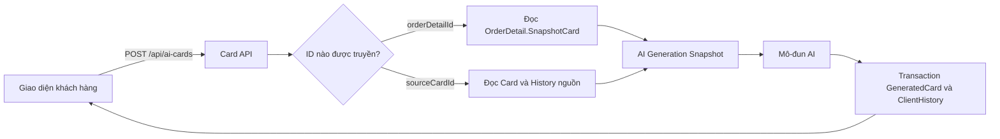
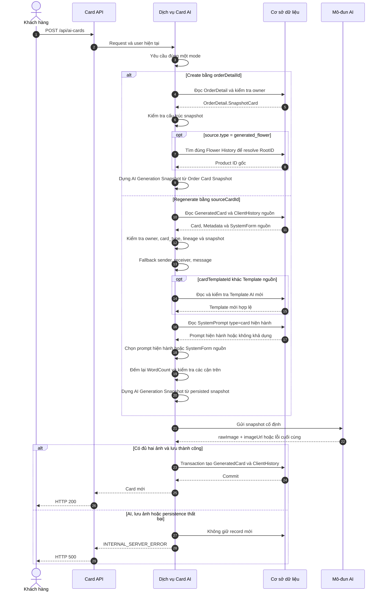
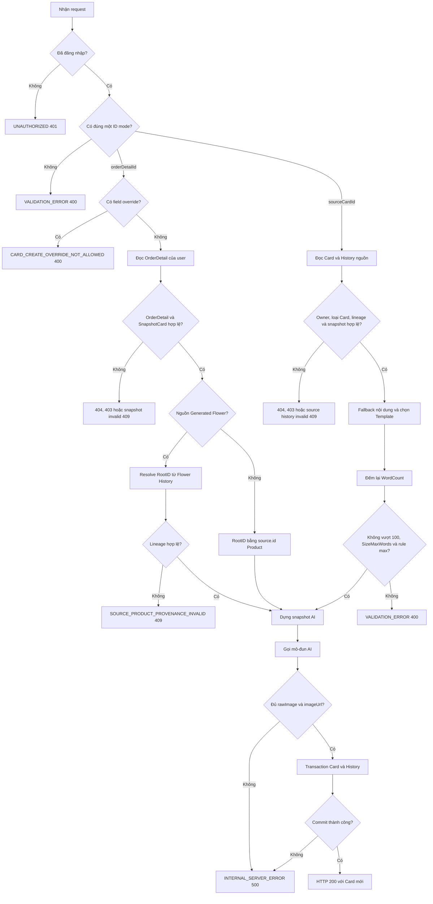

<!-- HƯỚNG DẪN CHO AI KHI ĐIỀN HOẶC CHỈNH SỬA MẪU
- Đọc toàn bộ mẫu, các comment hướng dẫn và tài liệu nguồn được cung cấp trước khi viết. Tuân thủ các quy tắc nghiệp vụ, điều kiện, ngoại lệ và giới hạn đã được xác nhận.
- Không bịa, tự chế hoặc suy đoán thành sự thật: yêu cầu, quy tắc, số liệu, API, schema, mã lỗi, nguồn tham khảo, người phụ trách và kết quả kiểm thử phải có căn cứ. Nội dung ví dụ trong mẫu không phải dữ kiện của dự án.
- Khi thiếu thông tin hoặc các nguồn mâu thuẫn, hỏi người dùng để làm rõ; giữ nguyên placeholder ở phần chưa xác định. Không tự chọn đáp án, lấp chỗ trống hay tuyên bố tài liệu đã hoàn tất.
- Chỉ thay nội dung cần điền hoặc được yêu cầu sửa. Không tự mở rộng phạm vi, sửa nghĩa quy tắc, bỏ điều kiện/ngoại lệ, xoá hay ghi đè nội dung hợp lệ đã có.
- Giữ nguyên tên, cấp và thứ tự heading, nhãn in đậm, tiền tố bullet, cấu trúc danh sách, tên/thứ tự/số cột bảng và cú pháp code fence. Không dịch, đổi tên, gộp hoặc thêm mục ngoài cấu trúc mẫu.
- Chỉ lặp khối luồng, AC hoặc API theo đúng khuôn khi có căn cứ; chỉ bỏ phần tuỳ chọn khi hướng dẫn riêng của mẫu cho phép và đã xác định không áp dụng.
- Mã tham chiếu và section phải trỏ tới tài liệu có thật đã được cung cấp hoặc kiểm chứng. Không giữ mã ví dụ như tham chiếu thật và không tự tạo tài liệu liên quan để hợp thức hoá liên kết.
- Giữ các comment hướng dẫn trong file. Xuất Markdown UTF-8, mỗi file một tài liệu; không bọc toàn bộ file trong code fence, không chèn lời dẫn hay giải thích ngoài mẫu.
- Trước khi bàn giao, đối chiếu nội dung với nguồn, kiểm tra cấu trúc, giá trị cho phép, giới hạn độ dài và tính nhất quán của mã/tham chiếu. Báo rõ phần chưa đủ thông tin; không tuyên bố đã chạy test hoặc import khi chưa thực hiện.
-->

<!-- Thay mã TDD-001 và nội dung ví dụ; giữ nguyên heading và nhãn in đậm.
Sơ đồ dùng mermaid, plantuml hoặc URL. Giữ heading Architecture, Sequence Diagram, Activity Diagram, State Diagram, Data Model.
Ví dụ API phải có heading trùng METHOD /path trong Endpoints. Xoá phần API/sơ đồ không dùng.
Version, Updated At và Change Log do lịch sử phiên bản quản lý, để trống khi nhập mới.
Author/Reviewer là tên hiển thị; gán tài khoản, phê duyệt, giả định và câu hỏi mở trên giao diện sau import.
Thiết kế phải truy vết về Story và Business Rule được cung cấp. Phân biệt thiết kế đề xuất với implementation đã kiểm chứng; không mô tả API/schema/sơ đồ ví dụ như hệ thống thật hoặc tự quyết định nghiệp vụ còn thiếu.
BẮT BUỘC KHI HOÀN THIỆN MẪU: phải có cả Reviewer và Approver, mỗi tên 1–200 ký tự sau khi bỏ khoảng trắng đầu/cuối. Không xoá hai dòng metadata, để trống, dùng tên bịa hoặc giữ placeholder rồi coi là hoàn tất.
Nếu chưa biết người review hoặc người phê duyệt, phải hỏi người dùng và báo tài liệu chưa đủ thông tin; không tự lấy Author/Owner làm người thay thế. Tên trong file không tự gán tài khoản hoặc xác nhận đã duyệt; gán thành viên trên giao diện sau import.
Đây là yêu cầu hoàn thiện mẫu; backend hiện vẫn nhận file cũ thiếu hai trường để tương thích.

VALIDATION CHO FILE NHẬP (đối chiếu ImportSnapshotValidator, MarkdownParser và ImportService):
- Mỗi file .md UTF-8 không rỗng chỉ có một heading cấp 1 chứa mã tài liệu dài 1–100 ký tự. Mã không được trùng trong cùng lần nhập hoặc thuộc loại tài liệu khác đã tồn tại.
- Không dùng tên README.md hoặc sitemap.md vì importer bỏ qua. Giao diện nhận .md/.zip, tối đa 2.000 file, tổng file tải lên 31 MiB; API giới hạn request 32 MiB và tổng nội dung đọc/giải nén 64 MiB.
- Chỉ nhập đè tài liệu cùng loại đang Draft, chưa có phiên bản và chưa lưu trữ. Import thay toàn bộ nội dung bản nháp, vì vậy phải giữ lại nội dung hợp lệ ngoài phần được yêu cầu sửa.
- Không dùng Status trong Markdown hoặc tên Approver để tự xác nhận phê duyệt; import không cấp quyền hay gán tài khoản từ tên. Chạy Kiểm tra file và xử lý lỗi/cảnh báo trước khi nhập.
- Giới hạn độ dài bên dưới tính theo string.Length của .NET (đơn vị UTF-16); không tự cắt ngắn dữ kiện quan trọng để vượt validation, hãy viết lại có căn cứ hoặc hỏi người dùng.
- Feature tối đa 300 ký tự và được dùng làm tiêu đề tài liệu. Status được parser nhận: Draft / In Review / Approved / Deprecated; tài liệu nhập mới vẫn có trạng thái phê duyệt Draft.
- Endpoint: đường dẫn tối đa 500 ký tự; tên/mô tả endpoint được lưu trong Name tối đa 300. HTTP method: GET / POST / PUT / PATCH / DELETE / HEAD / OPTIONS.
- Error Codes: mã tối đa 100 ký tự, không trùng trong tài liệu; giữ dạng - **CODE** (400): mô tả. HTTP status trong Error Codes và Response phải là số nguyên đọc được bằng Int32; không tự đặt status khác hợp đồng API.
- URL sơ đồ tối đa 1.000 ký tự. Mục sơ đồ được sử dụng phải có khối mermaid/plantuml hoặc URL theo mẫu; không để một mục sơ đồ rỗng. Nhãn mục được tách từ bullet như tên External API Fields tối đa 300 ký tự.
- Heading Examples phải khớp METHOD /path ở Endpoints. Giữ các nhãn Request:, Response 200: và Error Response: để parser tách đúng dữ liệu.
- Tham chiếu dạng DOC-KEY/section: ghi chú; mã đích tối đa 100, section tối đa 100, ghi chú tối đa 1.000. Không trùng bộ mã đích + section + loại liên kết trong cùng tài liệu.
-->

# TDD-006

## Document Info

- **Feature**: Tạo mới và tạo lại thiệp thiết kế AI qua một endpoint
- **Author**: Nguyễn Tùng Dương
- **Reviewer**: Tân Trần
- **Approver**: Tân Trần
- **Status**: Draft
- **Version**:
- **Updated At**:

## Context & Goals

### Problem

Luồng Card AI trước đây nhận trực tiếp Product, Generated Flower, Template, Size Config, Price Config và nội dung khi tạo mới; các cách tạo lại được tách sang endpoint và TDD khác. Thiết kế mới cần một endpoint duy nhất. Tạo mới chỉ nhận `orderDetailId` và dùng dữ liệu bất biến trong `OrderDetail.SnapshotCard`. Tạo lại chỉ nhận `sourceCardId` cùng các field nội dung hoặc Template tùy chọn, rồi dùng snapshot đã lưu trên Card và History nguồn. Nếu hai mode không được phân biệt rõ, hệ thống có thể đọc dữ liệu live ngoài ý muốn, áp sai giá, ghi sai lineage hoặc cho request ghi đè snapshot của OrderDetail.

### Goals

- Dùng duy nhất `POST /api/ai-cards` cho cả tạo mới và tạo lại Card AI.
- Phân biệt hai mode bằng đúng một trong `orderDetailId` hoặc `sourceCardId`.
- Tạo mới dùng toàn bộ `OrderDetail.SnapshotCard` mà không đọc lại Product, Generated Flower, Template, Card Config hoặc System Prompt hiện hành.
- Tạo lại cho phép đổi Template và ba field nội dung nhưng kế thừa form type, ảnh đính kèm, Size và toàn bộ giá từ Card nguồn.
- Bảo toàn `base_id`, `RootID`, snapshot ảnh nguồn, snapshot Template và quan hệ Card cha-con trong `ClientHistory`.
- Chỉ lưu Card và History mới khi mô-đun AI trả đủ ảnh và giao dịch dữ liệu hoàn tất.

### Non-goals

- Không mô tả cách Order hoặc OrderDetail được tạo và cách `OrderDetail.SnapshotCard` được chuẩn bị.
- Không cập nhật OrderDetail hoặc gắn ID Card mới trở lại OrderDetail.
- Không mô tả thuật toán quota, retry hoặc tích hợp nhà cung cấp bên trong mô-đun AI.
- Không xử lý Card HandMade; flow đó dùng `POST /api/handmade-cards` theo TDD-021.
- Không tạo Unit Test trong phạm vi cập nhật tài liệu này.

## Architecture

Controller nhận một DTO chung rồi yêu cầu dịch vụ chọn đúng một mode. Mode tạo mới tải OrderDetail thuộc khách hàng và chuyển `SnapshotCard` thành gói dữ liệu AI trong bộ nhớ. Mode tạo lại tải GeneratedCard cùng ClientHistory nguồn, áp dụng fallback cho nội dung, giải quyết Template hiệu lực và dựng lại gói dữ liệu AI. Hai mode cùng gọi mô-đun AI và cùng lưu `GeneratedCard` với `ClientHistory` trong một giao dịch.



**Notes**:

- `OrderDetail.SnapshotCard` là Order Card Snapshot bất biến được tạo ngoài phạm vi API này.
- Snapshot nguồn của Regenerate là dữ liệu kết hợp từ `GeneratedCard`, `ClientHistory.Metadata` và `ClientHistory.SystemForm`; không phải `GeneratedCard.RawImage`.
- AI Generation Snapshot là object cố định trong bộ nhớ được gửi cho mô-đun AI. Service không tải lại dependency sau khi object này được dựng xong.
- Mô-đun AI tự quản lý quota và retry; TDD này không mô tả thuật toán hoặc con số quota.
- Tên class và method triển khai chưa được xác nhận từ code; tài liệu chỉ chốt hành vi của endpoint và dịch vụ nghiệp vụ.

## Sequence Diagram

Request đi qua kiểm tra đăng nhập và kiểm tra mode trước. Nhánh Create đọc OrderDetail và snapshot. Nhánh Regenerate đọc Card/History nguồn, áp dụng dữ liệu request được phép thay đổi và dùng prompt hiện hành hoặc prompt nguồn. Cả hai nhánh chỉ trả thành công sau khi lưu đồng thời Card và History mới.



## Activity Diagram

Mode được xác định trước khi đọc dữ liệu nghiệp vụ. Mọi lỗi admission dừng trước AI. Regenerate chỉ tính lại WordCount; tất cả field Size và giá được kế thừa nguyên trạng từ Card nguồn.



## Data Model

`OrderDetail.SnapshotCard` chỉ là nguồn cho Create và không bị API này cập nhật. `GeneratedCard` lưu nội dung, ảnh kết quả, Size và giá. `ClientHistory` lưu lineage bằng các cột đa hình cùng snapshot ảnh nguồn và Template trong metadata. Các cột lineage không có khóa ngoại; dịch vụ chịu trách nhiệm kiểm tra.

```mermaid
erDiagram
    ORDER_DETAIL {
        uuid Id PK
        uuid OrderId
        json SnapshotCard
    }

    GENERATED_CARD {
        uuid Id PK
        string Content
        string ImageUrl
        string RawImage
        uuid UserId
        string CardType
        string FormType
        string SenderName
        string ReceiverName
        string MessageContent
        string AttachedImageUrl
        string SizeName
        decimal SizeWidth
        decimal SizeHeight
        decimal SizeBasePrice
        int SizeMaxWords
        int WordCount
        json WordConfigSnapshot
        decimal BasePrice
        decimal ExtraPrice
        decimal TotalPrice
        datetime CreatedAt
    }

    CLIENT_HISTORY {
        uuid Id PK
        uuid UserId
        string Type
        json SystemForm
        json Metadata
        uuid RootID
        uuid BaseId
        uuid OutputId
        datetime CreatedAt
    }
```



**Notes**:

- Không khai báo quan hệ database từ OrderDetail tới GeneratedCard; mỗi lần gọi hợp lệ tạo Card mới và không ghi ngược vào OrderDetail.
- `ClientHistory.BaseId`, `RootID` và `OutputId` là tham chiếu đa hình do code quản lý, không phải khóa ngoại.
- `ClientHistory.Metadata` của Card không dùng `schemaVersion`.
- `sizeConfig={group:"card_config",key:"card_config.sizes"}` vẫn được giữ trong metadata, nhưng Create không đọc Config trong API này.

**OrderDetail.SnapshotCard**

Snapshot có cấu trúc cố định dưới đây. `cardConfig` nhận object đúng cấu trúc hoặc null. Mọi giá trị giá và `wordCount` được tin theo snapshot, không được API này tính, đối chiếu lại hoặc kiểm tra quan hệ chéo với field khác.

```json
{
  "source": {
    "type": "product|generated_flower",
    "id": "uuid",
    "imageUrl": "https://..."
  },
  "cardTemplate": {
    "templateId": "uuid",
    "templateName": "Tên template",
    "templateType": "ai",
    "templateImageUrl": "https://..."
  },
  "cardSize": {
    "name": "Lớn",
    "width": 15,
    "height": 25,
    "base_price": 15000,
    "max_words": 100
  },
  "cardConfig": {
    "min_words": 36,
    "max_words": 70,
    "extra_price": 39000
  },
  "senderName": "Nguyễn An",
  "receiverName": "Trần Bình",
  "messageContent": "Lời chúc đã chụp",
  "formType": "calligraphy",
  "attachedImageUrl": null,
  "wordCount": 45,
  "basePrice": 15000,
  "extraPrice": 39000,
  "totalPrice": 54000,
  "systemPrompt": {
    "type": "card",
    "content": "Full prompt đã chụp"
  },
  "validatedAt": "2026-09-11T08:00:00Z"
}
```

**ClientHistory.Metadata của Card**

Create chép ảnh nguồn và Template từ Order Card Snapshot vào History để lần Regenerate sau không phải đọc dữ liệu live. Regenerate chép tiếp source snapshot và lưu Template thực tế của lần mới. Không lưu `orderDetailId`.

```json
{
  "operation": "create|regenerate",
  "sourceType": "product|generated_flower",
  "originProductId": "uuid",
  "generatedFlowerId": "uuid-or-null",
  "provenanceStatus": "available",
  "source": {
    "type": "product|generated_flower",
    "id": "uuid",
    "imageUrl": "https://..."
  },
  "cardTemplate": {
    "id": "uuid",
    "name": "Tên template",
    "templateType": "ai",
    "imageUrl": "https://..."
  },
  "sizeConfig": {
    "group": "card_config",
    "key": "card_config.sizes"
  },
  "regeneratedFromCardId": "uuid-or-null",
  "systemPromptSource": "order_detail_snapshot|current|source_card_fallback",
  "validatedAt": "UTC timestamp"
}
```

Create dùng `validatedAt` của `OrderDetail.SnapshotCard`. Regenerate dùng thời điểm chuẩn bị dữ liệu của request hiện tại. `ClientHistory.SystemForm` lưu `{type,content}` của prompt thực tế đã dùng. Card cũ thiếu `source.imageUrl` hoặc `cardTemplate.imageUrl` không đủ điều kiện Regenerate và trả `CARD_SOURCE_HISTORY_INVALID/409`.

## Internal API

### Endpoints

- **POST** `/api/ai-cards` — Tạo mới Card AI từ `OrderDetail.SnapshotCard` hoặc tạo lại từ Card/History nguồn.

- **orderDetailId** — UUID tùy chọn; có mặt duy nhất để chọn mode Create.
- **sourceCardId** — UUID tùy chọn; là `GeneratedCard.Id`, có mặt duy nhất để chọn mode Regenerate.
- **cardTemplateId** — UUID, chuỗi rỗng hoặc null, chỉ dùng trong Regenerate. Bỏ, rỗng, blank, null hoặc bằng Template nguồn thì dùng snapshot nguồn; ID khác được kiểm tra live.
- **senderName** — String hoặc null, chỉ dùng trong Regenerate; bỏ, null, rỗng hoặc blank thì dùng người gửi nguồn.
- **receiverName** — String hoặc null, chỉ dùng trong Regenerate; bỏ, null, rỗng hoặc blank thì dùng người nhận nguồn.
- **messageContent** — String hoặc null, chỉ dùng trong Regenerate; bỏ, null, rỗng hoặc blank thì dùng lời chúc nguồn.

### Examples

#### POST /api/ai-cards

```
Request:
{"orderDetailId":"110e8400-e29b-41d4-a716-446655440001"}

Response 200:
{"value":{"id":"660e8400-e29b-41d4-a716-446655440001","content":"...","imageUrl":"https://storage.example.com/cards/final.png","rawImage":"https://storage.example.com/cards/raw.png","userId":"770e8400-e29b-41d4-a716-446655440001","createdAt":"2026-09-11T08:10:00Z","cardType":"ai","formType":"calligraphy","senderName":"Nguyễn An","receiverName":"Trần Bình","messageContent":"Lời chúc đã chụp","attachedImageUrl":null,"sizeName":"Lớn","sizeWidth":15,"sizeHeight":25,"sizeBasePrice":15000,"sizeMaxWords":100,"wordCount":45,"wordConfigSnapshot":{"min_words":36,"max_words":70,"extra_price":39000},"basePrice":15000,"extraPrice":39000,"totalPrice":54000}}

Error Response:
{"title":"Conflict","status":409,"detail":"OrderDetail không có SnapshotCard dùng được để tạo Card AI.","messageCode":"ORDER_DETAIL_CARD_SNAPSHOT_INVALID","errors":null,"traceId":"<trace-id>","timestampUtc":"<UTC timestamp>"}
```

Create chỉ kiểm tra snapshot parse được, đủ field, đúng kiểu và các UUID/URL/string cần thiết có hình thức dùng được. Service không tính hoặc đối chiếu lại `wordCount`, khoảng giá và các giá trị tiền. Nếu source là Generated Flower, service vẫn tìm đúng Flower History để gán RootID theo quy tắc lineage.

#### POST /api/ai-cards

```
Request:
{"sourceCardId":"660e8400-e29b-41d4-a716-446655440001","cardTemplateId":"550e8400-e29b-41d4-a716-446655440002","senderName":"Nguyễn An","receiverName":null,"messageContent":"Lời chúc mới"}

Response 200:
{"value":{"id":"660e8400-e29b-41d4-a716-446655440002","content":"...","imageUrl":"https://storage.example.com/cards/final-regenerated.png","rawImage":"https://storage.example.com/cards/raw-regenerated.png","userId":"770e8400-e29b-41d4-a716-446655440001","createdAt":"2026-09-11T08:20:00Z","cardType":"ai","formType":"calligraphy","senderName":"Nguyễn An","receiverName":"Trần Bình","messageContent":"Lời chúc mới","attachedImageUrl":null,"sizeName":"Lớn","sizeWidth":15,"sizeHeight":25,"sizeBasePrice":15000,"sizeMaxWords":100,"wordCount":3,"wordConfigSnapshot":{"min_words":36,"max_words":70,"extra_price":39000},"basePrice":15000,"extraPrice":39000,"totalPrice":54000}}

Error Response:
{"title":"Conflict","status":409,"detail":"Card hoặc History nguồn thiếu snapshot dùng được để tạo lại.","messageCode":"CARD_SOURCE_HISTORY_INVALID","errors":null,"traceId":"<trace-id>","timestampUtc":"<UTC timestamp>"}
```

Trong ví dụ, `receiverName=null` dùng lại người nhận nguồn. `WordCount` được đếm lại là 3 nhưng rule và giá vẫn giữ nguyên từ Card nguồn, kể cả khi 3 nhỏ hơn `min_words=36`. Message chỉ bị từ chối khi vượt 100 từ, `SizeMaxWords` hoặc, với Calligraphy, `WordConfigSnapshot.max_words`.

### Error Codes

- **UNAUTHORIZED** (401): Người gọi chưa đăng nhập hoặc tài khoản không hoạt động.
- **VALIDATION_ERROR** (400): Request thiếu cả hai ID mode, có đồng thời hai ID mode, ID sai UUID, nội dung Regenerate vượt giới hạn hoặc field có giá trị không hợp lệ.
- **CARD_CREATE_OVERRIDE_NOT_ALLOWED** (400): Mode Create chứa key `cardTemplateId`, `senderName`, `receiverName` hoặc `messageContent`, kể cả khi giá trị là null; client không được ghi đè Order Card Snapshot.
- **ORDER_DETAIL_NOT_FOUND** (404): Không có OrderDetail ứng với `orderDetailId`.
- **ACCESS_DENIED** (403): OrderDetail, GeneratedCard hoặc ClientHistory nguồn không thuộc người dùng hiện tại.
- **ORDER_DETAIL_CARD_SNAPSHOT_INVALID** (409): `OrderDetail.SnapshotCard` null, không parse được, thiếu field, sai kiểu hoặc chứa UUID/URL/string bắt buộc không dùng được.
- **SOURCE_PRODUCT_PROVENANCE_INVALID** (409): Source trong Order Card Snapshot là Generated Flower nhưng không tìm được đúng một Flower History hợp lệ để gán Product RootID.
- **CARD_NOT_FOUND** (404): Không có GeneratedCard ứng với `sourceCardId`.
- **HANDMADE_CARD_REGENERATE_NOT_SUPPORTED** (409): Card hoặc History nguồn thuộc loại HandMade.
- **CARD_SOURCE_HISTORY_INVALID** (409): Thiếu đúng một History Card nguồn, lineage sai, RootID rỗng, snapshot Size/rule/ảnh nguồn/Template thiếu hoặc cả prompt hiện hành lẫn prompt nguồn đều không dùng được.
- **CARD_TEMPLATE_NOT_FOUND** (404): `cardTemplateId` mới trong Regenerate không tồn tại.
- **CARD_TEMPLATE_DELETED** (410): Template mới đã bị xóa mềm.
- **CARD_TEMPLATE_INACTIVE** (409): Template mới chưa hoạt động.
- **CARD_TEMPLATE_TYPE_INVALID** (409): Template mới không có `templateType=ai`.
- **INTERNAL_SERVER_ERROR** (500): Mô-đun AI báo lỗi cuối cùng, thiếu `rawImage` hoặc `imageUrl`, lưu ảnh thất bại hoặc transaction Card/History không commit được.

## References

### User Stories

- STORY-035: Tạo thiệp thiết kế AI.
- STORY-036: Tạo lại thiệp từ lịch sử.
- STORY-037: Thay nội dung hoặc Template khi tạo lại Card AI.

### Business Rules

- BR-006-01: Chỉ khách hàng đã đăng nhập và có tài khoản hoạt động được gọi endpoint.
- BR-006-02: Request phải có đúng một trong `orderDetailId` hoặc `sourceCardId`.
- BR-006-03: Create không nhận các field override dành cho Regenerate; key xuất hiện với giá trị null vẫn bị từ chối.
- BR-006-04: Create chỉ dùng `OrderDetail.SnapshotCard` bất biến và không revalidate dependency live.
- BR-006-05: OrderDetail phải tồn tại và thuộc người dùng; trạng thái Order không ảnh hưởng admission.
- BR-006-06: SnapshotCard sai cấu trúc trả `ORDER_DETAIL_CARD_SNAPSHOT_INVALID/409`.
- BR-006-07: Source Product dùng `base_id=RootID=source.id`; Source Generated Flower phải resolve RootID qua Flower History.
- BR-006-08: Create tin `wordCount`, Size, rule và toàn bộ giá trong snapshot.
- BR-006-09: Create lưu ảnh nguồn và Template snapshot vào History; không lưu `orderDetailId`.
- BR-006-10: Regenerate chỉ nhận ba field nội dung và Template tùy chọn ngoài `sourceCardId`.
- BR-006-11: Nội dung thiếu, null, rỗng hoặc blank dùng giá trị Card nguồn.
- BR-006-12: Sender/receiver không quá 20 từ; message không quá 100 từ và không vượt SizeMaxWords.
- BR-006-13: Regenerate chỉ tính lại WordCount; các field Size và giá còn lại kế thừa nguyên từ Card nguồn.
- BR-006-14: Calligraphy còn yêu cầu WordCount không vượt `WordConfigSnapshot.max_words`; không kiểm tra cận dưới.
- BR-006-15: Template nguồn dùng snapshot; chỉ Template khác nguồn được validate live và phải là Template AI khả dụng.
- BR-006-16: Regenerate ưu tiên prompt hiện hành rồi fallback `SystemForm` nguồn.
- BR-006-17: Regenerate dùng ảnh nguồn hoa từ History, không dùng RawImage Card nguồn làm ảnh tham chiếu.
- BR-006-18: History mới kế thừa `base_id/RootID` và lưu `regeneratedFromCardId` bằng Card trực tiếp được chọn.
- BR-006-19: Mỗi lần gọi thành công tạo Card mới; Card/History/OrderDetail nguồn không bị sửa.
- BR-006-20: Thành công cần đủ rawImage, imageUrl và transaction Card/History; lỗi không giữ record mới.

### Use Cases

- Tạo mới Card AI từ một OrderDetail đã có SnapshotCard.
- Tạo lại Card AI bằng nội dung nguồn hoặc nội dung mới và Template nguồn hoặc Template AI mới.

### Others

- AI_Card_Context/Card AI: Contract tổng thể, snapshot và lineage Card.
- AI_DB_Diagram/OrderDetail: Schema logic của OrderDetail, GeneratedCard và ClientHistory.
- AI_CUSTOMIZE_DB/OrderDetail: Sơ đồ DBML đồng bộ với schema logic.
- TDD-021/Internal API: Flow HandMade dùng endpoint riêng.

## Change Log
