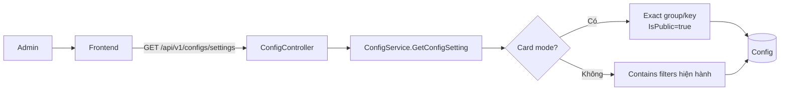
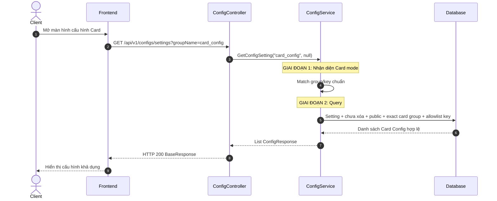
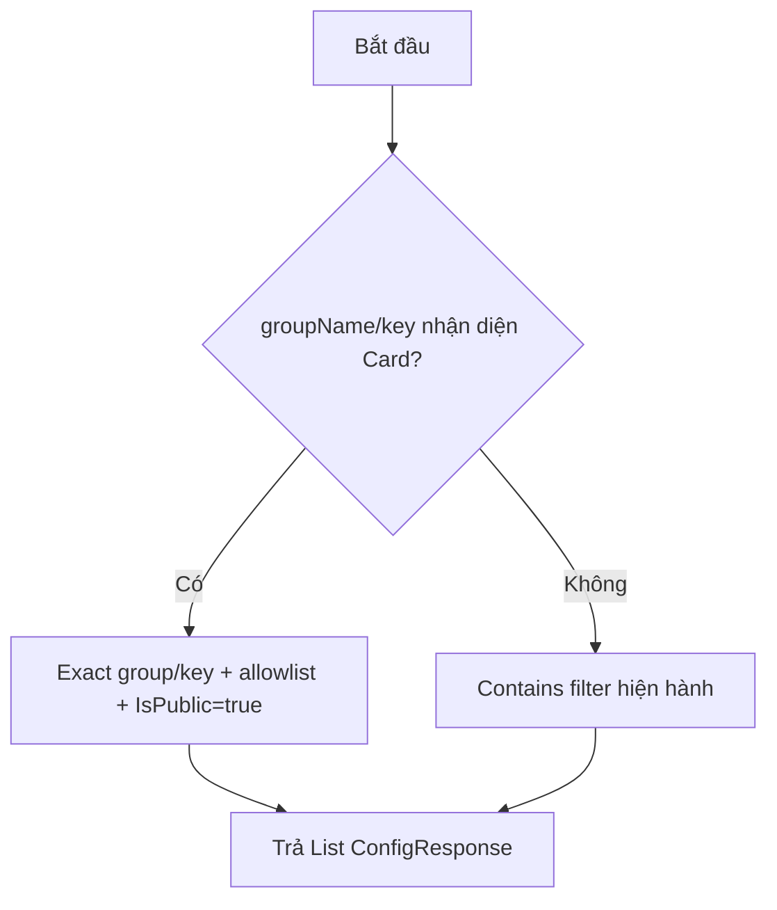
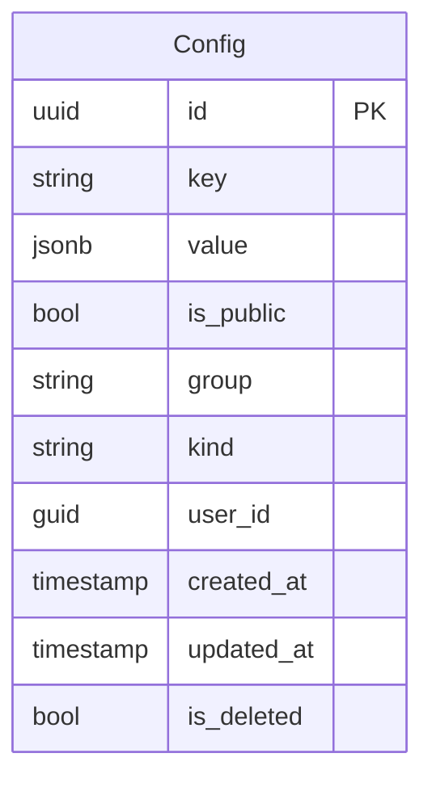

# TDD-008: Lấy danh sách Config Setting và Card Config

## Thông tin tài liệu
- **Tiêu đề**: Mở rộng API danh sách Setting để đọc Card Config đang hoạt động
- **Ghi chú**: Giữ nguyên endpoint và hai query parameter hiện có. Khi filter nhận diện Card Config, service áp dụng quy tắc exact/public/allowlist; các Config Setting khác tiếp tục dùng hành vi hiện hành.

## Metadata quản trị tài liệu
| Trường | Giá trị |
|---|---|
| Mã tài liệu | TDD-008 |
| Phiên bản | v0.6 |
| Author | Codex |
| Reviewer | |
| Approver | Chưa chỉ định |
| Owner | Nhóm Hoa Theo Mùa |
| Cập nhật gần nhất | 2026-09-08 |

---

## BƯỚC 1 — Thông tin & Bối cảnh

### Thông tin tài liệu
- **Mã tài liệu**: TDD-008
- **Tính năng**: Danh sách Config Setting có hỗ trợ Card Config
- **Tác giả**: Codex
- **Người review**:
- **Phiên bản**: v0.6
- **Cập nhật (YYYY-MM-DD)**: 2026-09-08
- **Story liên quan**: Không có

### Business Rules
- BR-008-01: Giữ nguyên `GET /api/v1/configs/settings`, `AdminPolicy` và hai query tùy chọn `groupName`, `key`; không thêm `isPublic`, `page` hoặc `pageSize`.
- BR-008-02: Query nền luôn chỉ lấy `Config` có `IsDeleted=false` và normalized `Kind=Setting`.
- BR-008-03: Card mode được kích hoạt khi `groupName` sau trim bằng `card_config` hoặc `key` sau trim bằng một trong hai key `card_config.sizes`, `card_config.prices`.
- BR-008-04: Trong Card mode, `group` và `key` được so sánh exact với giá trị Card chuẩn; chỉ hai key allowlist và record `IsPublic=true` được trả về.
- BR-008-05: Ngoài Card mode, filter `groupName`/`key` giữ nguyên cách trim, lowercase và `Contains`; không lọc `IsPublic` để tránh ảnh hưởng Config Setting cũ.
- BR-008-06: Response giữ nguyên `List<ConfigResponse>` gồm `id`, `key`, `group`, `isPublic`, `value`, `kind`, `userId`; không có pagination, `totalCount`, `isDeleted`, `createdAt`, `updatedAt`.
- BR-008-07: Không cam kết thứ tự vì contract không bổ sung sort.
- BR-008-08: Card Config không tồn tại, inactive, đã xóa, sai Kind, sai group hoặc key ngoài allowlist đều không xuất hiện; endpoint trả HTTP 200 với `value=[]` nếu không còn record hợp lệ.

### Bối cảnh & Mục tiêu

**Vấn đề**
> Frontend đang dùng API Setting hiện có và chỉ truyền `groupName`/`key`. Card cần đọc đúng hai singleton khả dụng mà không tạo endpoint hoặc query contract mới, đồng thời không làm thay đổi kết quả của Config ngoài Card.

**Mục tiêu**
- Tái sử dụng API danh sách Setting hiện hành.
- Bảo đảm Card mode chỉ lộ Card Config active, đúng group/key.
- Giữ nguyên response DTO và hành vi của Setting ngoài Card.

**Ngoài phạm vi** (Out of scope)
- Phân trang, tổng số record và sắp xếp.
- Parse/validate inner schema khi đọc; schema được kiểm soát ở Create/Update.
- Sửa request từ frontend.

---

## BƯỚC 2 — Kiến trúc & Sơ đồ

### Kiến trúc tổng quan (Architecture)
**Tiêu đề**: Mở rộng query Setting theo Card mode
**Mô tả**: Frontend gọi route cũ; Controller chuyển hai filter sang ConfigService; service chọn nhánh Card hoặc nhánh Setting hiện hành trước khi query EF Core.


**Ghi chú**: Cả hai nhánh dùng chung `Kind=Setting` và `IsDeleted=false`.

### Sequence Diagram
**Tiêu đề**: Trình tự lấy Card Config qua endpoint Setting
**Mô tả**: Card mode chỉ thay cách lọc; Controller và response wrapper không đổi.


**Ghi chú**: Nếu không có record hợp lệ, danh sách rỗng; không trả lỗi nghiệp vụ.

### Activity Diagram (optional — chỉ điền nếu logic có nhiều nhánh điều kiện phức tạp)
**Tiêu đề**: Chọn chế độ lọc Setting
**Mô tả**: Phân biệt Card mode với hành vi Config cũ.



### State Diagram (optional — chỉ điền nếu entity chính có vòng đời trạng thái)
- **Không áp dụng**: Endpoint chỉ đọc dữ liệu.

### Mô hình dữ liệu (Data Model / ERD)
**Tiêu đề**: Bảng Config dùng cho Setting và Card Config
**Mô tả**: Không thêm bảng hoặc field mới.



---

## BƯỚC 3 — API

### API Contract nội bộ

#### Endpoint #1
- **Method**: GET
- **Endpoint**: `/api/v1/configs/settings`
- **Tên endpoint**: Lấy danh sách Setting/Card Config
- **Mô tả**: Giữ contract hiện hành; tự áp dụng Card mode từ `groupName` hoặc `key`.

**Query Parameters**

| Parameter | Type | Required | Mô tả |
|---|---|---|---|
| groupName | string | No | `card_config` kích hoạt Card mode; giá trị khác dùng Contains hiện hành |
| key | string | No | Card key chuẩn kích hoạt Card mode; giá trị khác dùng Contains hiện hành |

**Ví dụ 1 — Lấy hai Card Config active** — HTTP `200`

Request:
```http
GET /api/v1/configs/settings?groupName=card_config
```

Response:
```json
{
  "isSuccess": true,
  "isFailed": false,
  "value": [
    { "id": "...", "group": "card_config", "key": "card_config.sizes", "kind": "Setting", "isPublic": true, "value": {}, "userId": "..." },
    { "id": "...", "group": "card_config", "key": "card_config.prices", "kind": "Setting", "isPublic": true, "value": {}, "userId": "..." }
  ]
}
```

**Ví dụ 2 — Lấy exact Size Config** — HTTP `200`

Request:
```http
GET /api/v1/configs/settings?key=card_config.sizes
```

Response:
```json
{
  "isSuccess": true,
  "isFailed": false,
  "value": [
    { "id": "...", "group": "card_config", "key": "card_config.sizes", "kind": "Setting", "isPublic": true, "value": {}, "userId": "..." }
  ]
}
```

**Ví dụ 3 — Không có Card Config khả dụng** — HTTP `200`

Request:
```http
GET /api/v1/configs/settings?groupName=card_config
```

Response:
```json
{ "isSuccess": true, "isFailed": false, "value": [] }
```

#### Mã lỗi
| Code | HTTP | Khi nào xảy ra |
|---|---|---|
| Không có mã nghiệp vụ mới | 200 | Card Config không tồn tại/không khả dụng được biểu diễn bằng `value=[]` |
| `MissingAccessToken` / `ExpiredAccessToken` / `InvalidAccessToken` | 401 | JWT middleware từ chối access token |
| Authorization middleware response | 403 | Principal không thỏa `AdminPolicy` |

### API Contract bên ngoài (optional — chỉ điền nếu hàm/API này gọi ra service/API của bên thứ ba)
- **Không áp dụng**: GET Settings không gọi API bên ngoài.

---

## BƯỚC 4 — Tham chiếu

### 🔴 Tham chiếu đến
- `AI_Card_Context.md` — hai singleton và trạng thái khả dụng của Card Config.
- Code hiện hành: `ConfigController.GetConfigSettingList`, `ConfigService.GetConfigSetting`, `ConfigResponse`.

### ⚫ Trỏ vào tài liệu này
- TDD-006, TDD-007, TDD-021 và TDD-027 đọc Card Config.
- TDD-009, TDD-010, TDD-011 quản trị Card Config.

### ⋯ Bị ảnh hưởng
- Mọi flow Card đọc Config active; Config ngoài namespace Card phải tiếp tục qua nhánh hiện hành.
