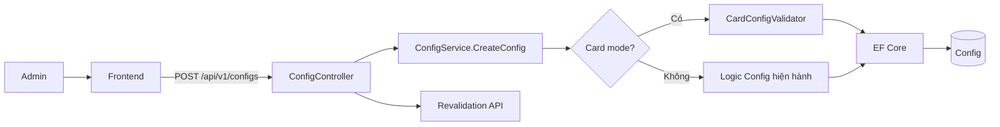
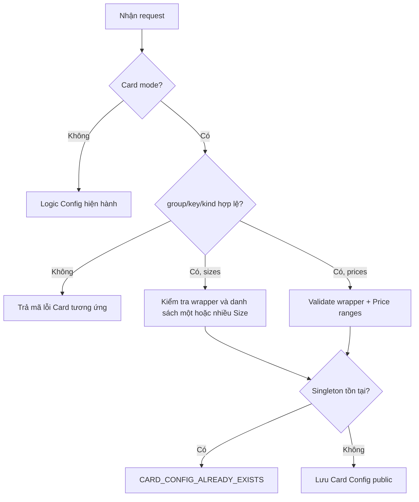
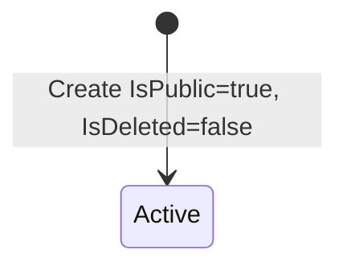
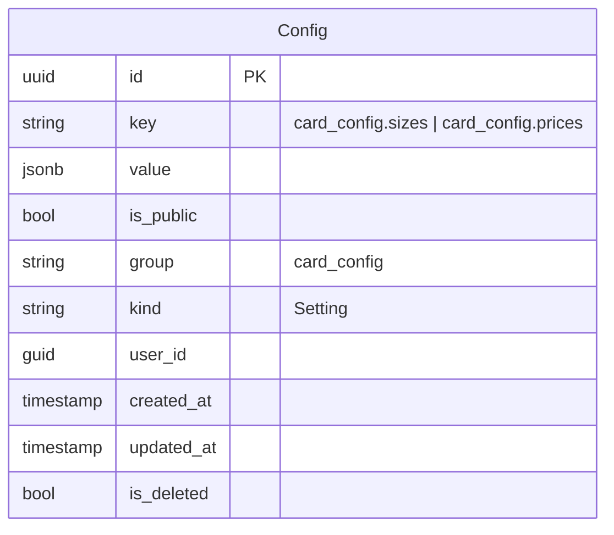

# TDD-009: Tạo Config có hỗ trợ Card Config

## Thông tin tài liệu
- **Tiêu đề**: Bổ sung validation Card Config vào API tạo Config hiện có
- **Ghi chú**: Giữ nguyên route và `CreateConfigRequest`. Request thuộc namespace `card_config` đi qua validation chuyên biệt; Config khác giữ nguyên hành vi hiện hành.

## Metadata quản trị tài liệu
| Trường | Giá trị |
|---|---|
| Mã tài liệu | TDD-009 |
| Phiên bản | v0.9 |
| Author | Codex |
| Reviewer | |
| Approver | Chưa chỉ định |
| Owner | Nhóm Hoa Theo Mùa |
| Cập nhật gần nhất | 2026-09-09 |

---

## BƯỚC 1 — Thông tin & Bối cảnh

### Thông tin tài liệu
- **Mã tài liệu**: TDD-009
- **Tính năng**: Tạo Card Config qua API Config
- **Tác giả**: Codex
- **Người review**:
- **Phiên bản**: v0.9
- **Cập nhật (YYYY-MM-DD)**: 2026-09-09
- **Story liên quan**: Không có

### Business Rules
- BR-009-01: Giữ nguyên `POST /api/v1/configs`, `AdminPolicy` và request gồm `key`, `group`, `kind`, `value`; không thêm field hoặc endpoint mới.
- BR-009-02: Card mode được kích hoạt nếu request `group=card_config` hoặc key có prefix `card_config.`; nhờ đó payload Card sai group/key không rơi sang nhánh Config thường.
- BR-009-03: Trong Card mode, `group` phải exact `card_config`; sai trả `CARD_CONFIG_GROUP_INVALID/400`.
- BR-009-04: Trong Card mode, key chỉ nhận exact `card_config.sizes` hoặc `card_config.prices`; sai trả `CARD_CONFIG_KEY_INVALID/400`.
- BR-009-05: Trong Card mode, `kind` phải exact `Setting`; sai trả `CARD_CONFIG_KIND_INVALID/400`. Frontend tiếp tục truyền field này như hiện nay.
- BR-009-06: Mỗi Card key là singleton trên record chưa xóa, không phụ thuộc `IsPublic`; trùng trả `CARD_CONFIG_ALREADY_EXISTS/409`. Record đã soft-delete không chặn tạo lại.
- BR-009-07: Wrapper `value` phải có đúng bảy field `group`, `label`, `value`, `options`, `required`, `inputType`, `validations`; `group=card_config`, label là string không rỗng, inner `value` là string JSON, `options=[]`, `required=false`, `inputType=json`, `validations=[]`.
- BR-009-08: Inner string phải parse thành object chỉ có `items`; `items` là array không rỗng. Field/item thừa, thiếu hoặc sai kiểu là không hợp lệ.
- BR-009-09: Với key sizes, `items` phải là danh sách không rỗng và được chứa một hoặc nhiều Size. Mỗi item có đúng `name`, `width`, `height`, `base_price`, `max_words`; `name` sau khi bỏ khoảng trắng đầu/cuối không được rỗng hoặc trùng với item khác vì client dùng chính tên này để chọn Size; `width>0`, `height>0`, `base_price>=0`, `max_words>0`. Vi phạm BR-009-07/08/09 trả `CARD_SIZE_CONFIG_INVALID/400`.
- BR-009-10: Price item có đúng `min_words`, `max_words`, `extra_price`; `min_words>=0`, `max_words>=min_words`, `extra_price>=0`; array tăng dần, không chồng lấn và rule sau bắt đầu tại `max_words` trước + 1. Vi phạm BR-009-07/08/10 với key prices trả `CALLIGRAPHY_CONFIG_INVALID/400`.
- BR-009-11: Card Config mới được gán `IsPublic=true`, `IsDeleted=false`, `CreatedAt=UtcNow`, `UpdatedAt=null`; frontend không cần thêm `isPublic` vào Create request.
- BR-009-12: Thành công giữ HTTP 200 và `ConfigResponse` hiện có; Controller vẫn gọi revalidation sau khi SaveChanges.
- BR-009-13: Config ngoài Card mode giữ normalization key, duplicate/group check, trạng thái mặc định và response hiện hành; không áp dụng schema Card.

### Bối cảnh & Mục tiêu

**Vấn đề**
> Frontend đã gửi đúng `group`, `key`, `kind` và wrapper qua API Config cũ. Backend cần nhận diện payload Card trong cùng luồng, kiểm tra schema và trả mã lỗi rõ ràng mà không thay đổi request contract.

**Mục tiêu**
- Thêm hai singleton Card Config vào API Create hiện có.
- Ngăn cấu hình sai trước khi lưu.
- Giữ tương thích cho Config không thuộc Card.

**Ngoài phạm vi** (Out of scope)
- Thêm endpoint hoặc DTO Create mới.
- Đổi HTTP thành công từ 200 sang 201 hoặc mở rộng response DTO.
- Thay đổi cơ chế revalidation hiện hành.

---

## BƯỚC 2 — Kiến trúc & Sơ đồ

### Kiến trúc tổng quan (Architecture)
**Tiêu đề**: Nhánh Card validation trong CreateConfig
**Mô tả**: Controller và DTO giữ nguyên; service phân nhánh theo namespace rồi dùng validator Card trước khi lưu chung bảng Config.


**Ghi chú**: `CardConfigValidator` là trách nhiệm logic, có thể là method nội bộ; tài liệu không bắt buộc tạo service/endpoint mới.

### Sequence Diagram
**Tiêu đề**: Tạo Card Config trong luồng Config hiện hành
**Mô tả**: Validate namespace, singleton và payload trước SaveChanges; sau đó giữ revalidation cũ.

```mermaid
sequenceDiagram
    autonumber
    actor Client
    participant FE as Frontend
    participant C as ConfigController
    participant S as ConfigService
    participant DB as Database
    participant R as Revalidation API
    Client->>FE: Lưu cấu hình Card
    FE->>C: POST /api/v1/configs {group,key,kind,value}
    C->>S: CreateConfig(request)
    Note over S: GIAI ĐOẠN 1: Nhận diện và validate Card
    S->>S: Validate group, key, kind, wrapper, inner items
    Note over S: GIAI ĐOẠN 2: Singleton
    S->>DB: Tìm same key chưa xóa
    alt Có singleton
        S-->>C: CARD_CONFIG_ALREADY_EXISTS/409
    else Hợp lệ
        S->>DB: Insert IsPublic=true; SaveChanges
        DB-->>S: Config mới
        S-->>C: ConfigResponse
        C->>R: Revalidate config
        C-->>FE: HTTP 200 BaseResponse
    end
```
**Ghi chú**: Validation lỗi dừng trước insert và revalidation.

### Activity Diagram (optional — chỉ điền nếu logic có nhiều nhánh điều kiện phức tạp)
**Tiêu đề**: Phân loại payload khi tạo Config
**Mô tả**: Card mode dùng validator theo key; Config thường giữ nhánh cũ.



### State Diagram (optional — chỉ điền nếu entity chính có vòng đời trạng thái)
**Tiêu đề**: Trạng thái khởi tạo Card Config
**Mô tả**: Create chỉ tạo record active/chưa xóa.



### Mô hình dữ liệu (Data Model / ERD)
**Tiêu đề**: Card Config trong bảng Config
**Mô tả**: Không thêm bảng/column; hai singleton phân biệt bằng key.



---

## BƯỚC 3 — API

### API Contract nội bộ

#### Endpoint #1
- **Method**: POST
- **Endpoint**: `/api/v1/configs`
- **Tên endpoint**: Tạo Config/Card Config
- **Mô tả**: Dùng request cũ; Card payload được validate theo key.

**Ví dụ 1 — Tạo Size Config hợp lệ** — HTTP `200`

Request:
```json
{"group":"card_config","key":"card_config.sizes","kind":"Setting","value":{"group":"card_config","label":"Kích thước thiệp","value":"{\"items\":[{\"name\":\"Nhỏ\",\"width\":10,\"height\":15,\"base_price\":10000,\"max_words\":70},{\"name\":\"Lớn\",\"width\":15,\"height\":25,\"base_price\":15000,\"max_words\":150}]}","options":[],"required":false,"inputType":"json","validations":[]}}
```

Response:
```json
{"isSuccess":true,"isFailed":false,"value":{"id":"...","key":"card_config.sizes","group":"card_config","isPublic":true,"value":{},"kind":"Setting","userId":"..."}}
```

**Ví dụ 2 — Tạo Price Config hợp lệ** — HTTP `200`

Request:
```json
{"group":"card_config","key":"card_config.prices","kind":"Setting","value":{"group":"card_config","label":"Bậc giá","value":"{\"items\":[{\"min_words\":0,\"max_words\":35,\"extra_price\":0},{\"min_words\":36,\"max_words\":70,\"extra_price\":39000}]}","options":[],"required":false,"inputType":"json","validations":[]}}
```

Response:
```json
{"isSuccess":true,"isFailed":false,"value":{"id":"...","key":"card_config.prices","group":"card_config","isPublic":true,"value":{},"kind":"Setting","userId":"..."}}
```

**Ví dụ 3 — Group sai** — HTTP `400`, `CARD_CONFIG_GROUP_INVALID`.

Request:
```json
{"group":"other","key":"card_config.sizes","kind":"Setting","value":{"group":"card_config"}}
```

Response:
```json
{"title":"Bad Request","status":400,"messageCode":"CARD_CONFIG_GROUP_INVALID","detail":"Card Config group must be card_config."}
```

**Ví dụ 4 — Key ngoài allowlist** — HTTP `400`, `CARD_CONFIG_KEY_INVALID`.

Request:
```json
{"group":"card_config","key":"card_config.unknown","kind":"Setting","value":{"group":"card_config"}}
```

Response:
```json
{"title":"Bad Request","status":400,"messageCode":"CARD_CONFIG_KEY_INVALID","detail":"Card Config key is invalid."}
```

**Ví dụ 5 — Kind khác Setting** — HTTP `400`, `CARD_CONFIG_KIND_INVALID`.

Request:
```json
{"group":"card_config","key":"card_config.sizes","kind":"Content","value":{"group":"card_config"}}
```

Response:
```json
{"title":"Bad Request","status":400,"messageCode":"CARD_CONFIG_KIND_INVALID","detail":"Card Config kind must be Setting."}
```

**Ví dụ 6 — Size wrapper/item sai** — HTTP `400`, `CARD_SIZE_CONFIG_INVALID`.

Request:
```text
POST /api/v1/configs với Size item width=0
```

Response:
```json
{"title":"Bad Request","status":400,"messageCode":"CARD_SIZE_CONFIG_INVALID","detail":"Size Config is invalid."}
```

**Ví dụ 7 — Price wrapper/range sai** — HTTP `400`, `CALLIGRAPHY_CONFIG_INVALID`.

Request:
```text
POST /api/v1/configs với Price ranges 0-35 và 37-70
```

Response:
```json
{"title":"Bad Request","status":400,"messageCode":"CALLIGRAPHY_CONFIG_INVALID","detail":"Calligraphy Config is invalid."}
```

**Ví dụ 8 — Singleton chưa xóa đã tồn tại** — HTTP `409`, `CARD_CONFIG_ALREADY_EXISTS`.

Request:
```text
POST /api/v1/configs với Size Config hợp lệ khi card_config.sizes chưa xóa đã tồn tại
```

Response:
```json
{"title":"Conflict","status":409,"messageCode":"CARD_CONFIG_ALREADY_EXISTS","detail":"Card Config already exists."}
```

#### Mã lỗi
| Code | HTTP | Khi nào xảy ra |
|---|---|---|
| `CARD_CONFIG_GROUP_INVALID` | 400 | Card mode nhưng group không exact `card_config` |
| `CARD_CONFIG_KEY_INVALID` | 400 | Card mode nhưng key ngoài hai giá trị allowlist |
| `CARD_CONFIG_KIND_INVALID` | 400 | Card mode nhưng kind không exact `Setting` |
| `CARD_SIZE_CONFIG_INVALID` | 400 | Wrapper, inner JSON, số lượng Size hoặc Size item vi phạm BR-009-07 đến 09 |
| `CALLIGRAPHY_CONFIG_INVALID` | 400 | Wrapper, inner JSON hoặc Price range vi phạm BR-009-07, 08, 10 |
| `CARD_CONFIG_ALREADY_EXISTS` | 409 | Có record chưa xóa cùng Card singleton key |
| `MissingAccessToken` / `ExpiredAccessToken` / `InvalidAccessToken` | 401 | JWT middleware từ chối |
| Authorization middleware response | 403 | Không thỏa `AdminPolicy` |

### API Contract bên ngoài (optional — chỉ điền nếu hàm/API này gọi ra service/API của bên thứ ba)
- **Endpoints sử dụng**: Revalidation HTTP POST hiện hành sau khi DB lưu thành công.
- **Field quan trọng**: `entity=config`, `group`, `key`.
- **Xử lý lỗi từ đối tác**: Giữ nguyên hành vi hiện tại; exception xảy ra sau commit không rollback Config.
- **Quirks / cạm bẫy**: HTTP non-success không throw vẫn không làm Controller đổi response thành công.

---

## BƯỚC 4 — Tham chiếu

### 🔴 Tham chiếu đến
- `AI_Card_Context.md` mục 3.4 — wrapper và inner schema.
- TDD-008 — cách đọc Card Config.
- Code hiện hành: `CreateConfigRequest`, `ConfigService.CreateConfig`, `ConfigController.CreateConfig`.

### ⚫ Trỏ vào tài liệu này
- TDD-021 và flow chuẩn bị `OrderDetail.SnapshotCard` sử dụng hai singleton. TDD-006 không đọc Config live.
- TDD-010 và TDD-011 quản lý vòng đời Config.

### ⋯ Bị ảnh hưởng
- Validator dùng chung của Create/Update và mọi flow Card đọc Config.
