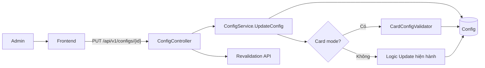
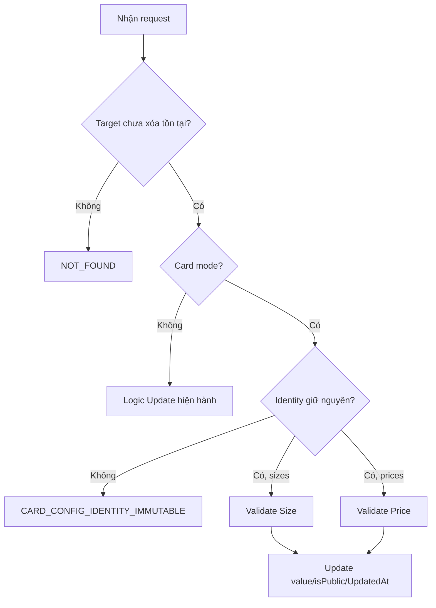
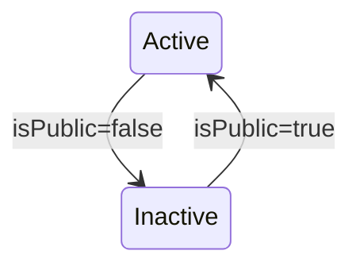
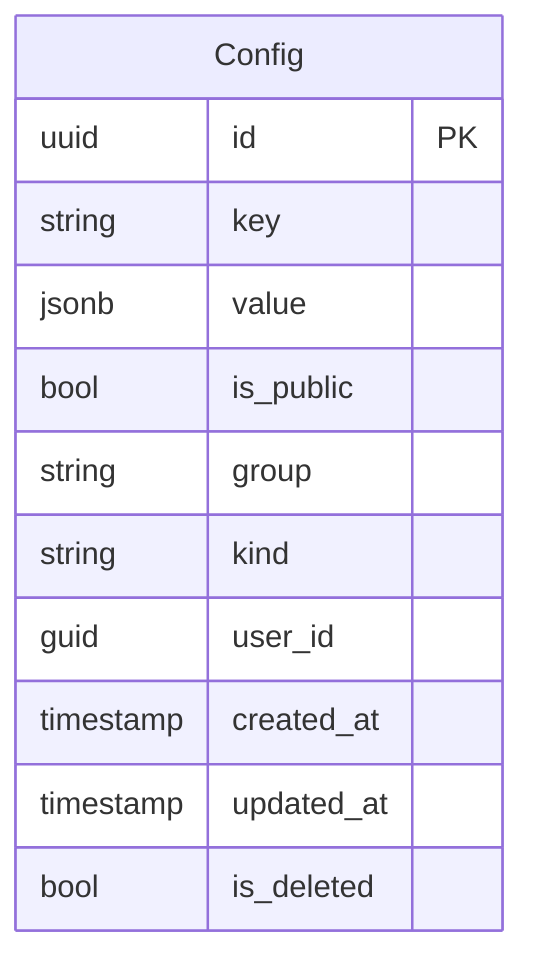

# TDD-010: Cập nhật Config có hỗ trợ Card Config

## Thông tin tài liệu
- **Tiêu đề**: Bổ sung validation Card Config vào API cập nhật Config hiện có
- **Ghi chú**: Giữ nguyên PUT route và `UpdateConfigRequest`; frontend tiếp tục truyền đầy đủ group, key, kind, value, isPublic. Card Config được validate trong cùng service trước khi lưu.

## Metadata quản trị tài liệu
| Trường | Giá trị |
|---|---|
| Mã tài liệu | TDD-010 |
| Phiên bản | v0.7 |
| Author | Codex |
| Reviewer | |
| Approver | Chưa chỉ định |
| Owner | Nhóm Hoa Theo Mùa |
| Cập nhật gần nhất | 2026-09-09 |

---

## BƯỚC 1 — Thông tin & Bối cảnh

### Thông tin tài liệu
- **Mã tài liệu**: TDD-010
- **Tính năng**: Cập nhật Card Config qua API Config
- **Tác giả**: Codex
- **Người review**:
- **Phiên bản**: v0.7
- **Cập nhật (YYYY-MM-DD)**: 2026-09-09
- **Story liên quan**: Không có

### Business Rules
- BR-010-01: Giữ nguyên `PUT /api/v1/configs/{id}`, `AdminPolicy`, GUID route và request `key`, `group`, `kind`, `value`, `isPublic`; không thêm/đổi field.
- BR-010-02: Tìm record chưa xóa theo ID trước. Không có hoặc đã soft-delete trả `NOT_FOUND/404`.
- BR-010-03: Card mode được kích hoạt khi record hiện tại hoặc request thuộc namespace `card_config`; payload sai identity không được rơi sang nhánh Config thường.
- BR-010-04: Với Card Config, `group`, `key`, `kind` là bắt buộc nhưng bất biến và phải đúng giá trị record hiện tại/canonical; đổi bất kỳ field nào trả `CARD_CONFIG_IDENTITY_IMMUTABLE/409`. Frontend chỉ cần gửi lại các giá trị đang có.
- BR-010-05: `isPublic` tiếp tục lấy từ request đầy đủ do frontend gửi và có thể chuyển active/inactive.
- BR-010-06: Wrapper và inner schema dùng lại BR-009-07/08. Size dùng BR-009-09; sai trả `CARD_SIZE_CONFIG_INVALID/400`.
- BR-010-07: Price dùng BR-009-10; sai trả `CALLIGRAPHY_CONFIG_INVALID/400`.
- BR-010-08: Update chỉ thay `value`, `isPublic` và `UpdatedAt=UtcNow`; không thay `group`, `key`, `kind`, `CreatedAt`, `UserId`, `IsDeleted`.
- BR-010-09: Thành công giữ response hiện hành là chuỗi `Cập nhật thành công` trong `BaseResponse`, HTTP 200; không đổi DTO response.
- BR-010-10: Controller tiếp tục gọi revalidation sau SaveChanges với request group/key; cơ chế lỗi ngoài giữ nguyên.
- BR-010-11: Config ngoài Card mode tiếp tục chạy logic Update Config hiện hành, gồm cách duplicate/group check và response cũ; schema Card không áp dụng.
- BR-010-12: Card/History đã tạo không bị sửa vì lưu snapshot và UpdateConfig không cập nhật các bảng đó.

### Bối cảnh & Mục tiêu

**Vấn đề**
> Card Config cần được chỉnh giá/kích thước và trạng thái qua form Config hiện có. Vì frontend đã truyền đầy đủ identity, backend chỉ cần xác nhận identity, validate payload và trả mã lỗi chuyên biệt trong cùng luồng.

**Mục tiêu**
- Không đổi request FE hoặc tạo endpoint mới.
- Ngăn đổi singleton identity và payload Card sai schema.
- Cập nhật timestamp khi Card Config thay đổi.
- Không phá Update của Config khác.

**Ngoài phạm vi** (Out of scope)
- PATCH hoặc optimistic concurrency.
- Tự động sửa payload sai.
- Tính lại giá/snapshot của Card đã tạo.
- Đổi response thành resource Config đầy đủ.

---

## BƯỚC 2 — Kiến trúc & Sơ đồ

### Kiến trúc tổng quan (Architecture)
**Tiêu đề**: Nhánh Card validation trong UpdateConfig
**Mô tả**: Controller/DTO giữ nguyên; service tải target, nhận diện Card mode rồi dùng cùng schema validator với Create.


**Ghi chú**: Validator Card dùng chung quy tắc với TDD-009; không yêu cầu route/service mới.

### Sequence Diagram
**Tiêu đề**: Cập nhật Card Config trong endpoint hiện hành
**Mô tả**: Tìm target trước, khóa identity, validate đúng schema theo key rồi cập nhật value/status/timestamp.

```mermaid
sequenceDiagram
    autonumber
    actor Client
    participant FE as Frontend
    participant C as ConfigController
    participant S as ConfigService
    participant DB as Database
    participant R as Revalidation API
    Client->>FE: Lưu chỉnh sửa Card Config
    FE->>C: PUT /api/v1/configs/{id} full request
    C->>S: UpdateConfig(id, request)
    Note over S: GIAI ĐOẠN 1: Tải target
    S->>DB: Find id where IsDeleted=false
    alt Không tìm thấy
        S-->>C: NOT_FOUND/404
    end
    Note over S: GIAI ĐOẠN 2: Card validation
    S->>S: Check immutable group/key/kind
    S->>S: Validate wrapper + items theo key
    Note over S: GIAI ĐOẠN 3: Lưu
    S->>DB: Update value, isPublic, UpdatedAt; SaveChanges
    S-->>C: Cập nhật thành công
    C->>R: Revalidate config
    C-->>FE: HTTP 200 BaseResponse
```
**Ghi chú**: Validation lỗi không SaveChanges và không gọi revalidation.

### Activity Diagram (optional — chỉ điền nếu logic có nhiều nhánh điều kiện phức tạp)
**Tiêu đề**: Phân nhánh update Card Config
**Mô tả**: Thể hiện thứ tự not-found, immutable và schema validation.



### State Diagram (optional — chỉ điền nếu entity chính có vòng đời trạng thái)
**Tiêu đề**: Chuyển trạng thái public của Card Config
**Mô tả**: Update có thể bật/tắt Card Config mà không xóa record.



### Mô hình dữ liệu (Data Model / ERD)
**Tiêu đề**: Field được cập nhật trong bảng Config
**Mô tả**: Không đổi schema; Card update ghi value, is_public và updated_at.



---

## BƯỚC 3 — API

### API Contract nội bộ

#### Endpoint #1
- **Method**: PUT
- **Endpoint**: `/api/v1/configs/{id}`
- **Tên endpoint**: Cập nhật Config/Card Config
- **Mô tả**: Request/response giữ nguyên; bổ sung validation theo target Card.

**Ví dụ 1 — Cập nhật Size Config hợp lệ** — HTTP `200`

Request:
```json
{"group":"card_config","key":"card_config.sizes","kind":"Setting","isPublic":true,"value":{"group":"card_config","label":"Kích thước thiệp","value":"{\"items\":[{\"name\":\"Kích thước chung\",\"width\":16,\"height\":26,\"base_price\":16000,\"max_words\":150}]}","options":[],"required":false,"inputType":"json","validations":[]}}
```

Response:
```json
{"isSuccess":true,"isFailed":false,"value":"Cập nhật thành công"}
```

**Ví dụ 2 — Cập nhật Price Config hợp lệ** — HTTP `200`

Request:
```json
{"group":"card_config","key":"card_config.prices","kind":"Setting","isPublic":true,"value":{"group":"card_config","label":"Bậc giá","value":"{\"items\":[{\"min_words\":0,\"max_words\":35,\"extra_price\":0},{\"min_words\":36,\"max_words\":70,\"extra_price\":49000}]}","options":[],"required":false,"inputType":"json","validations":[]}}
```

Response:
```json
{"isSuccess":true,"isFailed":false,"value":"Cập nhật thành công"}
```

**Ví dụ 3 — Target không tồn tại hoặc đã xóa** — HTTP `404`, `NOT_FOUND`.

Request:
```http
PUT /api/v1/configs/00000000-0000-0000-0000-000000000000 với full Card request hợp lệ
```

Response:
```json
{"title":"Not Found","status":404,"messageCode":"NOT_FOUND","detail":"Config not found."}
```

**Ví dụ 4 — Đổi group/key/kind** — HTTP `409`, `CARD_CONFIG_IDENTITY_IMMUTABLE`.

Request:
```text
PUT Size Config nhưng request key=card_config.prices
```

Response:
```json
{"title":"Conflict","status":409,"messageCode":"CARD_CONFIG_IDENTITY_IMMUTABLE","detail":"Card Config group, key and kind are immutable."}
```

**Ví dụ 5 — Size payload sai** — HTTP `400`, `CARD_SIZE_CONFIG_INVALID`.

Request:
```text
PUT Size Config với item max_words=0
```

Response:
```json
{"title":"Bad Request","status":400,"messageCode":"CARD_SIZE_CONFIG_INVALID","detail":"Size Config is invalid."}
```

**Ví dụ 6 — Price payload sai** — HTTP `400`, `CALLIGRAPHY_CONFIG_INVALID`.

Request:
```text
PUT Price Config với ranges 0-35 và 35-70
```

Response:
```json
{"title":"Bad Request","status":400,"messageCode":"CALLIGRAPHY_CONFIG_INVALID","detail":"Calligraphy Config is invalid."}
```

#### Mã lỗi
| Code | HTTP | Khi nào xảy ra |
|---|---|---|
| `NOT_FOUND` | 404 | Target không tồn tại hoặc đã soft-delete |
| `CARD_CONFIG_IDENTITY_IMMUTABLE` | 409 | Card request đổi group, key hoặc kind |
| `CARD_SIZE_CONFIG_INVALID` | 400 | Size wrapper/inner không có đúng một Size chung hợp lệ |
| `CALLIGRAPHY_CONFIG_INVALID` | 400 | Price wrapper/inner ranges không hợp lệ |
| `MissingAccessToken` / `ExpiredAccessToken` / `InvalidAccessToken` | 401 | JWT middleware từ chối |
| Authorization middleware response | 403 | Không thỏa `AdminPolicy` |

### API Contract bên ngoài (optional — chỉ điền nếu hàm/API này gọi ra service/API của bên thứ ba)
- **Endpoints sử dụng**: Revalidation HTTP POST hiện hành sau SaveChanges.
- **Field quan trọng**: `entity=config`, request `group`, request `key`.
- **Xử lý lỗi từ đối tác**: Giữ nguyên; exception sau commit không rollback update.
- **Quirks / cạm bẫy**: Non-success response không throw không làm Controller đổi HTTP 200.

---

## BƯỚC 4 — Tham chiếu

### 🔴 Tham chiếu đến
- TDD-009 — schema và validator Card Config dùng chung.
- `AI_Card_Context.md` mục 3.4.
- Code hiện hành: `UpdateConfigRequest`, `ConfigService.UpdateConfig`, `ConfigController.UpdateConfig`.

### ⚫ Trỏ vào tài liệu này
- TDD-006, TDD-007, TDD-021, TDD-027 đọc cấu hình hiện hành nhưng Card cũ dùng snapshot.
- TDD-011 xóa mềm Config.

### ⋯ Bị ảnh hưởng
- Card Config validator và khả năng chọn cấu hình active cho request Card mới.
