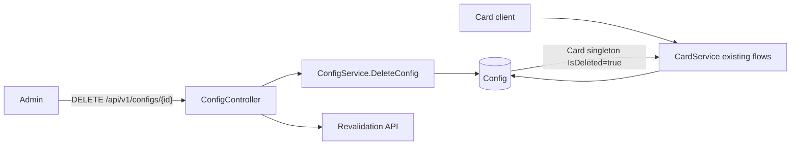
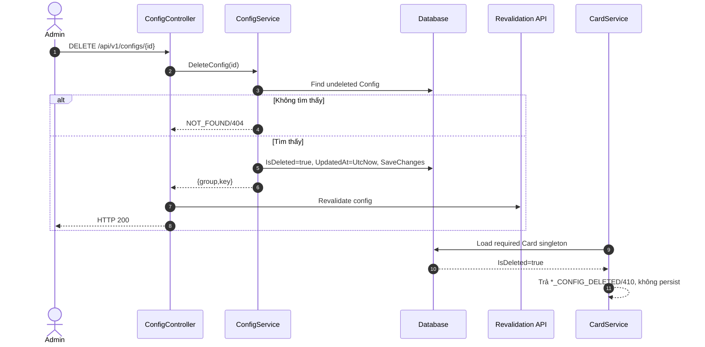
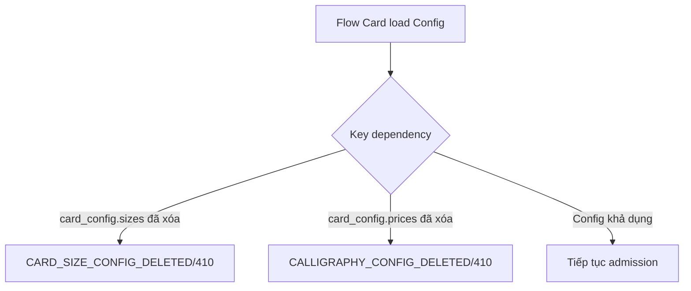
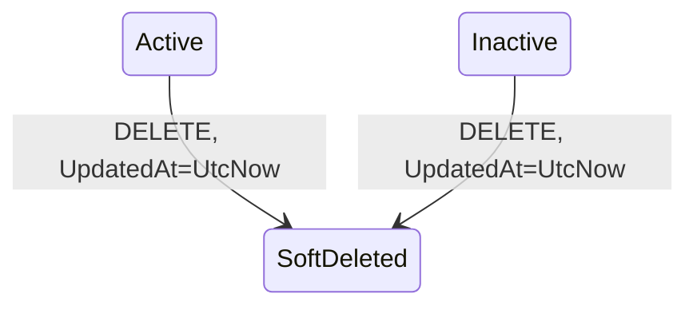
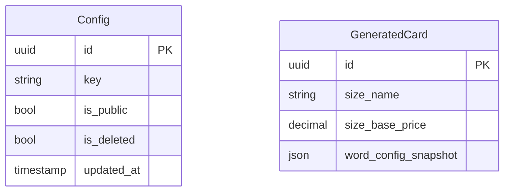

# TDD-011: Xóa Config có hỗ trợ Card Config

## Thông tin tài liệu
- **Tiêu đề**: Xóa mềm Card Config qua API Config và chặn sử dụng mới
- **Ghi chú**: Giữ nguyên DELETE route/response. Card Config được cập nhật timestamp khi xóa; các flow Card hiện có trả mã lỗi tương ứng nếu singleton đã xóa.

## Metadata quản trị tài liệu
| Trường | Giá trị |
|---|---|
| Mã tài liệu | TDD-011 |
| Phiên bản | v0.7 |
| Author | Codex |
| Reviewer | |
| Approver | Chưa chỉ định |
| Owner | Nhóm Hoa Theo Mùa |
| Cập nhật gần nhất | 2026-09-09 |

---

## BƯỚC 1 — Thông tin & Bối cảnh

### Thông tin tài liệu
- **Mã tài liệu**: TDD-011
- **Tính năng**: Xóa mềm Card Config
- **Tác giả**: Codex
- **Người review**:
- **Phiên bản**: v0.7
- **Cập nhật (YYYY-MM-DD)**: 2026-09-09
- **Story liên quan**: Không có

### Business Rules
- BR-011-01: Giữ nguyên `DELETE /api/v1/configs/{id}`, GUID route, `AdminPolicy` và request không có body.
- BR-011-02: Service tìm record chưa xóa theo ID; không tồn tại hoặc đã soft-delete trả `NOT_FOUND/404`.
- BR-011-03: Khi tìm thấy, service giữ cơ chế soft-delete `IsDeleted=true` và bổ sung `UpdatedAt=UtcNow`; không xóa vật lý.
- BR-011-04: Response thành công giữ `ResponseDeleteConfig` hiện tại gồm `group`, `key`, được bọc trong `BaseResponse`, HTTP 200; không thêm field request/response.
- BR-011-05: Controller tiếp tục gọi revalidation sau SaveChanges với `entity=config`, `group`, `key`; hành vi external failure hiện hành không đổi.
- BR-011-06: Nếu record là `card_config.sizes`, mọi flow tạo Card mới đang cần Size Config phải phát hiện record đã xóa và trả `CARD_SIZE_CONFIG_DELETED/410` trước khi gọi AI hoặc persist Card/History.
- BR-011-07: Nếu record là `card_config.prices`, flow Card mới cần calligraphy pricing phải trả `CALLIGRAPHY_CONFIG_DELETED/410` trước khi gọi AI hoặc persist Card/History.
- BR-011-08: Card/History đã tạo giữ nguyên snapshot; Delete Config không cập nhật hoặc xóa các record cũ.
- BR-011-09: Config ngoài Card vẫn giữ luồng soft-delete/revalidation hiện hành; việc bổ sung mã lỗi Card chỉ áp dụng tại các flow Card đang tiêu thụ hai singleton.

### Bối cảnh & Mục tiêu

**Vấn đề**
> Admin cần xóa Card Config bằng API Config cũ. Việc xóa phải có dấu thời gian và khiến request Card mới nhận mã lỗi rõ ràng, trong khi dữ liệu Card cũ vẫn độc lập nhờ snapshot.

**Mục tiêu**
- Giữ nguyên DELETE contract.
- Cập nhật `UpdatedAt` khi soft-delete.
- Phân biệt dependency Size/Price đã xóa trong các flow Card hiện có.
- Bảo toàn snapshot đã tạo.

**Ngoài phạm vi** (Out of scope)
- Khôi phục Config.
- Cascade delete Card/History.
- Thêm body hoặc endpoint Delete mới.
- Thay đổi response thành công hiện hành.

---

## BƯỚC 2 — Kiến trúc & Sơ đồ

### Kiến trúc tổng quan (Architecture)
**Tiêu đề**: Xóa Card Config và ảnh hưởng lên Card admission
**Mô tả**: ConfigController soft-delete như hiện tại; CardService ở các endpoint tạo hiện có kiểm tra singleton live và trả mã lỗi nếu dependency đã xóa.


**Ghi chú**: Không tạo luồng Card mới; chỉ bổ sung lỗi vào bước kiểm tra Config của các flow đang có.

### Sequence Diagram
**Tiêu đề**: Soft-delete và lần sử dụng Card Config tiếp theo
**Mô tả**: Delete commit trước revalidation; request Card sau đó bị chặn theo key dependency.


**Ghi chú**: Card cũ không load lại Config để thay snapshot.

### Activity Diagram (optional — chỉ điền nếu logic có nhiều nhánh điều kiện phức tạp)
**Tiêu đề**: Kiểm tra dependency đã xóa
**Mô tả**: Mã lỗi phụ thuộc singleton mà flow Card cần.



### State Diagram (optional — chỉ điền nếu entity chính có vòng đời trạng thái)
**Tiêu đề**: Vòng đời soft-delete Card Config
**Mô tả**: API không hỗ trợ restore.



### Mô hình dữ liệu (Data Model / ERD)
**Tiêu đề**: Config và snapshot Card
**Mô tả**: Generated Card không bị cascade; các cột snapshot giữ dữ liệu tại thời điểm tạo.



---

## BƯỚC 3 — API

### API Contract nội bộ

#### Endpoint #1
- **Method**: DELETE
- **Endpoint**: `/api/v1/configs/{id}`
- **Tên endpoint**: Xóa mềm Config/Card Config
- **Mô tả**: Giữ request/response hiện hành, bổ sung timestamp và mã not-found.

**Ví dụ 1 — Xóa Card Config thành công** — HTTP `200`

Request:
```http
DELETE /api/v1/configs/550e8400-e29b-41d4-a716-446655440001
```

Response:
```json
{"isSuccess":true,"isFailed":false,"value":{"group":"card_config","key":"card_config.sizes"}}
```

**Ví dụ 2 — Config không tồn tại hoặc đã xóa** — HTTP `404`

Response:
```json
{"title":"Not Found","status":404,"detail":"Config not found.","messageCode":"NOT_FOUND"}
```

#### Endpoint bị ảnh hưởng #2
- **Method**: POST
- **Endpoint**: Các endpoint tạo Card hiện có tại TDD-006/TDD-021/TDD-027
- **Tên endpoint**: Card admission dùng Config live
- **Mô tả**: Không đổi request; bổ sung mã lỗi khi dependency đã soft-delete.

**Ví dụ 3 — Size Config đã xóa** — HTTP `410`, `CARD_SIZE_CONFIG_DELETED`.

Request:
```http
POST endpoint tạo Card hiện có với request hợp lệ; service tự lấy Size chung
```

Response:
```json
{"title":"Gone","status":410,"messageCode":"CARD_SIZE_CONFIG_DELETED","detail":"Size Config has been deleted."}
```

**Ví dụ 4 — Price Config đã xóa** — HTTP `410`, `CALLIGRAPHY_CONFIG_DELETED`.

Request:
```http
POST endpoint tạo Card calligraphy hiện có với nội dung hợp lệ
```

Response:
```json
{"title":"Gone","status":410,"messageCode":"CALLIGRAPHY_CONFIG_DELETED","detail":"Calligraphy Config has been deleted."}
```

#### Mã lỗi
| Code | HTTP | Khi nào xảy ra |
|---|---|---|
| `NOT_FOUND` | 404 | DELETE target không tồn tại hoặc đã soft-delete |
| `CARD_SIZE_CONFIG_DELETED` | 410 | Flow Card mới cần `card_config.sizes` nhưng singleton đã xóa |
| `CALLIGRAPHY_CONFIG_DELETED` | 410 | Flow Card mới cần `card_config.prices` nhưng singleton đã xóa |
| `MissingAccessToken` / `ExpiredAccessToken` / `InvalidAccessToken` | 401 | JWT middleware từ chối DELETE |
| Authorization middleware response | 403 | Principal không thỏa `AdminPolicy` |

### API Contract bên ngoài (optional — chỉ điền nếu hàm/API này gọi ra service/API của bên thứ ba)
- **Endpoints sử dụng**: Revalidation HTTP POST hiện hành sau soft-delete.
- **Field quan trọng**: `entity=config`, deleted record `group`, deleted record `key`.
- **Xử lý lỗi từ đối tác**: Giữ nguyên; exception sau commit không rollback soft-delete.
- **Quirks / cạm bẫy**: Non-success response không throw không làm Controller đổi HTTP 200.

---

## BƯỚC 4 — Tham chiếu

### 🔴 Tham chiếu đến
- TDD-006, TDD-021, TDD-027 — các flow Card sử dụng Config live.
- TDD-009, TDD-010 — tạo/cập nhật singleton.
- Code hiện hành: `ConfigService.DeleteConfig`, `ConfigController.DeleteConfig`, `ResponseDeleteConfig`.

### ⚫ Trỏ vào tài liệu này
- Các UT Card admission cần kiểm tra mã lỗi dependency đã xóa.

### ⋯ Bị ảnh hưởng
- Tất cả flow tạo Card mới; Card/History đã tạo không bị thay đổi vì dùng snapshot.
