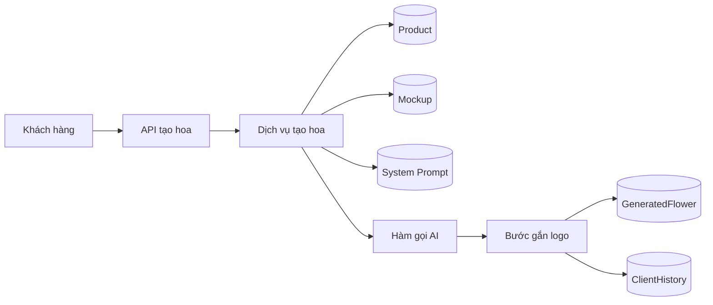
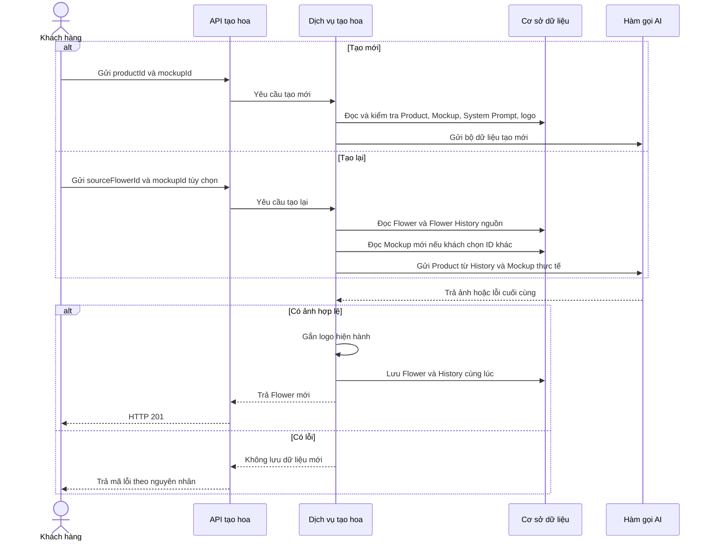
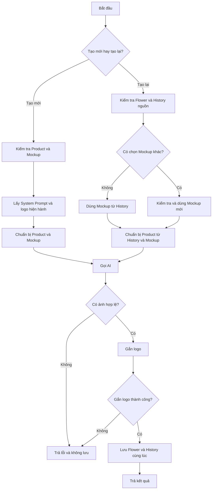
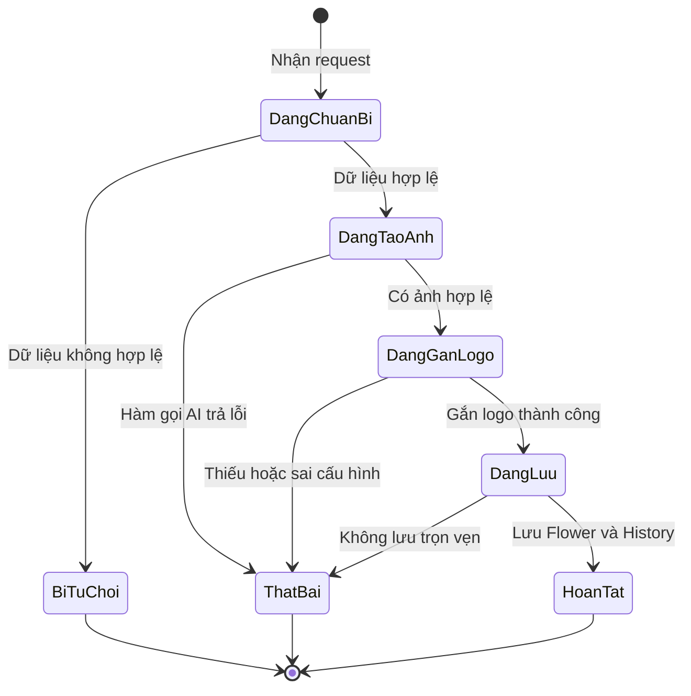
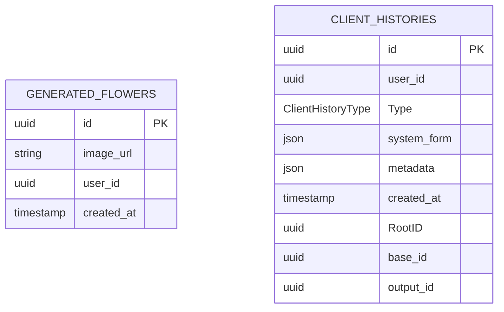

# TDD-016: Tạo và tạo lại mẫu hoa bằng AI

## Thông tin tài liệu

- **Tiêu đề**: Tạo mẫu hoa mới và tạo lại mẫu hoa từ lịch sử
- **Ghi chú**: Khách hàng chọn sản phẩm và mẫu bố cục để tạo ảnh hoa. Cả tạo mới và tạo lại đều không nhận `userInput`.

## Metadata quản trị tài liệu

| Trường            | Giá trị           |
| ----------------- | ----------------- |
| Mã tài liệu       | TDD-016           |
| Phiên bản         | v2.0              |
| Author            | Codex             |
| Reviewer          | Chưa chỉ định     |
| Approver          | Chưa chỉ định     |
| Owner             | Nhóm Hoa Theo Mùa |
| Cập nhật gần nhất | 2026-09-09        |

---

## BƯỚC 1 — Thông tin & Bối cảnh

### Thông tin tài liệu

- **Mã tài liệu**: TDD-016
- **Tính năng**: Tạo mẫu hoa mới và tạo lại một mẫu hoa đã có trong lịch sử.
- **Story liên quan**: STORY-030, STORY-033.
- **Phạm vi API**: `POST /api/ai-flowers` và `POST /api/ai-flowers/{sourceFlowerId}/regenerate`.
- **Ngoài phạm vi**: Cách hàm gọi AI tự đếm lượt, thử lại và tạo mã lỗi riêng. Tài liệu ngữ cảnh có thể mô tả các quy tắc đó, nhưng TDD này chỉ nhận kết quả cuối cùng từ hàm gọi AI.

### Business Rules

- **BR-016-01**: Chỉ khách hàng đã đăng nhập và có tài khoản đang hoạt động mới được tạo hoặc tạo lại mẫu hoa.
- **BR-016-02**: Khi tạo mới, request chỉ nhận `productId` và `mockupId`. `userInput` không còn thuộc hợp đồng API. Tên field dùng dạng camelCase để thống nhất với cấu hình chung của API.
- **BR-016-03**: `productId` phải là đúng mã Product hoặc biến thể khách hàng đã chọn. Nếu Product có biến thể thì không dùng mã Product cha thay cho mã biến thể.
- **BR-016-04**: Product được kiểm tra theo thứ tự: có tồn tại hay không, có bị đánh dấu xóa hay không, có đang hoạt động hay không và có thể bán hay không. Mỗi nguyên nhân có mã lỗi riêng để người gọi hiểu đúng lý do.
- **BR-016-05**: Mockup, tức mẫu bố cục dùng để tạo ảnh hoa, phải tồn tại, chưa bị đánh dấu xóa và đang hoạt động.
- **BR-016-06**: Khi tạo mới, hệ thống phải lấy hướng dẫn dành cho hoa đang được sử dụng trong `SystemPrompt`. Nếu không có hướng dẫn dùng được thì dừng trước khi gọi AI.
- **BR-016-07**: Nếu request Create hoặc Regenerate chứa `userInput`, hệ thống trả `VALIDATION_ERROR/400` và không gọi AI.
- **BR-016-08**: Hệ thống chuẩn bị một bộ dữ liệu cố định trong bộ nhớ rồi gửi một lần cho hàm gọi AI. Bộ dữ liệu tạo mới gồm Product, Mockup, ảnh Product, hướng dẫn dành cho hoa và cấu hình cần dùng. Cách hàm gọi AI tự thử lại nằm ngoài TDD này.
- **BR-016-09**: Ảnh AI trả về phải dùng được. Hệ thống gắn logo theo cấu hình hiện hành trước khi lưu. Thiếu hoặc sai cấu hình logo được xem là lỗi nội bộ.
- **BR-016-10**: Thành công phải lưu một `GeneratedFlower` và một `ClientHistory` trong cùng một giao dịch dữ liệu. Nếu một bước lưu thất bại thì không giữ lại bản ghi nào.
- **BR-016-11**: `GeneratedFlower` chỉ giữ ID, địa chỉ ảnh kết quả, ID khách hàng và thời điểm tạo. Bảng này không có `input_snapshot`.
- **BR-016-12**: History của hoa có `type="flower"`, `base_id=productId`, `RootID=base_id` và `output_id=generatedFlower.id`. `RootID` bắt buộc khác `Guid.Empty`, chỉ dùng nội bộ và không có khóa ngoại trong cơ sở dữ liệu.
- **BR-016-13**: `ClientHistory.Metadata` là nơi duy nhất lưu dữ liệu cần dùng lại khi tạo lại hoa. Metadata không lặp Product ID, Flower ID, ảnh kết quả hoặc System Prompt vì các dữ liệu đó đã có ở cột khác.
- **BR-016-14**: Metadata phải lưu tên Product, thuộc tính Product, ảnh Product bất biến, trạng thái Product tại thời điểm tạo, Mockup thực tế, cấu hình logo thực tế, loại thao tác, nguồn tạo lại nếu có, nguồn System Prompt và thời điểm dữ liệu được chuẩn bị.
- **BR-016-15**: `ClientHistory.SystemForm` lưu `{type, content}` của System Prompt thực tế đã dùng và không lưu ID của prompt. Metadata không lặp lại nội dung này.
- **BR-016-16**: Không tạo `flower_requests`, `flower_ai_jobs` hoặc bản ghi trung gian khác.
- **BR-016-17**: Khi tạo lại, Flower nguồn phải tồn tại, thuộc khách hàng hiện tại và có đúng một History loại `flower` với `output_id` bằng ID Flower nguồn.
- **BR-016-18**: History nguồn phải có `base_id` và `RootID` cùng là một Product ID hợp lệ, khác `Guid.Empty`. Metadata phải có đủ tên, thuộc tính, ảnh Product và Mockup cần dùng. Thiếu hoặc mâu thuẫn thì trả `FLOWER_SOURCE_HISTORY_INVALID/409`; không đọc Product hiện tại để đoán bù.
- **BR-016-19**: Request tạo lại chỉ được có `mockupId` tùy chọn. Hệ thống không nhận `productId`, `userInput` hoặc field thay đổi nội dung nào khác.
- **BR-016-20**: Tạo lại không dùng ảnh kết quả của Flower nguồn làm ảnh đầu vào. Tên, thuộc tính và ảnh Product được lấy từ History metadata nguồn.
- **BR-016-21**: Nếu `mockupId` bị bỏ trống, bằng `null` hoặc bằng ID Mockup nguồn, hệ thống dùng nguyên Mockup trong History metadata mà không đọc lại bản ghi Mockup hiện tại.
- **BR-016-22**: Nếu `mockupId` khác ID Mockup nguồn, Mockup mới phải tồn tại, chưa bị đánh dấu xóa và đang hoạt động. History mới lưu dữ liệu của Mockup mới này.
- **BR-016-23**: Khi tạo lại, hệ thống ưu tiên System Prompt hiện hành dành cho hoa. Nếu prompt hiện hành không dùng được thì lấy `system_form` của History nguồn. Nếu cả hai đều không dùng được thì trả `FLOWER_SOURCE_HISTORY_INVALID/409`.
- **BR-016-24**: Tạo lại luôn dùng cấu hình logo hiện hành. History mới lưu đúng cấu hình logo đã dùng cho lần tạo lại đó.
- **BR-016-25**: History mới kế thừa `base_id` của History nguồn và đặt `RootID=base_id`. `metadata.regeneratedFromFlowerId` lưu ID Flower trực tiếp được chọn, còn `output_id` lưu ID Flower mới.
- **BR-016-26**: Trong chuỗi F1 → F2 → F3, cả ba History giữ cùng Product trong `base_id/RootID`. F2 lưu `regeneratedFromFlowerId=F1`; F3 lưu `regeneratedFromFlowerId=F2`.
- **BR-016-27**: Nếu hàm gọi AI, bước gắn logo hoặc giao dịch lưu dữ liệu trả lỗi cuối cùng thì API trả lỗi nội bộ và không lưu Flower hoặc History mới.
- **BR-016-28**: Product và Mockup chỉ được kiểm tra ở thời điểm chuẩn bị dữ liệu của request. Thay đổi xảy ra sau thời điểm đó không làm hủy kết quả đang được xử lý.

### Bối cảnh & Mục tiêu

**Vấn đề**

Khách hàng cần xem trước một mẫu hoa được tạo từ Product và Mockup đã chọn. Khách hàng cũng có thể tạo một phiên bản mới từ kết quả cũ. Dữ liệu dùng lại phải còn chính xác ngay cả khi Product hoặc Mockup hiện tại đã thay đổi.

Trước đây dữ liệu này được ghi cả trong `GeneratedFlower.input_snapshot` và `ClientHistory.Metadata`. Hai nơi lưu cùng mục đích dễ lệch nhau. Thiết kế mới bỏ `input_snapshot` và giao toàn bộ dữ liệu dùng lại cho Flower History.

**Mục tiêu**

- Tạo ảnh hoa từ đúng Product và Mockup khách hàng chọn.
- Không nhận hoặc lưu `userInput` trong cả hai đường dẫn API.
- Dùng Flower History làm nguồn duy nhất khi tạo lại.
- Giữ được tên, thuộc tính và ảnh Product tại thời điểm tạo.
- Không để Product hoặc Mockup thay đổi về sau làm sai dữ liệu nguồn.
- Lưu Flower và History đầy đủ hoặc không lưu gì cả.

**Kết quả mong đợi**

- `GeneratedFlower` chỉ chứa kết quả ảnh.
- `ClientHistory` chứa nguồn gốc Product và dữ liệu cần dùng lại.
- Tạo lại không phụ thuộc vào Product hiện tại.
- Card vẫn có thể dùng `GeneratedFlower.ImageUrl`; Product gốc vẫn được xác định bằng `base_id/RootID` của Flower History.

---

## BƯỚC 2 — Kiến trúc & Sơ đồ

### Kiến trúc tổng quan (Architecture)



Sơ đồ cho thấy dịch vụ tạo hoa đọc các nguồn cần thiết, gửi dữ liệu cho hàm gọi AI, gắn logo và lưu kết quả. `GeneratedFlower` giữ ảnh kết quả; `ClientHistory` giữ dữ liệu cần truy lại.

### Sequence Diagram



Khi tạo mới, dữ liệu gồm Product và Mockup hiện tại. Khi tạo lại, dữ liệu Product đến từ Flower History. Cả hai nhánh không nhận `userInput` và chỉ lưu khi đã có ảnh hợp lệ và gắn logo thành công.

### Activity Diagram



Điểm quan trọng của luồng là tạo lại không đọc Product hiện tại. Nếu History không đủ dữ liệu thì hệ thống dừng, thay vì đoán hoặc ghép dữ liệu từ nguồn khác.

### State Diagram



Trạng thái hoàn tất chỉ đạt được khi cả Flower và History đã được lưu. Mọi trạng thái lỗi đều kết thúc mà không giữ dữ liệu mới dang dở.

### Mô hình dữ liệu (Data Model / ERD)



Không tạo khóa ngoại giữa hai bảng trong sơ đồ này. Code chịu trách nhiệm gán `output_id` bằng ID Flower và giữ `base_id/RootID` là Product ID gốc.

Metadata của Flower History dùng `schemaVersion=3`:

```json
{
  "schemaVersion": 3,
  "operation": "create",
  "product": {
    "name": "Combo A - biến thể đỏ",
    "attributes": {},
    "image": {
      "url": "https://storage.example.com/products/a.jpg",
      "objectKey": "products/a.jpg",
      "versionId": "v15",
      "sha256": "hash-cua-anh"
    },
    "observedStatus": {
      "isActive": true,
      "isDeleted": false,
      "sellableQuantity": 3
    }
  },
  "mockup": {
    "id": "550e8400-e29b-41d4-a716-446655440002",
    "name": "Bó hoa đặt giữa",
    "description": "Bố cục nhìn thẳng",
    "image": {
      "url": "https://storage.example.com/mockups/m.jpg",
      "objectKey": "mockups/m.jpg",
      "versionId": "v8",
      "sha256": "hash-cua-anh"
    },
    "observedStatus": {
      "isActive": true,
      "isDeleted": false
    }
  },
  "logoConfig": {},
  "regeneratedFromFlowerId": null,
  "systemPromptSource": "current",
  "validatedAt": "2026-09-09T08:00:00Z"
}
```

`product` không chứa ID vì Product ID đã nằm trong `base_id/RootID`. `userInput` không thuộc request và không xuất hiện trong metadata. Với lần tạo lại, `operation="regenerate"`, `regeneratedFromFlowerId` có ID Flower nguồn và `systemPromptSource` có giá trị `current` hoặc `source_flower_fallback`.

`system_form` lưu riêng hướng dẫn thực tế đã dùng:

```json
{
  "type": "flower",
  "content": "Nội dung hướng dẫn đầy đủ"
}
```

---

## BƯỚC 3 — API

### API Contract nội bộ

#### Endpoint #1

- **Method**: POST
- **Endpoint**: `/api/ai-flowers`
- **Tên endpoint**: Tạo mẫu hoa mới
- **Mô tả**: Tạo một ảnh hoa từ Product và Mockup khách hàng chọn.

| Field       | Type |       Required | Mô tả                                                                                  |
| ----------- | ---- | -------------: | -------------------------------------------------------------------------------------- |
| `productId` | uuid |             Có | ID chính xác của Product hoặc biến thể được chọn.                                      |
| `mockupId`  | uuid |             Có | ID Mockup dùng làm bố cục.                                                             |
| `userInput` | —    | Không cho phép | Field này đã bị loại khỏi luồng tạo hoa; nếu xuất hiện thì trả `VALIDATION_ERROR/400`. |

**Ví dụ — Tạo thành công** — HTTP `201`

Request:

```json
{
  "productId": "550e8400-e29b-41d4-a716-446655440001",
  "mockupId": "550e8400-e29b-41d4-a716-446655440002"
}
```

Response:

```json
{
  "value": {
    "id": "660e8400-e29b-41d4-a716-446655440001",
    "imageUrl": "https://storage.example.com/flowers/flower-01.png",
    "userId": "770e8400-e29b-41d4-a716-446655440001",
    "createdAt": "2026-09-09T08:00:00Z"
  }
}
```

History được lưu với `base_id=RootID=productId`, `output_id=value.id`. Metadata có Product, Mockup và cấu hình thực tế. Request và dữ liệu lưu không có `userInput`.

#### Endpoint #2

- **Method**: POST
- **Endpoint**: `/api/ai-flowers/{sourceFlowerId}/regenerate`
- **Tên endpoint**: Tạo lại mẫu hoa
- **Mô tả**: Tạo Flower mới từ dữ liệu Product và Mockup đã lưu trong Flower History nguồn.

| Field            | Vị trí | Type      |       Required | Mô tả                                                                                  |
| ---------------- | ------ | --------- | -------------: | -------------------------------------------------------------------------------------- |
| `sourceFlowerId` | path   | uuid      |             Có | ID của `GeneratedFlower` được chọn.                                                    |
| `mockupId`       | body   | uuid/null |          Không | Bỏ trống, `null` hoặc bằng ID nguồn để dùng Mockup đã lưu; ID khác để chọn Mockup mới. |
| `productId`      | body   | —         | Không cho phép | Product luôn lấy từ History nguồn.                                                     |
| `userInput`      | body   | —         | Không cho phép | Tạo lại không sử dụng nội dung người dùng đã nhập.                                     |

**Ví dụ 1 — Dùng lại Mockup nguồn** — HTTP `201`

Request:

```json
{}
```

**Ví dụ 2 — Chọn Mockup khác** — HTTP `201`

Request:

```json
{
  "mockupId": "550e8400-e29b-41d4-a716-446655440099"
}
```

Response của cả hai trường hợp có cùng cấu trúc với Endpoint #1. History mới giữ Product ID gốc trong `base_id/RootID` và lưu ID Flower nguồn trong `metadata.regeneratedFromFlowerId`.

**Ví dụ 3 — History nguồn thiếu dữ liệu Product** — HTTP `409`

```json
{
  "status": 409,
  "messageCode": "FLOWER_SOURCE_HISTORY_INVALID"
}
```

Hệ thống không đọc Product hiện tại hoặc metadata của loại History khác để đoán dữ liệu bị thiếu.

#### Mã lỗi

| Code                               | HTTP | Áp dụng | Khi nào xảy ra                                                                                                                      |
| ---------------------------------- | ---: | ------- | ----------------------------------------------------------------------------------------------------------------------------------- |
| `VALIDATION_ERROR`                 |  400 | Cả hai  | Path hoặc body sai kiểu, thiếu field bắt buộc hoặc chứa field không được phép.                                                      |
| `UNAUTHORIZED`                     |  401 | Cả hai  | Chưa đăng nhập hoặc tài khoản không hoạt động.                                                                                      |
| `PRODUCT_NOT_FOUND`                |  404 | Tạo mới | Product không tồn tại.                                                                                                              |
| `PRODUCT_DELETED`                  |  410 | Tạo mới | Product đã bị đánh dấu xóa.                                                                                                         |
| `PRODUCT_INACTIVE`                 |  409 | Tạo mới | Product đang ngừng hoạt động.                                                                                                       |
| `PRODUCT_OUT_OF_STOCK`             |  409 | Tạo mới | Product không còn số lượng có thể bán.                                                                                              |
| `PRODUCT_NOT_SELLABLE`             |  422 | Tạo mới | Product thiếu công thức hoặc dữ liệu lõi cần thiết.                                                                                 |
| `PRODUCT_AVAILABILITY_UNAVAILABLE` |  503 | Tạo mới | Không xác định được số lượng có thể bán.                                                                                            |
| `MOCKUP_NOT_FOUND`                 |  404 | Cả hai  | Mockup cần kiểm tra không tồn tại.                                                                                                  |
| `MOCKUP_DELETED`                   |  410 | Cả hai  | Mockup cần kiểm tra đã bị đánh dấu xóa.                                                                                             |
| `MOCKUP_INACTIVE`                  |  409 | Cả hai  | Mockup cần kiểm tra đang ngừng hoạt động.                                                                                           |
| `SYSTEM_PROMPT_INVALID`            |  409 | Tạo mới | Không có System Prompt dành cho hoa dùng được.                                                                                      |
| `FLOWER_SOURCE_NOT_FOUND`          |  404 | Tạo lại | Flower nguồn không tồn tại.                                                                                                         |
| `ACCESS_DENIED`                    |  403 | Tạo lại | Flower nguồn thuộc khách hàng khác.                                                                                                 |
| `FLOWER_SOURCE_HISTORY_INVALID`    |  409 | Tạo lại | Thiếu History, có nhiều History phù hợp, nguồn gốc Product mâu thuẫn, metadata thiếu dữ liệu hoặc không có System Prompt dùng được. |
| `INTERNAL_SERVER_ERROR`            |  500 | Cả hai  | Hàm gọi AI trả lỗi cuối cùng, thiếu hoặc sai cấu hình logo, gắn logo thất bại hoặc không lưu trọn vẹn Flower và History.            |

TDD này không định nghĩa mã lỗi quota hoặc quy tắc thử lại. Các việc đó thuộc hàm gọi AI và được mô tả trong tài liệu ngữ cảnh tương ứng.

### API Contract bên ngoài

- Dịch vụ nghiệp vụ gọi một hàm AI nội bộ và nhận ảnh hợp lệ hoặc lỗi cuối cùng.
- Với tạo mới, dữ liệu gửi vào gồm Product, ảnh Product và Mockup.
- Với tạo lại, Product và ảnh Product đến từ Flower History; Mockup đến từ History hoặc Mockup mới được chọn.
- Cả hai luồng đều từ chối `userInput`.
- Dịch vụ nghiệp vụ không tự đếm lượt và không tự điều khiển số lần thử lại.
- Nhà cung cấp AI, địa chỉ dịch vụ và thông tin đăng nhập chưa được quy định trong codebase nên không được tự bổ sung tại TDD này.

---

## BƯỚC 4 — Tham chiếu

### 🔴 Tham chiếu đến

- `AI_Flower_Context.md` — quy tắc tổng thể của luồng tạo hoa và phần vận hành bên trong hàm gọi AI.
- `AI_DB_Diagram.md`, `AI_CUSTOMIZE_DB.dbdiagram` — cấu trúc `GeneratedFlower`, `ClientHistory`, Mockup và System Prompt.
- TDD-012 đến TDD-015 — quản lý và trạng thái Mockup.
- Product Entity/Core Database — Product, biến thể và cách xác định khả năng bán.

### ⚫ Trỏ vào tài liệu này

- TDD-006 — tạo mới Card AI từ `OrderDetail.SnapshotCard` và tạo lại Card AI từ Card History; Flower History vẫn được dùng để resolve Product gốc khi snapshot có nguồn Generated Flower.
- TDD-021 — tạo Card HandMade từ Product hoặc Generated Flower.

### ⋯ Bị ảnh hưởng

- `GeneratedFlower` entity và cấu hình bảng — bỏ `InputSnapshot`/`input_snapshot`.
- Migration cơ sở dữ liệu — xóa cột `GeneratedFlower.input_snapshot`.
- Flower History — trở thành nguồn duy nhất chứa dữ liệu Product và Mockup dùng cho tạo lại.
- Checkout/Order — tiếp tục dùng `RootID` để xác định Product gốc và kiểm tra Product hiện tại khi đặt hàng.
