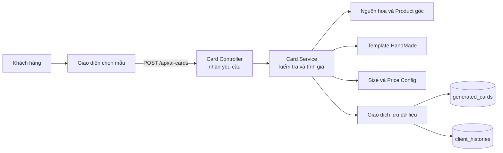
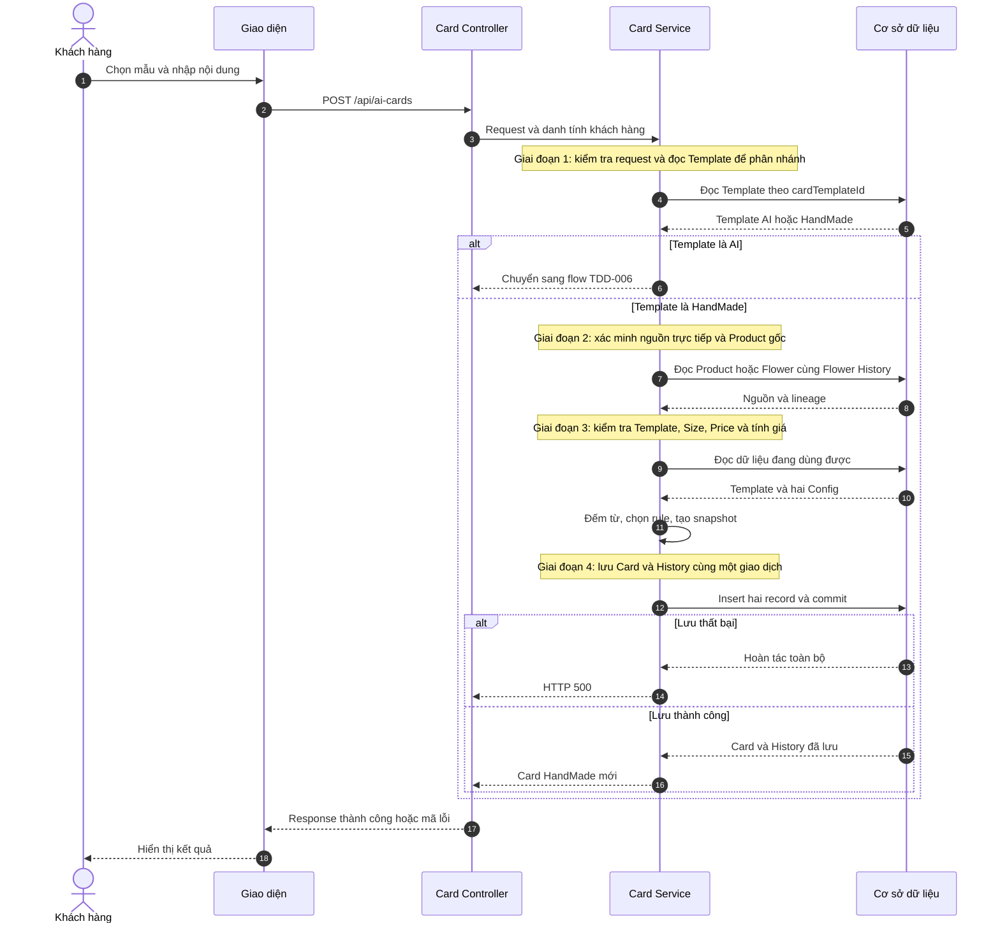
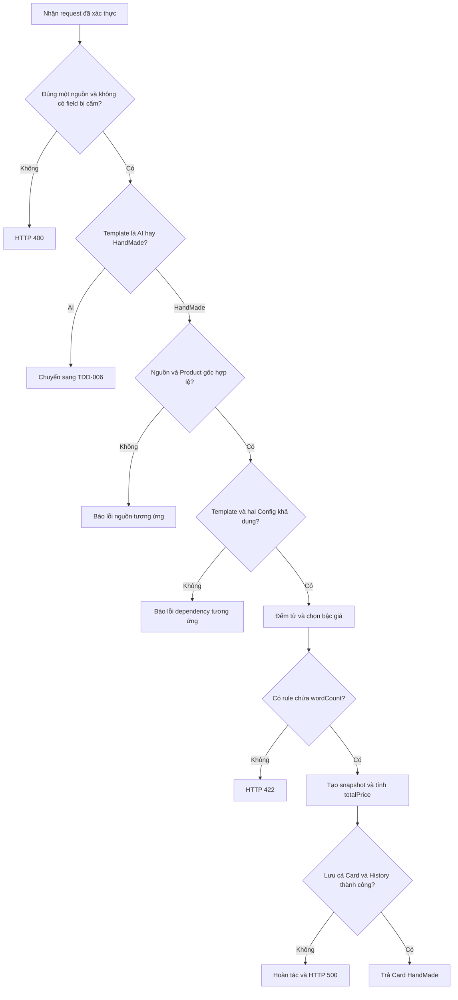
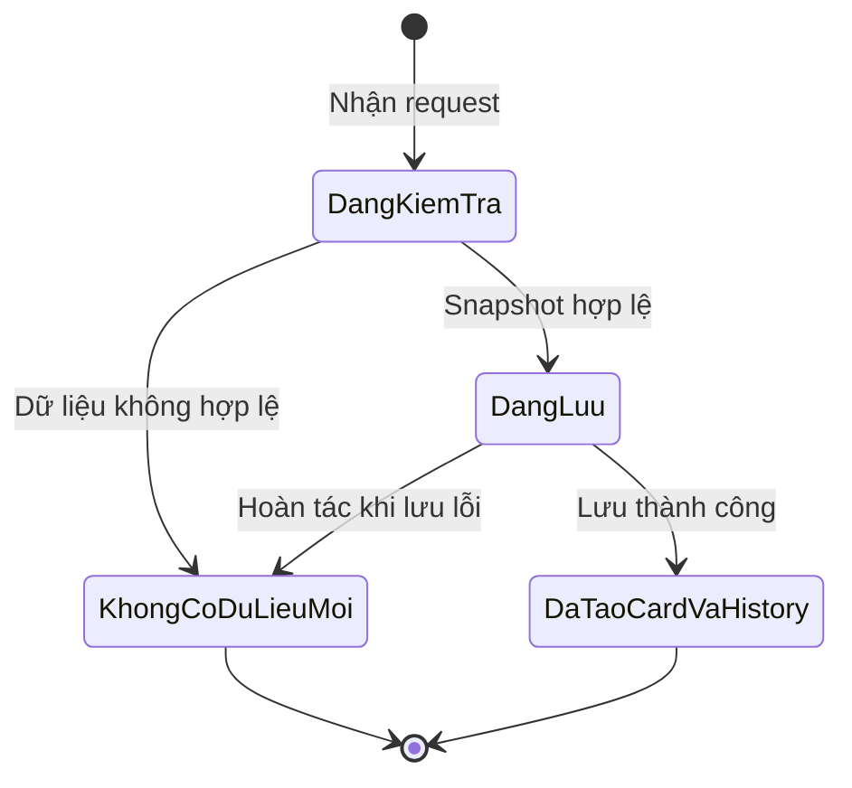
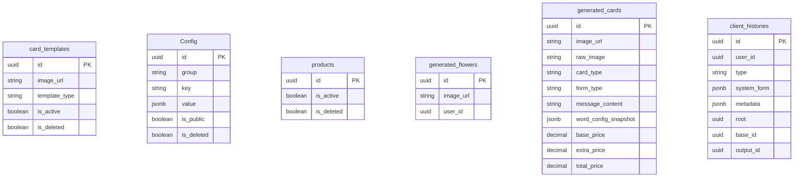

# TDD-021: Chọn mẫu có sẵn và tạo thiệp HandMade

## Thông tin tài liệu
- **Tiêu đề**: Tạo thiệp HandMade từ Product hoặc Generated Flower
- **Ghi chú**: Khách hàng chọn một mẫu có sẵn và gửi nội dung cần viết. Hệ thống tính phụ phí theo số từ, lưu thiệp cùng lịch sử nguồn gốc, nhưng không gọi mô-đun trí tuệ nhân tạo và không dùng hạn mức Card AI.

## Metadata quản trị tài liệu
| Trường | Giá trị |
|---|---|
| Mã tài liệu | TDD-021 |
| Phiên bản | v1.0 |
| Author | Nguyễn Tùng Dương |
| Reviewer | Tân Trần |
| Approver | Chưa chỉ định |
| Owner | Nguyễn Tùng Dương |
| Cập nhật gần nhất | 2026-09-09 |

---

## BƯỚC 1 — Thông tin & Bối cảnh

### Thông tin tài liệu
- **Mã tài liệu**: TDD-021
- **Tính năng**: Tạo thiệp HandMade
- **Tác giả**: Nguyễn Tùng Dương
- **Người review**: Tân Trần
- **Phiên bản**: v1.0
- **Cập nhật (YYYY-MM-DD)**: 2026-09-09
- **Story liên quan**:
  - STORY-035 — Tạo thiệp thiết kế

### Business Rules
- **BR-021-01**: Chỉ khách hàng đã đăng nhập và có tài khoản đang hoạt động mới được tạo thiệp.
- **BR-021-02**: Client gọi chung `POST /api/ai-cards`. Hệ thống đọc `cardTemplateId` để phân nhánh: `template_type="ai"` chuyển sang TDD-006; `template_type="handmade"` đi tiếp theo tài liệu này.
- **BR-021-03**: Request phải có đúng một nguồn hoa: `productId` hoặc `generatedFlowerId`. Thiếu cả hai hoặc truyền cả hai đều trả `VALIDATION_ERROR/400`.
- **BR-021-04**: Request bắt buộc có `cardTemplateId`, `senderName`, `receiverName` và key `messageContent`. Sender/receiver sau trim không được rỗng và mỗi field không quá 20 từ. Message được phép rỗng, không quá 100 từ và không vượt `max_words` của Size Config.
- **BR-021-05**: Client không được gửi `formType`. Card HandMade luôn có `form_type="calligraphy"`; key này xuất hiện thì trả `HANDMADE_CARD_FORM_TYPE_NOT_ALLOWED/400`.
- **BR-021-06**: Client không được gửi `attachedImageUrl`, kể cả giá trị `null`. Card HandMade luôn có `attached_image_url=null`; vi phạm trả `HANDMADE_CARD_ATTACHMENT_NOT_ALLOWED/400`.
- **BR-021-07**: Product nguồn dùng đúng ID Product/variant khách đã chọn. Hệ thống lần lượt kiểm tra: không tồn tại → đã bị đánh dấu xóa → ngừng hoạt động → hết số lượng có thể bán. Trường hợp `no_formula|no_core` trả `PRODUCT_NOT_SELLABLE/422`; không tính được khả năng bán thì trả `PRODUCT_AVAILABILITY_UNAVAILABLE/503`.
- **BR-021-08**: Generated Flower phải tồn tại, thuộc khách hàng hiện tại và có `image_url` dùng được. Bản ghi thuộc người khác cũng trả `GENERATED_FLOWER_NOT_FOUND/404` để không lộ dữ liệu.
- **BR-021-09**: Với Generated Flower, phải tìm đúng Flower History có `type="flower"`, `output_id=generatedFlowerId`. `base_id` và `root` phải cùng là Product ID hợp lệ. Chuỗi nguồn gốc bị thiếu hoặc mâu thuẫn trả `SOURCE_PRODUCT_PROVENANCE_INVALID/409`; hệ thống không đoán Product từ `metadata`.
- **BR-021-10**: Template HandMade phải tồn tại, chưa xóa, đang hoạt động, có đúng loại `handmade` và `image_url` dùng được. Trạng thái chỉ được kiểm tra một lần trước khi tạo bản chụp dữ liệu của request.
- **BR-021-11**: `card_config.sizes` là singleton (mỗi key chỉ có một bản ghi chưa xóa). Bản ghi phải tồn tại, chưa xóa, có `is_public=true` và đúng cấu trúc JSON hai lớp; `items` có đúng một Size. Client không gửi `sizeKey` hoặc chọn Size.
- **BR-021-12**: `card_config.prices` cũng là singleton. Bản ghi phải tồn tại, chưa xóa, có `is_public=true` và đúng cấu trúc JSON hai lớp. Các khoảng số từ phải liên tục, không chồng lấn; hệ thống chọn đúng bậc giá chứa `wordCount`.
- **BR-021-13**: Không có bậc giá chứa `wordCount` thì trả `CALLIGRAPHY_PRICE_RULE_NOT_FOUND/422`; hệ thống không chọn bậc gần nhất hoặc tự đặt giá.
- **BR-021-14**: `wordCount` chỉ tính từ `messageContent`. Chuỗi rỗng/blank có 0 từ; khoảng trắng, tab hoặc xuống dòng liên tiếp chỉ là một dấu phân cách.
- **BR-021-15**: `sizeBasePrice` lưu để kiểm toán nhưng không thu. `basePrice=0`, `extraPrice=rule.extra_price`, `totalPrice=extraPrice`.
- **BR-021-16**: `image_url` của Card dùng trực tiếp `card_templates.image_url`. Hệ thống không sao chép ảnh, không chèn chữ lên preview và không gọi dịch vụ lưu file.
- **BR-021-17**: HandMade không gọi AI, không đọc System Prompt, không retry và không giữ/trừ quota Card AI.
- **BR-021-18**: Thành công lưu `generated_cards` và `client_histories` trong cùng một transaction (giao dịch dữ liệu được hoàn tất toàn bộ hoặc hoàn tác toàn bộ). Một bước lỗi thì không bản ghi mới nào được giữ lại.
- **BR-021-19**: Card mới có `card_type="handmade"`, `form_type="calligraphy"`, `raw_image=null`, `attached_image_url=null`, nội dung, snapshot Size/rule và giá theo BR-021-15.
- **BR-021-20**: History mới có `type="handmade_card"`, `system_form=null`, `output_id=generatedCard.id`. Nguồn Product có `base_id=root=productId`; nguồn Generated Flower có `base_id=generatedFlowerId`, `root=Product ID gốc`.
- **BR-021-21**: `metadata` chỉ lưu nguồn gốc, `provenanceStatus="available"`, bản chụp Template không gồm ảnh, định danh Size Config không gồm toàn bộ dữ liệu cấu hình và `validatedAt`. Không lặp nội dung/giá đã có trong Card.
- **BR-021-22**: `root` bắt buộc khác `Guid.Empty`, chỉ dùng nội bộ, không có khóa ngoại và không xuất hiện trong phản hồi công khai.
- **BR-021-23**: HandMade không hỗ trợ Regenerate hay Recreate Content. Hai flow trả lần lượt `HANDMADE_CARD_REGENERATE_NOT_SUPPORTED/409` và `HANDMADE_CARD_RECREATE_NOT_SUPPORTED/409`.
- **BR-021-24**: Create Card không tự gắn kết quả vào Checkout/Order.

### Bối cảnh & Mục tiêu

**Vấn đề**
> Khách hàng cần chọn một mẫu thiệp có sẵn để cửa hàng viết tay thay vì tạo thiết kế bằng AI. Hệ thống vẫn phải xác minh nguồn hoa, giữ Product gốc, kiểm tra cấu hình và tính đúng phụ phí. Nếu thiếu snapshot hoặc lịch sử nguồn gốc, hệ thống không thể giải thích giá và Order tương lai không xác định được Product cần kiểm tra tồn kho.

**Mục tiêu**
- Dùng chung API tạo Card nhưng phân nhánh rõ AI và HandMade.
- Tạo HandMade từ Product hoặc Generated Flower thuộc khách hàng.
- Tự lấy Size chung, đếm từ và tính đúng phụ phí.
- Lưu Card và History cùng lúc, không để dữ liệu một phần.
- Giữ Product gốc trong `client_histories.root` mà không đưa field nội bộ ra API.
- Không gọi AI, prompt, quota hoặc dịch vụ lưu ảnh.

**Ngoài phạm vi** (Out of scope)
- Không tạo thiết kế hoặc chèn chữ lên ảnh.
- Không upload, sao chép hoặc xóa ảnh Template.
- Không tạo lại Card HandMade.
- Không gắn Card vào Checkout/Order và không quyết định contract Order còn mở.

---

## BƯỚC 2 — Kiến trúc & Sơ đồ

### Kiến trúc tổng quan (Architecture)
**Tiêu đề**: Các thành phần tạo thiệp HandMade
**Mô tả**: Giao diện gửi request tới Card Controller. Card Service đọc nguồn, Template và Config, tính giá, rồi lưu Card và History trong một giao dịch.



**Ghi chú**: Service/controller cho flow này chưa được triển khai; entity, mapping và migration đã tồn tại. Không có AI, quota, System Prompt hoặc File Storage trong sơ đồ vì flow không sử dụng chúng.

### Sequence Diagram
**Tiêu đề**: Trình tự kiểm tra, tính giá và lưu thiệp
**Mô tả**: Hệ thống dừng tại điều kiện đầu tiên không hợp lệ. Chỉ khi snapshot hoàn chỉnh thì Card và History mới được lưu cùng nhau.



**Ghi chú**: Dependency đổi trạng thái sau khi snapshot hình thành không làm request đang chạy đọc lại dữ liệu.

### Activity Diagram
**Tiêu đề**: Các nhánh dừng của flow HandMade
**Mô tả**: Mỗi nhánh nêu rõ dữ liệu nào không đạt và kết quả hệ thống trả về.



### State Diagram
**Tiêu đề**: Trạng thái tồn tại của kết quả
**Mô tả**: Không có bản nháp hoặc job. Card và History chỉ xuất hiện khi giao dịch thành công.



### Mô hình dữ liệu (Data Model / ERD)
**Tiêu đề**: Dữ liệu đọc và lưu của HandMade
**Mô tả**: `base_id`, `root`, `output_id` là tham chiếu đa hình do code quản lý, không phải khóa ngoại; vì vậy không vẽ quan hệ database giả.



---

## BƯỚC 3 — API

### API Contract nội bộ

#### Endpoint #1
- **Method**: POST
- **Endpoint**: `/api/ai-cards`
- **Tên endpoint**: Tạo Card dùng chung
- **Mô tả**: Hệ thống đọc Template để chọn AI hoặc HandMade. Contract dưới đây áp dụng cho Template HandMade.

| Field | Type | Required | Mô tả |
|---|---|---:|---|
| `productId` | uuid/null | Có điều kiện | Chỉ truyền khi không có `generatedFlowerId`. |
| `generatedFlowerId` | uuid/null | Có điều kiện | Chỉ truyền khi không có `productId`. |
| `cardTemplateId` | uuid | Có | Template HandMade đang hoạt động, chưa xóa. |
| `senderName` | string | Có | Không blank, tối đa 20 từ. |
| `receiverName` | string | Có | Không blank, tối đa 20 từ. |
| `messageContent` | string | Có | Key bắt buộc; chuỗi rỗng hợp lệ; không vượt giới hạn. |
| `formType` | — | Không cho phép | Key xuất hiện sẽ bị từ chối. |
| `attachedImageUrl` | — | Không cho phép | Key xuất hiện sẽ bị từ chối. |

Client không gửi `sizeKey`; hệ thống tự lấy Size duy nhất.

**Ví dụ 1 — Tạo từ Product** — HTTP `200`

Request:
```json
{"productId":"440e8400-e29b-41d4-a716-446655440021","cardTemplateId":"550e8400-e29b-41d4-a716-446655440021","senderName":"An","receiverName":"Bình","messageContent":"Chúc bạn luôn vui và hạnh phúc"}
```
Response:
```json
{"value":{"id":"660e8400-e29b-41d4-a716-446655440021","imageUrl":"https://storage.example.com/templates/handmade-01.png","rawImage":null,"cardType":"handmade","formType":"calligraphy","senderName":"An","receiverName":"Bình","messageContent":"Chúc bạn luôn vui và hạnh phúc","attachedImageUrl":null,"sizeName":"Kích thước chung","sizeWidth":15,"sizeHeight":25,"sizeBasePrice":20000,"sizeMaxWords":100,"wordCount":8,"wordConfigSnapshot":{"min_words":0,"max_words":35,"extra_price":0},"basePrice":0,"extraPrice":0,"totalPrice":0}}
```

History có `type="handmade_card"`, `base_id=root=productId`, `system_form=null`.

**Ví dụ 2 — Tạo từ Generated Flower, message rỗng** — HTTP `200`

Request:
```json
{"generatedFlowerId":"770e8400-e29b-41d4-a716-446655440021","cardTemplateId":"550e8400-e29b-41d4-a716-446655440021","senderName":"An","receiverName":"Bình","messageContent":""}
```
Response quan trọng:
```json
{"value":{"cardType":"handmade","formType":"calligraphy","wordCount":0,"basePrice":0,"extraPrice":0,"totalPrice":0,"rawImage":null,"attachedImageUrl":null}}
```

History có `base_id=generatedFlowerId`; `root` lấy từ Flower History và không trả ra API.

**Ví dụ 3 — Gửi formType** — HTTP `400`

```json
{"productId":"440e8400-e29b-41d4-a716-446655440021","cardTemplateId":"550e8400-e29b-41d4-a716-446655440021","senderName":"An","receiverName":"Bình","messageContent":"Chúc mừng","formType":"calligraphy"}
```
```json
{"status":400,"messageCode":"HANDMADE_CARD_FORM_TYPE_NOT_ALLOWED"}
```

**Ví dụ 4 — Lineage Flower không hợp lệ** — HTTP `409`

```json
{"status":409,"messageCode":"SOURCE_PRODUCT_PROVENANCE_INVALID"}
```

**Ví dụ 5 — Không có bậc giá** — HTTP `422`

```json
{"status":422,"messageCode":"CALLIGRAPHY_PRICE_RULE_NOT_FOUND"}
```

#### Mã lỗi
| Code | HTTP | Khi nào xảy ra |
|---|---:|---|
| `VALIDATION_ERROR` | 400 | Body sai kiểu, thiếu field, không đúng một nguồn hoặc text vượt giới hạn. |
| `HANDMADE_CARD_FORM_TYPE_NOT_ALLOWED` | 400 | Request chứa `formType`. |
| `HANDMADE_CARD_ATTACHMENT_NOT_ALLOWED` | 400 | Request chứa `attachedImageUrl`. |
| `CARD_TEMPLATE_NOT_FOUND` | 404 | Template không tồn tại. |
| `CARD_TEMPLATE_DELETED` | 410 | Template đã xóa. |
| `CARD_TEMPLATE_INACTIVE` | 409 | Template inactive. |
| `CARD_SIZE_CONFIG_NOT_FOUND` | 404 | Không có Size singleton. |
| `CARD_SIZE_CONFIG_DELETED` | 410 | Size Config đã xóa. |
| `CARD_SIZE_CONFIG_INACTIVE` | 409 | Size Config không public. |
| `CARD_SIZE_CONFIG_INVALID` | 409 | Size payload sai hoặc không có đúng một Size. |
| `CALLIGRAPHY_CONFIG_NOT_FOUND` | 404 | Không có Price singleton. |
| `CALLIGRAPHY_CONFIG_DELETED` | 410 | Price Config đã xóa. |
| `CALLIGRAPHY_CONFIG_INACTIVE` | 409 | Price Config không public. |
| `CALLIGRAPHY_CONFIG_INVALID` | 409 | Price payload/range sai. |
| `CALLIGRAPHY_PRICE_RULE_NOT_FOUND` | 422 | Không có rule chứa `wordCount`. |
| `CARD_CONFIG_AMBIGUOUS` | 409 | Có nhiều record chưa xóa cùng exact `(group,key)`. |
| `PRODUCT_NOT_FOUND` | 404 | Product không tồn tại. |
| `PRODUCT_DELETED` | 410 | Product đã xóa. |
| `PRODUCT_INACTIVE` | 409 | Product inactive. |
| `PRODUCT_OUT_OF_STOCK` | 409 | `sellableQuantity=0`. |
| `PRODUCT_NOT_SELLABLE` | 422 | Product không có formula/CORE dùng được. |
| `PRODUCT_AVAILABILITY_UNAVAILABLE` | 503 | Không xác minh được khả năng bán. |
| `GENERATED_FLOWER_NOT_FOUND` | 404 | Flower không tồn tại hoặc khác owner. |
| `GENERATED_FLOWER_INPUT_INVALID` | 409 | Flower thiếu ảnh dùng được. |
| `SOURCE_PRODUCT_PROVENANCE_INVALID` | 409 | Thiếu hoặc mâu thuẫn Flower History/Product gốc. |
| `UNAUTHORIZED` | 401 | Chưa đăng nhập/tài khoản không hoạt động. |
| `INTERNAL_SERVER_ERROR` | 500 | Không lưu nguyên tử Card và History. |

### API Contract bên ngoài
- **Không áp dụng**: HandMade không gọi AI, File Storage, Nhanh.vn hoặc dịch vụ bên thứ ba.

---

## BƯỚC 4 — Tham chiếu

> Chú thích: 🔴 tài liệu này phụ thuộc · ⚫ tài liệu khác phụ thuộc vào tài liệu này · ⋯ thay đổi ở đây có thể làm tài liệu khác sai.

### 🔴 Tham chiếu đến
- `AI_Card_Context.md`, `AI_DB_Diagram.md`, `AI_CUSTOMIZE_DB.dbdiagram`.
- TDD-006 — nhánh AI của cùng API.
- TDD-008 đến TDD-011 — Card Config.
- TDD-016 — Flower History và Product lineage.
- TDD-022 đến TDD-026 — Card Template.

### ⚫ Trỏ vào tài liệu này
- TDD-007 — chặn Regenerate HandMade.
- TDD-027 — chặn Recreate Content HandMade.
- UT-021-01 đến UT-021-36.

### ⋯ Bị ảnh hưởng
- TDD-006 nếu đổi cách phân nhánh `template_type`.
- TDD-007/TDD-027 nếu đổi `card_type` hoặc History type.
- TDD-022 đến TDD-026 nếu đổi Template.
- Order tương lai nếu đổi `base_id/root`.
