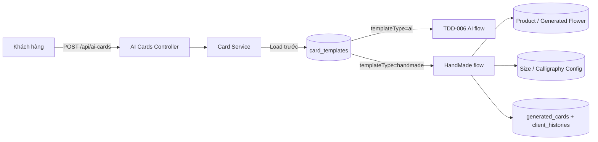
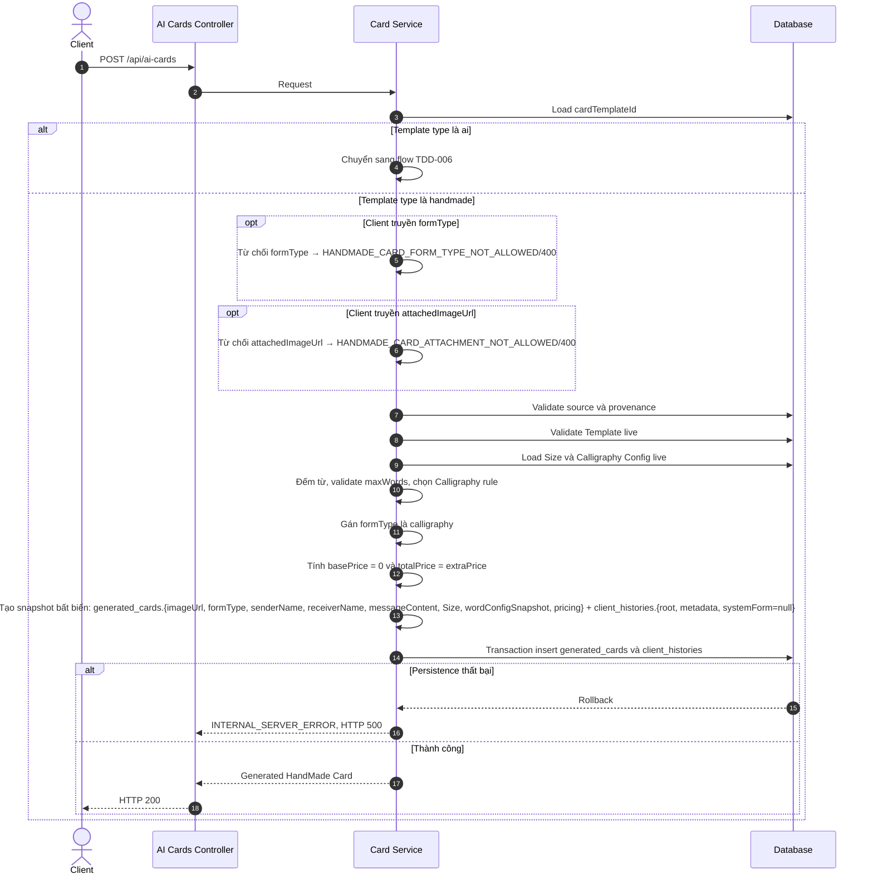
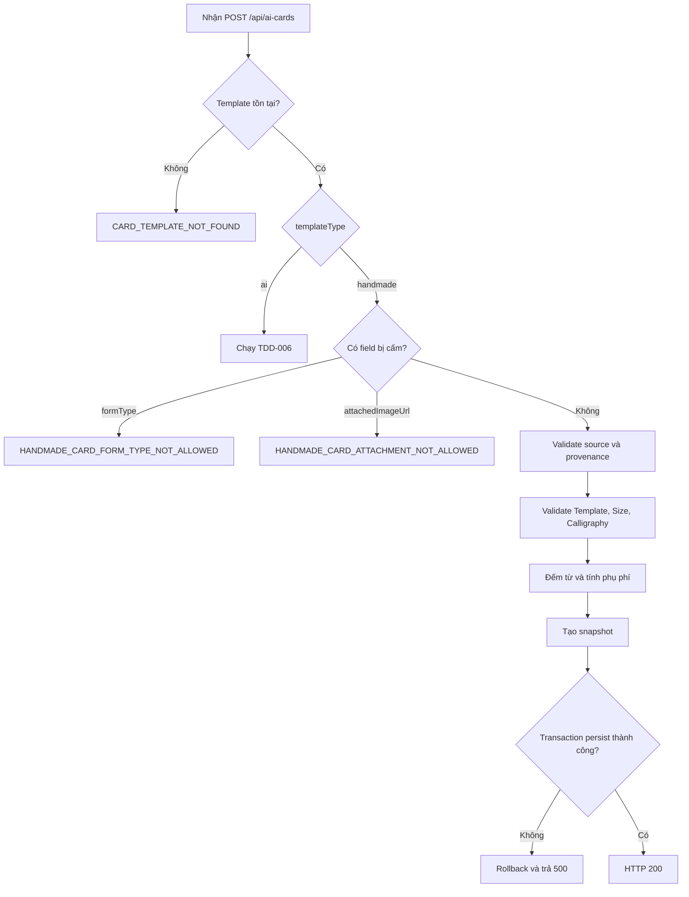
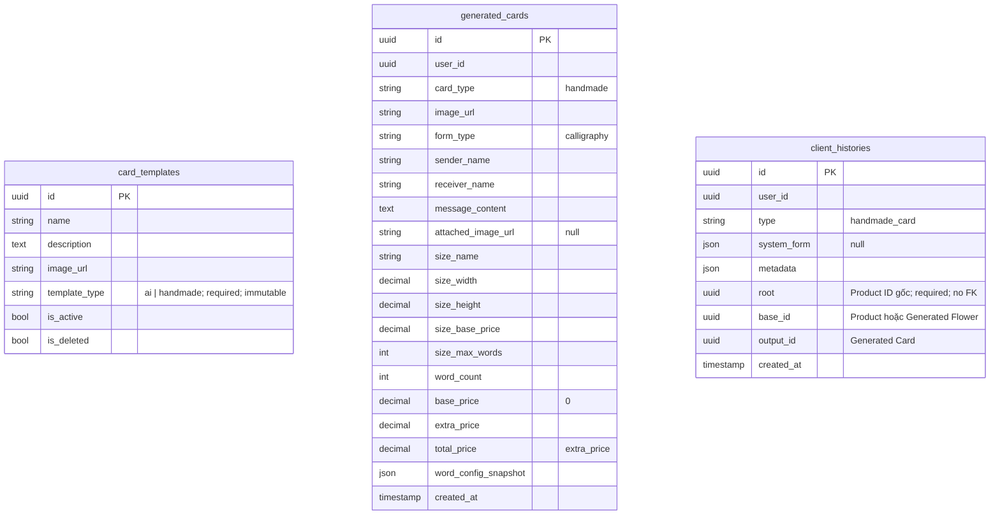

# TDD-021: Khách hàng chọn mẫu thiệp có sẵn và tạo thiệp HandMade cho hoa

## Thông tin tài liệu

- **Tiêu đề**: Khách hàng chọn mẫu thiệp có sẵn và tạo thiệp HandMade cho hoa
- **Ghi chú**: Flow dùng chung `POST /api/ai-cards` với Card AI nhưng không gọi AI. Service load `card_templates` trước và phân nhánh theo `templateType`. Đây là thiết kế mục tiêu vì code Card/HandMade chưa tồn tại trong codebase.

## Metadata quản trị tài liệu

| Trường | Giá trị |
|---|---|
| Mã tài liệu | TDD-021 |
| Phiên bản | v0.7 |
| Author | Nguyễn Tùng Dương |
| Reviewer | Tân Trần |
| Approver | Chưa chỉ định |
| Owner | Nguyễn Tùng Dương |
| Cập nhật gần nhất | 2026-09-09 |

---

## BƯỚC 1 — Thông tin & Bối cảnh

### Thông tin tài liệu
- **Mã tài liệu**: TDD-021
- **Tính năng**: Tạo HandMade Card từ mẫu Admin
- **Tác giả**: Nguyễn Tùng Dương
- **Người review**: Tân Trần
- **Phiên bản**: v0.7
- **Cập nhật (YYYY-MM-DD)**: 2026-09-09
- **Story liên quan**:
  - STORY-035 — Tạo thiệp thiết kế
  - Chưa có Story riêng cho HandMade Card

### Business Rules

- **BR-017-01**: Chỉ khách hàng đã đăng nhập và có tài khoản hoạt động được gọi API.
- **BR-017-02**: Column `card_templates.template_type` là string bắt buộc, chỉ nhận lowercase `ai` hoặc `handmade`, không được đổi sau khi tạo. Dữ liệu Template hiện có được xem là `ai`.
- **BR-017-03**: Client dùng chung `POST /api/ai-cards`. Service phải load Template trước; `templateType=ai` chạy TDD-006, `templateType=handmade` chạy TDD này.
- **BR-017-04**: Request HandMade bắt buộc đúng một nguồn hoa: `productId` hoặc `generatedFlowerId`; đồng thời bắt buộc có các field `cardTemplateId`, `senderName`, `receiverName`, `messageContent`. `messageContent` được phép là chuỗi rỗng; khi đó được tính là 0 từ.
- **BR-017-05**: Không chấp nhận `formType`. Nếu có field này, trả `HANDMADE_CARD_FORM_TYPE_NOT_ALLOWED/400` với message `Thiệp mẫu có sẵn luôn sử dụng hình thức viết tay; không được truyền formType.`
- **BR-017-06**: Không chấp nhận `attachedImageUrl`. Nếu có field này, trả `HANDMADE_CARD_ATTACHMENT_NOT_ALLOWED/400` với message `Thiệp mẫu có sẵn không hỗ trợ ảnh đính kèm.`
- **BR-017-07**: Server luôn gán `formType="calligraphy"` cho HandMade.
- **BR-017-08**: Template HandMade được validate live một lần theo thứ tự not-found → deleted → inactive và phải có `templateType="handmade"`.
- **BR-017-09**: Singleton `card_config.sizes` phải có đúng một Size chung. Hệ thống tự lấy và snapshot Size này, sau đó kiểm tra `messageContent` không vượt `max_words`; client không chọn Size.
- **BR-017-10**: Giá size không được thu: `sizeBasePrice` giữ giá cấu hình để audit, còn `basePrice=0`.
- **BR-017-11**: Hệ thống đếm từ giống Card AI, parse hai lớp singleton `card_config.prices`, chọn đúng rule chứa `wordCount` và chỉ snapshot rule đã áp dụng. Không có rule phù hợp trả `CALLIGRAPHY_PRICE_RULE_NOT_FOUND/422`.
- **BR-017-12**: `extraPrice` bằng phụ phí của Calligraphy rule; `totalPrice=extraPrice`.
- **BR-017-13**: Ảnh kết quả dùng trực tiếp column `card_templates.image_url`; chỉ lưu URL, không tạo bản sao và không render người gửi, người nhận hoặc nội dung lên ảnh preview.
- **BR-017-14**: HandMade không gọi AI, không load System Prompt, không retry và không reserve/consume quota Card AI theo ngày hoặc quota Card AI theo `baseId` nguồn.
- **BR-017-15**: Request thành công tạo `generated_cards.card_type="handmade"` và `client_histories.type="handmade_card"` trong cùng transaction. Nếu client không gọi API thì không tạo record.
- **BR-017-16**: Column `client_histories.system_form=null`; metadata không có `systemPrompt` và chỉ giữ source, provenance, Template snapshot không gồm `imageUrl`, định danh Size Config không gồm `value` và `validatedAt`. Dữ liệu Card, Size, Calligraphy, pricing và nội dung nằm trong `generated_cards`.
- **BR-017-17**: Nguồn Product có `baseId=products.id` và `root=baseId`; nguồn Generated Flower có `baseId=generated_flowers.id`, còn `root` lấy từ `base_id` của Flower History `type="flower", output_id=generatedFlowerId`. Mọi trường hợp có `outputId=generated_cards.id` mới tạo.
- **BR-017-18**: HandMade mới bắt buộc provenance đầy đủ, `provenanceStatus="available"` và `root` Product khác `Guid.Empty`. Nguồn Generated Flower phải thuộc user và resolve nhất quán về Product gốc; thiếu Flower History/Product ID gốc hoặc lineage không nhất quán trả `SOURCE_PRODUCT_PROVENANCE_INVALID/409` trước persistence. Không dùng metadata để đoán Product ID.
- **BR-017-19**: HandMade không được tạo lại dưới bất kỳ hình thức nào và không hỗ trợ chuyển chéo AI ↔ HandMade. Regenerate source history `handmade_card` trả `HANDMADE_CARD_REGENERATE_NOT_SUPPORTED/409` với message `Thiệp HandMade không hỗ trợ chức năng tạo lại.`
- **BR-017-21**: Danh sách Template cho màn AI chỉ trả `templateType=ai`; màn chọn thiệp có sẵn chỉ trả `templateType=handmade`. Admin dùng chung CRUD và không được cập nhật `templateType` của record đã tạo.
- **BR-017-22**: Phần gắn Card vào Checkout/Order không thuộc phạm vi TDD này.

### Bối cảnh & Mục tiêu

**Vấn đề**

> Khách hàng cần có lựa chọn sử dụng trực tiếp mẫu thiệp do Admin chuẩn bị thay vì luôn tạo ảnh mới bằng AI. Flow này vẫn phải lưu Card, giá, history, snapshot và lineage đầy đủ nhưng không được sử dụng dependency hoặc quota riêng của AI.

**Mục tiêu**

- Cho phép khách hàng dùng mẫu thiệp có sẵn do Admin chuẩn bị thay vì tạo ảnh bằng AI.
- Giữ cách lưu `generated_cards`, history, snapshot, lineage và tính phụ phí viết tay nhất quán với Card AI.
- Tách rõ hai loại Template/Card/History bằng string discriminator mở rộng được.

**Ngoài phạm vi** (Out of scope)

- Render nội dung lên ảnh mẫu HandMade.
- Tạo lại HandMade Card hoặc chuyển đổi giữa Card AI và HandMade.
- Checkout, Order, thanh toán và lựa chọn Card trong đơn hàng.
- Unit Test cho flow mới.

---

## BƯỚC 2 — Kiến trúc & Sơ đồ

### Kiến trúc tổng quan (Architecture)

**Tiêu đề**: Phân nhánh Card AI và HandMade trên endpoint dùng chung

**Mô tả**: Frontend gửi request tạo Card; Controller chuyển vào Card Service; Service load Template để chọn flow. Nhánh HandMade validate nguồn hoa, Size/Calligraphy Config rồi transaction lưu Generated Card và Client History mà không gọi AI.



**Ghi chú**: Không có AI Module, System Prompt, retry hoặc quota component trong nhánh HandMade.

### Sequence Diagram

**Tiêu đề**: Trình tự tạo HandMade Card từ Template Admin

**Mô tả**: Luồng thể hiện thứ tự phân nhánh, validation, pricing, snapshot và persistence trong một request đồng bộ.



**Ghi chú**: Mọi dependency live chỉ được validate một lần trước khi tạo snapshot.

### Activity Diagram

**Tiêu đề**: Quyết định xử lý request Card theo Template

**Mô tả**: Nhánh `ai` chuyển sang TDD-006; nhánh `handmade` tiếp tục validation và persistence của TDD này.



### State Diagram

- **Không áp dụng**: Generated HandMade Card được tạo thành kết quả bất biến trong một request; TDD này không định nghĩa vòng đời trạng thái riêng.

### Mô hình dữ liệu (Data Model / ERD)

**Quy ước**: ERD bên dưới dùng đúng tên table/column PostgreSQL dạng `snake_case`; field API và JSON snapshot trong các phần còn lại dùng `camelCase`.

**Tiêu đề**: Dữ liệu Template, Generated Card và Client History

**Mô tả**: HandMade dùng chung `card_templates` và `generated_cards`, phân biệt bằng string discriminator; lineage được lưu qua `client_histories`.



Sơ đồ không vẽ dây quan hệ cho `client_histories`: `base_id`, `root` và `output_id` đều do code quản lý, không có FK/navigation/cascade trong database.

### Snapshot bắt buộc

Snapshot được tạo trong bộ nhớ ở message số 13 của sequence, trước khi mở transaction; không có bảng snapshot riêng. Transaction ngay sau đó persist snapshot vào các field sau:

- `generated_cards`: snapshot của Card kết quả gồm `cardType`, `imageUrl` (URL trực tiếp của Template), `formType`, `senderName`, `receiverName`, `messageContent`, `attachedImageUrl=null`, `sizeName`, `sizeWidth`, `sizeHeight`, `sizeBasePrice`, `sizeMaxWords`, `wordCount`, `wordConfigSnapshot`, `basePrice`, `extraPrice` và `totalPrice`.
- `client_histories`: không có column `input`.
- `client_histories.root`: Product ID gốc, bắt buộc, khác `Guid.Empty`, không có FK và không nằm trong response API.
- `client_histories.metadata`: snapshot provenance gồm `schemaVersion`, `sourceType`, `originProductId`, `generatedFlowerId`, `provenanceStatus`, `cardTemplate` không gồm `imageUrl`, `sizeConfig` chỉ gồm `group`/`key` và `validatedAt`.
- `client_histories.system_form`: luôn là `null`; metadata không có `systemPrompt` vì HandMade không gọi AI.

```json
{
  "schemaVersion": 2,
  "sourceType": "product",
  "originProductId": "product-001",
  "generatedFlowerId": null,
  "provenanceStatus": "available",
  "cardTemplate": {
    "id": "template-hm-001",
    "name": "Mẫu thiệp viết tay",
    "templateType": "handmade",
    "description": "Mẫu do Admin chuẩn bị"
  },
  "sizeConfig": {
    "group": "card_config",
    "key": "card_config.sizes"
  },
  "validatedAt": "2026-09-04T08:00:00Z"
}
```

`systemPrompt` không xuất hiện trong metadata HandMade và `system_form=null`. Với nguồn Generated Flower, `sourceType="generated_flower"`, `generatedFlowerId` có giá trị, `originProductId` là Product gốc resolve từ Flower History và cột `root` nhận cùng Product ID đó.

---

## BƯỚC 3 — API

### API Contract nội bộ

#### Endpoint #1

- **Method**: POST
- **Endpoint**: `/api/ai-cards`
- **Tên endpoint**: Tạo Card từ Template đã chọn
- **Mô tả**: Load `cardTemplateId`; Template `ai` được xử lý theo TDD-006, Template `handmade` tạo HandMade Card theo TDD-021.
- **Quyền**: Customer đã đăng nhập và có tài khoản hoạt động

**Request Body — `application/json`**

| Field | Type | Required | Mô tả |
|---|---|---:|---|
| `productId` | uuid? | Điều kiện | Nguồn hoa thường; chỉ truyền một trong hai nguồn |
| `generatedFlowerId` | uuid? | Điều kiện | Nguồn hoa AI; chỉ truyền một trong hai nguồn |
| `cardTemplateId` | uuid | Có | Template có `templateType=handmade` |
| `senderName` | string | Có | Người gửi |
| `receiverName` | string | Có | Người nhận |
| `messageContent` | string | Có | Nội dung; field bắt buộc có trong request nhưng được phép là chuỗi rỗng. Hệ thống vẫn tính từ và phụ phí viết tay. |
| `formType` | — | Không cho phép | Server tự gán `calligraphy` |
| `attachedImageUrl` | — | Không cho phép | HandMade không hỗ trợ ảnh đính kèm |

**Ví dụ 1 — Tạo HandMade Card từ Product** — HTTP `200`

```http
POST /api/ai-cards
Content-Type: application/json

{
  "productId": "product-001",
  "cardTemplateId": "template-hm-001",
  "senderName": "Minh",
  "receiverName": "Lan",
  "messageContent": "Chúc bạn luôn vui và hạnh phúc"
}
```

```json
{
  "value": {
    "id": "generated-card-hm-001",
    "cardType": "handmade",
    "imageUrl": "https://storage.example.com/cards/hm-001.png",
    "formType": "calligraphy",
    "sizeBasePrice": 10000,
    "basePrice": 0,
    "extraPrice": 39000,
    "totalPrice": 39000
  }
}
```

History tương ứng có `type="handmade_card"`, `baseId="product-001"`, `outputId="generated-card-hm-001"` và `systemForm=null`.

**Ví dụ 2 — Tạo HandMade Card từ Generated Flower** — HTTP `200`

```http
POST /api/ai-cards
Content-Type: application/json

{
  "generatedFlowerId": "generated-flower-001",
  "cardTemplateId": "template-hm-001",
  "senderName": "Minh",
  "receiverName": "Lan",
  "messageContent": "Chúc mừng sinh nhật"
}
```

History có `baseId="generated-flower-001"`, `root="product-001"`; metadata bắt buộc có `generatedFlowerId`, `originProductId` và `provenanceStatus="available"`.

```json
{
  "value": {
    "id": "generated-card-hm-002",
    "cardType": "handmade",
    "imageUrl": "https://storage.example.com/cards/hm-001.png",
    "formType": "calligraphy",
    "basePrice": 0,
    "extraPrice": 0,
    "totalPrice": 0
  }
}
```

**Ví dụ 3 — Từ chối `formType` do client truyền** — HTTP `400`

```http
POST /api/ai-cards
Content-Type: application/json

{
  "productId": "product-001",
  "cardTemplateId": "template-hm-001",
  "senderName": "Minh",
  "receiverName": "Lan",
  "messageContent": "Chúc mừng sinh nhật",
  "formType": "calligraphy"
}
```

```json
{
  "messageCode": "HANDMADE_CARD_FORM_TYPE_NOT_ALLOWED",
  "message": "Thiệp mẫu có sẵn luôn sử dụng hình thức viết tay; không được truyền formType."
}
```

**Ví dụ 4 — Từ chối ảnh đính kèm** — HTTP `400`

```http
POST /api/ai-cards
Content-Type: application/json

{
  "productId": "product-001",
  "cardTemplateId": "template-hm-001",
  "senderName": "Minh",
  "receiverName": "Lan",
  "messageContent": "Chúc mừng sinh nhật",
  "attachedImageUrl": "https://storage.example.com/user/image.png"
}
```

```json
{
  "messageCode": "HANDMADE_CARD_ATTACHMENT_NOT_ALLOWED",
  "message": "Thiệp mẫu có sẵn không hỗ trợ ảnh đính kèm."
}
```

#### Mã lỗi

| Code | HTTP | Khi nào xảy ra |
|---|---:|---|
| `VALIDATION_ERROR` | 400 | Thiếu/sai field, không truyền đúng một nguồn hoặc message vượt `maxWords` |
| `HANDMADE_CARD_FORM_TYPE_NOT_ALLOWED` | 400 | Request HandMade truyền `formType` |
| `HANDMADE_CARD_ATTACHMENT_NOT_ALLOWED` | 400 | Request HandMade truyền `attachedImageUrl` |
| `CARD_TEMPLATE_NOT_FOUND` | 404 | Template không tồn tại |
| `CARD_TEMPLATE_DELETED` | 410 | Template đã soft-delete |
| `CARD_TEMPLATE_INACTIVE` | 409 | Template chưa xóa nhưng inactive |
| `CARD_SIZE_CONFIG_NOT_FOUND` | 404 | Không có singleton `card_config.sizes` |
| `CARD_SIZE_CONFIG_DELETED` | 410 | Size Config đã soft-delete |
| `CARD_SIZE_CONFIG_INACTIVE` | 409 | Size Config không public/không khả dụng |
| `CARD_SIZE_CONFIG_INVALID` | 409 | Wrapper/JSON sai schema hoặc `items` không có đúng một Size chung |
| `CALLIGRAPHY_CONFIG_NOT_FOUND` | 404 | Không có singleton `card_config.prices` |
| `CALLIGRAPHY_CONFIG_DELETED` | 410 | Calligraphy Config đã soft-delete |
| `CALLIGRAPHY_CONFIG_INACTIVE` | 409 | Calligraphy Config không public/không khả dụng |
| `CALLIGRAPHY_CONFIG_INVALID` | 409 | Wrapper hoặc chuỗi JSON/items/range của Price Config sai schema |
| `CALLIGRAPHY_PRICE_RULE_NOT_FOUND` | 422 | `wordCount` không thuộc bậc giá hiện hành nào |
| `CARD_CONFIG_AMBIGUOUS` | 409 | Có nhiều Config active/chưa xóa cho cùng exact `(group,key)` |
| `PRODUCT_NOT_FOUND` | 404 | Product không tồn tại |
| `PRODUCT_DELETED` | 410 | Product đã soft-delete |
| `PRODUCT_INACTIVE` | 409 | Product inactive |
| `PRODUCT_OUT_OF_STOCK` | 409 | Product không còn số lượng có thể bán |
| `PRODUCT_NOT_SELLABLE` | 422 | Product không có formula/CORE dùng được |
| `PRODUCT_AVAILABILITY_UNAVAILABLE` | 503 | Không xác minh được tồn kho Product |
| `GENERATED_FLOWER_NOT_FOUND` | 404 | Generated Flower không tồn tại hoặc không thuộc user |
| `GENERATED_FLOWER_INPUT_INVALID` | 409 | Generated Flower thiếu dữ liệu nguồn bắt buộc |
| `SOURCE_PRODUCT_PROVENANCE_INVALID` | 409 | Không resolve được Product gốc hoặc lineage không nhất quán |
| `UNAUTHORIZED` | 401 | Chưa đăng nhập hoặc tài khoản không hoạt động |
| `INTERNAL_SERVER_ERROR` | 500 | Không thể lưu transaction Card và History |

### Quy tắc tích hợp với API liên quan

#### API danh sách và quản trị Template

- API danh sách phải hỗ trợ filter string `templateType=ai|handmade`.
- Màn tạo Card AI yêu cầu filter `ai`; màn chọn mẫu có sẵn yêu cầu filter `handmade`.
- Admin Create bắt buộc truyền một `templateType` hợp lệ. Admin Update không nhận thay đổi `templateType`.
- Một Template sai type không được dùng chéo flow.

### API Contract bên ngoài

- **Không áp dụng**: Flow HandMade không gọi AI, File Storage hoặc API bên thứ ba; chỉ dùng URL Template và dữ liệu nội bộ đã lưu.

---

## BƯỚC 4 — Tham chiếu

> Chú thích: 🔴 Tham chiếu đến (tài liệu này đọc/phụ thuộc) · ⚫ Trỏ vào tài liệu này (tài liệu khác phụ thuộc vào tài liệu này) · ⋯ Bị ảnh hưởng (thay đổi ở đây có thể làm tài liệu kia sai theo)

### 🔴 Tham chiếu đến

- TDD-006 — Tạo Card AI qua cùng endpoint.
- AI_Card_Context — Quy tắc Card, snapshot, pricing và lineage.
- AI_DB_Diagram — Schema `card_templates`, `generated_cards`, `client_histories`.
- AI_CUSTOMIZE_DB.dbdiagram — Mô tả DB triển khai mục tiêu.
- TDD-022 và TDD-023 — Danh sách/chi tiết Template HandMade khả dụng.
- TDD-024 đến TDD-026 — Vòng đời quản trị Card Template.

### ⚫ Trỏ vào tài liệu này

- TDD-007 — Dùng `type="handmade_card"` để chặn Regenerate.
- TDD-022 — Danh sách Template HandMade phục vụ đầu vào flow này.

### ⋯ Bị ảnh hưởng

- TDD-006 nếu thay đổi cách endpoint dùng chung phân nhánh theo `templateType`.
- TDD-007 nếu thay đổi rule không hỗ trợ Regenerate HandMade.
- TDD-022 đến TDD-026 nếu thay đổi trạng thái, ảnh hoặc discriminator của Card Template.
