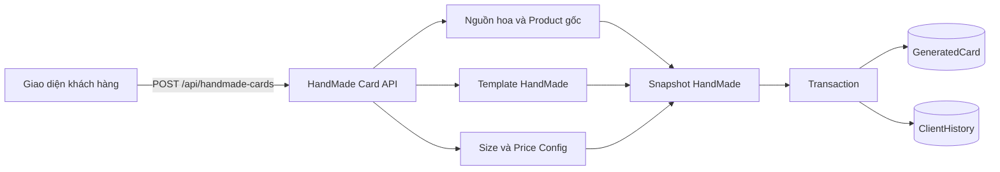
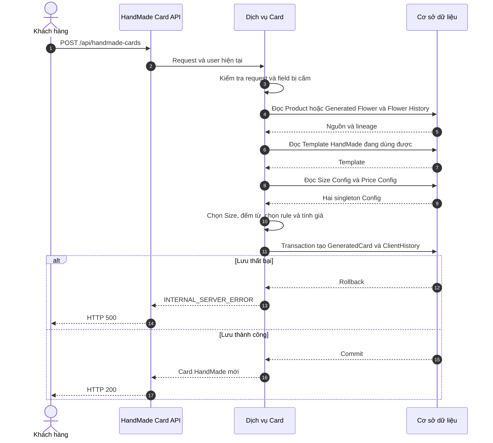
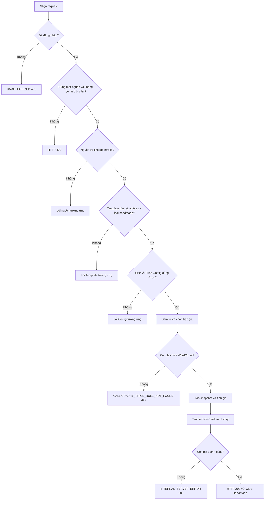
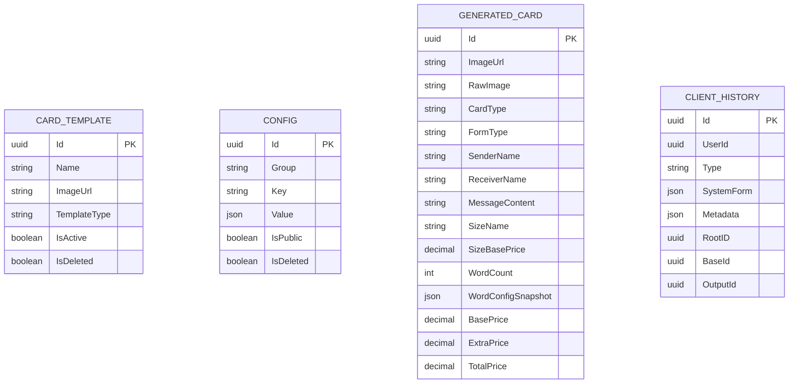

<!-- HƯỚNG DẪN CHO AI KHI ĐIỀN HOẶC CHỈNH SỬA MẪU
- Đọc toàn bộ mẫu, các comment hướng dẫn và tài liệu nguồn được cung cấp trước khi viết. Tuân thủ các quy tắc nghiệp vụ, điều kiện, ngoại lệ và giới hạn đã được xác nhận.
- Không bịa, tự chế hoặc suy đoán thành sự thật: yêu cầu, quy tắc, số liệu, API, schema, mã lỗi, nguồn tham khảo, người phụ trách và kết quả kiểm thử phải có căn cứ. Nội dung ví dụ trong mẫu không phải dữ kiện của dự án.
- Khi thiếu thông tin hoặc các nguồn mâu thuẫn, hỏi người dùng để làm rõ; giữ nguyên placeholder ở phần chưa xác định. Không tự chọn đáp án, lấp chỗ trống hay tuyên bố tài liệu đã hoàn tất.
- Chỉ thay nội dung cần điền hoặc được yêu cầu sửa. Không tự mở rộng phạm vi, sửa nghĩa quy tắc, bỏ điều kiện/ngoại lệ, xoá hay ghi đè nội dung hợp lệ đã có.
- Giữ nguyên tên, cấp và thứ tự heading, nhãn in đậm, tiền tố bullet, cấu trúc danh sách, tên/thứ tự/số cột bảng và cú pháp code fence. Không dịch, đổi tên, gộp hoặc thêm mục ngoài cấu trúc mẫu.
- Chỉ lặp khối luồng, AC hoặc API theo đúng khuôn khi có căn cứ; chỉ bỏ phần tuỳ chọn khi hướng dẫn riêng của mẫu cho phép và đã xác định không áp dụng.
- Mã tham chiếu và section phải trỏ tới tài liệu có thật đã được cung cấp hoặc kiểm chứng. Không giữ mã ví dụ như tham chiếu thật và không tự tạo tài liệu liên quan để hợp thức hoá liên kết.
- Giữ các comment hướng dẫn trong file. Xuất Markdown UTF-8, mỗi file một tài liệu; không bọc toàn bộ file trong code fence, không chèn lời dẫn hay giải thích ngoài mẫu.
- Trước khi bàn giao, đối chiếu nội dung với nguồn, kiểm tra cấu trúc, giá trị cho phép, giới hạn độ dài và tính nhất quán của mã/tham chiếu. Báo rõ phần chưa đủ thông tin; không tuyên bố đã chạy test hoặc import khi chưa thực hiện.
-->

<!-- Thay mã TDD-001 và nội dung ví dụ; giữ nguyên heading và nhãn in đậm.
Sơ đồ dùng mermaid, plantuml hoặc URL. Giữ heading Architecture, Sequence Diagram, Activity Diagram, State Diagram, Data Model.
Ví dụ API phải có heading trùng METHOD /path trong Endpoints. Xoá phần API/sơ đồ không dùng.
Version, Updated At và Change Log do lịch sử phiên bản quản lý, để trống khi nhập mới.
Author/Reviewer là tên hiển thị; gán tài khoản, phê duyệt, giả định và câu hỏi mở trên giao diện sau import.
Thiết kế phải truy vết về Story và Business Rule được cung cấp. Phân biệt thiết kế đề xuất với implementation đã kiểm chứng; không mô tả API/schema/sơ đồ ví dụ như hệ thống thật hoặc tự quyết định nghiệp vụ còn thiếu.
BẮT BUỘC KHI HOÀN THIỆN MẪU: phải có cả Reviewer và Approver, mỗi tên 1–200 ký tự sau khi bỏ khoảng trắng đầu/cuối. Không xoá hai dòng metadata, để trống, dùng tên bịa hoặc giữ placeholder rồi coi là hoàn tất.
Nếu chưa biết người review hoặc người phê duyệt, phải hỏi người dùng và báo tài liệu chưa đủ thông tin; không tự lấy Author/Owner làm người thay thế. Tên trong file không tự gán tài khoản hoặc xác nhận đã duyệt; gán thành viên trên giao diện sau import.
Đây là yêu cầu hoàn thiện mẫu; backend hiện vẫn nhận file cũ thiếu hai trường để tương thích.

VALIDATION CHO FILE NHẬP (đối chiếu ImportSnapshotValidator, MarkdownParser và ImportService):
- Mỗi file .md UTF-8 không rỗng chỉ có một heading cấp 1 chứa mã tài liệu dài 1–100 ký tự. Mã không được trùng trong cùng lần nhập hoặc thuộc loại tài liệu khác đã tồn tại.
- Không dùng tên README.md hoặc sitemap.md vì importer bỏ qua. Giao diện nhận .md/.zip, tối đa 2.000 file, tổng file tải lên 31 MiB; API giới hạn request 32 MiB và tổng nội dung đọc/giải nén 64 MiB.
- Chỉ nhập đè tài liệu cùng loại đang Draft, chưa có phiên bản và chưa lưu trữ. Import thay toàn bộ nội dung bản nháp, vì vậy phải giữ lại nội dung hợp lệ ngoài phần được yêu cầu sửa.
- Không dùng Status trong Markdown hoặc tên Approver để tự xác nhận phê duyệt; import không cấp quyền hay gán tài khoản từ tên. Chạy Kiểm tra file và xử lý lỗi/cảnh báo trước khi nhập.
- Giới hạn độ dài bên dưới tính theo string.Length của .NET (đơn vị UTF-16); không tự cắt ngắn dữ kiện quan trọng để vượt validation, hãy viết lại có căn cứ hoặc hỏi người dùng.
- Feature tối đa 300 ký tự và được dùng làm tiêu đề tài liệu. Status được parser nhận: Draft / In Review / Approved / Deprecated; tài liệu nhập mới vẫn có trạng thái phê duyệt Draft.
- Endpoint: đường dẫn tối đa 500 ký tự; tên/mô tả endpoint được lưu trong Name tối đa 300. HTTP method: GET / POST / PUT / PATCH / DELETE / HEAD / OPTIONS.
- Error Codes: mã tối đa 100 ký tự, không trùng trong tài liệu; giữ dạng - **CODE** (400): mô tả. HTTP status trong Error Codes và Response phải là số nguyên đọc được bằng Int32; không tự đặt status khác hợp đồng API.
- URL sơ đồ tối đa 1.000 ký tự. Mục sơ đồ được sử dụng phải có khối mermaid/plantuml hoặc URL theo mẫu; không để một mục sơ đồ rỗng. Nhãn mục được tách từ bullet như tên External API Fields tối đa 300 ký tự.
- Heading Examples phải khớp METHOD /path ở Endpoints. Giữ các nhãn Request:, Response 200: và Error Response: để parser tách đúng dữ liệu.
- Tham chiếu dạng DOC-KEY/section: ghi chú; mã đích tối đa 100, section tối đa 100, ghi chú tối đa 1.000. Không trùng bộ mã đích + section + loại liên kết trong cùng tài liệu.
-->

# TDD-021

## Document Info

- **Feature**: Chọn mẫu có sẵn và tạo thiệp HandMade
- **Author**: Nguyễn Tùng Dương
- **Reviewer**: Tân Trần
- **Approver**: Tân Trần
- **Status**: Draft
- **Version**:
- **Updated At**:

## Context & Goals

### Problem

Khách hàng cần chọn một mẫu thiệp có sẵn để cửa hàng viết tay thay vì tạo thiết kế bằng AI. Flow phải kiểm tra nguồn hoa, giữ đúng Product gốc, chọn Size, tính phụ phí theo số từ và lưu Card cùng History. Endpoint HandMade phải tách khỏi `POST /api/ai-cards` để request không bị hiểu nhầm là Create hoặc Regenerate Card AI.

### Goals

- Dùng riêng `POST /api/handmade-cards` cho Card HandMade.
- Tạo Card từ Product hoặc Generated Flower thuộc khách hàng.
- Kiểm tra Template HandMade, Size Config và Price Config hiện hành.
- Lưu đúng Size, rule, giá và lineage trong Card/History mới.
- Không gọi AI, System Prompt, quota hoặc dịch vụ lưu ảnh.
- Lưu `GeneratedCard` và `ClientHistory` trong cùng transaction.

### Non-goals

- Không tạo thiết kế hoặc chèn chữ lên ảnh Template.
- Không upload, sao chép hoặc xóa ảnh Template.
- Không tạo lại Card HandMade.
- Không gắn Card vào Checkout hoặc Order.

## Architecture

Endpoint riêng nhận yêu cầu HandMade. Dịch vụ tải nguồn hoa, xác định Product gốc, kiểm tra Template và hai Config, tính giá rồi lưu Card/History trong một transaction. Tên class và method triển khai chưa được xác nhận từ code; tài liệu chỉ chốt hành vi nghiệp vụ.



**Notes**:

- `imageUrl` của Card dùng trực tiếp `CardTemplate.ImageUrl`; không tạo hoặc upload ảnh mới.
- HandMade không đọc System Prompt, không gọi mô-đun AI và không dùng quota Card AI.
- Dependency đổi trạng thái sau khi snapshot trong bộ nhớ đã hoàn tất không làm request đang chạy đọc lại dữ liệu.

## Sequence Diagram

Hệ thống dừng tại lỗi đầu tiên theo thứ tự validation. Chỉ khi mọi dependency hợp lệ và tính được giá thì mới lưu hai record.



## Activity Diagram

Template AI không được chuyển sang TDD-006 từ endpoint này; client phải gọi đúng endpoint Card AI.



## Data Model

`GeneratedCard` lưu dữ liệu hiển thị, snapshot Size/rule và giá. `ClientHistory` lưu provenance và Template đã chọn. Các cột lineage là tham chiếu đa hình do code quản lý, không phải khóa ngoại.



**Notes**:

- Card mới có `card_type=handmade`, `FormType=calligraphy`, `RawImage=null`, `AttachedImageUrl=null`.
- `SizeBasePrice` được giữ để audit nhưng không thu; `BasePrice=0`, `ExtraPrice=rule.extra_price`, `TotalPrice=ExtraPrice`.
- History mới có `type=handmade_card`, `SystemForm=null`, `OutputId=GeneratedCard.Id`.
- Nguồn Product: `BaseId=RootID=productId`. Nguồn Generated Flower: `BaseId=generatedFlowerId`, `RootID` là Product ID gốc từ Flower History.
- Metadata chỉ lưu provenance, Template snapshot không gồm ảnh, định danh Size/Price Config và `validatedAt`; không lặp nội dung và giá đã có trong Card.

## Internal API

### Endpoints

- **POST** `/api/handmade-cards` — Tạo Card HandMade từ Product hoặc Generated Flower.

- **productId** — UUID tùy chọn; chỉ truyền khi không có `generatedFlowerId`.
- **generatedFlowerId** — UUID tùy chọn; chỉ truyền khi không có `productId`.
- **cardTemplateId** — UUID bắt buộc; Template phải là loại `handmade`.
- **sizeName** — String bắt buộc; phải trùng `items[].name` của Size Config.
- **senderName** — String bắt buộc, không blank, tối đa 20 từ.
- **receiverName** — String bắt buộc, không blank, tối đa 20 từ.
- **messageContent** — Key bắt buộc; chuỗi rỗng hợp lệ, tối đa 100 từ và không vượt Size `max_words`.
- **formType** — Không được phép xuất hiện.
- **attachedImageUrl** — Không được phép xuất hiện, kể cả giá trị null.

### Examples

#### POST /api/handmade-cards

```
Request:
{"productId":"440e8400-e29b-41d4-a716-446655440021","cardTemplateId":"550e8400-e29b-41d4-a716-446655440021","sizeName":"Lớn","senderName":"An","receiverName":"Bình","messageContent":"Chúc bạn luôn vui và hạnh phúc"}

Response 200:
{"value":{"id":"660e8400-e29b-41d4-a716-446655440021","imageUrl":"https://storage.example.com/templates/handmade-01.png","rawImage":null,"cardType":"handmade","formType":"calligraphy","senderName":"An","receiverName":"Bình","messageContent":"Chúc bạn luôn vui và hạnh phúc","attachedImageUrl":null,"sizeName":"Lớn","sizeWidth":15,"sizeHeight":25,"sizeBasePrice":20000,"sizeMaxWords":100,"wordCount":8,"wordConfigSnapshot":{"min_words":0,"max_words":35,"extra_price":0},"basePrice":0,"extraPrice":0,"totalPrice":0}}

Error Response:
{"title":"Bad Request","status":400,"detail":"HandMade Card không nhận formType từ client.","messageCode":"HANDMADE_CARD_FORM_TYPE_NOT_ALLOWED","errors":null,"traceId":"<trace-id>","timestampUtc":"<UTC timestamp>"}
```

Request phải có đúng một nguồn. Product được kiểm tra tồn tại, chưa xóa, active và có số lượng có thể bán. Generated Flower phải thuộc người dùng, có ảnh dùng được và có đúng Flower History để resolve Product gốc. `wordCount` chỉ tính từ `messageContent`; chuỗi blank có 0 từ và các nhóm khoảng trắng liên tiếp là một dấu phân cách.

### Error Codes

- **UNAUTHORIZED** (401): Người gọi chưa đăng nhập hoặc tài khoản không hoạt động.
- **VALIDATION_ERROR** (400): Body sai kiểu, thiếu field, không có đúng một nguồn, text vượt giới hạn hoặc `sizeName` không khớp.
- **HANDMADE_CARD_FORM_TYPE_NOT_ALLOWED** (400): Request chứa key `formType`.
- **HANDMADE_CARD_ATTACHMENT_NOT_ALLOWED** (400): Request chứa key `attachedImageUrl`.
- **CARD_TEMPLATE_NOT_FOUND** (404): Template không tồn tại.
- **CARD_TEMPLATE_DELETED** (410): Template đã xóa mềm.
- **CARD_TEMPLATE_INACTIVE** (409): Template không active.
- **CARD_TEMPLATE_TYPE_INVALID** (409): Template không thuộc loại `handmade`.
- **CARD_SIZE_CONFIG_NOT_FOUND** (404): Không có Size Config singleton.
- **CARD_SIZE_CONFIG_DELETED** (410): Size Config đã xóa mềm.
- **CARD_SIZE_CONFIG_INACTIVE** (409): Size Config không public.
- **CARD_SIZE_CONFIG_INVALID** (409): Size payload rỗng, item sai cấu trúc hoặc trùng tên.
- **CALLIGRAPHY_CONFIG_NOT_FOUND** (404): Không có Price Config singleton.
- **CALLIGRAPHY_CONFIG_DELETED** (410): Price Config đã xóa mềm.
- **CALLIGRAPHY_CONFIG_INACTIVE** (409): Price Config không public.
- **CALLIGRAPHY_CONFIG_INVALID** (409): Price payload hoặc khoảng từ sai.
- **CALLIGRAPHY_PRICE_RULE_NOT_FOUND** (422): Không có rule chứa `wordCount`.
- **CARD_CONFIG_AMBIGUOUS** (409): Có nhiều record chưa xóa cùng exact `(group,key)`.
- **PRODUCT_NOT_FOUND** (404): Product không tồn tại.
- **PRODUCT_DELETED** (410): Product đã xóa mềm.
- **PRODUCT_INACTIVE** (409): Product không active.
- **PRODUCT_OUT_OF_STOCK** (409): Product có số lượng có thể bán bằng 0.
- **PRODUCT_NOT_SELLABLE** (422): Product không có formula hoặc CORE dùng được.
- **PRODUCT_AVAILABILITY_UNAVAILABLE** (503): Không xác minh được khả năng bán.
- **GENERATED_FLOWER_NOT_FOUND** (404): Flower không tồn tại hoặc không thuộc người dùng.
- **GENERATED_FLOWER_INPUT_INVALID** (409): Flower thiếu ảnh dùng được.
- **SOURCE_PRODUCT_PROVENANCE_INVALID** (409): Flower History hoặc Product gốc bị thiếu hay mâu thuẫn.
- **INTERNAL_SERVER_ERROR** (500): Transaction không lưu được đồng thời Card và History.

## References

### User Stories

- STORY-035: Khách hàng chọn mẫu có sẵn và tạo Card HandMade.

### Business Rules

- BR-021-01: Chỉ khách hàng đã đăng nhập và có tài khoản active được tạo Card.
- BR-021-02: HandMade dùng endpoint riêng `POST /api/handmade-cards`; Template AI bị từ chối.
- BR-021-03: Request có đúng một trong `productId` hoặc `generatedFlowerId`.
- BR-021-04: Sender/receiver không blank và tối đa 20 từ; message có key bắt buộc, được rỗng, tối đa 100 từ và không vượt Size.
- BR-021-05: Request không được chứa `formType` hoặc `attachedImageUrl`.
- BR-021-06: Product nguồn phải đang bán được; Generated Flower phải thuộc user, có ảnh và lineage hợp lệ.
- BR-021-07: Template phải tồn tại, chưa xóa, active, có ảnh và loại `handmade`.
- BR-021-08: Size/Price Config là singleton active, parse được; Size chọn theo `sizeName`, rule chọn theo `wordCount`.
- BR-021-09: Các khoảng Price liên tục, không chồng lấn; không có rule phù hợp thì không tự chọn rule gần nhất.
- BR-021-10: `BasePrice=0`, `ExtraPrice` bằng phụ phí rule và `TotalPrice=ExtraPrice`.
- BR-021-11: HandMade dùng trực tiếp ảnh Template, không gọi AI, prompt, quota hoặc storage.
- BR-021-12: Card và History được lưu nguyên tử với đúng discriminator, snapshot giá và lineage.
- BR-021-13: `RootID` không rỗng, chỉ dùng nội bộ, không có foreign key và không trả trong public API.
- BR-021-14: Card HandMade không được dùng làm `sourceCardId` cho Regenerate ở TDD-006.
- BR-021-15: Flow không tự gắn kết quả vào Checkout hoặc Order.

### Use Cases

- Tạo Card HandMade từ Product đang bán được.
- Tạo Card HandMade từ Generated Flower có lineage hợp lệ.

### Others

- AI_Card_Context/HandMade: Contract, pricing và metadata chung.
- AI_DB_Diagram/ClientHistory: Schema và lineage đa hình.
- TDD-006/Internal API: Từ chối Card nguồn loại HandMade.
- TDD-008/Internal API: Contract đọc danh sách Config.
- TDD-016/Data Model: Quy tắc Flower History và Product gốc.
- TDD-022/Internal API: Contract đọc Template.

## Change Log
