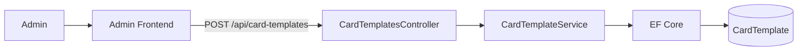
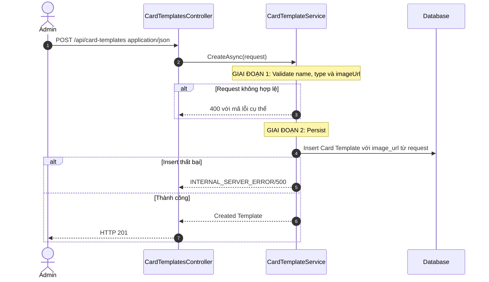
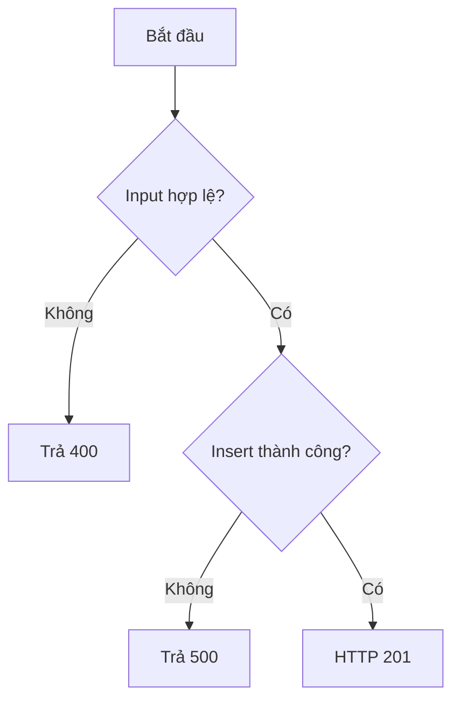
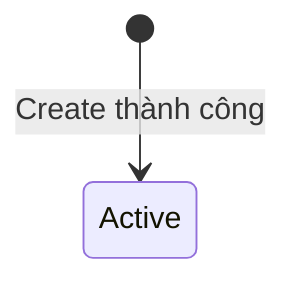
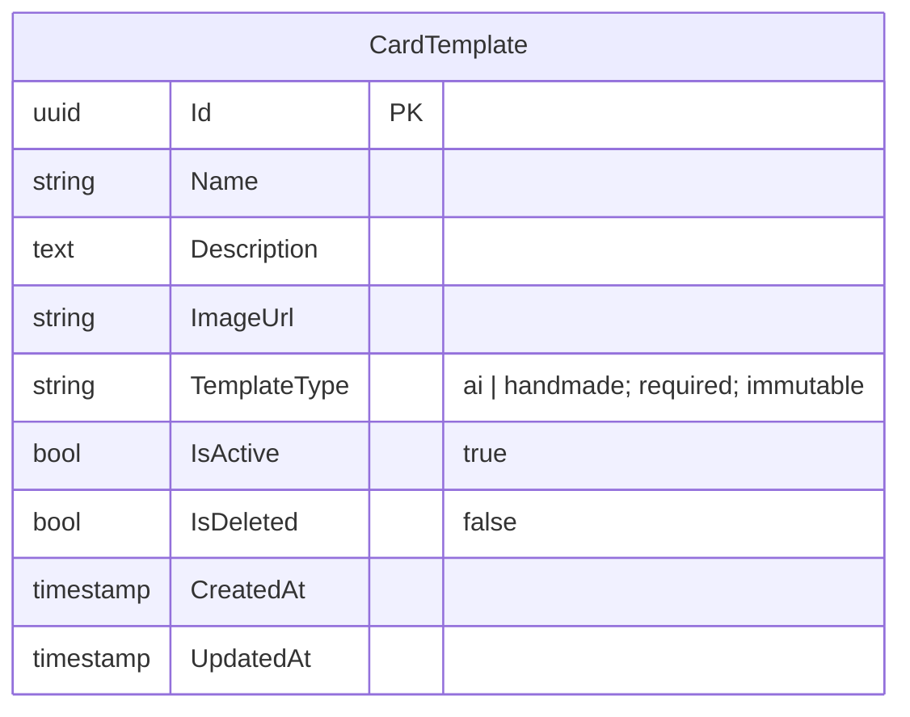

# TDD-024: Tạo Card Template

## Thông tin tài liệu
- **Tiêu đề**: Admin tạo Card Template AI hoặc HandMade
- **Ghi chú**: API tạo Template mới, nhận `imageUrl` và lưu discriminator `templateType`. Đây là thiết kế mục tiêu vì code Card Template chưa tồn tại.

## Metadata quản trị tài liệu
| Trường | Giá trị |
|---|---|
| Mã tài liệu | TDD-024 |
| Phiên bản | v0.4 |
| Author | Nguyễn Tùng Dương |
| Reviewer | Tân Trần |
| Approver | Chưa chỉ định |
| Owner | Nguyễn Tùng Dương |
| Cập nhật gần nhất | 2026-09-07 |

---

## BƯỚC 1 — Thông tin & Bối cảnh

### Thông tin tài liệu
- **Mã tài liệu**: TDD-024
- **Tính năng**: Tạo Card Template
- **Tác giả**: Nguyễn Tùng Dương
- **Người review**: Tân Trần
- **Phiên bản**: v0.4
- **Cập nhật (YYYY-MM-DD)**: 2026-09-07
- **Story liên quan**:
  - STORY-035 — Tạo thiệp thiết kế
  - Chưa có Story riêng cho CRUD Card Template

### Business Rules
- **BR-020-01**: Chỉ Admin đã đăng nhập và có tài khoản hoạt động được gọi API.
- **BR-020-02**: `name` bắt buộc, trim trước khi lưu và không được chỉ chứa khoảng trắng.
- **BR-020-03**: `description` là tùy chọn. Không truyền, truyền `null`, chuỗi rỗng hoặc chỉ có khoảng trắng thì lưu `null`; giá trị khác được trim trước khi lưu.
- **BR-020-04**: `templateType` bắt buộc, là string lowercase và chỉ nhận `ai` hoặc `handmade`.
- **BR-020-05**: `imageUrl` bắt buộc, phải là chuỗi URL hợp lệ, không rỗng và không dài quá 2048 ký tự.
- **BR-020-06**: Hệ thống nhận trực tiếp `imageUrl` từ request và lưu vào column `image_url`; không nhận file và không gọi upload ảnh.
- **BR-020-07**: Template mới mặc định `isActive=true`, `isDeleted=false`; client không được truyền hai field này trong Create.
- **BR-020-08**: `templateType` được lưu trực tiếp vào column `template_type`; Card Template không có field `metadata`.
- **BR-020-09**: Nếu insert DB thất bại, không tạo Card Template; không có bước cleanup file vì API không upload ảnh.
- **BR-020-10**: Không áp dụng uniqueness theo `name`; nhiều Template có thể trùng tên nhưng có ID riêng.

### Bối cảnh & Mục tiêu

**Vấn đề**
> Admin cần quản lý chung Template phục vụ AI và mẫu thiệp HandMade, đồng thời hệ thống phải phân loại chúng bằng một field ổn định.

**Mục tiêu**
- Tạo Template với tên, mô tả và URL ảnh hợp lệ.
- Lưu `templateType` lowercase, bắt buộc.
- Thiết lập trạng thái mặc định nhất quán.

**Ngoài phạm vi** (Out of scope)
- Thay đổi Template sau khi tạo.
- Tạo Card AI/HandMade.
- Tạo thumbnail hoặc xử lý ảnh nâng cao.
- Upload, xóa hoặc quản lý file ảnh.
- Unit Test.

---

## BƯỚC 2 — Kiến trúc & Sơ đồ

### Kiến trúc tổng quan (Architecture)
**Tiêu đề**: Trình tự tạo Card Template
**Mô tả**: Controller nhận JSON request; Service validate dữ liệu và lưu trực tiếp `imageUrl` vào record bằng EF Core.



**Ghi chú**: Flow không gọi File Storage; URL ảnh phải được cung cấp sẵn trong request.

### Sequence Diagram
**Tiêu đề**: Validate và persist Template
**Mô tả**: DB chỉ được ghi sau khi toàn bộ request, bao gồm `imageUrl`, hợp lệ.



**Ghi chú**: Không gọi AI hoặc System Prompt trong CRUD Template.

### Activity Diagram
**Tiêu đề**: Quyết định tạo Template
**Mô tả**: Chỉ persist sau khi tất cả input và URL ảnh hợp lệ.



### State Diagram
**Tiêu đề**: Trạng thái khởi tạo Card Template
**Mô tả**: Create luôn tạo record Active và chưa xóa.



### Mô hình dữ liệu (Data Model / ERD)
**Tiêu đề**: Record Card Template mới
**Mô tả**: Column `template_type` là string bắt buộc; dữ liệu cũ được backfill `ai` theo AI_DB_Diagram.

**Quy ước**: ERD bên dưới dùng đúng tên table/column PostgreSQL dạng `snake_case`; field request và response dùng `camelCase`.



---

## BƯỚC 3 — API

### API Contract nội bộ

#### Endpoint #1
- **Method**: POST
- **Endpoint**: `/api/card-templates`
- **Tên endpoint**: Tạo Card Template
- **Mô tả**: Admin truyền URL ảnh và tạo Template AI hoặc HandMade.

**Request Body — `application/json`**

| Field | Type | Required | Mô tả |
|---|---|---:|---|
| `name` | string | Có | Trim trước khi lưu; thiếu, `null`, rỗng hoặc blank trả `VALIDATION_ERROR/400` |
| `description` | string/null | Không | Không truyền, `null`, rỗng hoặc blank lưu `null`; giá trị khác được trim |
| `templateType` | string | Có | Bắt buộc đúng lowercase `ai` hoặc `handmade`; giá trị khác trả `CARD_TEMPLATE_TYPE_INVALID/400` |
| `imageUrl` | string | Có | URL ảnh hợp lệ, không rỗng, tối đa 2048 ký tự; không nhận file/base64 |
| `isActive` | — | Không cho phép | Server luôn khởi tạo `true`; nếu client truyền trả `VALIDATION_ERROR/400` |
| `isDeleted` | — | Không cho phép | Server luôn khởi tạo `false`; nếu client truyền trả `VALIDATION_ERROR/400` |

Không có query parameter hoặc path parameter. Request không gọi File Storage và không kiểm tra nội dung file phía sau URL.

**Response thành công — HTTP `201`**

| Field | Type | Mô tả |
|---|---|---|
| `isSuccess` | boolean | Luôn `true` |
| `isFailed` | boolean | Luôn `false` |
| `error` | null | Luôn `null` |
| `traceId` | string/null | Trace identifier của request |
| `timestampUtc` | datetime | Thời điểm server tạo response theo UTC |
| `value.id` | uuid | ID Template mới |
| `value.name` | string | Tên đã trim |
| `value.description` | string/null | Mô tả đã chuẩn hóa |
| `value.imageUrl` | string | URL nhận trực tiếp từ request |
| `value.templateType` | string | `ai` hoặc `handmade` |
| `value.isActive` | boolean | `true` |
| `value.isDeleted` | boolean | `false` |
| `value.createdAt` | datetime | Thời điểm tạo theo UTC |
| `value.updatedAt` | datetime/null | Giá trị thời điểm cập nhật theo mapping của resource mới |

**Ví dụ 1 — Tạo Template HandMade thành công** — HTTP `201`

```http
POST /api/card-templates
Content-Type: application/json

{
  "name": "Thiệp sinh nhật viết tay",
  "description": "Mẫu thiệp có sẵn do Admin thiết kế",
  "templateType": "handmade",
  "imageUrl": "https://storage.example.com/card-templates/hm-birthday.png"
}
```

```json
{
  "isSuccess": true,
  "isFailed": false,
  "error": null,
  "traceId": "0HNAEXAMPLE0001",
  "timestampUtc": "2026-09-07T08:00:00Z",
  "value": {
    "id": "template-hm-001",
    "name": "Thiệp sinh nhật viết tay",
    "description": "Mẫu thiệp có sẵn do Admin thiết kế",
    "imageUrl": "https://storage.example.com/card-templates/hm-birthday.png",
    "templateType": "handmade",
    "isActive": true,
    "isDeleted": false,
    "createdAt": "2026-09-04T08:00:00Z",
    "updatedAt": "2026-09-04T08:00:00Z"
  }
}
```

**Response lỗi chuẩn**

| Field | Type | Mô tả |
|---|---|---|
| `title` | string | Nhóm lỗi HTTP |
| `status` | integer | HTTP status code |
| `detail` | string | Chi tiết lỗi an toàn để trả client |
| `messageCode` | string | Mã lỗi để client xử lý |
| `errors` | object/null | Chi tiết validation nếu có; production có thể là `null` |
| `traceId` | string/null | Trace identifier của request |
| `timestampUtc` | datetime | Thời điểm server tạo response theo UTC |

**Ví dụ 2 — `templateType` không hợp lệ** — HTTP `400`

```json
{
  "title": "Bad Request",
  "status": 400,
  "detail": "templateType chỉ nhận giá trị lowercase ai hoặc handmade.",
  "messageCode": "CARD_TEMPLATE_TYPE_INVALID",
  "errors": null,
  "traceId": "0HNAEXAMPLE0002",
  "timestampUtc": "2026-09-07T08:01:00Z"
}
```

**Ví dụ 3 — Thiếu `imageUrl`** — HTTP `400`

```json
{
  "title": "Bad Request",
  "status": 400,
  "detail": "URL ảnh mẫu thiệp là bắt buộc.",
  "messageCode": "CARD_TEMPLATE_IMAGE_REQUIRED",
  "errors": null,
  "traceId": "0HNAEXAMPLE0003",
  "timestampUtc": "2026-09-07T08:02:00Z"
}
```

**Các trường hợp request và kết quả**

| Trường hợp | HTTP | `messageCode`/kết quả |
|---|---:|---|
| Request hợp lệ với `templateType=ai` | 201 | Trả Template AI mới trong `value` |
| Request hợp lệ với `templateType=handmade` | 201 | Trả Template HandMade mới trong `value` |
| Không truyền `description`, hoặc truyền `null`/rỗng/blank | 201 | Tạo thành công với `value.description=null` |
| Thiếu `name`; `name=null`, rỗng, blank hoặc sai kiểu | 400 | `VALIDATION_ERROR` |
| Thiếu `templateType`; null, rỗng, khác `ai|handmade` hoặc sai chữ hoa/thường | 400 | `CARD_TEMPLATE_TYPE_INVALID` |
| Thiếu `imageUrl`; `imageUrl=null`, rỗng hoặc blank | 400 | `CARD_TEMPLATE_IMAGE_REQUIRED` |
| `imageUrl` sai định dạng URL, dài quá 2048 ký tự hoặc sai kiểu | 400 | `VALIDATION_ERROR` |
| Client truyền `isActive` hoặc `isDeleted` | 400 | `VALIDATION_ERROR` |
| Không có/không hợp lệ access token hoặc tài khoản không hoạt động | 401 | `UNAUTHORIZED` |
| Người gọi không có role Admin | 403 | `FORBIDDEN` |
| Insert DB thất bại hoặc lỗi hệ thống không xác định | 500 | `INTERNAL_SERVER_ERROR` |

#### Mã lỗi
| Code | HTTP | Khi nào xảy ra |
|---|---:|---|
| `VALIDATION_ERROR` | 400 | `name` thiếu/rỗng/sai kiểu; `imageUrl` sai URL/quá 2048 ký tự/sai kiểu; truyền `isActive`, `isDeleted` hoặc request field không hợp lệ |
| `CARD_TEMPLATE_TYPE_INVALID` | 400 | `templateType` thiếu/null/rỗng hoặc khác lowercase `ai|handmade` |
| `CARD_TEMPLATE_IMAGE_REQUIRED` | 400 | Không truyền hoặc truyền `imageUrl` rỗng |
| `UNAUTHORIZED` | 401 | Admin chưa đăng nhập hoặc tài khoản không hoạt động |
| `FORBIDDEN` | 403 | Người gọi không có role Admin |
| `INTERNAL_SERVER_ERROR` | 500 | Không insert được record |

### API Contract bên ngoài

- **Không áp dụng**: Endpoint không gọi File Storage hoặc API bên thứ ba.

---

## BƯỚC 4 — Tham chiếu

### 🔴 Tham chiếu đến
- AI_Card_Context — Quy tắc `templateType` và hai flow Card.
- AI_DB_Diagram — Schema, backfill và ràng buộc discriminator.

### ⚫ Trỏ vào tài liệu này
- TDD-022 — Template mới xuất hiện trong danh sách theo filter.
- TDD-025 — Cập nhật Template đã tạo.
- TDD-026 — Xóa mềm Template.

### ⋯ Bị ảnh hưởng
- TDD-006 và TDD-021 nếu thay đổi giá trị `templateType`, ảnh hoặc trạng thái mặc định.
