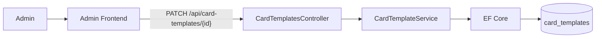
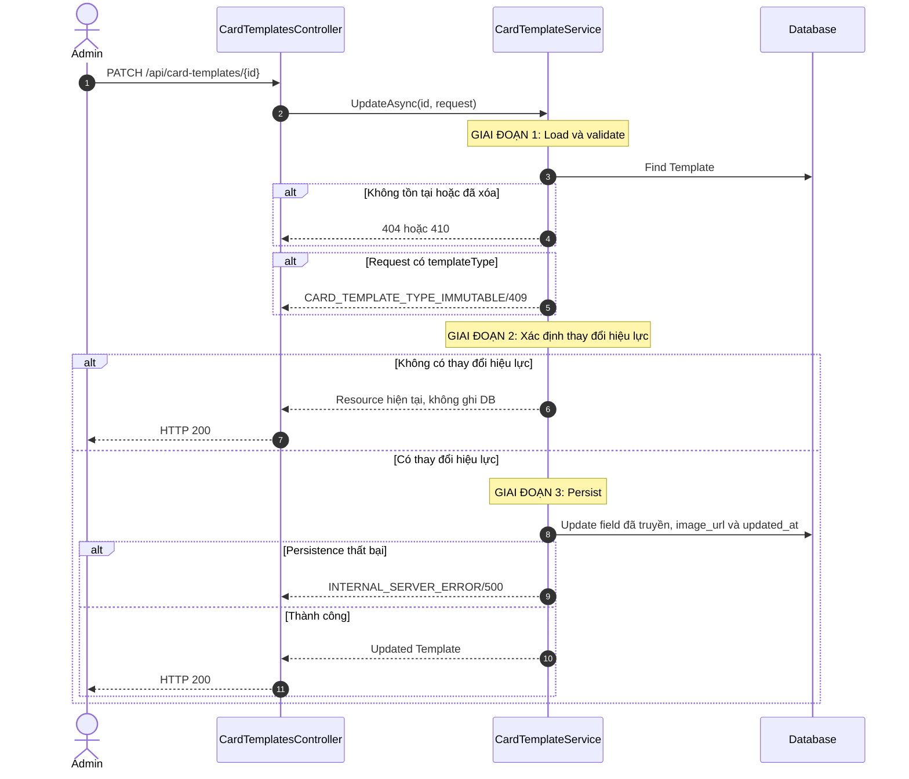
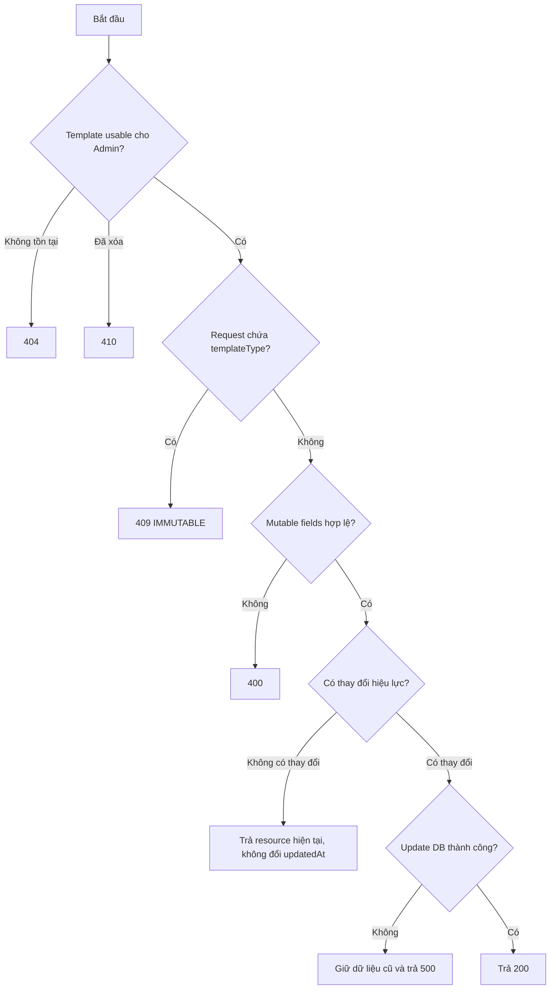
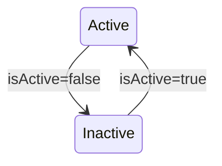
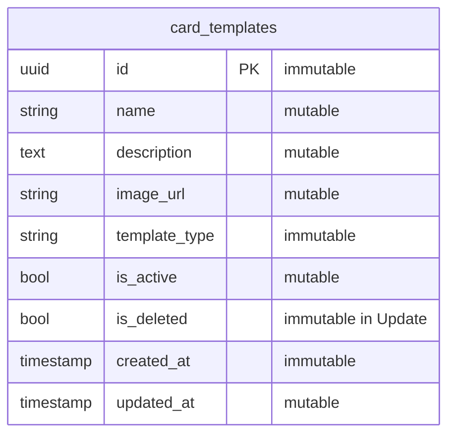

# TDD-025: Cập nhật Card Template

## Thông tin tài liệu
- **Tiêu đề**: Admin cập nhật nội dung, URL ảnh hoặc trạng thái Card Template
- **Ghi chú**: API partial update Template nhưng giữ `templateType` bất biến. Đây là thiết kế mục tiêu vì code Card Template chưa tồn tại.

## Metadata quản trị tài liệu
| Trường | Giá trị |
|---|---|
| Mã tài liệu | TDD-025 |
| Phiên bản | v0.5 |
| Author | Nguyễn Tùng Dương |
| Reviewer | Tân Trần |
| Approver | Chưa chỉ định |
| Owner | Nguyễn Tùng Dương |
| Cập nhật gần nhất | 2026-09-07 |

---

## BƯỚC 1 — Thông tin & Bối cảnh

### Thông tin tài liệu
- **Mã tài liệu**: TDD-025
- **Tính năng**: Cập nhật Card Template
- **Tác giả**: Nguyễn Tùng Dương
- **Người review**: Tân Trần
- **Phiên bản**: v0.5
- **Cập nhật (YYYY-MM-DD)**: 2026-09-07
- **Story liên quan**:
  - Chưa có Story riêng cho CRUD Card Template

### Business Rules
- **BR-021-01**: Chỉ Admin đã đăng nhập và có tài khoản hoạt động được gọi API.
- **BR-021-02**: Template không tồn tại trả `CARD_TEMPLATE_NOT_FOUND/404`; đã soft-delete trả `CARD_TEMPLATE_DELETED/410`.
- **BR-021-03**: Request cho phép cập nhật `name`, `description`, `imageUrl`, `isActive` và phải chứa ít nhất một field trong nhóm này. Field không xuất hiện trong request phải giữ nguyên giá trị hiện tại; không được gán `null` hoặc giá trị mặc định ngoài ý muốn.
- **BR-021-04**: `templateType` không thuộc Update request. Nếu client truyền field này, kể cả cùng giá trị hiện tại, trả `CARD_TEMPLATE_TYPE_IMMUTABLE/409`.
- **BR-021-05**: `name` nếu truyền phải trim và không được rỗng. `description` nếu truyền được trim; chuỗi rỗng hoặc chỉ có khoảng trắng đặt `description=null`.
- **BR-021-06**: `imageUrl` mới nếu truyền phải là chuỗi URL hợp lệ, không rỗng và không dài quá 2048 ký tự. Không truyền thì giữ nguyên `imageUrl`; không hỗ trợ xóa URL ảnh khỏi Template.
- **BR-021-07**: Nếu truyền `imageUrl` mới, service lưu trực tiếp URL đó vào column `image_url`; không nhận file và không gọi upload ảnh.
- **BR-021-08**: Nếu DB update thất bại, record và `image_url` cũ được giữ nguyên; không có bước cleanup file.
- **BR-021-09**: `isActive=false` làm Template biến mất khỏi danh sách Customer và không được chọn cho Create/Regenerate mới; dữ liệu lịch sử vẫn sử dụng được theo policy của TDD-007 từ `generated_cards` và phần Template metadata không trùng.
- **BR-021-10**: Cập nhật column `updated_at` bằng UTC khi persistence thực sự thay đổi dữ liệu; không đổi `created_at`, `id`, `template_type` hoặc `is_deleted`.
- **BR-021-11**: Nếu request không có `imageUrl` và mọi giá trị hiệu lực của `name`, `description`, `isActive` đều giống dữ liệu hiện tại, trả HTTP 200 với resource hiện tại, không ghi DB và không đổi `updatedAt`. `imageUrl` được truyền nhưng giống URL hiện tại không tạo thay đổi hiệu lực.
- **BR-021-12**: Request DTO/binder phải biểu diễn được sự vắng mặt của field; riêng `isActive` phải nullable để phân biệt “không truyền” với `false`, còn `description` phải kiểm tra sự hiện diện của key trong JSON request để phân biệt “không truyền” với chuỗi rỗng dùng để xóa. Chưa áp dụng optimistic concurrency; cập nhật đồng thời dùng last-write-wins trên các field được truyền.

### Bối cảnh & Mục tiêu

**Vấn đề**
> Admin cần chỉnh nội dung, ảnh và khả năng sử dụng của Template, nhưng việc đổi loại AI/HandMade sau khi Template đã được dùng sẽ làm sai snapshot và luồng nghiệp vụ.

**Mục tiêu**
- Cho phép cập nhật các field có thể thay đổi.
- Giữ `templateType` bất biến.
- Cho phép thay URL ảnh và giữ URL cũ khi persistence lỗi.
- Giữ snapshot lịch sử không bị ảnh hưởng bởi dữ liệu live mới.

**Ngoài phạm vi** (Out of scope)
- Khôi phục Template đã soft-delete.
- Thay đổi `templateType`.
- Cập nhật Generated Card hoặc history đã tồn tại.
- Upload, xóa hoặc quản lý file ảnh.
- Unit Test.

---

## BƯỚC 2 — Kiến trúc & Sơ đồ

### Kiến trúc tổng quan (Architecture)
**Tiêu đề**: Trình tự cập nhật Card Template
**Mô tả**: Service load record, validate patch và lưu trực tiếp `imageUrl` mới nếu có.



**Ghi chú**: Dữ liệu đã lưu trong `generated_cards` và Template metadata không trùng trong history không được update theo Template live; `cardTemplate.imageUrl` không được lưu trong metadata.

### Sequence Diagram
**Tiêu đề**: Cập nhật Template và URL ảnh
**Mô tả**: `imageUrl` mới chỉ thay thế giá trị cũ khi DB update thành công.



**Ghi chú**: Flow không gọi File Storage; chỉ cập nhật URL được cung cấp trong request.

### Activity Diagram
**Tiêu đề**: Quyết định cập nhật Template
**Mô tả**: `templateType` bị chặn trước persistence.



### State Diagram
**Tiêu đề**: Chuyển trạng thái Active/Inactive
**Mô tả**: Update chỉ chuyển giữa Active và Inactive; Deleted không thể cập nhật.



### Mô hình dữ liệu (Data Model / ERD)
**Tiêu đề**: Mutable và immutable fields của Card Template
**Mô tả**: `template_type`, `id`, `created_at`, `is_deleted` không được Update thay đổi.

**Quy ước**: ERD bên dưới dùng đúng tên table/column PostgreSQL dạng `snake_case`; field request và response dùng `camelCase`.



---

## BƯỚC 3 — API

### API Contract nội bộ

#### Endpoint #1
- **Method**: PATCH
- **Endpoint**: `/api/card-templates/{id}`
- **Tên endpoint**: Cập nhật Card Template
- **Mô tả**: Admin cập nhật một phần các field mutable của Template; field không truyền giữ nguyên và không cho đổi `templateType`.

**Request Body — `application/json`**

**Path parameter**

| Field | Type | Required | Mô tả |
|---|---|---:|---|
| `id` | uuid | Có | ID Card Template cần cập nhật; sai định dạng trả `VALIDATION_ERROR/400` |

**Body**

| Field | Type | Required | Mô tả |
|---|---|---:|---|
| `name` | string | Không | Nếu truyền phải trim và không được `null`, rỗng hoặc blank |
| `description` | string/null | Không | Không truyền thì giữ nguyên; truyền `null`, rỗng hoặc blank thì đặt `null`; giá trị khác được trim |
| `imageUrl` | string | Không | Nếu truyền phải là URL hợp lệ, không rỗng, tối đa 2048 ký tự; không nhận file/base64 |
| `isActive` | boolean | Không | Không truyền thì giữ nguyên; `true` bật và `false` tắt khả năng dùng cho flow mới; explicit `null` không hợp lệ |
| `templateType` | — | Không cho phép | Discriminator bất biến; nếu xuất hiện trong request trả `CARD_TEMPLATE_TYPE_IMMUTABLE/409` |
| `isDeleted` | — | Không cho phép | Update không thay đổi trạng thái xóa; nếu xuất hiện trả `VALIDATION_ERROR/400` |

Body phải chứa ít nhất một field được phép cập nhật. Không có query parameter. Endpoint không tải, upload hoặc xóa file tại `imageUrl`.

**Response thành công — HTTP `200`**

| Field | Type | Mô tả |
|---|---|---|
| `isSuccess` | boolean | Luôn `true` |
| `isFailed` | boolean | Luôn `false` |
| `error` | null | Luôn `null` |
| `traceId` | string/null | Trace identifier của request |
| `timestampUtc` | datetime | Thời điểm server tạo response theo UTC |
| `value.id` | uuid | ID Template |
| `value.name` | string | Tên hiệu lực sau update |
| `value.description` | string/null | Mô tả hiệu lực sau update |
| `value.imageUrl` | string | URL hiệu lực sau update |
| `value.templateType` | string | Giá trị bất biến `ai` hoặc `handmade` |
| `value.isActive` | boolean | Trạng thái hiệu lực sau update |
| `value.isDeleted` | boolean | Luôn `false` đối với record update thành công |
| `value.createdAt` | datetime | Thời điểm tạo, không thay đổi |
| `value.updatedAt` | datetime/null | Đổi sang UTC hiện tại khi có thay đổi; giữ nguyên khi no-op |

**Ví dụ 1 — Cập nhật tên, ảnh và trạng thái** — HTTP `200`

```http
PATCH /api/card-templates/template-hm-001
Content-Type: application/json

{
  "name": "Thiệp sinh nhật viết tay mới",
  "isActive": false,
  "imageUrl": "https://storage.example.com/card-templates/hm-birthday-v2.png"
}
```

```json
{
  "isSuccess": true,
  "isFailed": false,
  "error": null,
  "traceId": "0HNAEXAMPLE0101",
  "timestampUtc": "2026-09-07T09:00:00Z",
  "value": {
    "id": "template-hm-001",
    "name": "Thiệp sinh nhật viết tay mới",
    "description": "Mẫu thiệp có sẵn do Admin thiết kế",
    "imageUrl": "https://storage.example.com/card-templates/hm-birthday-v2.png",
    "templateType": "handmade",
    "isActive": false,
    "isDeleted": false,
    "createdAt": "2026-09-04T08:00:00Z",
    "updatedAt": "2026-09-04T09:00:00Z"
  }
}
```

Các field không truyền, gồm `description`, được lấy từ record hiện tại và không bị gán `null`.

**Ví dụ 2 — Xóa `description` bằng `null`** — HTTP `200`

```http
PATCH /api/card-templates/template-hm-001
Content-Type: application/json

{
  "description": null
}
```

Response trả resource đầy đủ với `value.description=null` và `updatedAt` mới.

**Ví dụ 3 — No-op, dữ liệu hiệu lực không thay đổi** — HTTP `200`

```http
PATCH /api/card-templates/template-hm-001
Content-Type: application/json

{
  "name": "Thiệp sinh nhật viết tay mới",
  "imageUrl": "https://storage.example.com/card-templates/hm-birthday-v2.png"
}
```

Response trả resource hiện tại; DB không update và `value.updatedAt` giữ nguyên.

**Response lỗi chuẩn**

| Field | Type | Mô tả |
|---|---|---|
| `title` | string | Nhóm lỗi HTTP |
| `status` | integer | HTTP status code |
| `detail` | string | Chi tiết lỗi an toàn để trả client |
| `messageCode` | string | Mã lỗi để client xử lý |
| `errors` | object/null | Chi tiết validation nếu có; production có thể là `null` |
| `traceId` | string/null | Trace identifier của request |
| `timestampUtc` | datetime | Thời điểm server tạo response theo UTC |

**Ví dụ 4 — Cố đổi `templateType`** — HTTP `409`

```json
{
  "title": "Conflict",
  "status": 409,
  "detail": "Không được thay đổi templateType của mẫu thiệp đã tạo.",
  "messageCode": "CARD_TEMPLATE_TYPE_IMMUTABLE",
  "errors": null,
  "traceId": "0HNAEXAMPLE0102",
  "timestampUtc": "2026-09-07T09:01:00Z"
}
```

**Ví dụ 5 — Request không có field cập nhật** — HTTP `400`

```json
{
  "title": "Bad Request",
  "status": 400,
  "detail": "Cần truyền ít nhất một field được phép cập nhật.",
  "messageCode": "VALIDATION_ERROR",
  "errors": null,
  "traceId": "0HNAEXAMPLE0103",
  "timestampUtc": "2026-09-07T09:02:00Z"
}
```

**Ví dụ 6 — Template đã xóa** — HTTP `410`

```json
{
  "title": "Gone",
  "status": 410,
  "detail": "Mẫu thiệp đã bị xóa và không thể cập nhật.",
  "messageCode": "CARD_TEMPLATE_DELETED",
  "errors": null,
  "traceId": "0HNAEXAMPLE0104",
  "timestampUtc": "2026-09-07T09:03:00Z"
}
```

**Các trường hợp request và kết quả**

| Trường hợp | HTTP | `messageCode`/kết quả |
|---|---:|---|
| Cập nhật một hoặc nhiều field hợp lệ | 200 | Trả resource đầy đủ và đổi `updatedAt` |
| `description=null`, rỗng hoặc blank | 200 | Đặt `value.description=null` |
| Các field sau chuẩn hóa giống hoàn toàn dữ liệu hiện tại | 200 | No-op; không ghi DB, giữ nguyên `updatedAt` |
| `id` sai định dạng | 400 | `VALIDATION_ERROR` |
| Body rỗng hoặc không có field được phép cập nhật | 400 | `VALIDATION_ERROR` |
| `name=null`, rỗng, blank hoặc sai kiểu | 400 | `VALIDATION_ERROR` |
| `imageUrl=null`, rỗng, blank, sai URL, quá 2048 ký tự hoặc sai kiểu | 400 | `VALIDATION_ERROR` |
| `isActive=null` hoặc sai kiểu | 400 | `VALIDATION_ERROR` |
| Request truyền `isDeleted` hoặc field không hợp lệ | 400 | `VALIDATION_ERROR` |
| Không có/không hợp lệ access token hoặc tài khoản không hoạt động | 401 | `UNAUTHORIZED` |
| Người gọi không có role Admin | 403 | `FORBIDDEN` |
| Không có Template theo `id` | 404 | `CARD_TEMPLATE_NOT_FOUND` |
| Request chứa `templateType`, kể cả bằng giá trị hiện tại | 409 | `CARD_TEMPLATE_TYPE_IMMUTABLE` |
| Template đã soft-delete | 410 | `CARD_TEMPLATE_DELETED` |
| DB update thất bại hoặc lỗi hệ thống không xác định | 500 | `INTERNAL_SERVER_ERROR` |

#### Mã lỗi
| Code | HTTP | Khi nào xảy ra |
|---|---:|---|
| `VALIDATION_ERROR` | 400 | ID sai; body rỗng; field sai kiểu; `name`/`imageUrl` không hợp lệ; `isActive=null`; truyền `isDeleted` hoặc field không hợp lệ |
| `UNAUTHORIZED` | 401 | Admin chưa đăng nhập hoặc tài khoản không hoạt động |
| `FORBIDDEN` | 403 | Người gọi không có role Admin |
| `CARD_TEMPLATE_NOT_FOUND` | 404 | Template không tồn tại |
| `CARD_TEMPLATE_DELETED` | 410 | Template đã soft-delete |
| `CARD_TEMPLATE_TYPE_IMMUTABLE` | 409 | Request truyền `templateType` |
| `INTERNAL_SERVER_ERROR` | 500 | Không cập nhật được DB |

### API Contract bên ngoài

- **Không áp dụng**: Endpoint không gọi File Storage hoặc API bên thứ ba.

---

## BƯỚC 4 — Tham chiếu

### 🔴 Tham chiếu đến
- TDD-023 — Chi tiết Template và taxonomy not-found/deleted.
- TDD-024 — Validation name và `imageUrl`.
- AI_Card_Context — Template type bất biến và snapshot policy.

### ⚫ Trỏ vào tài liệu này
- TDD-022 — Visibility danh sách thay đổi theo `isActive`.
- TDD-006, TDD-007, TDD-021 — Admission validation của flow Card.

### ⋯ Bị ảnh hưởng
- TDD-006 và TDD-021 khi thay đổi ảnh/trạng thái Template dùng cho request mới.
- TDD-007 không bị trạng thái live của Template nguồn làm hỏng snapshot cũ.
