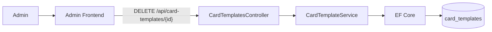
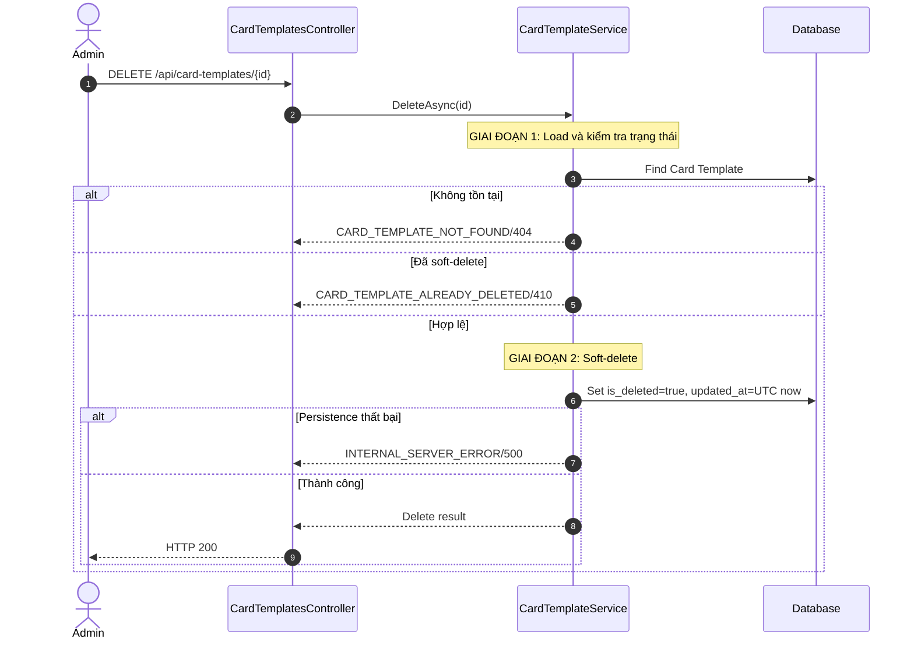
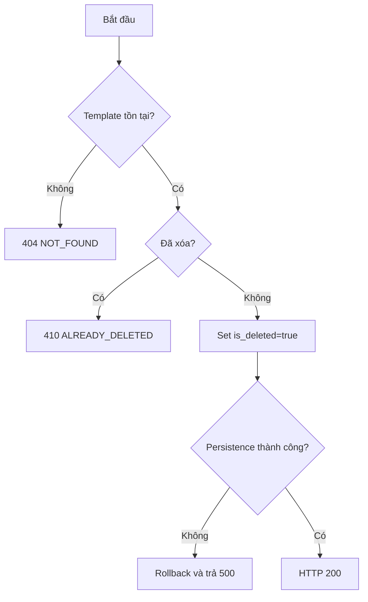
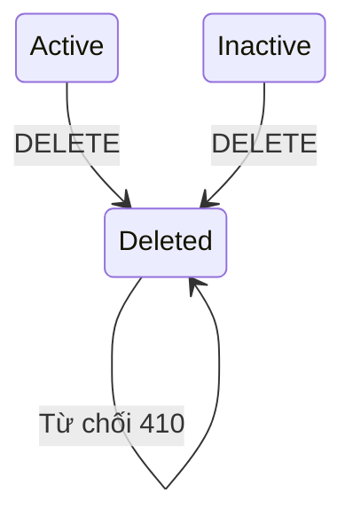
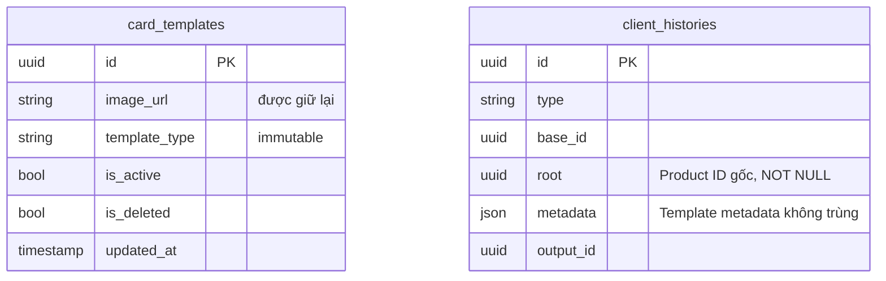

# TDD-026: Xóa Card Template

## Thông tin tài liệu
- **Tiêu đề**: Admin xóa mềm Card Template
- **Ghi chú**: API ngừng sử dụng Template cho flow mới nhưng giữ record, ảnh, dữ liệu trong `generated_cards` và phần Template metadata không trùng của history. Đây là thiết kế mục tiêu vì code Card Template chưa tồn tại.

## Metadata quản trị tài liệu
| Trường | Giá trị |
|---|---|
| Mã tài liệu | TDD-026 |
| Phiên bản | v0.4 |
| Author | Nguyễn Tùng Dương |
| Reviewer | Tân Trần |
| Approver | Chưa chỉ định |
| Owner | Nguyễn Tùng Dương |
| Cập nhật gần nhất | 2026-09-09 |

---

## BƯỚC 1 — Thông tin & Bối cảnh

### Thông tin tài liệu
- **Mã tài liệu**: TDD-026
- **Tính năng**: Xóa Card Template
- **Tác giả**: Nguyễn Tùng Dương
- **Người review**: Tân Trần
- **Phiên bản**: v0.4
- **Cập nhật (YYYY-MM-DD)**: 2026-09-07
- **Story liên quan**:
  - Chưa có Story riêng cho CRUD Card Template

### Business Rules
- **BR-022-01**: Chỉ Admin đã đăng nhập và có tài khoản hoạt động được gọi API.
- **BR-022-02**: Xóa mềm bằng cách set `is_deleted=true` và cập nhật `updated_at` UTC; không xóa vật lý record.
- **BR-022-03**: Template không tồn tại trả `CARD_TEMPLATE_NOT_FOUND/404`.
- **BR-022-04**: Template đã soft-delete trả `CARD_TEMPLATE_ALREADY_DELETED/410`; thao tác không được xem là thành công lặp lại.
- **BR-022-05**: Có thể xóa Template Active hoặc Inactive.
- **BR-022-06**: Không xóa file `image_url` tại thời điểm soft-delete để bảo toàn preview/audit và tránh ảnh hưởng dữ liệu lịch sử; `client_histories.metadata` không snapshot `cardTemplate.imageUrl`.
- **BR-022-07**: Không update hoặc xóa `generated_cards` và `client_histories`; dữ liệu Card/ảnh đã lưu nằm trong `generated_cards`, còn history giữ provenance và phần Template metadata không trùng.
- **BR-022-08**: Template đã xóa không xuất hiện trong danh sách và không được dùng cho Card Create hoặc làm Template mới khi Regenerate.
- **BR-022-09**: Regenerate AI bỏ trống/null hoặc dùng đúng ID Template nguồn vẫn dùng dữ liệu nguồn đã lưu trong `generated_cards` và phần Template metadata không trùng, không query trạng thái record live, kể cả Template đã bị xóa.
- **BR-022-10**: Nếu persistence thất bại, record phải giữ nguyên `is_deleted=false` và `updated_at` cũ.

### Bối cảnh & Mục tiêu

**Vấn đề**
> Template không còn phù hợp phải được loại khỏi flow mới nhưng không được phá hỏng Generated Card và history đã lưu trước đó.

**Mục tiêu**
- Xóa mềm Template theo quyền Admin.
- Loại Template khỏi danh sách và flow tạo mới.
- Giữ ảnh trong Generated Card và metadata lịch sử nguyên vẹn.
- Đảm bảo rollback khi persistence thất bại.

**Ngoài phạm vi** (Out of scope)
- Xóa vật lý record hoặc file ảnh.
- Khôi phục Template đã xóa.
- Xóa Generated Card/history đã dùng Template.
- Unit Test.

---

## BƯỚC 2 — Kiến trúc & Sơ đồ

### Kiến trúc tổng quan (Architecture)
**Tiêu đề**: Trình tự xóa mềm Card Template
**Mô tả**: Controller xác thực Admin; Service load record, kiểm tra trạng thái và update cờ soft-delete qua EF Core.



**Ghi chú**: File Storage không được gọi trong flow soft-delete.

### Sequence Diagram
**Tiêu đề**: Kiểm tra và xóa mềm Template
**Mô tả**: Chỉ record tồn tại và chưa xóa mới được cập nhật.



**Ghi chú**: Không kiểm tra ràng buộc với Generated Card vì dữ liệu nguồn đã nằm trong `generated_cards` và phần Template metadata không trùng của history.

### Activity Diagram
**Tiêu đề**: Quyết định xóa Card Template
**Mô tả**: Active và Inactive đều có thể chuyển sang Deleted.



### State Diagram
**Tiêu đề**: Vòng đời khi xóa Template
**Mô tả**: Deleted là trạng thái cuối trong phạm vi hiện tại.



### Mô hình dữ liệu (Data Model / ERD)
**Tiêu đề**: Soft-delete Card Template và dữ liệu lịch sử liên quan
**Mô tả**: Không có FK bắt buộc từ history tới Template live; metadata chỉ giữ phần Template không trùng và không có `cardTemplate.imageUrl`. Các cột lineage đa hình `base_id`, `root`, `output_id` đều do code quản lý và không tạo quan hệ database.

**Quy ước**: ERD bên dưới dùng đúng tên table/column PostgreSQL dạng `snake_case`; field response dùng `camelCase`.



Sơ đồ không nối `card_templates` với `client_histories`: Template chỉ được ghi nhận trong metadata snapshot; `base_id`, `root` và `output_id` không có FK/navigation/cascade.

---

## BƯỚC 3 — API

### API Contract nội bộ

#### Endpoint #1
- **Method**: DELETE
- **Endpoint**: `/api/card-templates/{id}`
- **Tên endpoint**: Xóa mềm Card Template
- **Mô tả**: Đánh dấu Template đã xóa mà không xóa record, ảnh hoặc lịch sử.

**Ví dụ 1 — Xóa thành công** — HTTP `200`

```http
DELETE /api/card-templates/template-hm-001
```

```json
{
  "value": {
    "success": true,
    "id": "template-hm-001",
    "isDeleted": true,
    "message": "Đã xóa mẫu thiệp thành công."
  }
}
```

**Ví dụ 2 — Template không tồn tại** — HTTP `404`

```json
{
  "messageCode": "CARD_TEMPLATE_NOT_FOUND",
  "message": "Không tìm thấy mẫu thiệp."
}
```

**Ví dụ 3 — Template đã xóa trước đó** — HTTP `410`

```json
{
  "messageCode": "CARD_TEMPLATE_ALREADY_DELETED",
  "message": "Mẫu thiệp đã bị xóa trước đó."
}
```

**Ví dụ 4 — Persistence thất bại** — HTTP `500`

```json
{
  "messageCode": "INTERNAL_SERVER_ERROR",
  "message": "Không thể xóa mẫu thiệp. Vui lòng thử lại sau."
}
```

Record và lịch sử giữ nguyên khi ví dụ 4 xảy ra.

#### Mã lỗi
| Code | HTTP | Khi nào xảy ra |
|---|---:|---|
| `VALIDATION_ERROR` | 400 | ID không đúng định dạng |
| `UNAUTHORIZED` | 401 | Admin chưa đăng nhập hoặc tài khoản không hoạt động |
| `FORBIDDEN` | 403 | Người gọi không có role Admin |
| `CARD_TEMPLATE_NOT_FOUND` | 404 | Template không tồn tại |
| `CARD_TEMPLATE_ALREADY_DELETED` | 410 | Template đã soft-delete |
| `INTERNAL_SERVER_ERROR` | 500 | Không lưu được trạng thái soft-delete |

### API Contract bên ngoài

- **Không áp dụng**: Endpoint không gọi API hoặc File Storage bên ngoài.

---

## BƯỚC 4 — Tham chiếu

### 🔴 Tham chiếu đến
- TDD-023 — Taxonomy Card Template not-found/deleted.
- AI_Card_Context — Snapshot policy khi Template live thay đổi.

### ⚫ Trỏ vào tài liệu này
- TDD-022 — Loại record đã xóa khỏi danh sách.
- TDD-006, TDD-007, TDD-021 — Admission behavior khi Template đã xóa.

### ⋯ Bị ảnh hưởng
- TDD-006 và TDD-021 chặn Template đã xóa trong Create mới.
- TDD-007 vẫn dùng Template snapshot nguồn nếu client không chọn Template mới.
