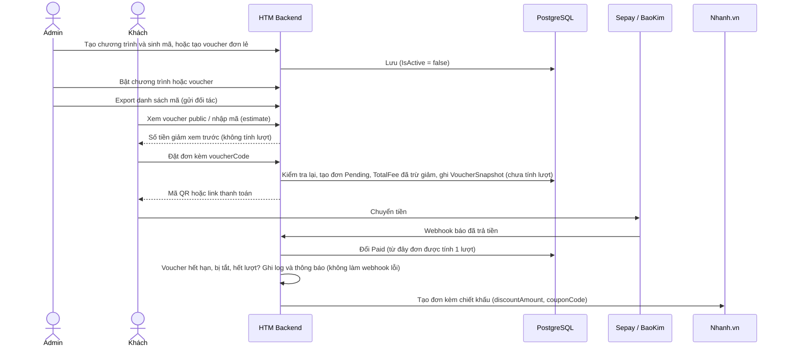
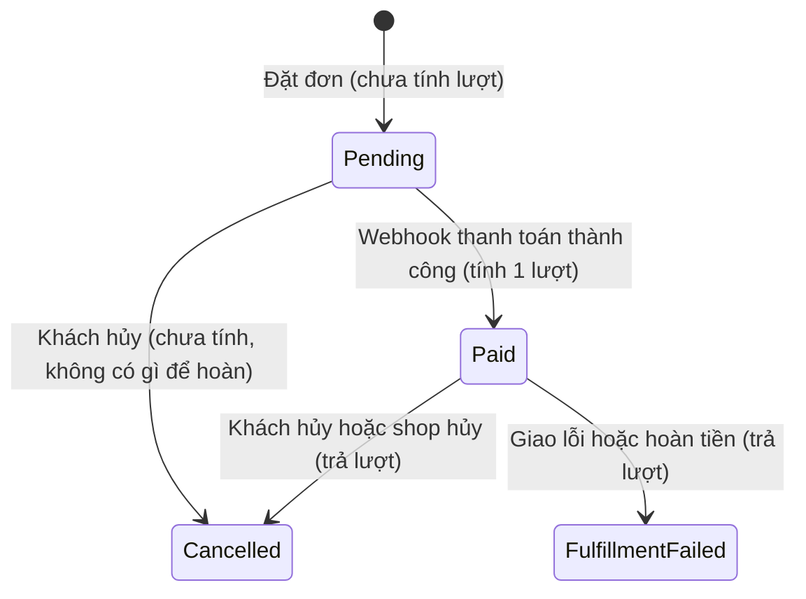
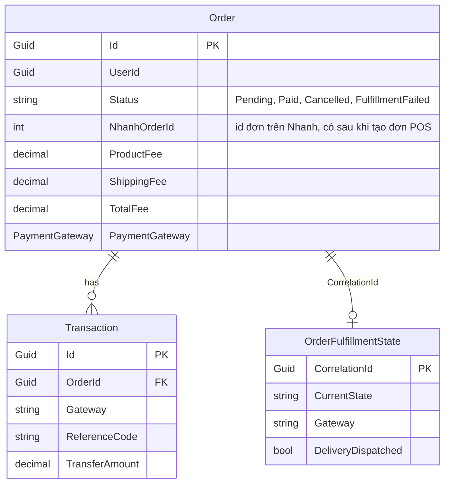
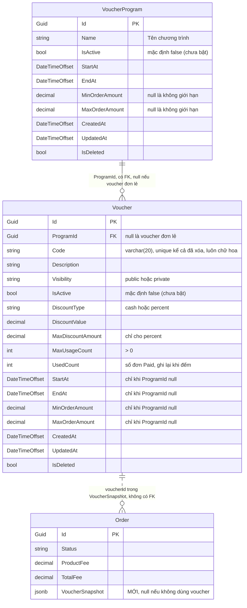

# PLANS: Voucher (mã giảm giá)

## Mục lục

1. Phạm vi
2. Nghiệp vụ đã chốt
3. Flow
4. Database
5. Quy ước API
6. API quản lý chương trình (Admin)
7. API quản lý voucher (Admin)
8. API của khách và API đã có
9. Sinh mã
10. Export
11. Nhanh.vn
12. Cần confirm lại
13. Điểm chạm vào code, quy ước dự án, test, thứ tự làm

---

## 1. Phạm vi

**Trong phạm vi:**

- Admin tạo **chương trình voucher** và sinh nhiều mã ngẫu nhiên vào chương trình (ví dụ chương trình 20/10, 100 mã).
- Admin tạo **voucher đơn lẻ** (public hoặc private), mã tự gõ hoặc tự sinh.
- Admin xem, sửa, bật/tắt, xóa mềm chương trình và voucher; export danh sách mã; xem lịch sử dùng của từng voucher.
- Khách xem voucher public ở trang thanh toán, nhập mã private, xem trước số tiền giảm, đặt đơn kèm 1 voucher.
- Tính lượt dùng khi đơn thanh toán thành công; gửi số tiền giảm sang Nhanh.vn dưới dạng chiết khấu.

**Ngoài phạm vi:**

- API cho nền tảng khác đấu nối voucher (VC05, VC06).
- **API import voucher** (chưa triển khai).
- Voucher quà tặng (mục 6 của nghiệp vụ gốc): chưa mô tả đủ, xem mục 12.
- Dùng nhiều voucher trong một đơn.
- Các hạng mục khác trong biên bản họp: đăng nhập OTP, slot đặt hàng, quà tặng. Chưa có tài liệu chốt; nếu được giao thì phải chốt nghiệp vụ trước.

Hạn chót ghi trong tài liệu cũ: hết ngày 12.

---

## 2. Nghiệp vụ đã chốt

### 2.1. Dạng voucher và cách tính giảm

- Hai kiểu giảm: **`cash`** (giảm số tiền cố định) và **`percent`** (giảm theo phần trăm).
- Voucher `percent` có **mức giảm tối đa** (`MaxDiscountAmount`, có thể không đặt). `cash` không có trần riêng.
- Voucher có **giá trị đơn tối thiểu** (`MinOrderAmount`), và có thể có giá trị đơn tối đa (`MaxOrderAmount`).
- Voucher được sinh và quản lý tại HTM. Website kiểm tra, tính và áp dụng giảm giá. Đơn chuyển về Nhanh với số tiền giảm ghi dưới dạng chiết khấu.
- **Giảm tính trên tiền hàng** (`ProductFee`), không gồm ship và VAT:
  - `cash`: giảm `DiscountValue`, không vượt tiền hàng.
  - `percent`: `tiền hàng × DiscountValue / 100`, làm tròn **xuống** đến đồng, rồi lấy nhỏ hơn `MaxDiscountAmount` nếu có. `DiscountValue` từ trên 0 đến tối đa 100, được dùng số lẻ (ví dụ 12,5).
- Voucher 100% (hoặc `cash` lớn hơn giá đơn) giảm hết tiền hàng, **không giảm phí ship**. Ví dụ tiền hàng 500.000đ, ship 30.000đ → khách trả 30.000đ.
- **VAT giữ như cũ:** 8% trên `ProductFee` **chưa giảm** (khi có mã số thuế).
- `TotalFee = tiền hàng + ship + VAT - giảm`. `ProductFee` giữ nguyên.
- **Tổng tiền phải lớn hơn 0:** đơn miễn ship (`ahamove.free_ship`) + giảm hết tiền hàng + không VAT thì `TotalFee = 0` → báo 400 `BAD_REQUEST` (`Order total must be greater than 0.`), không tạo đơn. Không có đơn 0 đồng.
- **Đơn tối thiểu/tối đa** so với `ProductFee`, **không tính phí ship** [To be confirmed, mục 12]. Khách áp mã rồi đổi số lượng khiến đơn không đạt tối thiểu thì `estimate` và đặt đơn báo lỗi 400, yêu cầu khách xử lý (bỏ mã hoặc thêm hàng).

### 2.2. Hai cách tạo voucher

|                                 | Flow 1: Chương trình                                                           | Flow 2: Voucher đơn lẻ                                        |
| ------------------------------- | ------------------------------------------------------------------------------ | ------------------------------------------------------------- |
| Admin làm                       | Tạo chương trình (tên, ngày, khoảng tổng tiền), rồi sinh N mã vào chương trình | Tạo 1 voucher                                                 |
| Ví dụ                           | 20/10: 100 mã, mỗi mã dùng 1 lần, giảm 20%                                     | Mã giảm 50.000đ, dùng chung 500 lượt, hiện ở trang thanh toán |
| `Visibility`                    | **Luôn `private`**                                                             | `public` hoặc `private`                                       |
| Mã                              | Chỉ tự sinh (tiền tố, độ dài 5 đến 10, hậu tố)                                 | Tự gõ (1 mã) hoặc tự sinh                                     |
| Chính sách giảm                 | Cùng chính sách cho cả đợt mã (ghi trên từng voucher)                          | Trên chính voucher                                            |
| Ngày hiệu lực, khoảng tổng tiền | Lấy từ chương trình                                                            | Trên chính voucher                                            |
| `MaxUsageCount`                 | Số lần sử dụng của mỗi mã, chọn khi sinh mã                                    | Chọn khi tạo; mã dùng chung thì lớn hơn 1                     |

- Mã dùng chung: nhiều khách nhập cùng một mã, số lượt cấu hình được (`MaxUsageCount`).
- Một khách được dùng cùng một voucher **nhiều lần** (nhiều đơn). Không giới hạn theo khách, chỉ giới hạn bởi `MaxUsageCount`.
- Mỗi đơn dùng **đúng 1 voucher, không cộng dồn**.

### 2.3. Public và private

|                            | `public`                                 | `private`                                   |
| -------------------------- | ---------------------------------------- | ------------------------------------------- |
| Hiển thị                   | Hiện ở trang thanh toán, khách tích chọn | Không hiện, khách nhập mã được gửi          |
| Ví dụ                      | Khuyến mãi công khai trên website        | Mã gửi cho khách của ngân hàng hoặc đối tác |
| Voucher trong chương trình | Không được                               | Bắt buộc                                    |

### 2.4. Bật/tắt (`IsActive`)

- Chương trình và voucher có cờ `IsActive`. Mới tạo: `IsActive = false` (chưa bật). Muốn khách dùng được thì bật lên.
- **Bật chương trình**: chương trình và **mọi voucher của nó** đặt `IsActive = true`, cùng transaction.
- **Tắt chương trình**: chương trình và **mọi voucher của nó** đặt `IsActive = false`, cùng transaction.
- Voucher trong chương trình vẫn bật/tắt riêng từng mã được, nhưng **không bật được khi chương trình đang tắt** (V4 bỏ qua mã đó với lý do `Program is not active`). Bật lại chương trình sẽ bật lại mọi mã, kể cả mã từng tắt riêng.
- Nhờ đồng bộ như trên, `Voucher.IsActive` luôn cho biết mã có đang bật hay không; không cần xem thêm cờ của chương trình.
- Kích hoạt lại voucher đã tắt là đặt `IsActive = true`.

### 2.5. Voucher dùng được khi nào

Lúc xem trước (`estimate`), danh sách public và lúc đặt đơn, voucher dùng được khi **tất cả** điều kiện đúng:

- Voucher chưa xóa và `IsActive = true`.
- Nếu thuộc chương trình: chương trình chưa xóa.
- Trong khoảng `StartAt` đến `EndAt` (giá trị hiệu lực: của chương trình nếu có, không thì của voucher).
- Số lượt đã dùng `< MaxUsageCount` (**kiểm tra mềm**, xem 2.6).
- `ProductFee` nằm trong `[MinOrderAmount, MaxOrderAmount]` (giá trị hiệu lực; `null` là không giới hạn).

Mã sai (không tồn tại, đang tắt, bị xóa, chưa đến hạn, hết hạn, hết lượt, tổng tiền ngoài khoảng): báo lỗi rõ lý do, khách bỏ mã và vẫn đặt đơn được.

### 2.6. Lượt sử dụng

- **Lượt chỉ tính khi đơn chuyển `Pending` sang `Paid`** (webhook thanh toán thành công).
- Đơn `Pending` (chờ thanh toán, lâu bao lâu cũng vậy) **không** tính lượt. Không có "giữ lượt", không có "hoàn lượt sau 15 phút".
- **Hoàn lượt:** đơn đã `Paid` sau đó bị **hủy** (`Cancelled`: khách hủy, shop hủy) hoặc **giao lỗi/hoàn tiền** (`FulfillmentFailed`) thì không còn tính lượt, lượt tự trả về. Áp dụng cho cả public và private.
  - `FulfillmentFailed` **không tính** lượt (đã chốt lại; quyết định cũ của BA là "không trả lượt").
  - Dòng "hoàn lượt nếu khách không thanh toán (15 phút)" trong nghiệp vụ gốc không còn áp dụng: đơn chưa trả tiền chưa bao giờ tính lượt.
- Lúc `estimate` và đặt đơn chỉ **kiểm tra mềm** "còn lượt". Hai khách cùng đặt đơn khi chưa ai trả tiền có thể cùng qua bước kiểm tra; ai trả tiền sau vẫn `Paid`, giữ mức giảm, voucher **có thể vượt `MaxUsageCount`**. Đã chốt: **chấp nhận**, ghi log `Warning` và thông báo.
- Có cột `Voucher.UsedCount` để xem nhanh số lượt đã dùng, nhưng **nguồn đúng là số đơn `Paid`** đếm từ đơn hàng (mục 4.5). Cột được ghi lại bằng cách đếm lại ở các bước voucher, không cộng/trừ trong luồng đơn hàng cũ, nên có thể trễ.

### 2.7. Thời hạn và các trường hợp đặc biệt

- Voucher có thời gian bắt đầu và kết thúc. Chưa đến `StartAt`: 400 `BAD_REQUEST` (`Voucher is not active yet.`). Quá `EndAt`: 400 `BAD_REQUEST` (`Voucher has expired.`).
- **Thanh toán thành công sau khi voucher vừa hết hạn** (hoặc bị tắt, bị xóa, hết lượt): đơn vẫn `Paid`, giữ mức giảm, tính lượt; ghi log và **thông báo voucher hết hạn**. Webhook không báo lỗi [To be confirmed, mục 12].
- **Admin sửa, xóa, tắt voucher đang áp dụng vào đơn hoặc có đơn chờ thanh toán:** đơn giữ nguyên mức giảm theo `VoucherSnapshot` và vẫn thanh toán bình thường. Tắt hoặc xóa chỉ chặn đơn mới. `MaxUsageCount` không được nhỏ hơn số lượt đã dùng.
- Mã hợp lệ lúc `estimate` vẫn có thể bị từ chối lúc đặt đơn (vừa hết hạn, vừa bị tắt, đơn miễn ship làm `TotalFee = 0`...). Khi đó đơn không được tạo, FE xóa mã rồi cho khách đặt lại.

### 2.8. Quản lý, export, lịch sử

- Admin thêm, sửa, xóa (mềm) voucher và chương trình.
- **Export** danh sách mã ra Excel với 4 chế độ: tất cả, chỉ public, chỉ private, theo một hoặc nhiều chương trình (mục 10). HTM gửi danh sách mã cho ngân hàng hoặc đối tác phân phối.
- **Lịch sử dùng** của từng voucher: chỉ các đơn `Paid` (đơn đã dùng voucher), gồm đơn hàng, khách hàng, thời gian sử dụng, số tiền được giảm (mục 7, V7).
- Vận hành theo dõi số lượt đã dùng ở danh sách voucher và có thể tắt voucher khi cần.
- Số mã tối đa: **1.000 mã mỗi lần sinh**, **10.000 mã mỗi chương trình** (đề xuất của BE) [To be confirmed].

---

## 3. Flow

### 3.1. Admin tạo voucher

**Flow 1: chương trình (ví dụ 20/10, 100 voucher)**

1. Tạo chương trình: `name` 20/10, `startAt` 2026-10-15, `endAt` 2026-10-31, `minOrderAmount` 200.000. Chương trình chưa bật (`isActive = false`).
2. Sinh mã vào chương trình: tiền tố `HTM`, độ dài 7, `quantity` 100, `maxUsageCount` 1, `percent` 20, `maxDiscountAmount` 100.000, mô tả "Quà tặng ngày Phụ nữ Việt Nam". Kết quả: 100 dòng `Voucher` (ví dụ `HTMK7Q2M4X`), `private`, `IsActive = false`. Có thể sinh thêm đợt khác vào cùng chương trình.
3. Bật chương trình: chương trình và 100 mã chuyển `IsActive = true`.
4. Export theo chương trình, gửi file cho ngân hàng hoặc đối tác. Khách nhập mã khi thanh toán.

**Flow 2: voucher đơn lẻ**

1. Tạo voucher: chọn `visibility`, kiểu và mức giảm, trần (nếu `percent`), `maxUsageCount`, `startAt`, `endAt`, đơn tối thiểu, mô tả; mã tự gõ hoặc tự sinh. Voucher chưa bật.
2. Bật voucher. Voucher `public` đã bật và dùng được sẽ hiện ở trang thanh toán; `private` thì khách nhập mã.

### 3.2. Khách dùng voucher



### 3.3. Trạng thái đơn và việc tính lượt



Trạng thái đơn có trong code: `Pending`, `Paid`, `Cancelled`, `FulfillmentFailed` (`Order/Service.cs`, `Webhook/Service.cs`, `Fulfillment/Service.cs`). Luồng `Paid → Cancelled` chưa có trong code (mục 12).

### 3.4. Ví dụ lượt dùng

Mã `HTMK7Q2M4X` (`MaxUsageCount` = 1). Đơn tiền hàng 800.000đ, giảm 20% = 160.000đ, trần 100.000đ nên `discountAmount` = 100.000.

| Bước                                   | Đơn của mã này                                       | Số lượt đã dùng | Mã còn dùng được cho đơn mới |
| -------------------------------------- | ---------------------------------------------------- | --------------: | ---------------------------- |
| Chưa dùng                              | Không có                                             |               0 | Có                           |
| Khách đặt đơn                          | `Pending`, `VoucherSnapshot.discountAmount` = 100000 |               0 | Có                           |
| Khách chưa trả tiền (bao lâu cũng vậy) | `Pending`                                            |               0 | Có                           |
| Thanh toán thành công                  | `Paid`                                               |               1 | Không (hết lượt)             |
| Khách hoặc shop hủy đơn đã trả         | `Cancelled`                                          |               0 | Có (trả lượt)                |
| Giao lỗi hoặc hoàn tiền                | `FulfillmentFailed`                                  |               0 | Có (trả lượt)                |

**Đua lượt:** khách A và B cùng đặt đơn khi chưa ai trả tiền, cả hai qua bước kiểm tra. A trả trước: lượt đã dùng = 1, hết lượt. B trả sau: đơn B vẫn `Paid`, giữ mức giảm, lượt đã dùng = 2 (vượt); log `Warning` và thông báo; webhook không báo lỗi. Từ đó đơn mới không dùng được mã này.

---

## 4. Database

PostgreSQL, EF Core. Quy ước như các bảng hiện có: `Id` Guid, `IsDeleted` (xóa mềm), `CreatedAt`, `UpdatedAt`. **Không có global query filter**: mọi truy vấn phải tự lọc `!IsDeleted`.

### 4.1. Bảng hiện có liên quan đến voucher (Khoang đụng tới phần này **KO ĐỤNG TỚI CÁC BẢNG NÀY**)

Sơ đồ chỉ ghi cột chính. Các bảng khác của hệ thống (sản phẩm, bài đăng, AI hoa và thiệp, tin tức...) không liên quan voucher.



- `Order` hiện **chưa có** cột voucher. Thêm đúng 1 cột `VoucherSnapshot` (mục 4.4).
- `OrderNhanhVn.MaGiamGia` (bảng bản sao đơn Nhanh) chỉ là mã Nhanh trả về, không dùng để tính voucher (xem mục 11.3).

### 4.2. Sơ đồ voucher



### 4.3. Bảng mới

**`VoucherProgram` (10 cột).** Gom nhiều mã cùng chính sách, dùng chung thời gian và khoảng tổng tiền.

| Cột              | Kiểu            | Bắt buộc | Ghi chú                                                            |
| ---------------- | --------------- | :------: | ------------------------------------------------------------------ |
| `Id`             | `uuid`          |    Có    | Khóa chính                                                         |
| `Name`           | `varchar`       |    Có    | Tên chương trình, ví dụ "20/10"                                    |
| `IsActive`       | `bool`          |    Có    | Mặc định `false` (chưa bật)                                        |
| `StartAt`        | `timestamptz`   |    Có    | Từ ngày                                                            |
| `EndAt`          | `timestamptz`   |    Có    | Đến ngày, lớn hơn `StartAt`                                        |
| `MinOrderAmount` | `decimal(18,2)` |  Không   | Đơn có tổng tiền từ; `null` là không giới hạn                      |
| `MaxOrderAmount` | `decimal(18,2)` |  Không   | Đơn có tổng tiền đến; có cả hai thì không nhỏ hơn `MinOrderAmount` |
| `CreatedAt`      | `timestamptz`   |    Có    |                                                                    |
| `UpdatedAt`      | `timestamptz`   |  Không   |                                                                    |
| `IsDeleted`      | `bool`          |    Có    | Xóa mềm, mặc định `false`                                          |

**`Voucher` (18 cột).** Mỗi dòng là một mã. Chính sách giảm luôn nằm trên voucher; lịch và khoảng tổng tiền nằm trên chương trình (nếu có) hoặc trên chính voucher (nếu đơn lẻ). `UsedCount` là số lưu tạm để hiển thị (mục 4.5).

| Cột                 | Kiểu            | Bắt buộc | Ghi chú                                                       |
| ------------------- | --------------- | :------: | ------------------------------------------------------------- |
| `Id`                | `uuid`          |    Có    | Khóa chính                                                    |
| `ProgramId`         | `uuid`          |  Không   | FK sang `VoucherProgram`. `null` là voucher đơn lẻ            |
| `Code`              | `varchar(20)`   |    Có    | Mã khách dùng. Luôn lưu chữ hoa. Unique trên mọi voucher, kể cả đã xóa mềm |
| `Description`       | `varchar`       |  Không   | Mô tả, hiển thị cho khách                                     |
| `Visibility`        | `varchar`       |    Có    | `public` hoặc `private`                                       |
| `IsActive`          | `bool`          |    Có    | Mặc định `false` (chưa bật)                                   |
| `DiscountType`      | `varchar`       |    Có    | `cash` hoặc `percent`                                         |
| `DiscountValue`     | `decimal(18,2)` |    Có    | Số tiền hoặc số %                                             |
| `MaxDiscountAmount` | `decimal(18,2)` |  Không   | Mức giảm tối đa, chỉ cho `percent`                            |
| `MaxUsageCount`     | `int`           |    Có    | Tổng số lượt tối đa, > 0                                      |
| `UsedCount` | `int` | Có | Số đơn `Paid` dùng voucher, mặc định 0. Số lưu tạm để hiển thị, có thể trễ (mục 4.5) |
| `StartAt`           | `timestamptz`   |  Không   | Chỉ có khi `ProgramId = null`                                 |
| `EndAt`             | `timestamptz`   |  Không   | Chỉ có khi `ProgramId = null`                                 |
| `MinOrderAmount`    | `decimal(18,2)` |  Không   | Chỉ có khi `ProgramId = null`                                 |
| `MaxOrderAmount`    | `decimal(18,2)` |  Không   | Chỉ có khi `ProgramId = null`                                 |
| `CreatedAt`         | `timestamptz`   |    Có    |                                                               |
| `UpdatedAt`         | `timestamptz`   |  Không   |                                                               |
| `IsDeleted`         | `bool`          |    Có    | Xóa mềm, mặc định `false`                                     |

**Giá trị hiệu lực** (không copy dữ liệu): voucher có `ProgramId` thì `StartAt`, `EndAt`, `MinOrderAmount`, `MaxOrderAmount` lấy của chương trình (`LEFT JOIN VoucherProgram`); không có thì lấy của chính voucher. Đổi ngày hoặc khoảng tiền của chương trình có hiệu lực ngay cho mọi mã.

### 4.4. Bảng `Order`: thêm `VoucherSnapshot`

| Cột               | Kiểu    | Bắt buộc | Mô tả                                                                       |
| ----------------- | ------- | :------: | --------------------------------------------------------------------------- |
| `VoucherSnapshot` | `jsonb` |  Không   | Snapshot voucher và kết quả giảm lúc tạo đơn. `null` nếu không dùng voucher |

```json
{
  "voucherId": "3f2c1a9e-5b7d-4c1e-9a3b-0d6e8f1a2b3c",
  "code": "HTMK7Q2M4X",
  "discountType": "percent",
  "discountValue": 20,
  "maxDiscountAmount": 100000,
  "discountAmount": 100000,
  "programId": "9c8b7a6d-5e4f-4a3b-8c2d-1e0f9a8b7c6d"
}
```

- `programId`, `maxDiscountAmount`: không bắt buộc (chỉ có khi voucher thuộc chương trình / `percent` có trần).
- `discountValue`: giá trị cấu hình lúc đó. `discountAmount`: số tiền thực tế được giảm (đã áp trần).
- Snapshot **không** cập nhật theo thay đổi về sau của `Voucher`. Không có FK từ `Order` sang `Voucher`; sửa, tắt, xóa voucher không đổi lịch sử đơn.
- Map EF giống `Config.Value`: `HasColumnType("jsonb")` (project đã bật `EnableDynamicJson()`).
- **Tên trường JSON phải đúng camelCase.** Npgsql không dùng cấu hình camelCase của ASP.NET; class snapshot phải khai báo `[JsonPropertyName("voucherId")]`... cho từng trường. **Rất quan trọng:** câu đếm lượt đọc `VoucherSnapshot->>'voucherId'`; sai tên trường thì đếm ra 0, voucher bị dùng vượt lượt mà không báo lỗi. Bắt buộc có test.

### 4.5. Đếm lượt dùng và lịch sử dùng

Số lượt đã dùng của một voucher = số đơn có `VoucherSnapshot.voucherId` của voucher đó và `Status = 'Paid'`:

```sql
SELECT COUNT(*) FROM "Order"
WHERE ("VoucherSnapshot"->>'voucherId') = @voucherId::text
  AND "Status" = 'Paid';
```

- **Kiểm tra "còn lượt"** (`estimate`, đặt đơn) và trạng thái hết lượt **luôn dùng câu đếm này**, không tin cột `UsedCount`.
- **Cột `Voucher.UsedCount`** được ghi lại bằng `UPDATE "Voucher" SET "UsedCount" = (câu đếm trên) WHERE "Id" = @voucherId` ở 3 chỗ, đều là code voucher:
  - Bước voucher trong webhook sau khi đơn `Paid` (cùng transaction với việc đổi `Paid`).
  - Khi `estimate` hoặc đặt đơn kiểm tra voucher (ghi số vừa đếm).
  - Khi xử lý đơn hủy từ Nhanh, nếu chọn phương án B ở mục 12.1.
- **Không sửa** luồng hủy đơn và `MarkFulfillmentFailedAsync`: đơn rời `Paid` thì cột chỉ đúng lại ở lần đếm kế tiếp.
- Danh sách Admin (V2), P2 và export (V6) **đọc thẳng cột** `UsedCount`. Lịch sử dùng (V7) đọc từ `Order`, chỉ đơn `Paid`.
- Viết bằng **SQL thô** (`FromSqlRaw`), vì LINQ khó dịch trường trong jsonb.
- Số mã đã dùng của chương trình: số `voucherId` khác nhau của các đơn `Paid` thuộc các mã của chương trình.

### 4.6. Ràng buộc

- `Code` luôn chữ hoa, unique trên **toàn bảng** (kể cả voucher đã xóa mềm), khớp `^[A-Z0-9]{4,20}$` (check constraint).
- `DiscountValue > 0`. `percent` thì `DiscountValue <= 100`.
- `MaxDiscountAmount` chỉ có khi `percent`; nếu có thì `> 0`.
- `MaxUsageCount > 0`. Khi sửa, không nhỏ hơn số lượt đã dùng.
- `UsedCount >= 0`, mặc định 0. Không ràng buộc `UsedCount <= MaxUsageCount` (chấp nhận vượt lượt).
- `ProgramId` có giá trị thì: `Visibility = private`; `StartAt`, `EndAt`, `MinOrderAmount`, `MaxOrderAmount` phải `null`.
- `ProgramId = null` thì `StartAt`, `EndAt` bắt buộc, `EndAt > StartAt`; `MinOrderAmount`, `MaxOrderAmount` nếu có thì `>= 0`, có cả hai thì `Max >= Min`.
- `VoucherProgram`: `EndAt > StartAt`; `Min/MaxOrderAmount` như trên.
- `Order.VoucherSnapshot` có thì bắt buộc có `voucherId` hợp lệ.
- `DiscountType`, `Visibility` lưu chuỗi chữ thường (enum trong code, `HasConversion<string>()`). Số tiền `HasPrecision(18, 2)`.
- Kiểm tra bằng FluentValidation; có thể thêm check constraint ở database, nhất là quy tắc theo `ProgramId`.

### 4.7. Index

- Unique `Voucher (Code)`, **không có điều kiện** `IsDeleted` (`Code` luôn chữ hoa nên không cần `lower`). Mã đã cấp, kể cả của voucher đã xóa mềm, không bao giờ cấp lại.
- `Voucher (ProgramId)` điều kiện `IsDeleted = false`: xem, export, bật, xóa mã theo chương trình.
- `Voucher (Visibility, IsActive, IsDeleted)`: danh sách trang thanh toán (ngày hiệu lực lọc qua `LEFT JOIN VoucherProgram`).
- Expression index `Order (("VoucherSnapshot"->>'voucherId'), "Status")` điều kiện `"VoucherSnapshot" IS NOT NULL`: đếm lượt và lịch sử dùng. **Tạo bằng SQL thô trong migration** (EF không tự sinh).

### 4.8. Migration

Một migration (hoặc tách): thêm bảng `VoucherProgram`, `Voucher`; thêm cột `Order.VoucherSnapshot` (nullable, không ảnh hưởng đơn cũ); expression index trên `Order`. Migration chạy tự động khi khởi động (`Program.cs` gọi `MigrateAsync()`).

---

## 5. Quy ước API

Các quy ước dưới đây lấy từ code hiện có (`HoaTheoMua.Service/Models/ApiResponse.cs`, `HoaTheoMua.Service/Exceptions/`, `HoaTheoMua.API/Middleware/GlobalExceptionHandlerMiddleware.cs`, `HoaTheoMua.API/Filters/ValidationActionFilter.cs`, `Program.cs`).

### 5.1. Feature, controller, class

- Feature mới: `HoaTheoMua.Service/Voucher/` (`IService`, `Service`, `Request`, `Response`) và `VoucherController`. Có thể tách chương trình thành feature riêng `HoaTheoMua.Service/VoucherProgram/` theo cùng khuôn. Đăng ký trong `Program.cs`:
  ```csharp
  using VoucherService = HoaTheoMua.Service.Voucher;
  builder.Services.AddScoped<VoucherService.IService, VoucherService.Service>();
  ```
- Class request/response **lồng** trong `Request` / `Response` của feature (như các feature khác): `Request.CreateVoucherRequest`, `Response.VoucherResponse`...
- Route viết rõ trong attribute (như `OrderController`: `[HttpPost("/api/v1/orders")]`). Quyền: `[Authorize(Policy = JwtExtensions.AdminPolicy)]` cho API quản lý, `JwtExtensions.CustomerPolicy` cho API của khách.
- Controller mỏng:
  ```csharp
  // API trả một đối tượng hoặc một chuỗi
  var result = await _voucherService.CreateVoucher(request);
  return Ok(ApiResponseFactory.Base(result, true, "", HttpContext.TraceIdentifier));

  // API danh sách: service trả BasePaginationResponse, controller trả thẳng
  var result = await _voucherService.GetVouchers(request);
  return Ok(result);
  ```
- API danh sách nhận query bằng class: `[FromQuery] Request.GetVouchersRequest request`, có `PageIndex = 1`, `PageSize = 20` mặc định.
- JSON camelCase (`PropertyNamingPolicy = CamelCase`). `discountType`, `visibility` khai báo `string` trong DTO kèm class hằng số (`VoucherDiscountTypes.Cash = "cash"`...), không dùng enum (enum mặc định ra số).

### 5.2. Ngày giờ và số tiền

- Request gửi ngày giờ có offset nào cũng được (ví dụ `+07:00`). Service đổi sang UTC (`.ToUniversalTime()`) **trước khi lưu**, vì Npgsql không ghi được `DateTimeOffset` có offset khác 0 vào cột `timestamptz`.
- Response luôn trả ngày giờ **UTC, offset `+00:00`** (đọc từ `timestamptz`). Ví dụ gửi `2026-10-15T00:00:00+07:00` thì trả về `2026-10-14T17:00:00+00:00`. FE tự đổi sang giờ Việt Nam.
- `CreatedAt`, `UpdatedAt` là `DateTimeOffset` (`IAuditableEntity`), gán `DateTimeOffset.UtcNow`, nên có phần lẻ giây: `"2026-10-10T03:00:00.1234567+00:00"`.
- Số tiền là `decimal`, cột `numeric(18,2)`. Giá trị **đọc từ DB** ra dạng `200000.00`; giá trị trả ngay từ object vừa gán từ request ra đúng như request (`200000`).

### 5.3. Response thành công

`ApiResponseFactory.Base(result, true, "", HttpContext.TraceIdentifier)`:

```json
{
  "isSuccess": true,
  "isFailed": false,
  "error": null,
  "traceId": "0HN7GQ3K4L5M6:00000001",
  "timestampUtc": "2026-10-10T03:00:00.1234567Z",
  "value": {}
}
```

- `traceId` là `HttpContext.TraceIdentifier` của Kestrel (dạng `<connection id>:<số thứ tự request>`).
- `timestampUtc` là `DateTime.UtcNow` (có hậu tố `Z`).
- `value` có thể là object, danh sách hoặc chuỗi (ví dụ `"Voucher deleted"`).

**Response phân trang** (`ApiResponseFactory.BasePagination(items, pageIndex, pageSize, totalCount)`, controller trả thẳng). Hàm này **không gán** `traceId` và `timestampUtc`, nên hai trường này luôn là giá trị mặc định:

```json
{
  "isSuccess": true,
  "isFailed": false,
  "error": null,
  "traceId": null,
  "timestampUtc": "0001-01-01T00:00:00",
  "value": {
    "items": [],
    "pageIndex": 1,
    "pageSize": 20,
    "totalCount": 0,
    "hasNextPage": false,
    "hasPreviousPage": false
  }
}
```

`hasNextPage = pageIndex * pageSize < totalCount`, `hasPreviousPage = pageIndex > 1`.

### 5.4. Response lỗi

`GlobalExceptionHandlerMiddleware` bắt mọi exception và trả `ApiResponseFactory.Error(...)`. HTTP status bằng `status` trong body.

**Lỗi validate (422)** do `ValidationActionFilter` (FluentValidation) ném `ValidationExceptionErrorV1`. `field` là đường dẫn camelCase (`items[0].maxUsageCount`), `message` là **câu tiếng Anh** đặt trong `WithMessage(...)`:

```json
{
  "title": "Unprocessable Entity",
  "status": 422,
  "detail": "",
  "messageCode": "VALIDATION_ERROR",
  "errors": [
    { "field": "discountValue", "message": "Discount percent must not exceed 100" },
    { "field": "endAt", "message": "End time must be later than start time" }
  ],
  "traceId": "0HN7GQ3K4L5M6:00000001",
  "timestampUtc": "2026-10-10T03:00:00.1234567Z"
}
```

**Lỗi nghiệp vụ (400/404/409)**: ném exception **có sẵn** bằng hàm tạo một tham số `(detail)`, giống `Order`, `Webhook`, `Address`. `messageCode` là mã chung do exception sinh ra (`NotFoundException` → `NOT_FOUND`, `BadRequestException` → `BAD_REQUEST`, `ConflictException` → `CONFLICT`), `detail` là **câu tiếng Anh**:

```csharp
throw new NotFoundException("Voucher not found.");          // messageCode = NOT_FOUND
throw new ConflictException("Voucher has no uses left.");    // messageCode = CONFLICT
throw new BadRequestException("Voucher has expired.");       // messageCode = BAD_REQUEST
```

```json
{
  "title": "Not Found",
  "status": 404,
  "detail": "Voucher not found.",
  "messageCode": "NOT_FOUND",
  "errors": null,
  "traceId": "0HN7GQ3K4L5M6:00000001",
  "timestampUtc": "2026-10-10T03:00:00.1234567Z"
}
```

- `title` theo loại exception: `Bad Request` (400), `Not Found` (404), `Conflict` (409).
- `errors`: môi trường **Production** là `null`; **Development** là `{ "detail": "<detail>" }`.
- Không cần sửa `CommonExceptions.cs`: dùng đúng các hàm tạo đang có.

**Lỗi hệ thống (500)**: exception không phải `AppException` (hoặc `ServerException`):

```json
{
  "title": "Internal Server Error",
  "status": 500,
  "detail": "An unexpected error occurred.",
  "messageCode": "INTERNAL_SERVER_ERROR",
  "errors": null,
  "traceId": "0HN7GQ3K4L5M6:00000001",
  "timestampUtc": "2026-10-10T03:00:00.1234567Z"
}
```

FE phân biệt lỗi nghiệp vụ theo `detail` (vì `messageCode` là mã chung theo loại lỗi), lỗi validate theo `errors[].message`.

### 5.5. Danh sách API

| #   | Việc                                | Method | Route                                          | Quyền                          |
| --- | ----------------------------------- | ------ | ---------------------------------------------- | ------------------------------ |
| P1  | Tạo chương trình                    | POST   | `/api/v1/admin/voucher-programs`               | Admin                          |
| P2  | Xem danh sách chương trình          | GET    | `/api/v1/admin/voucher-programs`               | Admin                          |
| P3  | Sửa chương trình                    | PUT    | `/api/v1/admin/voucher-programs/{id}`          | Admin                          |
| P4  | Bật/tắt chương trình                | PATCH  | `/api/v1/admin/voucher-programs/{id}/active`   | Admin                          |
| P5  | Xóa chương trình                    | DELETE | `/api/v1/admin/voucher-programs/{id}`          | Admin                          |
| P6  | Sinh mã vào chương trình            | POST   | `/api/v1/admin/voucher-programs/{id}/vouchers` | Admin                          |
| V1  | Tạo voucher đơn lẻ                  | POST   | `/api/v1/admin/vouchers`                       | Admin                          |
| V2  | Xem danh sách voucher               | GET    | `/api/v1/admin/vouchers`                       | Admin                          |
| V3  | Sửa nhiều voucher một lần           | PUT    | `/api/v1/admin/vouchers`                       | Admin                          |
| V4  | Bật/tắt voucher hàng loạt           | PATCH  | `/api/v1/admin/vouchers/active`                | Admin                          |
| V5  | Xóa voucher                         | DELETE | `/api/v1/admin/vouchers/{id}`                  | Admin                          |
| V6  | Export                              | GET    | `/api/v1/admin/vouchers/export`                | Admin                          |
| V7  | Lịch sử dùng của voucher            | GET    | `/api/v1/admin/vouchers/{id}/usages`           | Admin                          |
| C1  | Danh sách voucher public            | GET    | `/api/v1/vouchers/public`                      | Customer                       |
| C2  | Kiểm tra mã, xem trước số tiền giảm | POST   | `/api/v1/vouchers/estimate`                    | Customer                       |
| C3  | Đặt đơn kèm voucher (API đã có)     | POST   | `/api/v1/orders`                               | Customer                       |
| W1  | Webhook Sepay (đã có)               | POST   | `/api/v1/sepay`                                | Header `Authorization: Apikey` |
| W2  | Webhook BaoKim (đã có)              | POST   | `/api/v1/baokim`                               | Header `Signature`             |

### 5.6. Class response dùng chung

```csharp
public class Response
{
    public class VoucherResponse
    {
        public Guid Id { get; set; }
        public Guid? ProgramId { get; set; }
        public string? ProgramName { get; set; }
        public required string Code { get; set; }
        public string? Description { get; set; }
        public required string Visibility { get; set; }       // public | private
        public bool IsActive { get; set; }
        public required string DiscountType { get; set; }     // cash | percent
        public decimal DiscountValue { get; set; }
        public decimal? MaxDiscountAmount { get; set; }
        public int MaxUsageCount { get; set; }
        public int UsedCount { get; set; }                    // đọc từ cột Voucher.UsedCount (có thể trễ)
        public DateTimeOffset StartAt { get; set; }           // giá trị hiệu lực, UTC
        public DateTimeOffset EndAt { get; set; }             // giá trị hiệu lực, UTC
        public decimal? MinOrderAmount { get; set; }          // giá trị hiệu lực
        public decimal? MaxOrderAmount { get; set; }          // giá trị hiệu lực
        public DateTimeOffset CreatedAt { get; set; }
        public DateTimeOffset? UpdatedAt { get; set; }
    }

    public class VoucherProgramResponse
    {
        public Guid Id { get; set; }
        public required string Name { get; set; }
        public bool IsActive { get; set; }
        public DateTimeOffset StartAt { get; set; }           // UTC
        public DateTimeOffset EndAt { get; set; }             // UTC
        public decimal? MinOrderAmount { get; set; }
        public decimal? MaxOrderAmount { get; set; }
        public int VoucherCount { get; set; }                 // số mã chưa xóa
        public int UsedVoucherCount { get; set; }             // số mã có ít nhất 1 đơn Paid
        public DateTimeOffset CreatedAt { get; set; }
        public DateTimeOffset? UpdatedAt { get; set; }
    }

    // Kết quả chung cho V3 (sửa nhiều) và V4 (bật/tắt hàng loạt)
    public class BulkUpdateResponse
    {
        public List<Guid> UpdatedIds { get; set; } = new();
        public List<Guid> NotFoundIds { get; set; } = new();
        public List<SkippedItem> SkippedItems { get; set; } = new();
    }

    public class SkippedItem
    {
        public Guid Id { get; set; }
        public required string Code { get; set; }
        public required string Reason { get; set; }           // câu tiếng Anh, xem bảng 8.1
    }
}
```

Mã voucher trong request không lồng object: V1 gửi `code` (nhập tay) **hoặc** `codePrefix` + `codeLength` + `codeSuffix` (tự sinh); P6 chỉ có `codePrefix`, `codeLength`, `codeSuffix`. Database chỉ lưu `Voucher.Code` đã ghép sẵn (mục 9).

---

## 6. API quản lý chương trình (Admin)

### P1. Tạo chương trình

`POST /api/v1/admin/voucher-programs`

Chỉ tạo chương trình (tên, thời gian, khoảng tổng tiền), **chưa có mã**. Sinh mã vào chương trình dùng P6. Không có `isActive` trong request: chương trình mới tạo luôn `isActive = false`, bật bằng P4.

```csharp
public class CreateVoucherProgramRequest                  // Request.CreateVoucherProgramRequest
{
    public required string Name { get; set; }           // tên chương trình, ví dụ "20/10"
    public DateTimeOffset StartAt { get; set; }         // từ ngày
    public DateTimeOffset EndAt { get; set; }           // đến ngày, lớn hơn StartAt
    public decimal? MinOrderAmount { get; set; }        // đơn có tổng tiền từ, null là không giới hạn
    public decimal? MaxOrderAmount { get; set; }        // đơn có tổng tiền đến, null là không giới hạn
}
```

| Trường | Bắt buộc | Ghi chú |
|---|:---:|---|
| `name` | Có | Không rỗng |
| `startAt`, `endAt` | Có | `endAt` lớn hơn `startAt`; áp cho mọi mã của chương trình |
| `minOrderAmount`, `maxOrderAmount` | Không | So với `ProductFee`; nếu có thì `>= 0`, có cả hai thì `max >= min`; áp cho mọi mã của chương trình |

Request:

```json
{
  "name": "20/10",
  "startAt": "2026-10-15T00:00:00+07:00",
  "endAt": "2026-10-31T23:59:59+07:00",
  "minOrderAmount": 200000,
  "maxOrderAmount": null
}
```

Response 200 (chương trình chưa bật, chưa có mã):

```json
{
  "isSuccess": true,
  "isFailed": false,
  "error": null,
  "traceId": "0HN7GQ3K4L5M6:00000001",
  "timestampUtc": "2026-10-10T03:00:00.1234567Z",
  "value": {
    "id": "9c8b7a6d-5e4f-4a3b-8c2d-1e0f9a8b7c6d",
    "name": "20/10",
    "isActive": false,
    "startAt": "2026-10-14T17:00:00+00:00",
    "endAt": "2026-10-31T16:59:59+00:00",
    "minOrderAmount": 200000,
    "maxOrderAmount": null,
    "voucherCount": 0,
    "usedVoucherCount": 0,
    "createdAt": "2026-10-10T03:00:00.1234567+00:00",
    "updatedAt": null
  }
}
```

Lỗi validate (422): `Name is required`, `Start time is required`, `End time is required`, `End time must be later than start time`, `Order amount must not be negative`, `Max order amount cannot be less than min order amount`.

### P2. Xem danh sách chương trình

`GET /api/v1/admin/voucher-programs?pageIndex=1&pageSize=20&keyword=20/10&isActive=true`

```csharp
public class GetVoucherProgramsRequest                    // Request.GetVoucherProgramsRequest, [FromQuery]
{
    public int PageIndex { get; set; } = 1;
    public int PageSize { get; set; } = 20;
    public string? Keyword { get; set; }                // tìm theo Name
    public bool? IsActive { get; set; }
}
```

Chương trình chưa xóa, sắp xếp `CreatedAt` giảm dần. Mỗi phần tử là `VoucherProgramResponse`. FE dùng API này để lấy tên và id khi export theo chương trình.

Response 200:

```json
{
  "isSuccess": true,
  "isFailed": false,
  "error": null,
  "traceId": null,
  "timestampUtc": "0001-01-01T00:00:00",
  "value": {
    "items": [
      {
        "id": "9c8b7a6d-5e4f-4a3b-8c2d-1e0f9a8b7c6d",
        "name": "20/10",
        "isActive": true,
        "startAt": "2026-10-14T17:00:00+00:00",
        "endAt": "2026-10-31T16:59:59+00:00",
        "minOrderAmount": 200000.00,
        "maxOrderAmount": null,
        "voucherCount": 100,
        "usedVoucherCount": 12,
        "createdAt": "2026-10-10T03:00:00.1234567+00:00",
        "updatedAt": "2026-10-11T02:00:00.7654321+00:00"
      }
    ],
    "pageIndex": 1,
    "pageSize": 20,
    "totalCount": 1,
    "hasNextPage": false,
    "hasPreviousPage": false
  }
}
```

Không có lỗi nghiệp vụ riêng.

### P3. Sửa chương trình

`PUT /api/v1/admin/voucher-programs/{id}`

```csharp
public class UpdateVoucherProgramRequest                  // Request.UpdateVoucherProgramRequest
{
    public string? Name { get; set; }                   // null là giữ nguyên
    public DateTimeOffset? StartAt { get; set; }
    public DateTimeOffset? EndAt { get; set; }
    public decimal? MinOrderAmount { get; set; }
    public decimal? MaxOrderAmount { get; set; }
}
```

Chỉ gửi trường cần đổi. Bật/tắt dùng P4. Có hiệu lực ngay cho mọi mã của chương trình (mã đọc từ chương trình). Không ảnh hưởng đơn đã tạo. Không xóa được `minOrderAmount`/`maxOrderAmount` về `null` (vì `null` là giữ nguyên) [To be confirmed].

Request:

```json
{ "endAt": "2026-11-05T23:59:59+07:00" }
```

Response 200: `value` là `VoucherProgramResponse` sau khi sửa (đọc từ DB):

```json
{
  "isSuccess": true,
  "isFailed": false,
  "error": null,
  "traceId": "0HN7GQ3K4L5M6:00000002",
  "timestampUtc": "2026-10-12T03:00:00.1234567Z",
  "value": {
    "id": "9c8b7a6d-5e4f-4a3b-8c2d-1e0f9a8b7c6d",
    "name": "20/10",
    "isActive": true,
    "startAt": "2026-10-14T17:00:00+00:00",
    "endAt": "2026-11-05T16:59:59+00:00",
    "minOrderAmount": 200000.00,
    "maxOrderAmount": null,
    "voucherCount": 100,
    "usedVoucherCount": 12,
    "createdAt": "2026-10-10T03:00:00.1234567+00:00",
    "updatedAt": "2026-10-12T03:00:00.1234567+00:00"
  }
}
```

Lỗi: 404 `NOT_FOUND` (`Voucher program not found.`). Validate (422): `Nothing to update`, `Name is required` (gửi tên rỗng), `End time must be later than start time`, `Order amount must not be negative`, `Max order amount cannot be less than min order amount`.

### P4. Bật/tắt chương trình

`PATCH /api/v1/admin/voucher-programs/{id}/active`

```csharp
public class SetVoucherProgramActiveRequest               // Request.SetVoucherProgramActiveRequest
{
    public bool? IsActive { get; set; }
}
```

```json
{ "isActive": true }
```

- `true`: chương trình **và mọi voucher của nó** đặt `IsActive = true`, cùng transaction.
- `false`: chương trình **và mọi voucher của nó** đặt `IsActive = false`, cùng transaction.

Response 200 (`value` là chuỗi `"Program activated"` hoặc `"Program deactivated"`):

```json
{
  "isSuccess": true,
  "isFailed": false,
  "error": null,
  "traceId": "0HN7GQ3K4L5M6:00000003",
  "timestampUtc": "2026-10-12T03:00:00.1234567Z",
  "value": "Program activated"
}
```

Lỗi: 404 `NOT_FOUND` (`Voucher program not found.`). Validate (422): `Is active is required`.

### P5. Xóa chương trình

`DELETE /api/v1/admin/voucher-programs/{id}`

Xóa mềm chương trình và **mọi voucher của nó**, cùng transaction. Đơn đã tạo không bị ảnh hưởng. Mã của các voucher đã xóa vẫn giữ, không cấp lại.

Response 200: envelope như P4, `"value": "Program deleted"`. Lỗi: 404 `NOT_FOUND` (`Voucher program not found.`).

### P6. Sinh mã vào chương trình

`POST /api/v1/admin/voucher-programs/{id}/vouchers`

Sinh `quantity` mã private ngẫu nhiên vào chương trình, cùng chính sách giảm. Có thể gọi nhiều lần (nhiều đợt). Cả đợt nằm trong một transaction: hoặc đủ `quantity` mã, hoặc không có mã nào.

`{id}` trên route là id chương trình nhận mã. Chương trình luôn **tự sinh** mã (không có `code` nhập tay). Không có `visibility` (luôn `private`), `isActive` (luôn `false` khi tạo), `startAt`, `endAt`, `minOrderAmount`, `maxOrderAmount` (lấy từ chương trình).

```csharp
public class GenerateProgramVouchersRequest               // Request.GenerateProgramVouchersRequest
{
    // Mã = CodePrefix + [CodeLength ký tự ngẫu nhiên] + CodeSuffix
    public string? CodePrefix { get; set; }             // tiền tố, có thể trống
    public int CodeLength { get; set; }                 // số ký tự ngẫu nhiên, 5..10
    public string? CodeSuffix { get; set; }             // hậu tố, có thể trống

    public int Quantity { get; set; }                   // số mã sinh ra, 1..1000
    public int MaxUsageCount { get; set; }              // số lần sử dụng của mỗi mã, > 0
    public required string DiscountType { get; set; }   // cash | percent
    public decimal DiscountValue { get; set; }
    public decimal? MaxDiscountAmount { get; set; }     // chỉ khi percent
    public string? Description { get; set; }
}

public class GenerateProgramVouchersResponse              // Response.GenerateProgramVouchersResponse
{
    public Guid ProgramId { get; set; }
    public int CreatedCount { get; set; }
    public List<string> Codes { get; set; } = new();
}
```

| Trường | Bắt buộc | Ghi chú |
|---|:---:|---|
| `codePrefix`, `codeSuffix` | Không | Chỉ `A-Z`, `0-9`; tiền tố + phần ngẫu nhiên + hậu tố tối đa 20 ký tự |
| `codeLength` | Có | 5 đến 10 |
| `quantity` | Có | 1 đến 1.000; tổng mã của chương trình không quá 10.000 |
| `maxUsageCount` | Có | Số lần sử dụng của **mỗi** mã, lớn hơn 0 |
| `discountType`, `discountValue` | Có | `percent` thì `discountValue` từ trên 0 đến 100 |
| `maxDiscountAmount` | Không | Chỉ gửi khi `percent` |
| `description` | Không | Ghi giống nhau cho cả đợt mã |

Request (chương trình 20/10, 100 mã):

```json
{
  "codePrefix": "HTM",
  "codeLength": 7,
  "codeSuffix": "",
  "quantity": 100,
  "maxUsageCount": 1,
  "discountType": "percent",
  "discountValue": 20,
  "maxDiscountAmount": 100000,
  "description": "Quà tặng ngày Phụ nữ Việt Nam"
}
```

Mỗi mã sinh ra: `ProgramId` = chương trình, `Visibility = private`, `IsActive = false` (mặc định, kể cả khi chương trình đang bật; bật bằng V4 hoặc P4), lịch và khoảng tiền để `null` (lấy từ chương trình).

Response 200:

```json
{
  "isSuccess": true,
  "isFailed": false,
  "error": null,
  "traceId": "0HN7GQ3K4L5M6:00000004",
  "timestampUtc": "2026-10-10T03:05:00.1234567Z",
  "value": {
    "programId": "9c8b7a6d-5e4f-4a3b-8c2d-1e0f9a8b7c6d",
    "createdCount": 100,
    "codes": ["HTMK7Q2M4X", "HTM9P4XRB2", "..."]
  }
}
```

Lỗi:

| `messageCode` | HTTP | Khi nào |
|---|---|---|
| `NOT_FOUND` | 404 | Chương trình không tồn tại hoặc đã xóa (`detail`: `Voucher program not found.`) |
| `CONFLICT` | 409 | Chương trình sẽ vượt 10.000 mã (`detail`: `Voucher program cannot exceed 10000 vouchers.`) |
| `INTERNAL_SERVER_ERROR` | 500 | Sinh trùng quá 5 vòng (`ServerException`), không tạo mã nào |

Validate (422): lỗi mã tự sinh ở mục 9.3, `Quantity must be between 1 and 1000`, `Max usage count must be greater than 0`, `Discount type must be cash or percent`, `Discount value must be greater than 0`, `Discount percent must not exceed 100`, `Max discount amount is only for percent`, `Max discount amount must be greater than 0`.

---

## 7. API quản lý voucher (Admin)

### V1. Tạo voucher đơn lẻ

`POST /api/v1/admin/vouchers`

```csharp
public class CreateVoucherRequest                         // Request.CreateVoucherRequest
{
    // Mã: gửi Code (nhập tay) HOẶC CodePrefix + CodeLength + CodeSuffix (tự sinh), không gửi cả hai
    public string? Code { get; set; }               // nhập tay, 4..20 ký tự A-Z0-9
    public string? CodePrefix { get; set; }         // tự sinh: tiền tố, có thể trống
    public int? CodeLength { get; set; }            // tự sinh: số ký tự ngẫu nhiên, 5..10
    public string? CodeSuffix { get; set; }         // tự sinh: hậu tố, có thể trống

    public string? Description { get; set; }
    public required string Visibility { get; set; }     // public | private
    public required string DiscountType { get; set; }   // cash | percent
    public decimal DiscountValue { get; set; }
    public decimal? MaxDiscountAmount { get; set; }     // chỉ khi percent
    public int MaxUsageCount { get; set; }
    public DateTimeOffset StartAt { get; set; }
    public DateTimeOffset EndAt { get; set; }
    public decimal? MinOrderAmount { get; set; }
    public decimal? MaxOrderAmount { get; set; }
}
```

| Trường | Bắt buộc | Ghi chú |
|---|:---:|---|
| `code` | Một trong hai cách | Nhập tay |
| `codePrefix`, `codeLength`, `codeSuffix` | Một trong hai cách | Tự sinh; `codeLength` bắt buộc khi tự sinh |
| `description` | Không | |
| `visibility` | Có | `public` hoặc `private` |
| `discountType`, `discountValue` | Có | `percent` thì `discountValue` từ trên 0 đến 100 |
| `maxDiscountAmount` | Không | Chỉ gửi khi `percent` |
| `maxUsageCount` | Có | Lớn hơn 0 |
| `startAt`, `endAt` | Có | `endAt` lớn hơn `startAt` |
| `minOrderAmount`, `maxOrderAmount` | Không | `null` là không giới hạn |

Không có `isActive` trong request: voucher mới tạo luôn `isActive = false`, bật bằng V4. Các trường hợp tạo mã và lỗi mã: mục 9.

**Request, Admin nhập tay mã:**

```json
{
  "code": "SALE50K",
  "description": "Giảm 50.000đ cho đơn từ 300.000đ",
  "visibility": "public",
  "discountType": "cash",
  "discountValue": 50000,
  "maxDiscountAmount": null,
  "maxUsageCount": 500,
  "startAt": "2026-10-01T00:00:00+07:00",
  "endAt": "2026-11-30T23:59:59+07:00",
  "minOrderAmount": 300000,
  "maxOrderAmount": null
}
```

Lưu: `Code = "SALE50K"`.

**Request, hệ thống tự sinh mã** (không gửi `code`):

```json
{
  "codePrefix": "HTM",
  "codeLength": 7,
  "codeSuffix": "",
  "description": "Giảm 10% tối đa 100.000đ",
  "visibility": "private",
  "discountType": "percent",
  "discountValue": 10,
  "maxDiscountAmount": 100000,
  "maxUsageCount": 1,
  "startAt": "2026-10-15T00:00:00+07:00",
  "endAt": "2026-10-31T23:59:59+07:00",
  "minOrderAmount": 200000,
  "maxOrderAmount": null
}
```

Lưu: `Code = "HTM"` + 7 ký tự ngẫu nhiên, ví dụ `HTMK7Q2M4X`. Database chỉ lưu `Code` đã ghép.

Luôn tạo đúng 1 voucher, `ProgramId = null`, `IsActive = false` (chưa bật).

Response 200 (với request nhập tay ở trên):

```json
{
  "isSuccess": true,
  "isFailed": false,
  "error": null,
  "traceId": "0HN7GQ3K4L5M6:00000005",
  "timestampUtc": "2026-10-10T03:10:00.1234567Z",
  "value": {
    "id": "8a7b6c5d-4e3f-4a2b-9c1d-0e9f8a7b6c5d",
    "programId": null,
    "programName": null,
    "code": "SALE50K",
    "description": "Giảm 50.000đ cho đơn từ 300.000đ",
    "visibility": "public",
    "isActive": false,
    "discountType": "cash",
    "discountValue": 50000,
    "maxDiscountAmount": null,
    "maxUsageCount": 500,
    "usedCount": 0,
    "startAt": "2026-09-30T17:00:00+00:00",
    "endAt": "2026-11-30T16:59:59+00:00",
    "minOrderAmount": 300000,
    "maxOrderAmount": null,
    "createdAt": "2026-10-10T03:10:00.1234567+00:00",
    "updatedAt": null
  }
}
```

Lỗi:

| `messageCode` | HTTP | Khi nào |
|---|---|---|
| `CONFLICT` | 409 | Mã nhập tay trùng mã của bất kỳ voucher nào, kể cả đã xóa mềm (`detail`: `Voucher code already exists.`) |
| `INTERNAL_SERVER_ERROR` | 500 | Tự sinh trùng quá 5 lần |

Validate (422): lỗi mã ở mục 9.3; `Visibility must be public or private`; `Discount type must be cash or percent`; `Discount value must be greater than 0`; `Discount percent must not exceed 100`; `Max discount amount is only for percent`; `Max discount amount must be greater than 0`; `Max usage count must be greater than 0`; `Start time is required`; `End time is required`; `End time must be later than start time`; `Order amount must not be negative`; `Max order amount cannot be less than min order amount`.

### V2. Xem danh sách voucher

`GET /api/v1/admin/vouchers?pageIndex=1&pageSize=20&keyword=HTM&visibility=private&isActive=true&programId=9c8b7a6d-5e4f-4a3b-8c2d-1e0f9a8b7c6d`

```csharp
public class GetVouchersRequest                           // Request.GetVouchersRequest, [FromQuery]
{
    public int PageIndex { get; set; } = 1;
    public int PageSize { get; set; } = 20;
    public string? Keyword { get; set; }                // tìm theo Code hoặc Description
    public string? Visibility { get; set; }             // public | private
    public bool? IsActive { get; set; }
    public Guid? ProgramId { get; set; }
}
```

Voucher chưa xóa, sắp xếp `CreatedAt` giảm dần. Mỗi phần tử là `VoucherResponse` (có `usedCount` đọc từ cột `UsedCount`, ngày và khoảng tiền hiệu lực, `programName`).

Response 200 (rút gọn 1 phần tử):

```json
{
  "isSuccess": true,
  "isFailed": false,
  "error": null,
  "traceId": null,
  "timestampUtc": "0001-01-01T00:00:00",
  "value": {
    "items": [
      {
        "id": "5e4d3c2b-1a09-4f8e-8d7c-6b5a49382716",
        "programId": "9c8b7a6d-5e4f-4a3b-8c2d-1e0f9a8b7c6d",
        "programName": "20/10",
        "code": "HTMK7Q2M4X",
        "description": "Quà tặng ngày Phụ nữ Việt Nam",
        "visibility": "private",
        "isActive": true,
        "discountType": "percent",
        "discountValue": 20.00,
        "maxDiscountAmount": 100000.00,
        "maxUsageCount": 1,
        "usedCount": 1,
        "startAt": "2026-10-14T17:00:00+00:00",
        "endAt": "2026-10-31T16:59:59+00:00",
        "minOrderAmount": 200000.00,
        "maxOrderAmount": null,
        "createdAt": "2026-10-10T03:05:00.1234567+00:00",
        "updatedAt": "2026-10-11T02:00:00.7654321+00:00"
      }
    ],
    "pageIndex": 1,
    "pageSize": 20,
    "totalCount": 1,
    "hasNextPage": false,
    "hasPreviousPage": false
  }
}
```

Không có lỗi nghiệp vụ riêng.

### V3. Sửa nhiều voucher một lần

`PUT /api/v1/admin/vouchers`

```csharp
public class UpdateVouchersRequest                        // Request.UpdateVouchersRequest
{
    public List<UpdateVoucherItem> Items { get; set; } = new();
}

public class UpdateVoucherItem                            // Request.UpdateVoucherItem; trường null là giữ nguyên
{
    public Guid Id { get; set; }
    public string? Description { get; set; }
    public string? Visibility { get; set; }             // chỉ voucher đơn lẻ
    public string? DiscountType { get; set; }
    public decimal? DiscountValue { get; set; }
    public decimal? MaxDiscountAmount { get; set; }
    public int? MaxUsageCount { get; set; }
    public DateTimeOffset? StartAt { get; set; }        // chỉ voucher đơn lẻ
    public DateTimeOffset? EndAt { get; set; }          // chỉ voucher đơn lẻ
    public decimal? MinOrderAmount { get; set; }        // chỉ voucher đơn lẻ
    public decimal? MaxOrderAmount { get; set; }        // chỉ voucher đơn lẻ
}
```

| Trường sửa được                                                                      | Voucher đơn lẻ | Voucher trong chương trình |
| ------------------------------------------------------------------------------------ | :------------: | :------------------------: |
| `description`, `discountType`, `discountValue`, `maxDiscountAmount`, `maxUsageCount` |       Có       |             Có             |
| `visibility`                                                                         |       Có       |   Không (luôn `private`)   |
| `startAt`, `endAt`, `minOrderAmount`, `maxOrderAmount`                               |       Có       | Không (sửa ở chương trình) |

Không đổi `code`, `programId`. Bật/tắt dùng V4.

Request:

```json
{
  "items": [
    {
      "id": "8a7b6c5d-4e3f-4a2b-9c1d-0e9f8a7b6c5d",
      "endAt": "2026-12-10T23:59:59+07:00",
      "maxUsageCount": 800
    },
    {
      "id": "5e4d3c2b-1a09-4f8e-8d7c-6b5a49382716",
      "endAt": "2026-12-10T23:59:59+07:00"
    },
    {
      "id": "11111111-2222-3333-4444-555555555555",
      "description": "Không tồn tại"
    }
  ]
}
```

Response 200 (`value` là `BulkUpdateResponse`): voucher 1 sửa được; voucher 2 thuộc chương trình nên không sửa được ngày; voucher 3 không tồn tại.

```json
{
  "isSuccess": true,
  "isFailed": false,
  "error": null,
  "traceId": "0HN7GQ3K4L5M6:00000006",
  "timestampUtc": "2026-10-12T03:00:00.1234567Z",
  "value": {
    "updatedIds": ["8a7b6c5d-4e3f-4a2b-9c1d-0e9f8a7b6c5d"],
    "notFoundIds": ["11111111-2222-3333-4444-555555555555"],
    "skippedItems": [
      {
        "id": "5e4d3c2b-1a09-4f8e-8d7c-6b5a49382716",
        "code": "HTMK7Q2M4X",
        "reason": "Program voucher dates and order amounts come from the program"
      }
    ]
  }
}
```

Quy tắc:

- Voucher đã xóa mềm tính là không tồn tại (`notFoundIds`).
- Voucher vi phạm quy tắc sau khi ghép với dữ liệu cũ thì bị bỏ qua và ghi vào `skippedItems`; voucher khác vẫn được sửa. `reason` có thể là: `Max usage count cannot be less than used count`, `Discount percent must not exceed 100`, `End time must be later than start time`, `Max discount amount is only for percent`, `Max order amount cannot be less than min order amount`, `Program voucher must stay private`, `Program voucher dates and order amounts come from the program`.
- Các voucher sửa được cập nhật trong cùng một transaction; `UpdatedAt` cập nhật cho từng voucher.
- Sửa voucher không ảnh hưởng đơn đã tạo.

Validate (422, toàn request): `Items are required`, `Duplicate voucher id`, `Nothing to update` (field `items[i]`: item chỉ có `id`), cùng các mã giá trị không hợp lệ ngay trong item (`Visibility must be public or private`, `Discount type must be cash or percent`, `Discount value must be greater than 0`, `Max usage count must be greater than 0`...).

### V4. Bật/tắt voucher hàng loạt

`PATCH /api/v1/admin/vouchers/active`

Đặt cùng một giá trị `isActive` cho nhiều voucher trong một lần (một voucher cũng dùng API này). Voucher mới tạo luôn `isActive = false`; Admin dùng API này để bật.

```csharp
public class SetVouchersActiveRequest                     // Request.SetVouchersActiveRequest
{
    public List<Guid> Ids { get; set; } = new();        // 1..1000, không trùng
    public bool? IsActive { get; set; }
}
```

Request:

```json
{
  "ids": [
    "5e4d3c2b-1a09-4f8e-8d7c-6b5a49382716",
    "8a7b6c5d-4e3f-4a2b-9c1d-0e9f8a7b6c5d",
    "11111111-2222-3333-4444-555555555555"
  ],
  "isActive": true
}
```

Response 200 (`value` là `BulkUpdateResponse`):

```json
{
  "isSuccess": true,
  "isFailed": false,
  "error": null,
  "traceId": "0HN7GQ3K4L5M6:00000007",
  "timestampUtc": "2026-10-12T03:00:00.1234567Z",
  "value": {
    "updatedIds": ["8a7b6c5d-4e3f-4a2b-9c1d-0e9f8a7b6c5d"],
    "notFoundIds": ["11111111-2222-3333-4444-555555555555"],
    "skippedItems": [
      {
        "id": "5e4d3c2b-1a09-4f8e-8d7c-6b5a49382716",
        "code": "HTMK7Q2M4X",
        "reason": "Program is not active"
      }
    ]
  }
}
```

Quy tắc:

- Áp dụng cho cả voucher đơn lẻ và voucher trong chương trình.
- Id không tồn tại hoặc đã xóa mềm: ghi vào `notFoundIds`, không báo lỗi cả request.
- **Bật** (`isActive = true`) voucher thuộc chương trình đang tắt: bỏ qua, ghi vào `skippedItems` với `reason = "Program is not active"`. Tắt thì luôn được.
- Voucher đã đúng giá trị cần đặt vẫn tính vào `updatedIds`.
- Mọi voucher được cập nhật trong cùng một transaction; `UpdatedAt` cập nhật cho từng voucher.
- Bật/tắt cả chương trình (và mọi mã của nó) dùng P4.

Validate (422): `Ids are required` (danh sách rỗng), `Duplicate voucher id`, `Ids must not exceed 1000` (quá 1.000), `Is active is required`.

### V5. Xóa voucher

`DELETE /api/v1/admin/vouchers/{id}`

Xóa mềm, kể cả voucher đã có người dùng. Sau khi xóa, mã **vẫn giữ**, không cấp lại cho voucher khác.

Response 200: envelope như P4, `"value": "Voucher deleted"`. Lỗi: 404 `NOT_FOUND` (`Voucher not found.`).

### V6. Export

`GET /api/v1/admin/vouchers/export?visibility=all|public|private` hoặc `GET /api/v1/admin/vouchers/export?programIds=<id1>&programIds=<id2>`

```csharp
public class ExportVouchersRequest                        // Request.ExportVouchersRequest, [FromQuery]
{
    public string? Visibility { get; set; }             // all | public | private; không gửi = all
    public List<Guid>? ProgramIds { get; set; }         // lặp tham số programIds=...
}
```

Trả **file Excel `.xlsx`**, không bọc envelope JSON (`File(content, "application/vnd.openxmlformats-officedocument.spreadsheetml.sheet", fileName)`). Lỗi vẫn trả JSON theo mục 5.4. Chi tiết ở mục 10.

### V7. Lịch sử dùng của voucher

`GET /api/v1/admin/vouchers/{id}/usages?pageIndex=1&pageSize=20`

**Chỉ đơn `Paid` mới là đã dùng voucher.** Đơn `Pending` (chưa thanh toán), `Cancelled`, `FulfillmentFailed` không có trong lịch sử. Số dòng (`totalCount`) bằng số lượt đã dùng.

```csharp
public class GetVoucherUsagesRequest                      // Request.GetVoucherUsagesRequest, [FromQuery]
{
    public int PageIndex { get; set; } = 1;
    public int PageSize { get; set; } = 20;
}

public class VoucherUsageResponse                         // Response.VoucherUsageResponse
{
    public Guid OrderId { get; set; }
    public Guid UserId { get; set; }
    public required string CustomerName { get; set; }   // Order.FullName (người đặt)
    public required string CustomerPhone { get; set; }  // Order.Phone
    public decimal DiscountAmount { get; set; }         // VoucherSnapshot.discountAmount
    public DateTimeOffset UsedAt { get; set; }          // thời điểm thanh toán: Transaction.CreatedAt sớm nhất của đơn
}
```

- `{id}`: id voucher. Voucher đã xóa mềm vẫn xem được lịch sử.
- Lấy các đơn có `Status = 'Paid'` và `VoucherSnapshot.voucherId` bằng voucher này (SQL thô, dùng expression index ở mục 4.7), sắp xếp `usedAt` giảm dần.
- `usedAt`: `Order` không có cột thời điểm thanh toán; `Transaction` được tạo khi webhook đổi đơn sang `Paid`, nên lấy `Transaction.CreatedAt` sớm nhất của đơn.

Response 200 (dạng phân trang, `BasePagination`):

```json
{
  "isSuccess": true,
  "isFailed": false,
  "error": null,
  "traceId": null,
  "timestampUtc": "0001-01-01T00:00:00",
  "value": {
    "items": [
      {
        "orderId": "c1d2e3f4-a5b6-4c7d-8e9f-0a1b2c3d4e5f",
        "userId": "0f1e2d3c-4b5a-4968-8776-655443322110",
        "customerName": "Nguyễn Văn A",
        "customerPhone": "0912345678",
        "discountAmount": 100000,
        "usedAt": "2026-10-16T02:30:00.1234567+00:00"
      }
    ],
    "pageIndex": 1,
    "pageSize": 20,
    "totalCount": 1,
    "hasNextPage": false,
    "hasPreviousPage": false
  }
}
```

- `discountAmount` đọc từ jsonb nên ra đúng số đã ghi lúc đặt đơn (không có `.00`).
- Lỗi: 404 `NOT_FOUND` (`Voucher not found.`) khi id không tồn tại.

---

## 8. API của khách và API đã có

### C1. Danh sách voucher public

`GET /api/v1/vouchers/public?productFee=800000`

```csharp
public class PublicVoucherResponse                        // Response.PublicVoucherResponse
{
    public Guid Id { get; set; }
    public required string Code { get; set; }
    public string? Description { get; set; }
    public required string DiscountType { get; set; }     // cash | percent
    public decimal DiscountValue { get; set; }
    public decimal? MaxDiscountAmount { get; set; }
    public decimal? MinOrderAmount { get; set; }
    public DateTimeOffset EndAt { get; set; }
    public decimal DiscountAmount { get; set; }           // số tiền giảm xem trước trên productFee, 0 nếu không gửi productFee
}
```

- Chỉ trả voucher `Visibility = public` **dùng được** (mục 2.5). Điều kiện tổng tiền chỉ áp khi có `productFee`. Voucher private không bao giờ có trong danh sách.
- Không trả `maxUsageCount`, `usedCount`. `value` là danh sách, không phân trang.

Response 200:

```json
{
  "isSuccess": true,
  "isFailed": false,
  "error": null,
  "traceId": "0HN7GQ3K4L5M6:00000008",
  "timestampUtc": "2026-10-16T02:00:00.1234567Z",
  "value": [
    {
      "id": "8a7b6c5d-4e3f-4a2b-9c1d-0e9f8a7b6c5d",
      "code": "SALE50K",
      "description": "Giảm 50.000đ cho đơn từ 300.000đ",
      "discountType": "cash",
      "discountValue": 50000.00,
      "maxDiscountAmount": null,
      "minOrderAmount": 300000.00,
      "endAt": "2026-11-30T16:59:59+00:00",
      "discountAmount": 50000.00
    }
  ]
}
```

Không có lỗi nghiệp vụ riêng.

### C2. Kiểm tra mã và xem trước số tiền giảm

`POST /api/v1/vouchers/estimate` · có giới hạn tần suất (chống dò mã private; thêm policy trong `RateLimitExtensions`, giống `ShippingEstimatePolicy` của `XanhSmController`)

```csharp
public class EstimateVoucherRequest                       // Request.EstimateVoucherRequest
{
    public required string Code { get; set; }           // không phân biệt hoa thường
    public decimal ProductFee { get; set; }             // tiền hàng, chỉ để xem trước
}

public class EstimateVoucherResponse                      // Response.EstimateVoucherResponse
{
    public Guid VoucherId { get; set; }
    public required string Code { get; set; }
    public string? Description { get; set; }
    public required string DiscountType { get; set; }
    public decimal DiscountValue { get; set; }
    public decimal? MaxDiscountAmount { get; set; }
    public decimal DiscountAmount { get; set; }
    public decimal ProductFeeAfterDiscount { get; set; }
}
```

Request:

```json
{ "code": "htmk7q2m4x", "productFee": 800000 }
```

BE đổi `code` thành chữ hoa rồi tìm. `productFee` do FE gửi, chỉ để xem trước; tính thật nằm trong đặt đơn. **Không tính lượt.**

Response 200:

```json
{
  "isSuccess": true,
  "isFailed": false,
  "error": null,
  "traceId": "0HN7GQ3K4L5M6:00000009",
  "timestampUtc": "2026-10-16T02:00:00.1234567Z",
  "value": {
    "voucherId": "5e4d3c2b-1a09-4f8e-8d7c-6b5a49382716",
    "code": "HTMK7Q2M4X",
    "description": "Quà tặng ngày Phụ nữ Việt Nam",
    "discountType": "percent",
    "discountValue": 20.00,
    "maxDiscountAmount": 100000.00,
    "discountAmount": 100000.00,
    "productFeeAfterDiscount": 700000.00
  }
}
```

Lỗi:

| `messageCode` | HTTP | `detail` | Khi nào |
|---|---|---|---|
| `NOT_FOUND` | 404 | Voucher not found. | Mã không tồn tại, bị xóa, hoặc voucher đang tắt |
| `BAD_REQUEST` | 400 | Voucher is not active yet. | Chưa đến `StartAt` |
| `BAD_REQUEST` | 400 | Voucher has expired. | Quá `EndAt` |
| `CONFLICT` | 409 | Voucher has no uses left. | Số đơn `Paid` `>= MaxUsageCount` |
| `BAD_REQUEST` | 400 | Order total is below the minimum for this voucher. | `productFee < MinOrderAmount` |
| `BAD_REQUEST` | 400 | Order total exceeds the maximum for this voucher. | `productFee > MaxOrderAmount` |

Validate (422): `Voucher code is required`, `Product fee must be greater than 0`. Mã sai thì khách bỏ mã và vẫn đặt đơn được.

### C3. Đặt đơn kèm voucher

`POST /api/v1/orders` (API đã có: `OrderController.CreateOrder`, quyền `CustomerPolicy`, giới hạn tần suất `OrderWritePolicy`). **Chỉ thêm 1 trường tùy chọn** `VoucherCode` vào `Order/Request.cs` (`Request.CreateOrderRequest`), mỗi đơn tối đa 1 mã; không gửi thì đơn chạy như cũ.

```csharp
public string? VoucherCode { get; set; }   // thêm vào Request.CreateOrderRequest
```

Request:

```json
{
  "latitude": 10.7769,
  "longitude": 106.7009,
  "ward": 12345,
  "city": 79,
  "address": "123 Nguyễn Huệ, Quận 1",
  "shortAddress": "123 Nguyễn Huệ",
  "fullName": "Nguyễn Văn A",
  "phone": "0912345678",
  "remarks": "Giao buổi sáng",
  "orderTime": 0,
  "items": [
    {
      "itemId": 101,
      "productId": "3f2c1a9e-5b7d-4c1e-9a3b-0d6e8f1a2b3c",
      "number": 1
    }
  ],
  "gateway": "Sepay",
  "paymentMethod": 1,
  "paymentGateway": 2,
  "shippingGateway": 1,
  "phoneReceiver": "0912345678",
  "fullNameReceiver": "Nguyễn Văn B",
  "isExportInvoice": false,
  "voucherCode": "HTMK7Q2M4X"
}
```

Giá trị các trường số (code hiện có): `paymentGateway` `1` = BaoKim, `2` = Sepay (`gateway` phải trùng tên); `shippingGateway` `1` = Ahamove, `2` = XanhSm; `paymentMethod` mặc định `1` (VA).

Khi có `voucherCode`, bên trong `CreateOrder`:

1. Kiểm tra "voucher dùng được" (mục 2.5) với `ProductFee` tính từ database (không tin số FE gửi). Lỗi dùng cùng `messageCode` và `detail` như C2.
2. Tính giảm trên `ProductFee` (có trần cho `percent`). `TotalFee = tiền hàng + ship + VAT - giảm`; VAT vẫn tính trên `ProductFee` chưa giảm.
3. `TotalFee` bằng 0 thì ném `BadRequestException("Order total must be greater than 0.")` (`messageCode` = `BAD_REQUEST`), không tạo đơn.
4. **Thứ tự:** code hiện gọi BaoKim tạo đơn thanh toán **trước** khi lưu đơn. Kiểm tra voucher và `TotalFee > 0` phải làm **trước khi gọi BaoKim**, nếu không mã sai vẫn để lại đơn thừa bên BaoKim.
5. Lưu đơn `Pending` kèm `VoucherSnapshot`. **Không tính lượt.**

Response 200 giữ nguyên kiểu hiện có (`value` là `BaoKim/Response.cs` với `[JsonPropertyName]` snake_case). Ví dụ Sepay, tiền hàng 800.000, giảm 100.000, không ship, không VAT, khách trả 700.000:

```json
{
  "isSuccess": true,
  "isFailed": false,
  "error": null,
  "traceId": "0HN7GQ3K4L5M6:0000000A",
  "timestampUtc": "2026-10-16T02:25:00.1234567Z",
  "value": {
    "order_id": 0,
    "mrc_order_id": "c1d2e3f4-a5b6-4c7d-8e9f-0a1b2c3d4e5f",
    "payment_url": "https://qr.sepay.vn/img?acc=<số tài khoản>&bank=MBBank&amount=700000&des=HTM-c1d2e3f4-a5b6-4c7d-8e9f-0a1b2c3d4e5f&template=qronly&showinfo=true&holder=HO KINH DOANH HOA THEO MUA"
  }
}
```

`mrc_order_id` là `Order.Id`; `payment_url` là link ảnh QR (Sepay) hoặc link thanh toán (BaoKim); `order_id` của Sepay luôn 0, BaoKim là mã đơn BaoKim. Số tiền QR/BaoKim đã trừ voucher vì đọc từ `TotalFee`.

Lỗi thêm mới: các lỗi voucher như C2 và 400 `BAD_REQUEST` (`Order total must be greater than 0.`). Mã sai thì **đơn không được tạo**, FE xóa mã rồi gửi lại.

Lỗi có sẵn giữ nguyên như code hiện tại (kiểu cũ, `messageCode` chung, mã nằm ở `detail`): 401 `UNAUTHORIZED` / `User is not verified`; 400 `BAD_REQUEST` với `detail` như `ORDER_ITEMS_INVALID`, `ORDER_STOCK_QUANTITY_INVALID`, `ORDER_ITEM_QUANTITY_INVALID`, `Not support other gateway`, phương thức giao hàng hoặc thanh toán đang tắt; 422 `VALIDATION_ERROR` với `errors[].message` như `ITEMS_REQUIRED`, `PHONE_RECEIVER_REQUIRED`, `PAYMENT_GATEWAY_MISMATCH`.

### W1, W2. Webhook Sepay và BaoKim (API đã có)

Request, response, đường dẫn **giữ nguyên** (`SepayController`). Cả hai kết thúc ở `FulfillPaidOrder` (`Webhook/Service.cs`), dùng chung cho nhánh saga (mặc định) và nhánh inline `FulfillPaidOrderInline` (sau công tắc `fulfillment.use_saga`).

**W1. Sepay** (`POST /api/v1/sepay`, header `Authorization: Apikey <khóa>`, body `Request.SepayWebhookRequest`):

```json
{
  "id": 92704,
  "gateway": "MBBank",
  "transactionDate": "2026-10-16 09:30:00",
  "accountNumber": "0123456789",
  "subAccount": null,
  "code": "",
  "content": "HTM-c1d2e3f4-a5b6-4c7d-8e9f-0a1b2c3d4e5f",
  "transferType": "in",
  "description": "HTM-c1d2e3f4-a5b6-4c7d-8e9f-0a1b2c3d4e5f",
  "transferAmount": 700000,
  "referenceCode": "FT26289000001",
  "accumulated": 0
}
```

`content` (hoặc `code`) chứa `HTM` + mã đơn; `transferAmount` phải bằng `TotalFee` (đã trừ voucher). Response 200 (`ApiResponseFactory.Base("success", ...)`; cũng trả khi đơn đã `Paid` hoặc `FulfillmentFailed`, bỏ qua):

```json
{
  "isSuccess": true,
  "isFailed": false,
  "error": null,
  "traceId": "0HN7GQ3K4L5M6:0000000B",
  "timestampUtc": "2026-10-16T02:30:00.1234567Z",
  "value": "success"
}
```

**W2. BaoKim** (`POST /api/v1/baokim`, header `Signature: <chữ ký>`; controller đọc body thô để kiểm chữ ký). Các trường hệ thống đọc:

```json
{
  "request_id": "B2B6A278C9815BD7EQ4AVPVZCI",
  "request_time": "2026-10-16 09:30:00",
  "merchant_code": "<mã merchant>",
  "operation": "<thao tác>",
  "payment_result": {
    "result_code": 200,
    "result_message": "Thành công",
    "order": {
      "id": 123456,
      "mrc_order_id": "c1d2e3f4-a5b6-4c7d-8e9f-0a1b2c3d4e5f",
      "total_amount": 700000,
      "payment_method": 1,
      "status": 1,
      "completed_at": "2026-10-16 09:30:00",
      "created_at": "2026-10-16 09:25:00",
      "updated_at": "2026-10-16 09:30:00"
    },
    "transaction": [
      {
        "id": 1,
        "order_id": 123456,
        "status": 1,
        "total_amount": 700000,
        "description": "Thanh toan don hang"
      }
    ]
  }
}
```

Chỉ coi là thành công khi `result_code = 200` và `order.status = 1`; `total_amount` so với `TotalFee` sau khi cắt về số nguyên. Response **không** phải envelope `ApiResponseFactory` mà là `BaoKimCallbackAck` (`Webhook/BaoKimResponse.cs`), vì BaoKim đọc `code` trong body để quyết định gửi lại:

```json
{ "code": 0, "message": "Thành công", "data": {} }
```

(`code` lấy từ `BaoKimConstant.CallbackAckCode`.)

**Thay đổi cho voucher:**

- Đơn chuyển `Pending` sang `Paid` là **đã tính 1 lượt** (đếm đơn `Paid`). Bước voucher đếm lại số đơn `Paid` và ghi vào `Voucher.UsedCount`, cùng transaction với việc đổi `Paid`.
- **Chỉ thêm một bước** ở cả hai nhánh, sau khi đơn `Paid`: nếu đơn có `VoucherSnapshot` và voucher lúc này đã hết hạn, bị tắt, bị xóa, hoặc số đơn `Paid` đã vượt `MaxUsageCount` → ghi log `Warning` (`voucherId`, `code`, `orderId`, lý do) và **thông báo voucher hết hạn** [To be confirmed: người nhận]. Bước này **không bao giờ làm webhook thất bại**, không đổi mức giảm, không gọi dịch vụ ngoài trong transaction.

| Tình huống                                         | Kết quả                                                                                              |
| -------------------------------------------------- | ---------------------------------------------------------------------------------------------------- |
| Đơn không dùng voucher                             | Như cũ                                                                                               |
| Bình thường                                        | Đơn `Paid`, lượt đã dùng + 1                                                                         |
| Webhook gửi lại, hai webhook trùng                 | Như hiện tại (chặn ở bước kiểm tra `Paid` và chỉ mục unique của sự kiện); mỗi đơn chỉ `Paid` một lần |
| Khách chuyển sai số tiền                           | Lỗi như hiện tại, đơn vẫn `Pending`, chưa tính lượt                                                  |
| Thanh toán sau khi voucher hết hạn, bị tắt, bị xóa | Đơn vẫn `Paid`, giữ mức giảm; log và thông báo                                                       |
| Hết lượt đúng lúc tiền về                          | Đơn vẫn `Paid`, giữ mức giảm, lượt vượt `MaxUsageCount`; log và thông báo; không ném lỗi             |

Lỗi có sẵn của webhook (giữ nguyên, kiểu cũ: `messageCode` chung, câu lỗi ở `detail`, đúng nguyên văn `Webhook/Service.cs`):

| HTTP | `messageCode` | `detail` |
|---|---|---|
| 401 | `UNAUTHORIZED` | `Missing Sepay Authorization header`, `Invalid Sepay Authorization header`, `Invalid Sepay API key`, `Missing BaoKim callback signature`, `Invalid BaoKim callback signature` |
| 400 | `BAD_REQUEST` | `Invalid description format`, `Missing payment_result.order`, `Invalid mrc_order_id format` |
| 404 | `NOT_FOUND` | `Order not found in description`, `Order not found for mrc_order_id` |
| 409 | `CONFLICT` | `Ambiguous payment code`, `Payment gateway does not match SePay webhook`, `Payment gateway does not match BaoKim webhook`, `Order is not Pending (current: <trạng thái>)`, `Transfer amount must be equal to transfer amount` (Sepay sai số tiền), `Paid amount does not match the order total` (BaoKim sai số tiền) |
| 500 | `INTERNAL_SERVER_ERROR` | `An unexpected error occurred.` (ví dụ chưa cấu hình `SepayOption.ApiKey`) |

### 8.1. Bảng mã lỗi voucher

**Lỗi nghiệp vụ** (`messageCode` do exception có sẵn sinh ra, phân biệt bằng `detail`):

| `messageCode` | HTTP | `detail` | Ở đâu |
|---|---|---|---|
| `NOT_FOUND` | 404 | Voucher not found. | C2, C3; V5, V7 theo id |
| `NOT_FOUND` | 404 | Voucher program not found. | P3, P4, P5, P6; V6 (theo `programIds`, `detail` = `Voucher program not found: <id1>, <id2>`) |
| `BAD_REQUEST` | 400 | Voucher is not active yet. | C2, C3 |
| `BAD_REQUEST` | 400 | Voucher has expired. | C2, C3 |
| `CONFLICT` | 409 | Voucher has no uses left. | C2, C3 |
| `BAD_REQUEST` | 400 | Order total is below the minimum for this voucher. | C2, C3 |
| `BAD_REQUEST` | 400 | Order total exceeds the maximum for this voucher. | C2, C3 |
| `BAD_REQUEST` | 400 | Order total must be greater than 0. | C3 |
| `CONFLICT` | 409 | Voucher code already exists. | V1 (nhập tay) |
| `CONFLICT` | 409 | Voucher program cannot exceed 10000 vouchers. | P6 |
| `INTERNAL_SERVER_ERROR` | 500 | An unexpected error occurred. | V1, P6 (sinh trùng quá 5 lần) |

**Lỗi validate** (422, `messageCode = VALIDATION_ERROR`, câu tiếng Anh nằm trong `errors[].message`):

| Mã | Ở đâu |
|---|---|
| Lỗi mã (mục 9.3) | V1, P6 |
| `Visibility must be public or private`, `Discount type must be cash or percent`, `Discount value must be greater than 0`, `Discount percent must not exceed 100`, `Max discount amount is only for percent`, `Max discount amount must be greater than 0`, `Max usage count must be greater than 0` | V1, P6, V3 |
| `Name is required`, `Start time is required`, `End time is required`, `End time must be later than start time`, `Order amount must not be negative`, `Max order amount cannot be less than min order amount` | P1, P3, V1, V3 |
| `Quantity must be between 1 and 1000` | P6 |
| `Items are required`, `Duplicate voucher id`, `Nothing to update` | V3 (`Nothing to update` cả P3) |
| `Ids are required`, `Duplicate voucher id`, `Ids must not exceed 1000`, `Is active is required` | V4 (`Is active is required` cả P4) |
| `Visibility must be all, public or private`, `Choose either visibility or programIds`, `Program ids must not exceed 50` | V6 |
| `Voucher code is required`, `Product fee must be greater than 0` | C2 |

**Lý do bỏ qua** (`skippedItems[].reason`, HTTP 200):

| Mã | Ở đâu | Khi nào |
|---|---|---|
| `Max usage count cannot be less than used count` | V3 | `maxUsageCount` mới nhỏ hơn số lượt đã dùng |
| `Program voucher must stay private` | V3 | Đổi `visibility` của mã trong chương trình |
| `Program voucher dates and order amounts come from the program` | V3 | Sửa `startAt`, `endAt`, `minOrderAmount`, `maxOrderAmount` của mã trong chương trình |
| `Discount percent must not exceed 100`, `End time must be later than start time`, `Max discount amount is only for percent`, `Max order amount cannot be less than min order amount` | V3 | Giá trị sau khi ghép với dữ liệu cũ không hợp lệ |
| `Program is not active` | V4 | Bật voucher khi chương trình đang tắt |

---

## 9. Sinh mã

### 9.1. Hai option

|          | Option 1: Admin nhập tay (gửi `code`)                | Option 2: Tự sinh: tiền tố + [5 đến 10 ký tự ngẫu nhiên] + hậu tố (không gửi `code`; P6 luôn tự sinh)               |
| -------- | ---------------------------------------------------- | ------------------------------------------------------------------------------------------------------------------- |
| Nhập     | `code`                                               | `codePrefix` (tùy chọn), `codeLength` (**5 đến 10**, FE có ô chọn), `codeSuffix` (tùy chọn)                         |
| Dùng ở   | Chỉ voucher đơn lẻ (V1), **đúng 1 mã**               | V1 và sinh mã vào chương trình (P6)                                                                                 |
| Ký tự    | `A-Z`, `0-9`; gõ chữ thường thì BE đổi thành chữ hoa | Tiền tố, hậu tố: `A-Z`, `0-9`. Phần ngẫu nhiên: 32 ký tự `ABCDEFGHJKLMNPQRSTUVWXYZ23456789` (bỏ `0`, `O`, `1`, `I`) |
| Độ dài   | 4 đến 20                                             | `codeLength` 5 đến 10; tiền tố + phần ngẫu nhiên + hậu tố tối đa 20                                                 |
| Trùng mã | 409 `CONFLICT` (`Voucher code already exists.`)                    | BE tự sinh lại                                                                                                      |

- Mã tự gõ vẫn cho phép `0`, `O`, `1`, `I` (lựa chọn của Admin).
- Không có API trả giới hạn cho FE: FE gõ cứng (độ dài 5 đến 10, tổng 20, 1.000 mã mỗi lần); BE validate đầy đủ.
- Có `code` thì là nhập tay; không có `code` thì là tự sinh. Không có trường chọn chế độ riêng.
- `codePrefix`, `codeLength`, `codeSuffix` **chỉ là tham số của request**, không lưu thành cột. Database chỉ lưu `Voucher.Code` là chuỗi đã ghép sẵn: request `codePrefix = "HTM"`, `codeLength = 7`, `codeSuffix = ""` → lưu `Code = "HTMK7Q2M4X"`. Response và export cũng chỉ trả `code` dạng chuỗi.

### 9.2. Cách sinh

| Việc             | Cách làm |
| ---------------- | -------- |
| Định dạng        | `codePrefix` + `codeLength` ký tự ngẫu nhiên + `codeSuffix`, ví dụ `HTM` + `K7Q2M4X` = `HTMK7Q2M4X`. FE gợi ý độ dài 7 |
| Nguồn ngẫu nhiên | `RandomNumberGenerator` (không dùng `Random`); mỗi vị trí chọn đều xác suất, không thiên lệch. Mã private là dữ liệu nhạy cảm |
| Phát hiện trùng  | Dựa vào unique index `Code` (phạm vi **toàn hệ thống, kể cả voucher đã xóa mềm**). Một mã: thêm dòng, vi phạm unique thì sinh lại. Theo lô: sinh dư khoảng 10% số mã còn thiếu, loại trùng trong tập vừa sinh, `INSERT ... ON CONFLICT DO NOTHING`, lặp đến đủ `quantity`. Không kiểm tra trước rồi mới thêm (hai request cùng lúc vẫn có thể trùng) |
| Thử lại tối đa   | 5 lần (hoặc 5 vòng với lô). Quá thì ném `ServerException` (500), không tạo mã nào |

| `codeLength` | Số tổ hợp (32^n)     |
| ------------ | -------------------- |
| 5            | ≈ 33,5 triệu         |
| 6            | ≈ 1,07 tỷ            |
| 7            | ≈ 34,4 tỷ (FE gợi ý) |
| 8            | ≈ 1.100 tỷ           |
| 9            | ≈ 35.200 tỷ          |
| 10           | ≈ 1,13 triệu tỷ      |

Độ dài càng lớn càng khó đoán mã. API `estimate` có giới hạn tần suất để chống dò mã.

### 9.3. Lỗi mã

| Điều kiện | Message | HTTP |
| --------- | -- | ---- |
| V1 gửi cả `code` và một trong `codePrefix`, `codeLength`, `codeSuffix` | `Send either code or code generation fields` | 422 |
| V1 không gửi `code` và không gửi `codeLength` | `Code or code length is required` | 422 |
| Nhập tay: `code` không đúng 4 đến 20 ký tự `A-Z0-9` | `Code must be 4 to 20 uppercase letters or digits` | 422 |
| Tự sinh (V1 hoặc P6): `codeLength` thiếu (P6) hoặc ngoài 5 đến 10 | `Code length must be between 5 and 10` | 422 |
| Tự sinh: `codePrefix` hoặc `codeSuffix` có ký tự ngoài `A-Z0-9` | `Code prefix or suffix is invalid` | 422 |
| Tự sinh: tổng độ dài quá 20 | `Code is too long` | 422 |
| Nhập tay trùng mã đã có, kể cả voucher đã xóa mềm | `messageCode` `CONFLICT`, `detail` `Voucher code already exists.` | 409 |

Message 422 nằm ở `errors[].message` (field `code`, `codeLength`, `codePrefix`, `codeSuffix`).

---

## 10. Export

`GET /api/v1/admin/vouchers/export`, quyền `AdminPolicy`. Mục đích: gửi danh sách mã cho ngân hàng hoặc đối tác. Không giới hạn số dòng.

### 10.1. Bốn chế độ

Chọn **một trong hai** cách lọc: theo loại (`visibility`) hoặc theo chương trình (`programIds`).

| Chế độ            | Tham số                                      | Xuất                                          | Tên file                                                                                                                         |
| ----------------- | -------------------------------------------- | --------------------------------------------- | -------------------------------------------------------------------------------------------------------------------------------- |
| Tất cả            | `visibility=all` (mặc định khi không gửi gì) | Mọi voucher chưa xóa                          | `vouchers-all-<thời điểm>.xlsx`                                                                                                  |
| Chỉ public        | `visibility=public`                          | Voucher `public`                              | `vouchers-public-<thời điểm>.xlsx`                                                                                               |
| Chỉ private       | `visibility=private`                         | Voucher `private` (gồm mã trong chương trình) | `vouchers-private-<thời điểm>.xlsx`                                                                                              |
| Theo chương trình | `programIds` (một hoặc nhiều, lặp tham số)   | Mọi mã của các chương trình đã chọn           | 1 chương trình: `vouchers-program-<8 ký tự đầu của id>-<thời điểm>.xlsx`; nhiều: `vouchers-programs-<số lượng>-<thời điểm>.xlsx` |

`<thời điểm>` dạng `20261010-103000`. Sheet `Vouchers`. FE chọn theo **tên chương trình** (lấy từ P2) và gửi `programIds`.

Quy tắc:

- Chỉ voucher chưa xóa, **mọi `IsActive`** (kể cả voucher đang tắt, để chuẩn bị mã trước khi bật). Cột `IsDeleted` luôn `false`.
- Sắp xếp: theo loại thì `CreatedAt` giảm dần; theo chương trình thì `ProgramName` tăng dần rồi `CreatedAt` giảm dần.
- Không có dòng nào khớp: file chỉ có dòng tiêu đề.
- Theo chương trình: một file, một sheet, cột `ProgramName` phân biệt; id trùng bỏ trùng; có id không tồn tại hoặc đã xóa thì 404 `NOT_FOUND` (`detail` = `Voucher program not found: <id1>, <id2>`), **không xuất file**; tối đa 50 chương trình (một file nhiều nhất 500.000 dòng, trong giới hạn 1.048.576 dòng của Excel).
- Ghi file dần từng phần bằng `MiniExcel` (đã có trong `HoaTheoMua.Service.csproj`), không giữ cả bảng trong bộ nhớ.

| Lỗi | HTTP | Ghi chú |
| --- | ---- | ------- |
| `Visibility must be all, public or private` | 422 | `errors[].message`, field `visibility` |
| `Choose either visibility or programIds` | 422 | Gửi cả `visibility` và `programIds` |
| `Program ids must not exceed 50` | 422 | Quá 50 id |
| `NOT_FOUND` | 404 | `messageCode`; `detail` = `Voucher program not found: <id1>, <id2>` |

### 10.2. Cột trong file (19 cột)

`Id`, `ProgramId`, `ProgramName`, `Code`, `Description`, `Visibility`, `IsActive`, `DiscountType`, `DiscountValue`, `MaxDiscountAmount`, `MaxUsageCount`, `UsedCount`, `StartAt`, `EndAt`, `MinOrderAmount`, `MaxOrderAmount`, `CreatedAt`, `UpdatedAt`, `IsDeleted`.

- `UsedCount` đọc từ cột `Voucher.UsedCount` (có thể trễ, xem mục 4.5).
- `StartAt`, `EndAt`, `MinOrderAmount`, `MaxOrderAmount` là **giá trị hiệu lực** (của chương trình nếu có, không thì của voucher). Lý do: mã trong chương trình lưu các cột này bằng `null`, mà file dùng để gửi đối tác.
- `ProgramId`, `ProgramName`, `MaxDiscountAmount`, `MinOrderAmount`, `MaxOrderAmount`, `UpdatedAt` để trống nếu `null`.

Định dạng ô:

- Giá trị dạng lưu trong database: `DiscountType` là `cash`/`percent`, `Visibility` là `public`/`private`, `IsActive`/`IsDeleted` là `true`/`false`.
- Ngày giờ ghi chuỗi ISO 8601 UTC đúng như đọc từ DB (ví dụ `2026-10-14T17:00:00+00:00`), không dùng ô ngày của Excel (không giữ múi giờ) [To be confirmed: có cần đổi sang giờ Việt Nam `+07:00` cho đối tác dễ đọc không].
- Số ghi dạng số, dấu thập phân `.`, không phân cách hàng nghìn.
- Ô văn bản (`Id`, `Code`, `Description`, `ProgramName`...) ghi đúng kiểu văn bản, không thêm dấu `'` vào đầu; giữ nguyên mã như `00123` và không để Excel đổi chuỗi bắt đầu bằng `=`, `+`, `-`, `@` thành công thức.

---

## 11. Nhanh.vn

### 11.1. Gửi chiết khấu khi tạo đơn trên Nhanh

Sau khi đơn `Paid`, luồng giao hàng gọi Nhanh `order/add` (`Fulfillment/Service.cs`). Tài liệu Nhanh: `https://apidocs.nhanh.vn/v3/order/add`. Nhanh **không** tính tiền từ coupon; HTM tự tính rồi gửi số tiền giảm.

| Phía HTM                          | Field trong `payment` | Ghi chú                                                                                                                                      |
| --------------------------------- | --------------------- | -------------------------------------------------------------------------------------------------------------------------------------------- |
| `VoucherSnapshot.discountAmount`  | `discountAmount`      | **Property mới** `Payment.DiscountAmount` (`decimal?`, `[JsonPropertyName("discountAmount")]`, `JsonIgnore(Condition = WhenWritingNull)`)    |
| Có voucher thì luôn `"cash"`      | `discountType`        | Field có sẵn; hiện gán `"percent"` (`Fulfillment/Service.cs:598`), phải đổi thành `"cash"` khi có voucher, nếu không Nhanh hiểu là phần trăm |
| `VoucherSnapshot.code`            | `couponCode`          | Field có sẵn; **hiện gửi `""`** (`Fulfillment/Service.cs:599`), đổi thành mã voucher                                                         |
| `Order.TotalFee` (đã trừ voucher) | `transferAmount`      | Không cần sửa                                                                                                                                |

- **Không đổi tên, không xóa, không đổi kiểu field cũ** trong `Webhook/NhanhVnRequest.cs`. Field `Discount` (JSON `discount`) giữ nguyên, vẫn gửi `0`.
- Đơn không dùng voucher: `DiscountAmount = null` nên không gửi, request giữ nguyên như hiện tại.
- `discountAmount` là số tiền đã áp trần, nên Nhanh không cần biết phần trăm.
- `CancelAutoPromotion` hiện gửi `0` (`Fulfillment/Service.cs:609`); đề xuất đặt `1` để Nhanh không tự giảm thêm theo chương trình riêng.
- Kiểm tra khi làm: class `Payment` còn được dùng để đọc dữ liệu Nhanh gửi về hay không (property mới nullable nên không ảnh hưởng).
- Retry và timeout của lần gọi Nhanh: theo luồng giao hàng sẵn có. Cách Nhanh báo lỗi khi từ chối `discountAmount`: chưa biết, cần test đơn thật.

### 11.2. Xác định đơn Nhanh áp dụng voucher gì

Đơn Nhanh bắn xuống (thêm/cập nhật) được lưu vào bảng `OrderNhanhVn` (`NhanhVnService/Service.cs`): `MaGiamGia` lấy từ `payment.couponCode` (dòng 652, 811), `TienChietKhau` từ `payment.discount.amount`. Bảng này tách biệt với `Order` của HTM.

**Cách 1 (chuẩn, cho đơn do HTM tạo):** `OrderNhanhVn.IdDonHangNhanh` = `Order.NhanhOrderId` → đọc `Order.VoucherSnapshot`.

```sql
SELECT n."IdDonHangNhanh",
       o."Id" AS htm_order_id,
       o."VoucherSnapshot"->>'voucherId'      AS voucher_id,
       o."VoucherSnapshot"->>'code'           AS voucher_code,
       o."VoucherSnapshot"->>'programId'      AS program_id,
       o."VoucherSnapshot"->>'discountAmount' AS discount_amount
FROM "OrderNhanhVn" n
JOIN "Order" o ON o."NhanhOrderId"::text = n."IdDonHangNhanh"
WHERE o."VoucherSnapshot" IS NOT NULL;
```

(Tên bảng theo cấu hình EF, cần kiểm tra.) Snapshot không đổi nên đúng kể cả khi voucher bị sửa hoặc xóa sau đó.

**Cách 2 (phụ, cho đơn tạo thẳng trên Nhanh):** `OrderNhanhVn.MaGiamGia` = `Voucher.Code`. Mã unique kể cả voucher đã xóa mềm nên mỗi mã khớp đúng một voucher. Hạn chế:

1. `MaGiamGia` bị ghi đè khi Nhanh cập nhật (kể cả chuỗi rỗng).
2. Mã trên Nhanh chưa chắc là mã HTM (nhân viên POS có thể nhập mã khác).

Đơn tạo thẳng trên Nhanh có nhập mã HTM **không** phải đơn HTM nên **không tính lượt**. Muốn đối soát lượt thì so số đơn `Paid` của HTM với số đơn Nhanh có `MaGiamGia` đó.

---

## 12. Cần confirm lại

### 12.1. Shop hủy đơn thì hoàn lại voucher thế nào? (Khoan làm phần này)

**Hiện trạng:**

- Lượt đếm từ `Order` có `Status = 'Paid'`. Đơn rời `Paid` (`Cancelled`, `FulfillmentFailed`) thì lượt tự trả về.
- Code chưa có luồng hủy đơn đã `Paid`; chỉ có khách hủy đơn `Pending` (`Order/Service.cs:1884-1891`) và đánh dấu `FulfillmentFailed` (`Fulfillment/Service.cs:792-802`).
- Shop thường hủy đơn **trên Nhanh.vn**. Webhook Nhanh chỉ cập nhật `OrderNhanhVn` (`TrangThaiDonHang`), **không cập nhật `Order.Status` của HTM**. Nên đơn hủy trên Nhanh vẫn `Paid` ở HTM và voucher chưa được hoàn.

|                                | A. Vận hành (chị Đào) tự hoàn, hệ thống không giải quyết       | B. Hệ thống tự hoàn (đề xuất)                                                                                  |
| ------------------------------ | -------------------------------------------------------------- | -------------------------------------------------------------------------------------------------------------- |
| Cách làm                       | Admin tăng `MaxUsageCount` của voucher thêm 1 (V3)             | Webhook Nhanh báo đơn hủy → tìm đơn HTM theo `NhanhOrderId` → đặt `Order.Status = 'Cancelled'`; lượt tự trả về |
| Xác định voucher của đơn Nhanh | Tra tay                                                        | Mục 11.2, cách 1                                                                                               |
| Việc phải làm                  | Không, nhưng dễ sót và có thể tăng lượt nhầm cho mã dùng chung | Thêm xử lý trong webhook Nhanh; cần danh sách trạng thái "hủy" của Nhanh                                       |
| Rủi ro                         | Mã dùng chung được thêm lượt cho người khác                    | Ánh xạ sai trạng thái Nhanh sẽ hoàn lượt nhầm                                                                  |

**Cần xác nhận:** chọn A hay B; nếu B thì trạng thái nào của Nhanh là "shop hủy" (đối chiếu tài liệu Nhanh). Hoàn tiền cho khách là quy trình riêng, ngoài phạm vi voucher.

### 12.2. Thanh toán thành công sau khi voucher vừa hết hạn (Warning)

**Đề xuất:** đơn đã tạo hợp lệ và khách đã chuyển đúng số tiền, nên đơn vẫn `Paid`, giữ mức giảm, tính 1 lượt; ghi log `Warning` và thông báo voucher hết hạn; webhook không báo lỗi.

**Cần xác nhận:** (a) giữ mức giảm cho khách, đúng không? (b) thông báo gửi cho ai (Admin, khách, hay cả hai) và qua kênh nào? (c) áp dụng cùng cách cho trường hợp voucher bị tắt, bị xóa hoặc hết lượt lúc tiền về?

### 12.3. Các điểm khác

| #   | Điểm                                                                                                   | Đề xuất hiện tại                                                                                                                        |
| --- | ------------------------------------------------------------------------------------------------------ | --------------------------------------------------------------------------------------------------------------------------------------- |
| 1   | Phí ship có tính vào giá trị đơn tối thiểu không                                                       | Không, so với `ProductFee`                                                                                                              |
| 2   | Giới hạn số mã mỗi chương trình                                                                        | 10.000 mã, 1.000 mã mỗi lần sinh                                                                                                        |
| 3   | Luồng khách hoặc shop hủy đơn đã `Paid` ngay trên HTM                                                  | Khi làm phải đặt `Order.Status = 'Cancelled'`                                                                                           |
| 4   | Tên khách và thời điểm dùng trong lịch sử (V7) | Đã chốt: `customerName = Order.FullName`, `customerPhone = Order.Phone`, `usedAt = Transaction.CreatedAt` sớm nhất của đơn |
| 5   | Voucher quà tặng (mục 6 nghiệp vụ gốc: hiển thị ở trang thanh toán để tích chọn)                       | Chưa mô tả đủ, chưa đưa vào thiết kế                                                                                                    |
| 6   | Giá thiệp nằm trong tiền hàng nên cũng bị giảm                                                         | Chưa kiểm tra Nhanh nhận phần thiệp thế nào; test đơn thật có thiệp và voucher                                                          |
| 7   | Nhanh có trả lại `couponCode` và số tiền chiết khấu trong webhook, và nhận `discountAmount` đúng không | Test một đơn thật                                                                                                                       |
| 8   | Bỏ điều kiện tổng tiền của chương trình (đặt lại `null`) khi sửa (P3)                                  | Hiện không làm được; cần thì thêm cờ xóa                                                                                                |
| 9   | Tắt rồi bật lại chương trình                                                                           | Đã chốt: tắt chương trình tắt mọi voucher; bật lại bật mọi voucher (kể cả mã từng tắt riêng). Cần giữ mã đã tắt riêng thì phải thêm cột |
| 10  | Dòng "hoàn lượt nếu khách không thanh toán (15 phút)" của nghiệp vụ gốc                                | Không áp dụng (lượt chỉ tính khi `Paid`); sửa câu chữ ở nguồn nghiệp vụ nếu cần                                                         |
| 11  | Đơn `Pending` lâu ngày                                                                                 | Không ảnh hưởng voucher; dọn đơn là việc riêng                                                                                          |

---

## 13. Điểm chạm vào code, quy ước dự án, test, thứ tự làm

### 13.1. Điểm chạm vào code hiện có

`Order.TotalFee` là số tiền khách trả; mọi nơi thanh toán đọc từ đó: Sepay QR (`Order/Service.cs:383`), BaoKim (`BaoKim/Service.cs:192`), webhook so khớp tiền (`Webhook/Service.cs:201`), Nhanh `TransferAmount` (`Fulfillment/Service.cs:587`). Trừ voucher ngay khi tính `TotalFee` thì các nơi đó không cần sửa.

| #   | Chỗ                                                                                                                                    | Sửa gì                                                                                                                           |
| --- | -------------------------------------------------------------------------------------------------------------------------------------- | -------------------------------------------------------------------------------------------------------------------------------- |
| 1   | `Order/Service.cs` (`CreateOrder`), `Order/Request.cs`                                                                                 | Thêm `VoucherCode`; kiểm tra voucher, tính giảm, `TotalFee > 0` **trước khi gọi BaoKim**; lưu `VoucherSnapshot`; không tính lượt |
| 2   | `Webhook/Service.cs` (`FulfillPaidOrder`, `FulfillPaidOrderInline`)                                                                    | Thêm bước voucher sau khi `Paid`: đếm lại và ghi `UsedCount`; log và thông báo khi hết hạn hoặc vượt lượt (mục 8, W1/W2); không bao giờ làm webhook lỗi                                          |
| 3   | Hủy đơn                                                                                                                                | Không cần hàm hoàn lượt; đơn rời `Paid` thì tự hết tính. Luồng hủy đơn `Paid` và xử lý hủy từ Nhanh: mục 12.1                    |
| 4   | `Fulfillment/Service.cs:583-614`                                                                                                       | Gán `DiscountAmount`, `DiscountType = "cash"`, `CouponCode` từ snapshot; đề xuất `CancelAutoPromotion = 1`                       |
| 5   | `Webhook/NhanhVnRequest.cs` (class `Payment`)                                                                                          | Chỉ thêm property `DiscountAmount`                                                                                               |
| 6   | `Repository`: entity `VoucherProgram`, `Voucher`, cột `Order.VoucherSnapshot`, configuration, migration (kèm expression index SQL thô) | Mới                                                                                                                              |
| 7   | `Service/Voucher/` (+ `VoucherProgram/` nếu tách), `VoucherController`, đăng ký `Program.cs`, policy rate limit cho `estimate`         | Mới                                                                                                                              |

Không có job nào cho voucher.

### 13.2. Quy ước dự án cần nhớ

- Xóa mềm: `IsDeleted = true`, luôn lọc `.Where(x => !x.IsDeleted)` (không có global filter).
- Lỗi: ném `AppException` (`BadRequestException`, `NotFoundException`, `ConflictException`...); `GlobalExceptionHandlerMiddleware` trả envelope lỗi.
- Folder `Extentions` và `Abtraction` sai chính tả có chủ ý, không sửa.
- Feature folder: `IService`/`Service`/`Request`/`Response`, alias khi đăng ký trong `Program.cs`.
- Hook git chỉ build; **CI không chạy test**. Chạy `dotnet test` thủ công trước khi push.

### 13.3. Test cần có (`HoaTheoMua.Service.Test`)

**Tính giảm và đặt đơn:**

- `cash` không vượt tiền hàng; `percent` làm tròn xuống và áp trần `MaxDiscountAmount`; số lẻ (12,5%).
- VAT tính trên `ProductFee` chưa giảm; `TotalFee = 0` thì lỗi và không gọi BaoKim.
- Đơn tối thiểu/tối đa; voucher đang tắt, chưa đến hạn, hết hạn, hết lượt.
- Voucher trong chương trình dùng ngày và khoảng tiền của chương trình.
- Đặt đơn ghi `VoucherSnapshot` đúng tên trường camelCase và không tính lượt.

**Lượt dùng và webhook:**

- Đơn `Paid` thì `UsedCount` được ghi lại đúng; đơn bị hủy hoặc `FulfillmentFailed` thì `UsedCount` đúng lại sau lần `estimate` hoặc đặt đơn kế tiếp; luồng hủy đơn và `MarkFulfillmentFailedAsync` không bị sửa.
- Đơn `Pending` không tính lượt; `Paid` tính đúng 1 lượt (kể cả webhook gửi lại).
- `Paid` rồi `Cancelled` hoặc `FulfillmentFailed` thì trả lượt.
- Thanh toán sau khi voucher hết hạn hoặc vượt lượt: vẫn `Paid`, giữ mức giảm, có log; bước log không làm webhook lỗi ở cả nhánh saga và inline.
- Câu đếm đọc đúng `voucherId` từ snapshot.

**Quản lý:**

- Bật chương trình bật mọi voucher; tắt chương trình tắt mọi voucher; V4 bật/tắt hàng loạt: `notFoundIds`, `skippedItems` khi bật mã của chương trình đang tắt, một transaction; tắt riêng một mã.
- Xóa chương trình xóa mềm mọi mã.
- V3: `notFoundIds`, `skippedItems` (`MaxUsageCount` nhỏ hơn lượt đã dùng; sửa ngày của mã trong chương trình).
- V7 chỉ trả đơn `Paid`; đơn `Pending`, `Cancelled`, `FulfillmentFailed` không xuất hiện; `totalCount` bằng số lượt đã dùng; `usedAt` lấy từ `Transaction`.

**Sinh mã:**

- Tự gõ trùng thì 409; tự sinh đúng định dạng, độ dài, bộ ký tự.
- Không tạo được mã trùng mã của voucher đã xóa mềm (nhập tay báo 409, tự sinh thì sinh lại).
- Sinh theo lô đủ `quantity`, không trùng; vượt giới hạn thì 422; trùng quá 5 vòng thì không tạo mã nào.

**Export:**

- Bốn chế độ trả đúng tập dòng; gửi cả hai tham số hoặc giá trị sai thì 422; chương trình không tồn tại thì 404 và không có file.
- Ngày hiệu lực của mã chương trình lấy từ chương trình; `UsedCount` lấy từ cột; bảng rỗng chỉ có tiêu đề.

### 13.4. Thứ tự làm đề xuất

1. Entity, configuration, migration (`VoucherProgram`, `Voucher`, `Order.VoucherSnapshot`, expression index).
2. Sinh mã và validate mã (mục 9).
3. API chương trình (P1 đến P6) và voucher (V1 đến V5).
4. Tính giảm, C1, C2 (kèm rate limit).
5. C3: sửa `CreateOrder`.
6. Webhook: bước log và thông báo (W1, W2).
7. Nhanh: `Payment.DiscountAmount`, `discountType`, `couponCode`.
8. V6 export, V7 lịch sử dùng.
9. Test (mục 13.3), rồi test thật một đơn trên Nhanh (mục 12.3, điểm 6 và 7).
