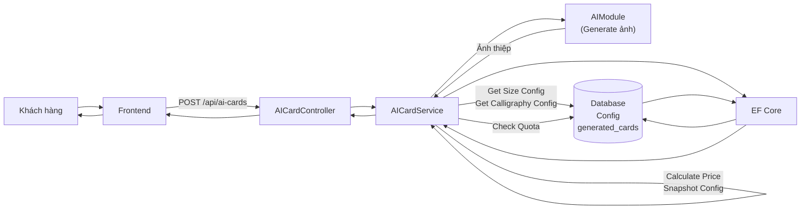
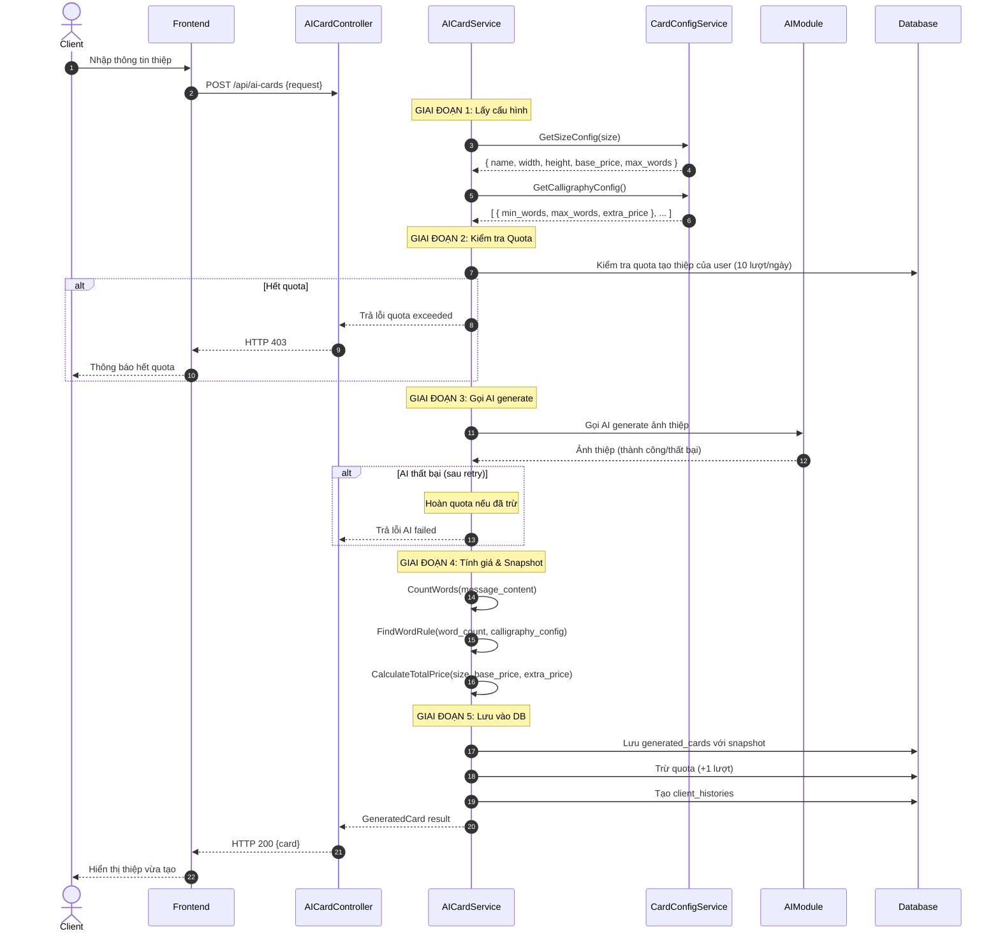
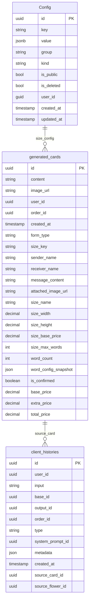

# TDD-035: Tạo thiệp thiết kế AI

## Thông tin tài liệu
- **Tiêu đề**: Tạo thiệp thiết kế AI cho khách hàng
- **Ghi chú**: API cho phép khách hàng tạo thiệp thiết kế mới với thông tin cá nhân hóa (người gửi, người nhận, lời chúc) và hình thức (gõ máy/calligraphy). Tính toán giá dựa trên cấu hình size và phụ phí calligraphy từ bảng card_config.

## Metadata quản trị tài liệu
| Trường | Giá trị |
|---|---|
| Mã tài liệu | TDD-035 |
| Phiên bản | v0.2 |
| Author | |
| Reviewer | |
| Approver | Chưa chỉnh định |
| Owner | |
| Cập nhật gần nhất | 2026-08-26 |

---

## BƯỚC 1 — Thông tin & Bối cảnh

### Thông tin tài liệu
- **Mã tài liệu**: TDD-035
- **Tính năng**: Tạo thiệp thiết kế AI
- **Tác giả**: 
- **Người review**: 
- **Phiên bản**: v0.2
- **Cập nhật (YYYY-MM-DD)**: 2026-08-26
- **Story liên quan**:
  - STORY-035

### Business Rules
- BR-035-01: Size config được lấy từ bảng `Config` với Group = `"card_size"`, Key = `"size_{size}"`, IsDeleted = false, và IsPublic = true, chứa: name, width, height, base_price, max_words
- BR-035-02: Calligraphy words config được lấy từ bảng `Config` với Group = `"card_config"`, Key = `"calligraphy_words"`, IsDeleted = false, và IsPublic = true, chứa mảng JSON các rule với min_words, max_words, extra_price
- BR-035-03: Chỉ Calligraphy mới có phụ phí theo số từ, Gõ máy không phụ phí
- BR-035-04: Tìm rule phù hợp trong calligraphy_words config: tìm rule có min_words <= word_count <= max_words
- BR-035-05: Tổng giá = Base Price + Extra Price (nếu có)
- BR-035-06: Khi tạo thiệp, lưu snapshot tất cả thông tin ảnh hưởng đến giá: size config, word config snapshot
- BR-035-07: Trước khi gọi AI, hệ thống kiểm tra quota tạo thiệp của khách hàng (tối đa 10 lượt/ngày)
- BR-035-08: Khi tạo thành công (có ảnh hợp lệ), hệ thống trừ 1 lượt quota và tạo client_histories
- BR-035-09: Khi AI thất bại (sau 2 lần retry), hệ thống hoàn quota đã trừ
- BR-035-10: client_histories chỉ được tạo khi có ảnh hợp lệ (thành công)
- BR-035-11: is_confirmed mặc định = false khi tạo mới

### Bối cảnh & Mục tiêu

**Vấn đề**
> Khách hàng cần tạo thiệp thiết kế AI với thông tin cá nhân hóa (tên người gửi, người nhận, lời chúc) và chọn hình thức (gõ máy/calligraphy). Hệ thống cần lấy cấu hình giá từ bảng Config có sẵn (Group="card_size", Group="card_config", Kind="Setting"), tính giá chính xác và lưu snapshot tại thời điểm tạo.

**Mục tiêu**
- Tạo thiệp mới với đầy đủ thông tin
- Lấy cấu hình size và calligraphy từ bảng Config
- Tính toán và lưu giá (base_price, extra_price, total_price) vào DB
- Lưu snapshot: size_name, size_width, size_height, size_base_price, size_max_words, word_config_snapshot
- Kiểm tra và quản lý quota tạo thiệp (10 lượt/ngày/khách hàng)
- Tạo client_histories khi có ảnh hợp lệ
- Trừ quota khi thành công, hoàn quota khi thất bại

**Ngoài phạm vi** (Out of scope)
- AI generation thực tế (được tách trong module riêng)
- Retry logic khi AI thất bại (được xử lý trong AI module)
- Tạo Order tự động sau khi xác nhận thiệp
- Bảng trung gian Card ↔ Order

---

## BƯỚC 2 — Kiến trúc & Sơ đồ

### Kiến trúc tổng quan (Architecture)
**Tiêu đề**: Trình tự tạo thiệp thiết kế AI
**Mô tả**: Client gọi API tạo thiệp → Controller nhận request → Service lấy config từ bảng Config → Kiểm tra quota → Gọi AI module → Tính giá & snapshot → Lưu vào DB → Trừ quota → Trả kết quả



### Sequence Diagram
**Tiêu đề**: Trình tự tạo thiệp thiết kế AI
**Mô tả**: Từng bước gọi qua lại giữa các thành phần



### Mô hình dữ liệu (Data Model / ERD)
**Tiêu đề**: Các bảng liên quan đến tạo thiệp
**Mô tả**: Config (bảng có sẵn), generated_cards, client_histories



---

## BƯỚC 3 — API

### API Contract nội bộ

#### Endpoint #1: Tạo thiệp thiết kế AI
- **Method**: POST
- **Endpoint**: `/api/ai-cards`
- **Tên endpoint**: Tạo thiệp thiết kế AI
- **Mô tả**: Tạo thiệp thiết kế mới với thông tin cá nhân hóa và tính giá từ config

**Ví dụ 1 — Happy path: Tạo thiệp Gõ máy thành công** — HTTP `200`

Request:
```json
POST /api/ai-cards
{
  "card_template_id": "550e8400-e29b-41d4-a716-446655440001",
  "size": "A",
  "form_type": "go_may",
  "sender_name": "Nguyễn An",
  "receiver_name": "Trần Bình",
  "message_content": "Chúc bạn sinh nhật vui vẻ",
  "attached_image_url": null
}
```

Response:
```json
{
  "value": {
    "id": "660e8400-e29b-41d4-a716-446655440002",
    "content": "...",
    "image_url": "https://storage.example.com/cards/660e8400.png",
    "user_id": "770e8400-e29b-41d4-a716-446655440003",
    "order_id": null,
    "created_at": "2026-08-26T10:30:00Z",
    "form_type": "go_may",
    "size_key": "size_A",
    "sender_name": "Nguyễn An",
    "receiver_name": "Trần Bình",
    "message_content": "Chúc bạn sinh nhật vui vẻ",
    "attached_image_url": null,
    "size_name": "A",
    "size_width": 10,
    "size_height": 15,
    "size_base_price": 100000,
    "size_max_words": 100,
    "word_count": 5,
    "word_config_snapshot": null,
    "is_confirmed": false,
    "base_price": 100000,
    "extra_price": 0,
    "total_price": 100000
  }
}
```

**Ví dụ 2 — Happy path: Tạo thiệp Calligraphy thành công (36-70 từ)** — HTTP `200`

Request:
```json
POST /api/ai-cards
{
  "card_template_id": "550e8400-e29b-41d4-a716-446655440001",
  "size": "B",
  "form_type": "calligraphy",
  "sender_name": "Nguyễn An",
  "receiver_name": "Trần Bình",
  "message_content": "Nhân dịp sinh nhật bạn, tôi xin gửi đến bạn những lời chúc tốt đẹp nhất. Chúc bạn luôn hạnh phúc, khỏe mạnh và thành công trong cuộc sống.",
  "attached_image_url": "https://storage.example.com/images/flower-001.jpg"
}
```

Response:
```json
{
  "value": {
    "id": "660e8400-e29b-41d4-a716-446655440002",
    "image_url": "https://storage.example.com/cards/660e8400.png",
    "form_type": "calligraphy",
    "size_key": "size_B",
    "size_name": "B",
    "size_width": 15,
    "size_height": 20,
    "size_base_price": 150000,
    "size_max_words": 150,
    "word_count": 42,
    "word_config_snapshot": {
      "min_words": 36,
      "max_words": 70,
      "extra_price": 39000
    },
    "is_confirmed": false,
    "base_price": 150000,
    "extra_price": 39000,
    "total_price": 189000
  }
}
```

**Ví dụ 3 — Calligraphy 71-100 từ (phụ phí cao nhất)** — HTTP `200`

Request:
```json
{
  "size": "C",
  "form_type": "calligraphy",
  "sender_name": "Nguyễn An",
  "receiver_name": "Trần Bình",
  "message_content": "Nhân dịp sinh nhật bạn, tôi xin gửi đến bạn những lời chúc tốt đẹp nhất. Chúc bạn luôn hạnh phúc, khỏe mạnh và thành công trong cuộc sống. Hy vọng rằng mọi ước mơ của bạn sẽ sớm trở thành hiện thực. Mong rằng năm mới sẽ mang đến cho bạn nhiều điều tốt lành và may mắn."
}
```

Response:
```json
{
  "value": {
    "size_key": "size_C",
    "size_name": "C",
    "size_base_price": 200000,
    "word_count": 72,
    "word_config_snapshot": {
      "min_words": 71,
      "max_words": 100,
      "extra_price": 69000
    },
    "base_price": 200000,
    "extra_price": 69000,
    "total_price": 269000
  }
}
```

**Ví dụ 4 — Hết quota tạo thiệp trong ngày** — HTTP `403`

Response:
```json
{
  "error": {
    "code": "QUOTA_EXCEEDED",
    "message": "Bạn đã sử dụng hết 10 lượt tạo thiệp AI trong ngày."
  }
}
```

**Ví dụ 5 — AI thất bại sau retry** — HTTP `500`

Response:
```json
{
  "error": {
    "code": "AI_GENERATION_FAILED",
    "message": "Không thể tạo ảnh thiệp. Vui lòng thử lại sau."
  }
}
```

#### Mã lỗi
| Code | HTTP | Khi nào xảy ra |
|---|---|---|
| QUOTA_EXCEEDED | 403 | Khách hàng đã sử dụng hết 10 lượt tạo thiệp trong ngày |
| AI_GENERATION_FAILED | 500 | AI không tạo được ảnh sau 2 lần retry |
| TEMPLATE_NOT_FOUND | 404 | card_template_id không tồn tại |
| SIZE_CONFIG_NOT_FOUND | 404 | Size config không tồn tại trong bảng Config |
| VALIDATION_ERROR | 400 | Request thiếu hoặc sai field bắt buộc |

---

## BƯỚC 4 — Tham chiếu

> Chú thích: 🔴 Tham chiếu đến (tài liệu này đọc/phụ thuộc) · ⚫ Trỏ vào tài liệu này (tài liệu khác phụ thuộc vào tài liệu này) · ⋯ Bị ảnh hưởng (thay đổi ở đây có thể làm tài liệu kia sai theo)

### 🔴 Tham chiếu đến
- AIModule - Module xử lý AI generation (tách riêng)
- Product Entity - Đã có sẵn trong codebase

### ⚫ Trỏ vào tài liệu này
- TDD-036 - Tạo lại thiệp từ lịch sử (sử dụng lại generated_cards và quota logic)

### ⋯ Bị ảnh hưởng
- ST-035-05-01 - System Test: Hiển thị giá tạm tính theo Size và Hình thức
- ST-035-10-01 - System Test: Retry và hoàn lượt khi AI không tạo được ảnh
