# 🚀 Hướng Dẫn Tích Hợp Hangfire Gửi Email Đăng Ký Tài Khoản

Tài liệu này hướng dẫn chi tiết cách áp dụng hệ thống **Hangfire Background Jobs** chạy trên **Redis** vào luồng **Gửi Email Xác Thực khi người dùng Đăng Ký Tài Khoản lần đầu** nhằm tối ưu hóa hiệu năng API và nâng cao trải nghiệm người dùng (UX).

---

## 📊 Sơ Đồ Quy Trình Xử Lý (Gửi Mail Đồng Bộ vs Bất Đồng Bộ)

```mermaid
gantt
    title So Sánh Thời Gian Phản Hồi API Đăng Ký
    dateFormat  X
    axisFormat %s

    section Luồng Gửi Đồng Bộ (Hiện Tại)
    Lưu Database (Postgres)  :active, 0, 10
    Gửi Email qua SMTP (Đại lý mạng)  :crit, 10, 260
    Trả phản hồi cho Client (Trễ > 3s)   :milestone, 260, 260

    section Luồng Bất Đồng Bộ (Hangfire)
    Lưu Database (Postgres)  :active, 0, 10
    Đẩy Job gửi Email lên Redis   :done, 10, 12
    Trả phản hồi cho Client (~15ms) :milestone, 12, 12
    Hangfire Worker tự gửi Mail ngầm :crit, 12, 262
```



---

## 1. Tại Sao Nên Tối Ưu Hóa Gửi Email Bằng Hangfire?

Trong luồng đăng ký mặc định của [Service.cs (Auth)](file:///c:/Users/Admin/Downloads/hoatheomua-be/HoaTheoMua.Service/Auth/Service.cs), dòng code gửi mail chạy đồng bộ:
```csharp
await _mailService.SendMail(new MailContent { ... });
```

### 🔴 Các Hạn Chế Của Luồng Đồng Bộ:
1. **Độ trễ API cao (API Latency)**: Giao thức mạng SMTP kết nối tới máy chủ Google (smtp.gmail.com) tiêu tốn **1.5s - 4s**. Người dùng phải nhìn màn hình loading xoay tròn chỉ để đợi email được gửi đi thành công.
2. **Rủi ro sập DB Transaction**: Việc gửi email nằm trong khối Transaction cơ sở dữ liệu. Nếu máy chủ SMTP gặp lỗi mạng hoặc hết dung lượng gửi, ứng dụng sẽ ném ra Exception, dẫn đến **Rollback toàn bộ thông tin đăng ký của User**. Người dùng đăng ký thất bại chỉ vì SMTP server lỗi tạm thời.
3. **Giữ kết nối Database quá lâu**: PostgreSQL Connection bị giữ chặt trong suốt thời gian hệ thống đợi SMTP phản hồi, gây lãng phí tài nguyên kết nối (Connection Pooling).

---

## 2. Hướng Dẫn Từng Bước Sửa Code Nghiệp Vụ

Để tối ưu hóa luồng này, chúng ta sẽ chuyển giao nhiệm vụ gửi email sang cho **Hangfire** chạy ngầm dưới nền.

### Bước 2.1: Tiêm `IJobService` vào Constructor trong [Service.cs (Auth)](file:///c:/Users/Admin/Downloads/hoatheomua-be/HoaTheoMua.Service/Auth/Service.cs)

Chỉnh sửa constructor của lớp `Service` để nhận thêm dependency [IJobService.cs](file:///c:/Users/Admin/Downloads/hoatheomua-be/HoaTheoMua.Service/Jobs/IJobService.cs):

```csharp
private readonly AppDbContext _dbContext;
private readonly SecurityOption _securityOptions = new();
private readonly JwtService.IService _jwtService;
private readonly IHttpContextAccessor _httpContext;
private readonly IJobService _jobService; // 1. Khai báo thêm IJobService

public Service(AppDbContext dbContext, IConfiguration configuration,
    IHttpContextAccessor httpContextAccessor,
    JwtService.IService jwtService,
    IJobService jobService) // 2. Tiêm qua Constructor DI
{
    _dbContext = dbContext;
    configuration.GetSection(nameof(SecurityOption)).Bind(_securityOptions);
    _jwtService = jwtService;
    _httpContext = httpContextAccessor;
    _jobService = jobService; // 3. Gán biến thành viên
}
```

### Bước 2.2: Thay thế code gửi email đồng bộ trong hàm `Register`

Thay vì trực tiếp đợi `SendMail`, ta commit transaction dữ liệu người dùng trước, sau đó đẩy Job gửi mail ngầm vào **Hangfire**:

```diff
-            await _mailService.SendMail(new MailContent
-            {
-                To = email,
-                Subject = "Hoa Theo Mua",
-                Body = MailTemplate.EmailContainToken(emailToken),
-            });
+            // 📌 BƯỚC QUAN TRỌNG: Commit transaction xuống DB trước khi gọi Enqueue
+            await transaction.CommitAsync();
+
+            // Đẩy tác vụ gửi Email vào background queue chạy trên Redis
+            _jobService.Enqueue<MailService.IService>(mailService => 
+                mailService.SendMail(new MailContent
+                {
+                    To = email,
+                    Subject = "Hoa Theo Mua",
+                    Body = MailTemplate.EmailContainToken(emailToken),
+                })
+            );
```

#### 💻 Đoạn Mã Code Hoàn Chỉnh Sau Khi Sửa:

```csharp
public async Task<string> Register(Request.RegisterRequest request)
{
    if (request.Password != request.ConfirmPassword)
    {
        throw new BadRequestException("Mật khẩu xác nhận không trùng khớp!");
    }

    var email = request.Email.Trim().ToLower();

    var transaction = await _dbContext.Database.BeginTransactionAsync();
    try
    {
        var isExistEmail = await _dbContext.Users.AnyAsync(x => x.Email.ToLower() == email);
        if (isExistEmail)
        {
            throw new ConflictException($"Email {request.Email} đã tồn tại trong hệ thống.");
        }

        var pepperPassword = request.Password + _securityOptions.Pepper;
        var hashedPassword = BCrypt.Net.BCrypt.EnhancedHashPassword(pepperPassword, hashType: BCrypt.Net.HashType.SHA256);

        var newUser = new Repository.Entity.User()
        {
            Id = Guid.NewGuid(),
            Email = email,
            FirstName = request.FirstName,
            LastName = request.LastName,
            HashPassword = hashedPassword,
            Role = Role.User,
            IsVerify = false
        };
        await _dbContext.Users.AddAsync(newUser);
        await _dbContext.SaveChangesAsync();

        var newClaims = new List<Claim>()
        {
            new Claim("UserId", newUser.Id.ToString()),
            new Claim("IsVerify", newUser.IsVerify.ToString().ToLower()),
            new Claim("Email", newUser.Email),
        };
        var emailToken = _jwtService.GenerateEmailVerificationToken(newClaims, 2);

        // 📌 BƯỚC QUAN TRỌNG: Commit dữ liệu người dùng thành công xuống PostgreSQL trước.
        await transaction.CommitAsync();

        // 🚀 Đẩy Job gửi Email vào hàng đợi ngầm trên Redis Server
        _jobService.Enqueue<MailService.IService>(mailService => 
            mailService.SendMail(new MailContent
            {
                To = email,
                Subject = "Hoa Theo Mua",
                Body = MailTemplate.EmailContainToken(emailToken),
            })
        );

        return "Đăng ký thành công. Vui lòng kiểm tra email để xác thực tài khoản.";
    }
    catch
    {
        await transaction.RollbackAsync();
        throw;
    }
}
```

> [!IMPORTANT]
> ### ⚠️ TẠI SAO BẮT BUỘC PHẢI COMMIT TRANSACTION TRƯỚC KHI ENQUEUE?
> Hangfire Worker kết nối với Redis hoạt động ở tần suất cực kỳ cao (gần như tức thì kể từ khi lệnh `Enqueue` được gọi). Nếu bạn đẩy job trước khi gọi `await transaction.CommitAsync()`, lúc này thông tin User chưa được lưu chính thức dưới DB (do transaction chưa commit). Khi Worker khởi chạy và gọi `SendMail` (hoặc các job truy vấn DB khác) sẽ báo lỗi không tìm thấy người dùng. Do đó, hãy luôn commit transaction thành công trước khi gọi Enqueue.

---

## 3. Bản Chất Cơ Chế Hoạt Động Bên Dưới (Redis Storage)

1. **Tuần tự hóa (Serialization)**: Khi gọi `_jobService.Enqueue<MailService.IService>(mailService => mailService.SendMail(...))`, Hangfire SDK bóc tách cây biểu thức Lambda (Expression Tree) để trích xuất ra:
   * Class triển khai: `HoaTheoMua.Service.MailService.IService`
   * Method: `SendMail`
   * Tham số: Đối tượng `MailContent` (được chuyển đổi thành JSON).
2. **Lưu trữ Redis**: Hangfire lưu metadata của job vào key `hangfire:job:<job-id>` (kiểu `Hash`) và thảy Job ID vào hàng đợi `hangfire:queue:default` (kiểu `List`).
3. **Thực thi ngầm**:
   * Worker Thread rảnh rỗi trên máy chủ API gọi lệnh chặn luồng nguyên tử `BRPOP` trên Redis để nhận tín hiệu có Job mới.
   * Worker tạo ra một DI Scope tạm thời (`IServiceProvider.CreateScope()`), giải quyết thực thể cụ thể [MailService.Service](file:///c:/Users/Admin/Downloads/hoatheomua-be/HoaTheoMua.Service/MailService/Service.cs) từ DI container.
   * Kích hoạt phương thức `SendMail` bằng kỹ thuật Reflection để tiến hành kết nối máy chủ SMTP thực tế gửi mail.

---

## 4. Các Lợi Ích Vận Hành Thực Tế

> [!TIP]
> ### ⚡ TRẢI NGHIỆM NGƯỜI DÙNG TỐI ƯU (UX)
> Thời gian phản hồi của API Đăng ký giảm từ **3000ms** xuống còn **~20ms** vì không cần chờ đợi mạng gửi mail. Người dùng lập tức nhìn thấy thông báo đăng ký thành công mà không gặp phải bất kỳ sự trì hoãn nào.

> [!WARNING]
> ### 🔄 TỰ ĐỘNG THỬ LẠI KHI SMTP LỖI (AUTOMATIC RETRY)
> Nếu máy chủ SMTP (Gmail) bị sập mạng hoặc hết hạn mức gửi (quota limits):
> * **Nếu dùng luồng cũ**: Người dùng bị báo lỗi 500, đăng ký thất bại hoàn toàn.
> * **Khi dùng Hangfire**: Job gửi email bị đánh dấu thất bại. Hangfire Server sẽ tự động lên lịch **Retry** (mặc định thử lại 10 lần) với cơ chế giãn cách thời gian tăng dần (**Exponential Backoff**: 1 phút, 2 phút, 5 phút, 10 phút...). Khi máy chủ SMTP hoạt động lại, email sẽ tự động được gửi đi thành công mà không làm mất thông tin tài khoản hay bắt khách hàng đăng ký lại.

> [!NOTE]
> ### 📊 DỄ DÀNG GIÁM SÁT VÀ TRA CỨU LOGS
> Đội ngũ vận hành có thể truy cập trang `/hangfire` Dashboard để giám sát tình hình gửi email. Nếu có email bị nhập sai định dạng hoặc lỗi đặc biệt, Admin có thể dễ dàng xem chi tiết nguyên nhân lỗi (Stack trace) và click nút **"Re-queue"** để kích hoạt gửi lại bằng tay từ trang quản trị.
