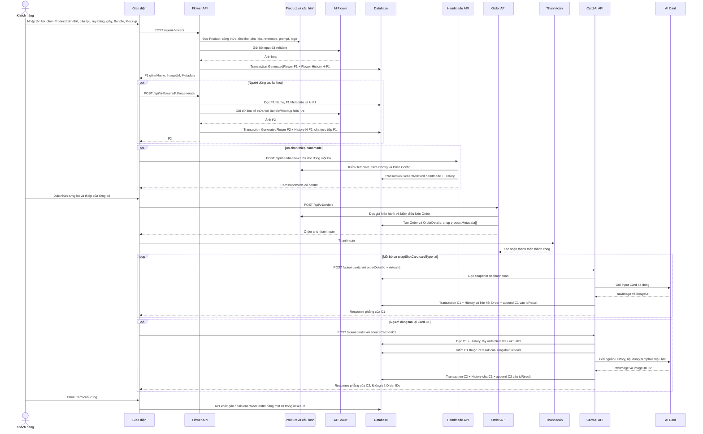

# Luồng tổng thể: Tạo hoa → Tạo lại hoa → Order → Tạo thiệp → Tạo lại thiệp

> Cập nhật: 2026-09-17  
> Trạng thái: đặc tả end-to-end dùng cho phát triển sau; chưa phải xác nhận code hiện tại đã triển khai đầy đủ.

## 1. Mục tiêu

Tài liệu nối các API và snapshot thành một flow duy nhất:

1. FE nhận dữ liệu tạo hoa AI.
2. Backend validate và tạo GeneratedFlower F1.
3. Người dùng có thể tạo lại F1 thành F2/F3.
4. Người dùng chuẩn bị thiệp AI hoặc tạo trước thiệp handmade.
5. Order chụp dữ liệu tuyệt đối vào `OrderDetails.Metadata.productMetadata[]`.
6. Sau thanh toán, FE gọi TDD-006 để tạo thiệp AI C1.
7. Người dùng có thể tạo lại C1 thành C2/C3.
8. API khác gán `finalGeneratedCardId` khi người dùng chốt kết quả.

Tài liệu này không thay TDD chi tiết. Khi có khác biệt, TDD-016 áp dụng cho Flower, TDD-006 áp dụng cho Card AI và TDD-021 áp dụng cho handmade.

## 2. API tham gia

| Giai đoạn | Method và route | Vai trò |
|---|---|---|
| Create Flower | `POST /api/ai-flowers` | Tạo F1 từ Product biến thể, cấu tạo, ruy băng, giấy, Bundle và Mockup. |
| Regenerate Flower | `POST /api/ai-flowers/{sourceFlowerId}/regenerate` | Tạo F2/F3; chỉ cho thay Bundle/Mockup. |
| Create Handmade | `POST /api/handmade-cards` | Tạo một GeneratedCard handmade cho đúng một bó trước Order. |
| Create Order | `POST /api/v1/orders` | Tạo OrderDetails và snapshot hoa/thiệp. Chi tiết code Order ngoài phạm vi TDD AI. |
| Create/Regenerate Card AI | `POST /api/ai-cards` | Create theo `orderDetailId + virtualId` hoặc Regenerate theo `sourceCardId`. |
| Chọn Card cuối | API khác, chưa thuộc TDD-006 | Gán `finalGeneratedCardId`; ID phải thuộc `idResult`. |

## 3. Sequence end-to-end



## 4. Giai đoạn A — Create Flower

### 4.1 Request từ FE

```json
{
  "name": "Bó hoa sinh nhật của An",
  "productId": "440e8400-e29b-41d4-a716-446655440001",
  "materialTotals": [
    {
      "matId": "550e8400-e29b-41d4-a716-446655440001",
      "quantity": 3
    },
    {
      "matId": "550e8400-e29b-41d4-a716-446655440022",
      "quantity": 5
    }
  ],
  "bundleId": "550e8400-e29b-41d4-a716-446655440098",
  "mockupId": "550e8400-e29b-41d4-a716-446655440099",
  "ribbonProductId": "660e8400-e29b-41d4-a716-446655440001",
  "wrappingPaperProductId": "660e8400-e29b-41d4-a716-446655440002"
}
```

| Field | Quy tắc |
|---|---|
| `name` | String bắt buộc do FE gửi; truyền cho AI và lưu ở `GeneratedFlower.Name`. Không lưu lặp trong Metadata. Giới hạn độ dài/blank chưa được chốt. |
| `productId` | UUID bắt buộc của Product biến thể con. Không có field size và không resolve từ Product cha. |
| `materialTotals` | Gửi đủ mọi nguyên liệu của công thức; quantity là tổng khách muốn. |
| `bundleId` | FlowerReference type=bundle. |
| `mockupId` | FlowerReference type=mockup. |
| `ribbonProductId` | Bắt buộc, không null; ProductLabel chứa token chính xác `RUY BĂNG`. |
| `wrappingPaperProductId` | Bắt buộc, không null; ProductLabel chứa token chính xác `GIẤY`. |

### 4.2 Thứ tự validation trước AI

1. Xác thực user và tài khoản hoạt động.
2. Kiểm request shape, UUID, `name`, field bị cấm và quantity số nguyên.
3. Từ chối `matId` trùng.
4. Tải Product biến thể bằng `productId`.
5. Tải ComboSpecification của chính biến thể.
6. So tập nguyên liệu: thiếu trước, ngoài công thức sau.
7. Mỗi tổng quantity phải không thấp hơn lượng gốc.
8. Dựng `AdditionCustome` chỉ từ phần chênh lệch dương; cho phép mảng rỗng.
9. Gọi `CalculateAvailableQty(productId)`; 0 thì `PRODUCT_OUT_OF_STOCK/409`.
10. Kiểm ruy băng tồn tại → chưa xóa → active → đúng token label.
11. Kiểm giấy theo cùng thứ tự.
12. Kiểm Bundle đầy đủ rồi Mockup đầy đủ.
13. Resolve System Form flower từ `Config.Kind="Setting"` và logo hiện hành. Nội dung lấy từ `Config.Value.value`; cách định danh record flower chưa chốt vì Group/Key và wrapper Value đang để trống.
14. Đóng bộ input trong bộ nhớ rồi mới gọi AI.

Không gọi `CalculateAvailableQty` cho ruy băng/giấy. Quota ba lượt/ngày và retry thuộc hàm AI.

### 4.3 Dữ liệu gửi AI Flower

- `name` do FE gửi.
- Product P1: tên, thuộc tính và ảnh.
- `materials` gốc và tổng sau custom.
- Tên/ảnh ruy băng.
- Tên/ảnh giấy.
- Bundle: kiểu/dáng bó.
- Mockup: bố cục/bối cảnh.
- System Form flower đã resolve từ Config.

Thứ tự ưu tiên nội dung: `Product/Combo → Bundle → Mockup`.

### 4.4 Persistence thành công

Trong một transaction:

- Tạo GeneratedFlower F1.
- `F1.Name` bằng request.name.
- `F1.ImageUrl` là ảnh AI đã gắn logo.
- `F1.Metadata` giữ cấu tạo/ruy băng/giấy.
- Tạo một ClientHistory type=flower, `BaseId=RootId=P1`, `OutputId=F1`.
- Create Flower sinh một UUID ảo mới và lưu ở `ClientHistory.SesionId`; S1 không phải ID của Flower, Product hay thực thể nào khác.
- History.SystemForm snapshot prompt thực tế.
- History.Metadata snapshot Product/Bundle/Mockup/logo.

Nếu lưu Flower hoặc History thất bại thì rollback cả hai.

### 4.5 GeneratedFlower F1 sau Create

```json
{
  "id": "6f0c1e8a-3b72-4d95-a146-91f7c8e25b40",
  "name": "Bó hoa sinh nhật của An",
  "imageUrl": "https://storage.example.com/generated-flowers/f1.png",
  "userId": "770e8400-e29b-41d4-a716-446655440001",
  "createdAt": "2026-09-16T08:00:00Z",
  "metadata": {
    "subId": "440e8400-e29b-41d4-a716-446655440001",
    "aiCustomize": true,
    "ribbon": {
      "id": "660e8400-e29b-41d4-a716-446655440001",
      "name": "Ruy băng lụa đỏ",
      "label": "PHỤ KIỆN, RUY BĂNG",
      "imageUrl": "https://storage.example.com/products/ribbon-red.png",
      "isActive": true,
      "isDeleted": false
    },
    "wrappingPaper": {
      "id": "660e8400-e29b-41d4-a716-446655440002",
      "name": "Giấy gói Hàn Quốc",
      "label": "GIẤY, PHỤ KIỆN",
      "imageUrl": "https://storage.example.com/products/paper-korea.png",
      "isActive": true,
      "isDeleted": false
    },
    "AdditionCustome": [
      {
        "matId": "550e8400-e29b-41d4-a716-446655440001",
        "quantity": 1,
        "name": "Hoa hồng",
        "isCore": true
      },
      {
        "matId": "550e8400-e29b-41d4-a716-446655440022",
        "quantity": 2,
        "name": "Hoa Lan",
        "isCore": false
      }
    ],
    "materials": [
      {
        "matId": "550e8400-e29b-41d4-a716-446655440001",
        "quantity": 2,
        "name": "Hoa hồng",
        "isCore": true
      },
      {
        "matId": "550e8400-e29b-41d4-a716-446655440022",
        "quantity": 3,
        "name": "Hoa Lan",
        "isCore": false
      }
    ]
  }
}
```

## 5. Giai đoạn B — Regenerate Flower

### 5.1 Request

```json
{
  "bundleId": "550e8400-e29b-41d4-a716-446655440198",
  "mockupId": null
}
```

Path chứa `sourceFlowerId=F1`. Body chỉ được có `bundleId` và `mockupId`, đều tùy chọn. Không nhận `name`, `productId`, `materialTotals`, `ribbonProductId`, `wrappingPaperProductId` hoặc `userInput`.

### 5.2 Nguồn dữ liệu

| Dữ liệu | Nguồn Regenerate |
|---|---|
| Tên bó | `GeneratedFlower.Name` của nguồn. |
| Cấu tạo gốc/tăng | GeneratedFlower.Metadata nguồn. |
| Ruy băng/giấy | GeneratedFlower.Metadata nguồn; không đọc Product live. |
| Product/ảnh Product | Flower History nguồn. |
| Bundle/Mockup | Snapshot History hoặc record mới hợp lệ nếu client đổi ID. |
| Prompt | Config System Form flower hiện hành; fallback History.SystemForm nguồn. Cách định danh Config flower chưa chốt. |
| Logo | Cấu hình hiện hành. |

Nếu client bỏ/null/gửi đúng ID snapshot của Bundle/Mockup thì dùng snapshot và không đọc record live. Chỉ record mới được kiểm tồn tại/type/delete/active.

### 5.3 Kết quả F2/F3

- Flower mới kế thừa nguyên `Name` và Metadata cấu tạo/ruy băng/giấy.
- Có `Id`, `ImageUrl`, `CreatedAt` mới.
- History mới giữ cùng `BaseId=RootId=P1`.
- History mới kế thừa nguyên `SesionId=S1` của Flower nguồn, không sinh UUID ảo mới.
- `metadata.regeneratedFromFlowerId` là cha trực tiếp.
- F3 tạo từ F2 thì lưu F2, không lưu F1 hoặc F3.
- Regenerate không gọi `CalculateAvailableQty` và không kiểm Product/ribbon/paper live.

## 6. Giai đoạn C — Chuẩn bị thiệp trước Order

### 6.1 Thiệp AI

FE thu thập Template, size, hình thức chữ, lời chúc và ảnh đính kèm. Chưa gọi TDD-006 ở giai đoạn này. Order sẽ chuẩn bị `snapShotCard` AI với `status="not yet"`, `idResult=[]`, `finalGeneratedCardId=null`. Field `systemPrompt` trong snapshot được dựng từ Config System Form dành cho Card: `type="card"`, còn `content` lấy từ `Config.Value.value`.

Việc chuẩn bị snapshot đang bị chặn cho đến khi có dữ liệu phân biệt Config Card, vì `Config.Group`, `Config.Key` và wrapper `Value` hiện đều để trống theo quyết định tạm thời.

AI Card được phép cho cả:

- Bó thường: `generatedFlower=null`, `aiCustomize=false`.
- Bó AI: `generatedFlower=F1/F2`, `aiCustomize=true`.

Trong cả hai trường hợp, `snapShotCard.source.id` vẫn là Product P1.

### 6.2 Thiệp handmade

Handmade phải được tạo trước Order và mỗi bó gọi riêng:

```json
{
  "generatedFlowerId": "6f0c1e8a-3b72-4d95-a146-91f7c8e25b40",
  "cardTemplateId": "550e8400-e29b-41d4-a716-446655440021",
  "sizeName": "Lớn",
  "messageContent": "Chúc bạn luôn vui và hạnh phúc"
}
```

Request dùng đúng một nguồn: `productId` hoặc `generatedFlowerId`. Không nhận `formType`, `attachedImageUrl`, `senderName`, `receiverName`. Backend luôn lưu:

- `CardType=handmade`.
- `FormType=calligraphy`.
- `RawImage=null`, `AttachedImageUrl=null`.
- `ImageUrl=CardTemplate.ImageUrl`.
- `BasePrice=0`, `ExtraPrice=rule.extra_price`, `TotalPrice=ExtraPrice`.
- Một GeneratedCard và một History riêng cho đúng một bó.

Không có handmade dùng chung hoặc `quantity=N`.

## 7. Giai đoạn D — Tạo Order và OrderDetails snapshot

### 7.1 Quy tắc nhóm dòng

- Cùng Product biến thể và cùng cấu hình dòng có thể nằm trong một OrderDetails với `Number>1`.
- Mỗi bó vẫn có một object riêng trong `productMetadata`; số object bằng Number.
- Khác Product biến thể hoặc khác dòng bán thì có OrderDetails khác.
- Dòng nguyên liệu tăng thêm là OrderDetails riêng trong cùng Order.
- Nếu nhiều bó cùng tăng một MatId, dòng nguyên liệu đó cộng tổng quantity của tất cả bó.
- Sản phẩm lẻ không phải combo có `Metadata=null`.

### 7.2 Giá

GeneratedFlower không lưu giá nguyên liệu. Khi tạo Order:

1. Order lấy giá mới nhất của combo P1.
2. Lấy giá mới nhất của từng nguyên liệu tăng thêm.
3. Điền `price` vào `materials` và `AdditionCustome` trong Order snapshot.
4. Tạo các OrderDetails nguyên liệu tăng thêm để tính tiền theo logic Order.

### 7.3 Nguồn snapshot bó AI

| Field Order | Nguồn |
|---|---|
| `name` | `GeneratedFlower.Name`. |
| `subId` | GeneratedFlower.Metadata.subId. |
| `generatedFlower` | GeneratedFlower.Id. |
| `aiCustomize` | true. |
| `ribbon`, `wrappingPaper` | GeneratedFlower.Metadata. |
| `materials`, `AdditionCustome` | GeneratedFlower.Metadata, sau đó Order bổ sung giá. |

Bó thường có `generatedFlower=null`, `aiCustomize=false`, `AdditionCustome=[]`, `ribbon=null`, `wrappingPaper=null`.

### 7.4 Ví dụ OrderDetails có hai bó AI giống Product nhưng custom/thiệp riêng

```json
{
  "Name": "Bó hoa hồng",
  "ItemId": 101,
  "Number": 2,
  "Metadata": {
    "productMetadata": [
      {
        "name": "Bó hoa sinh nhật của An",
        "subId": "440e8400-e29b-41d4-a716-446655440001",
        "generatedFlower": "6f0c1e8a-3b72-4d95-a146-91f7c8e25b40",
        "aiCustomize": true,
        "ribbon": {
          "id": "660e8400-e29b-41d4-a716-446655440001",
          "name": "Ruy băng lụa đỏ",
          "label": "PHỤ KIỆN, RUY BĂNG",
          "imageUrl": "https://storage.example.com/products/ribbon-red.png",
          "isActive": true,
          "isDeleted": false
        },
        "wrappingPaper": {
          "id": "660e8400-e29b-41d4-a716-446655440002",
          "name": "Giấy gói Hàn Quốc",
          "label": "GIẤY, PHỤ KIỆN",
          "imageUrl": "https://storage.example.com/products/paper-korea.png",
          "isActive": true,
          "isDeleted": false
        },
        "AdditionCustome": [
          {
            "matId": "550e8400-e29b-41d4-a716-446655440001",
            "quantity": 1,
            "name": "Hoa hồng",
            "price": 10000,
            "isCore": true
          }
        ],
        "materials": [
          {
            "matId": "550e8400-e29b-41d4-a716-446655440001",
            "quantity": 2,
            "name": "Hoa hồng",
            "price": 10000,
            "isCore": true
          }
        ],
        "snapShotCard": {
          "virtualId": "770e8400-e29b-41d4-a716-446655440001",
          "cardType": "ai",
          "source": {
            "type": "product",
            "id": "440e8400-e29b-41d4-a716-446655440001",
            "imageUrl": "https://storage.example.com/products/product-p1.png"
          },
          "rawImage": null,
          "cardTemplate": {
            "templateId": "550e8400-e29b-41d4-a716-446655440002",
            "templateName": "Thiệp hoa cổ điển",
            "templateType": "ai",
            "templateImageUrl": "https://storage.example.com/templates/card-ai.png"
          },
          "cardSize": {
            "name": "Nhỏ",
            "width": 10,
            "height": 15,
            "base_price": 10000,
            "max_words": 70
          },
          "cardConfig": null,
          "messageContent": "Chúc mừng sinh nhật",
          "formType": "go_may",
          "attachedImageUrl": null,
          "quantity": 1,
          "wordCount": 4,
          "basePrice": 10000,
          "extraPrice": 0,
          "totalPrice": 10000,
          "systemPrompt": {
            "type": "card",
            "content": "Prompt Card đã chốt"
          },
          "validatedAt": "2026-09-16T09:00:00Z",
          "status": "not yet",
          "idResult": [],
          "finalGeneratedCardId": null
        }
      },
      {
        "name": "Bó hoa sinh nhật của Bình",
        "subId": "440e8400-e29b-41d4-a716-446655440001",
        "generatedFlower": "a84d29f6-7c13-48be-b520-3d9e61a74fc2",
        "aiCustomize": true,
        "ribbon": {
          "id": "660e8400-e29b-41d4-a716-446655440003",
          "name": "Ruy băng voan trắng",
          "label": "PHỤ KIỆN, RUY BĂNG",
          "imageUrl": "https://storage.example.com/products/ribbon-white.png",
          "isActive": true,
          "isDeleted": false
        },
        "wrappingPaper": {
          "id": "660e8400-e29b-41d4-a716-446655440004",
          "name": "Giấy gói kem",
          "label": "GIẤY, PHỤ KIỆN",
          "imageUrl": "https://storage.example.com/products/paper-cream.png",
          "isActive": true,
          "isDeleted": false
        },
        "AdditionCustome": [],
        "materials": [
          {
            "matId": "550e8400-e29b-41d4-a716-446655440001",
            "quantity": 2,
            "name": "Hoa hồng",
            "price": 10000,
            "isCore": true
          }
        ],
        "snapShotCard": {
          "virtualId": "770e8400-e29b-41d4-a716-446655440002",
          "cardType": "ai",
          "source": {
            "type": "product",
            "id": "440e8400-e29b-41d4-a716-446655440001",
            "imageUrl": "https://storage.example.com/products/product-p1.png"
          },
          "rawImage": null,
          "cardTemplate": {
            "templateId": "550e8400-e29b-41d4-a716-446655440002",
            "templateName": "Thiệp hoa cổ điển",
            "templateType": "ai",
            "templateImageUrl": "https://storage.example.com/templates/card-ai.png"
          },
          "cardSize": {
            "name": "Nhỏ",
            "width": 10,
            "height": 15,
            "base_price": 10000,
            "max_words": 70
          },
          "cardConfig": null,
          "messageContent": "Chúc một ngày thật vui",
          "formType": "go_may",
          "attachedImageUrl": null,
          "quantity": 1,
          "wordCount": 5,
          "basePrice": 10000,
          "extraPrice": 0,
          "totalPrice": 10000,
          "systemPrompt": {
            "type": "card",
            "content": "Prompt Card đã chốt"
          },
          "validatedAt": "2026-09-16T09:00:00Z",
          "status": "not yet",
          "idResult": [],
          "finalGeneratedCardId": null
        }
      }
    ]
  }
}
```

Hai thiệp không dùng chung dù nội dung/Template giống nhau. `virtualId` khác nhau và FE gọi TDD-006 riêng cho từng bó.

## 8. Giai đoạn E — Create Card AI sau thanh toán

### 8.1 Request

```json
{
  "orderDetailId": "110e8400-e29b-41d4-a716-446655440001",
  "virtualId": "770e8400-e29b-41d4-a716-446655440001"
}
```

Không nhận override nội dung, Template, size, giá hoặc source. `cardTemplateId`/`messageContent` xuất hiện trong nhánh Create, kể cả null, bị từ chối. Card AI History luôn có `SesionId=null`; field này không được chụp hoặc lưu trong `OrderDetails.Metadata`.

### 8.2 Validation

1. Auth và request shape.
2. OrderDetails tồn tại, thuộc user.
3. Order đã thanh toán.
4. `virtualId` xác định đúng một `snapShotCard` trong dòng được truyền.
5. `cardType=ai`, `quantity=1`.
6. `status=not yet`, `idResult=[]`, `finalGeneratedCardId=null`.
7. Bất biến bó thường/bó AI và Product lineage hợp lệ.
8. Source, Template, size, rule, giá, prompt và WordCount hợp lệ.
9. Giữ quyền xử lý theo `orderDetailId + virtualId`.
10. Chỉ sau đó gọi AI.

### 8.3 Hai nhánh Create

- `rawImage=null`: dùng `source.imageUrl` của Product P1 và Template snapshot để tạo ảnh mới.
- `rawImage` có URL: dùng chính URL đó làm nền; vẫn là `operation=create`, `regeneratedFromCardId=null`.

### 8.4 Transaction thành công

Trong cùng transaction:

1. Insert GeneratedCard C1.
2. Insert ClientHistory type=card.
   History Card có `SesionId=null`.
3. History.Metadata lưu `orderDetailId`, `virtualId`, source lineage, Template và `regeneratedFromCardId=null`.
4. Đổi snapshot `status=done`.
5. Append C1 vào `idResult`.
6. Không thay `finalGeneratedCardId`.

Nếu một bước thất bại thì không giữ Card, History hoặc phép append dở dang.

### 8.5 Snapshot sau Create

```json
{
  "status": "done",
  "idResult": [
    "660e8400-e29b-41d4-a716-446655440001"
  ],
  "finalGeneratedCardId": null
}
```

### 8.6 Response phẳng

```json
{
  "value": {
    "id": "660e8400-e29b-41d4-a716-446655440001",
    "createdAt": "2026-09-16T09:10:00Z",
    "imageUrl": "https://storage.example.com/cards/c1-final.png",
    "rawImage": "https://storage.example.com/cards/c1-raw.png",
    "userId": "770e8400-e29b-41d4-a716-446655440001",
    "cardType": "ai",
    "formType": "go_may",
    "messageContent": "Chúc mừng sinh nhật",
    "attachedImageUrl": null,
    "sizeName": "Nhỏ",
    "sizeWidth": 10,
    "sizeHeight": 15,
    "sizeBasePrice": 10000,
    "sizeMaxWords": 70,
    "wordCount": 4,
    "wordConfigSnapshot": null,
    "basePrice": 10000,
    "extraPrice": 0,
    "totalPrice": 10000,
    "orderDetailId": "110e8400-e29b-41d4-a716-446655440001",
    "generatedFlowerId": "6f0c1e8a-3b72-4d95-a146-91f7c8e25b40",
    "virtualId": "770e8400-e29b-41d4-a716-446655440001"
  }
}
```

Bó thường trả `generatedFlowerId=null`. Không có `value.cards`.

## 9. Giai đoạn F — Regenerate Card AI

### 9.1 Request

Giữ nội dung và Template nguồn:

```json
{
  "sourceCardId": "660e8400-e29b-41d4-a716-446655440001"
}
```

Hoặc thay nội dung/Template:

```json
{
  "sourceCardId": "660e8400-e29b-41d4-a716-446655440001",
  "cardTemplateId": "550e8400-e29b-41d4-a716-446655440099",
  "messageContent": "Chúc mừng tốt nghiệp"
}
```

Regenerate không nhận `orderDetailId`, `virtualId`, `sizeName`, `formType`, `attachedImageUrl`, giá, senderName hoặc receiverName.

### 9.2 Tìm nguồn và Order snapshot

1. Tải GeneratedCard theo `sourceCardId`.
2. Kiểm Card thuộc user và là AI.
3. Tìm đúng một ClientHistory type=card có `OutputId=sourceCardId`.
4. Đọc `orderDetailId + virtualId` từ History.Metadata.
5. Tải OrderDetails liên kết và kiểm owner.
6. `virtualId` phải xác định duy nhất một snapshot.
7. `sourceCardId` phải nằm trong `snapshot.idResult`.
8. Nếu `finalGeneratedCardId` khác null thì phải thuộc cùng `idResult`.
9. Thiếu/sai liên kết trả `CARD_SOURCE_HISTORY_INVALID/409` trước AI.

Order snapshot chỉ dùng để xác định nơi append kết quả. Ảnh, nội dung, Template, size và giá cho Regenerate lấy từ Card/History nguồn.

### 9.3 Kế thừa và override

| Dữ liệu | Quy tắc |
|---|---|
| `messageContent` | Bỏ/null/rỗng/blank dùng nguồn; giá trị khác dùng nội dung mới. |
| Template | Bỏ/null/rỗng/blank/trùng ID nguồn dùng snapshot; ID khác phải tồn tại, chưa xóa, active, type=ai. |
| `formType`, `attachedImageUrl` | Kế thừa Card nguồn. |
| Size/rule/giá | Kế thừa nguyên Card nguồn. |
| `WordCount` | Đếm lại từ nội dung hiệu lực. |
| Prompt | Config System Form card hiện hành; fallback History.SystemForm nguồn. Cách định danh Config card chưa chốt. |
| Ảnh hoa | `ClientHistory.Metadata.source.imageUrl`; không dùng Card.RawImage/ImageUrl làm ảnh hoa. |
| Lineage | BaseId/RootId kế thừa; `regeneratedFromCardId=sourceCardId`. |

Nội dung không vượt 100 từ, SizeMaxWords và `WordConfigSnapshot.max_words` nếu calligraphy. Không kiểm cận dưới và không tính lại giá.

### 9.4 Transaction C2

Trong cùng transaction:

1. Insert GeneratedCard C2.
2. Insert History C2, `regeneratedFromCardId=C1`.
3. Kế thừa nguyên `orderDetailId + virtualId`.
4. Append C2 vào `idResult` của snapshot liên kết.
5. Giữ `status=done`.
6. Giữ nguyên `finalGeneratedCardId`.

```json
{
  "status": "done",
  "idResult": [
    "660e8400-e29b-41d4-a716-446655440001",
    "660e8400-e29b-41d4-a716-446655440002"
  ],
  "finalGeneratedCardId": null
}
```

Regenerate response không trả `orderDetailId` hoặc `virtualId`.

### 9.5 Chuỗi C1 → C2 → C3

- Create tạo C1: History C1 có `regeneratedFromCardId=null`.
- Regenerate từ C1 tạo C2: History C2 trỏ C1.
- Regenerate từ C2 tạo C3: History C3 trỏ C2.
- Regenerate lại từ C1 cũng được phép và tạo một nhánh mới; không khóa theo sourceCardId.
- Mọi History trong chuỗi kế thừa cùng `orderDetailId + virtualId`.
- Mọi Card ID mới được append vào cùng `idResult`.

## 10. Giai đoạn G — Chọn kết quả Card cuối cùng

TDD-006 không gán field này. API khác thực hiện:

```json
{
  "idResult": [
    "660e8400-e29b-41d4-a716-446655440001",
    "660e8400-e29b-41d4-a716-446655440002",
    "660e8400-e29b-41d4-a716-446655440003"
  ],
  "finalGeneratedCardId": "660e8400-e29b-41d4-a716-446655440002"
}
```

`finalGeneratedCardId` phải là một phần tử của chính `idResult`. Chọn C2 không xóa C1/C3. Nếu tạo thêm C4 sau khi đã chọn C2, TDD-006 append C4 nhưng giữ lựa chọn C2.

## 11. Ma trận bó hoa và loại thiệp

| Loại bó | `generatedFlower` | `aiCustomize` | Ruy băng/giấy | AI Card | Handmade |
|---|---|---:|---|---|---|
| Bó thường | null | false | Hai field tồn tại và bằng null | Được phép | Được phép |
| Bó AI không tăng hoa | UUID F1 | true | Snapshot object | Được phép | Được phép |
| Bó AI có tăng hoa | UUID F1 | true | Snapshot object | Được phép | Được phép |

Một bó có tối đa một `snapShotCard` trong Order. Nếu chọn handmade thì không đồng thời chọn AI cho chính bó đó.

## 12. Transaction và chống ghi đè JSON

- Flower Create/Regenerate: GeneratedFlower + Flower History trong một transaction.
- Handmade: GeneratedCard + Handmade History trong một transaction.
- Card AI Create: GeneratedCard + Card History + đổi status + append idResult trong một transaction.
- Card AI Regenerate: GeneratedCard + History + append idResult trong một transaction.
- Flower Create sinh UUID ảo ở `ClientHistory.SesionId`; Flower Regenerate kế thừa UUID đó. Card AI và HandMade luôn giữ cột này bằng `null`; không có Order snapshot nào chứa field này. API Admin TDD-026 trả giá trị Flower session trong `clientHistory`; API Customer TDD-027 dùng nó để group và filter lịch sử hoa của user đang đăng nhập.
- Không ghi toàn bộ `OrderDetails.Metadata` từ bản đọc cũ sau khi request khác đã cập nhật.
- Việc append phải bảo toàn mọi Card ID đã có; hai request Regenerate hợp lệ không được làm mất ID của nhau.
- Create đồng thời cùng `orderDetailId + virtualId` bị từ chối bằng `CARD_GENERATION_IN_PROGRESS/409`.
- Regenerate không bị khóa theo `sourceCardId`; quota/retry do hàm AI quản lý.

## 13. Các lỗi chính theo giai đoạn

### Create Flower

- Product/công thức/tồn kho: `PRODUCT_NOT_FOUND`, `PRODUCT_SPECIFICATION_NOT_FOUND`, `PRODUCT_OUT_OF_STOCK`, `PRODUCT_AVAILABILITY_UNAVAILABLE`.
- Nguyên liệu: duplicate/missing/unknown và quantity không hợp lệ.
- Ruy băng: `RIBBON_PRODUCT_NOT_FOUND`, `RIBBON_PRODUCT_DELETED`, `RIBBON_PRODUCT_INACTIVE`, `RIBBON_PRODUCT_LABEL_INVALID`.
- Giấy: `WRAPPING_PAPER_PRODUCT_NOT_FOUND`, `WRAPPING_PAPER_PRODUCT_DELETED`, `WRAPPING_PAPER_PRODUCT_INACTIVE`, `WRAPPING_PAPER_PRODUCT_LABEL_INVALID`.
- Bundle/Mockup/Prompt: taxonomy trong TDD-016.

### Regenerate Flower

- `FLOWER_SOURCE_NOT_FOUND/404`.
- `ACCESS_DENIED/403`.
- `FLOWER_SOURCE_HISTORY_INVALID/409`.

### Create/Regenerate Card AI

- Order/snapshot: `ORDER_DETAIL_NOT_FOUND`, `ORDER_NOT_PAID`, `NOT_FOUND`, `ORDER_DETAIL_CARD_SNAPSHOT_INVALID`.
- Loại thiệp: `HANDMADE_CARD_NOT_SUPPORTED`, `HANDMADE_CARD_REGENERATE_NOT_SUPPORTED`.
- Nguồn Card: `CARD_NOT_FOUND`, `CARD_SOURCE_HISTORY_INVALID`, `SOURCE_PRODUCT_PROVENANCE_INVALID`.
- Đồng thời/trạng thái: `CARD_GENERATION_IN_PROGRESS`, `CARD_ALREADY_CREATED`.
- Template: `CARD_TEMPLATE_NOT_FOUND`, `CARD_TEMPLATE_DELETED`, `CARD_TEMPLATE_INACTIVE`, `CARD_TEMPLATE_TYPE_INVALID`.

## 14. Checklist triển khai theo thứ tự

1. Bổ sung `GeneratedFlower.Name` và `GeneratedFlower.Metadata` vào entity/migration.
2. Tạo DTO/schema deserialize cho toàn bộ JSON trong tài liệu DB.
3. Hoàn thiện Create/Regenerate Flower theo TDD-016.
4. Hoàn thiện Order snapshot `productMetadata[]`, gồm null rule cho bó thường.
5. Bảo đảm Order tạo `virtualId` duy nhất và `idResult=[]`.
6. Hoàn thiện handmade trước Order theo TDD-021.
7. Hoàn thiện TDD-006 Create, lưu liên kết Order vào History.
8. Hoàn thiện TDD-006 Regenerate, đọc lại liên kết và append nguyên tử.
9. Tạo API chọn `finalGeneratedCardId` với invariant membership.
10. Thêm migration/compatibility cho các cột GeneratedCard legacy khi quyết định đã rõ.

## 15. Tài liệu nguồn

- [Database & JSON Schema](./AI_DB_Diagram.md)
- [AI Flower Context](./AI_Flower_Context.md)
- [AI Card Context](./AI_Card_Context.md)
- [TDD-016](./tdd/TDD-016/TDD-016-tao-yeu-cau-va-mau-hoa-ai.md)
- [TDD-006](./tdd/TDD-006/TDD-006-tao-thiep-thiet-ke-ai.md)
- [TDD-021](./tdd/TDD-021/TDD-021-chon-va-tao-thiep-handmade.md)
