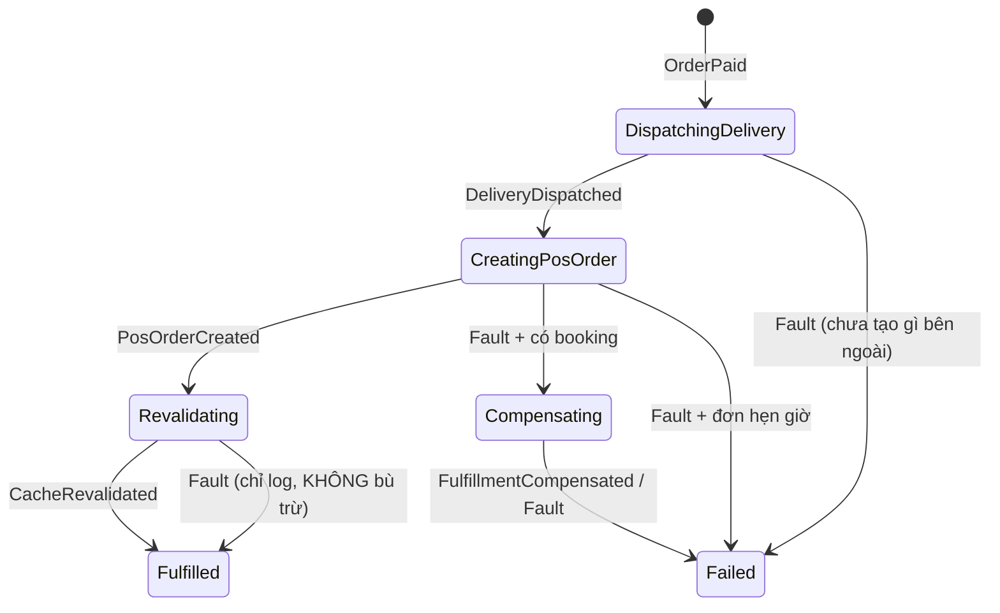

#### Request

Saga không có endpoint riêng. Nó được kích hoạt bởi event `OrderPaid` mà webhook thanh toán publish
qua **bus outbox**, trong đúng transaction ghi `Order.Status = "Paid"` và dòng `Transactions`.

```Json
{
  "orderId": "a8d56513-2cc8-4376-847f-1bdd467636c7",
  "transactionId": "6f1c0f2e-...",
  "gateway": "BaoKim",
  "requestId": "B2B6A278C9815BD7EQ4AVPVZCI",
  "amount": 160000
}
```

Kill switch: config key `fulfillment.use_saga` (group `fulfillment`). Đặt `false` để webhook quay về
đường fulfillment inline cũ mà không cần deploy.

#### Response

Webhook ack **ngay lập tức**, không đợi đơn vị giao hàng (Ahamove/XanhSm) hay NhanhVn:

```Json
{ "value": "success", "isSuccess": true, "isFailed": false, "error": null,
  "traceId": "0HNO1M4HRO7NS:00000001", "timestampUtc": "2026-08-24T07:32:05.920351Z" }
```

Tra cứu tiến độ cho ops: `GET /api/v1/admin/fulfillments?state=Failed&stuckForMinutes=15&limit=100`
(policy `StaffOrAdminPolicy`).

#### Flow chart



`CorrelationId` chính là `Order.Id`, nên mỗi đơn chỉ có đúng một saga.

Không có timer nào. Escalation do `Fault<T>` mà MassTransit tự publish khi consumer hết retry
(`1s, 5s, 15s, 30s, 60s`; `FulfillmentPermanentException` bị `Ignore` nên fault ngay).

**Đơn vị giao hàng** do `Order.ShippingGateway` quyết định, saga không có cấu hình riêng:

| `ShippingGateway` | Đặt xe (bước `DispatchDelivery`) | Hủy (bước `CompensateFulfillment`) | Ghi vào NhanhVn |
|---|---|---|---|
| `Ahamove` (1) | `POST /v3/orders`, giờ lấy = now + `ahamove.idle_time`, tôn trọng `ahamove.instant_delivery` | `DELETE /v3/orders/{id}` | `carrier.id = 12` |
| `XanhSm` (2) | `XanhSm.IService.BookDoorToDoorAsync` (điểm lấy/giao và cân nặng dựng bằng `Order.Service.CreateXanhSmPoints`), giờ lấy = now | `XanhSm.IService.CancelDeliveryAsync` (`POST cancel-order`, `cancel_code` 9000) | `carrier.id = 0`, `isSelfConnect = 1` |

Id bên đối tác lưu ở `OrderFulfillmentState.ShippingPartyOrderId` (và `Order.ShippingPartyOrderId`),
kèm `OrderFulfillmentState.ShippingGateway` để bước bù trừ biết gọi API hủy nào. Lỗi từ `XanhSm.Service`
được map: `BadGateway`/`TooManyRequest` → `FulfillmentTransientException` (retry), còn lại →
`FulfillmentPermanentException` (fault ngay).

#### Test case

**Test case 01: Happy path**
- **Điều kiện:** đơn `Pending`, số tiền khớp `TotalFee`, đơn vị giao hàng (Ahamove hoặc XanhSm) và NhanhVn đều trả về thành công.
- **Kết quả:** saga đi `DispatchingDelivery → CreatingPosOrder → Revalidating → Fulfilled`.
  `ShippingPartyOrderId` và `NhanhOrderId` được ghi xuống DB **ngay sau mỗi lời gọi**, không đợi tới cuối.

**Test case 02: NhanhVn hỏng sau khi đã đặt xe**
- **Điều kiện:** đặt xe thành công (Ahamove `POST /v3/orders` hoặc XanhSm `BookDoorToDoorAsync`),
  `POST /order/add` trả 5xx tới khi hết retry.
- **Kết quả:** saga sang `Compensating`, gọi đúng API hủy của đơn vị đã đặt (`DELETE /v3/orders/{id}`
  hoặc XanhSm `cancel-order`) với đúng `ShippingPartyOrderId`, rồi sang `Failed`.
  `Order.Status = "FulfillmentFailed"`, `CompensationAttempts = 1` (đúng 1 chân phải hoàn tác).
  Ghi `LogCritical` kèm `ShippingGateway` + `ShippingPartyOrderId` — **tiền đã thu, hoàn tiền phải làm thủ công**.

**Test case 03: Đơn hẹn giờ, NhanhVn hỏng**
- **Điều kiện:** `OrderTime > 0` hoặc có tag giao hàng ⇒ chưa đặt xe với đơn vị nào.
- **Kết quả:** sang thẳng `Failed`, **không** phát `CompensateFulfillment` (không có gì để hủy).

**Test case 04: Đặt xe hỏng ngay bước đầu**
- **Điều kiện:** Ahamove `POST /v3/orders` (hoặc XanhSm `BookDoorToDoorAsync`) lỗi tới khi hết retry.
- **Kết quả:** `Failed`, `FailedStep = "DispatchDelivery"`, không bù trừ.

**Test case 05: Purge cache hỏng**
- **Điều kiện:** hai bước đầu xong, `RevalidateApi` lỗi.
- **Kết quả:** vẫn `Fulfilled`. **Cố ý không bù trừ** — purge cache lỗi không phải lý do hủy một
  chuyến giao hàng có thật.

**Test case 06: Gateway gửi lại webhook (replay)**
- **Điều kiện:** gửi lại đúng callback đó (cùng `Gateway` + `RequestId`) nhiều lần, kể cả song song.
- **Kết quả:** mọi request đều ack. Đúng **1** dòng `Transactions`, đúng **1** saga, **0** lời gọi
  đặt xe/NhanhVn thêm. Chốt chặn là unique index `IX_Transactions_Gateway_RequestId`; vi phạm
  `23505` được webhook bắt và coi là replay, không phải lỗi.

**Test case 07: Bù trừ không hoàn tất**
- **Điều kiện:** Ahamove trả `406 INVALID_ORDER_STATUS` (đơn đã giao xong nên không hủy được), hoặc XanhSm
  `cancel-order` trả 400.
- **Kết quả:** vẫn sang `Failed`, `FailureReason` ghi rõ phần còn tồn đọng, `LogCritical` báo ops
  dọn tay. **Không** retry vô hạn.

> ⚠️ NhanhVn dùng `POST /order/cancelcarrier`, endpoint này chỉ hủy **vận đơn với hãng vận chuyển**,
> không hủy bản ghi đơn hàng bên NhanhVn. Đơn POS vẫn còn và phải hủy thủ công.

#### Ghi chú: CompensationAttempts

Đếm **số vòng bù trừ mà saga đã phát ra**, không phải số lần gọi API.

| Giá trị | Nghĩa |
|---|---|
| `0` | Không có gì để hoàn tác — lỗi xảy ra trước khi đặt xe, hoặc đơn hẹn giờ nên chưa đặt xe với đơn vị nào |
| `1` | Phát lệnh bù trừ một lần và nó chạy xong |
| `2`, `3` | Vòng trước đã dùng hết retry của endpoint và saga phát lại lệnh |

Hai tầng retry lồng nhau, tổng tối đa **9 lần gọi API hủy**:

```
vòng 1:  CompensateFulfillment  →  3 lần gọi (1s, 5s)  →  Fault
             ↓  CompensationAttempts = 2
vòng 2:  CompensateFulfillment  →  3 lần gọi           →  Fault
             ↓  CompensationAttempts = 3
vòng 3:  CompensateFulfillment  →  3 lần gọi           →  Fault
             ↓  chạm cap MaxCompensationRounds = 3
          Failed  +  LogCritical  →  ops dọn tay
```

Vì sao có tầng saga trong khi endpoint đã retry: bộ đếm của endpoint chỉ nằm trong RAM, process
chết là mất; `CompensationAttempts` nằm trong Postgres nên vòng lặp sống sót qua restart.

Cap là tuyệt đối: chạm `MaxCompensationRounds` luôn chuyển sang `Failed`, và `Failed` `Ignore` mọi
fault sau đó — không có đường nào lặp vô hạn. Test `CompensationKeepsFaulting_StopsAtTheRoundCap`
khoá đúng tính chất này.

Endpoint `compensate-fulfillment` cố ý retry ít hơn các endpoint khác (3 lần thay vì 6) để tổng số
lần gọi API hủy của đối tác không vượt 9.
