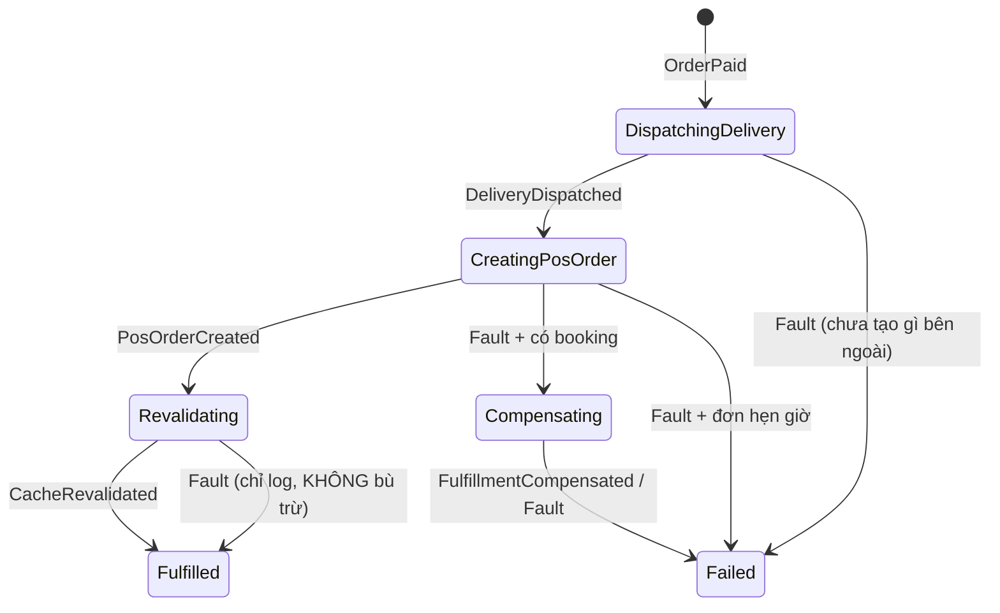

#### Request

Saga không có endpoint riêng. Nó được kích hoạt bởi event `OrderPaid` mà webhook thanh toán publish
qua **bus outbox**, trong đúng transaction ghi `Order.Status = "Paid"` và dòng `Transactions`.

```Json
{
  "orderId": "a8d56513-2cc8-4376-847f-1bdd467636c7",
  "transactionId": "6f1c0f2e-...",
  "gateway": "BaoKim",
  "requestId": "B2B6A278C9815BD7EQ4AVPVZCI",
  "amount": 160000
}
```

Kill switch: config key `fulfillment.use_saga` (group `fulfillment`). Đặt `false` để webhook quay về
đường fulfillment inline cũ mà không cần deploy.

#### Response

Webhook ack **ngay lập tức**, không đợi Ahamove/NhanhVn:

```Json
{ "value": "success", "isSuccess": true, "isFailed": false, "error": null,
  "traceId": "0HNO1M4HRO7NS:00000001", "timestampUtc": "2026-08-24T07:32:05.920351Z" }
```

Tra cứu tiến độ cho ops: `GET /api/v1/admin/fulfillments?state=Failed&stuckForMinutes=15&limit=100`
(policy `StaffOrAdminPolicy`).

#### Flow chart



`CorrelationId` chính là `Order.Id`, nên mỗi đơn chỉ có đúng một saga.

Không có timer nào. Escalation do `Fault<T>` mà MassTransit tự publish khi consumer hết retry
(`1s, 5s, 15s, 30s, 60s`; `FulfillmentPermanentException` bị `Ignore` nên fault ngay).

#### Test case

**Test case 01: Happy path**
- **Điều kiện:** đơn `Pending`, số tiền khớp `TotalFee`, Ahamove và NhanhVn đều trả về thành công.
- **Kết quả:** saga đi `DispatchingDelivery → CreatingPosOrder → Revalidating → Fulfilled`.
  `AhahaMoveOrderId` và `NhanhOrderId` được ghi xuống DB **ngay sau mỗi lời gọi**, không đợi tới cuối.

**Test case 02: NhanhVn hỏng sau khi Ahamove đã đặt xe**
- **Điều kiện:** `POST /v3/orders` thành công, `POST /order/add` trả 5xx tới khi hết retry.
- **Kết quả:** saga sang `Compensating`, gọi `DELETE /v3/orders/{ahamoveOrderId}` để hủy đúng chuyến
  đã đặt, rồi sang `Failed`. `Order.Status = "FulfillmentFailed"`, `CompensationAttempts = 1`.
  Ghi `LogCritical` kèm `AhamoveOrderId` — **tiền đã thu, hoàn tiền phải làm thủ công**.

**Test case 03: Đơn hẹn giờ, NhanhVn hỏng**
- **Điều kiện:** `OrderTime > 0` hoặc có tag giao hàng ⇒ Ahamove chưa từng được gọi.
- **Kết quả:** sang thẳng `Failed`, **không** phát `CompensateFulfillment` (không có gì để hủy).

**Test case 04: Ahamove hỏng ngay bước đầu**
- **Điều kiện:** `POST /v3/orders` lỗi tới khi hết retry.
- **Kết quả:** `Failed`, `FailedStep = "DispatchDelivery"`, không bù trừ.

**Test case 05: Purge cache hỏng**
- **Điều kiện:** hai bước đầu xong, `RevalidateApi` lỗi.
- **Kết quả:** vẫn `Fulfilled`. **Cố ý không bù trừ** — purge cache lỗi không phải lý do hủy một
  chuyến giao hàng có thật.

**Test case 06: Gateway gửi lại webhook (replay)**
- **Điều kiện:** gửi lại đúng callback đó (cùng `Gateway` + `RequestId`) nhiều lần, kể cả song song.
- **Kết quả:** mọi request đều ack. Đúng **1** dòng `Transactions`, đúng **1** saga, **0** lời gọi
  Ahamove/NhanhVn thêm. Chốt chặn là unique index `IX_Transactions_Gateway_RequestId`; vi phạm
  `23505` được webhook bắt và coi là replay, không phải lỗi.

**Test case 07: Bù trừ không hoàn tất**
- **Điều kiện:** Ahamove trả `406 INVALID_ORDER_STATUS` (đơn đã giao xong nên không hủy được).
- **Kết quả:** vẫn sang `Failed`, `FailureReason` ghi rõ phần còn tồn đọng, `LogCritical` báo ops
  dọn tay. **Không** retry vô hạn.

> ⚠️ NhanhVn dùng `POST /order/cancelcarrier`, endpoint này chỉ hủy **vận đơn với hãng vận chuyển**,
> không hủy bản ghi đơn hàng bên NhanhVn. Đơn POS vẫn còn và phải hủy thủ công.
