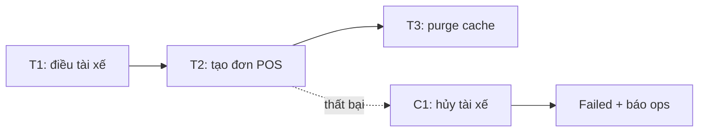
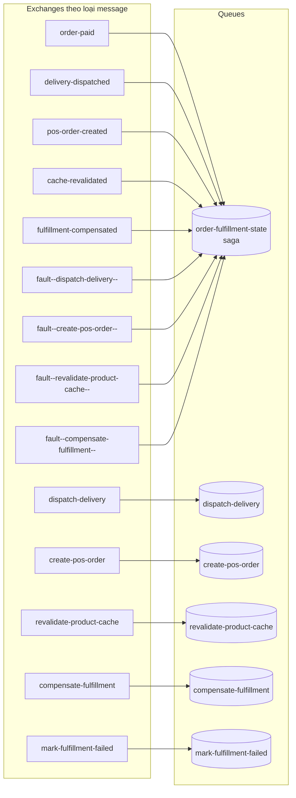
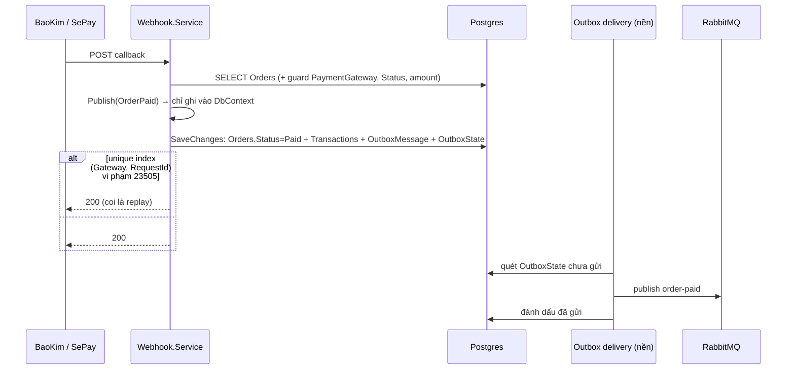
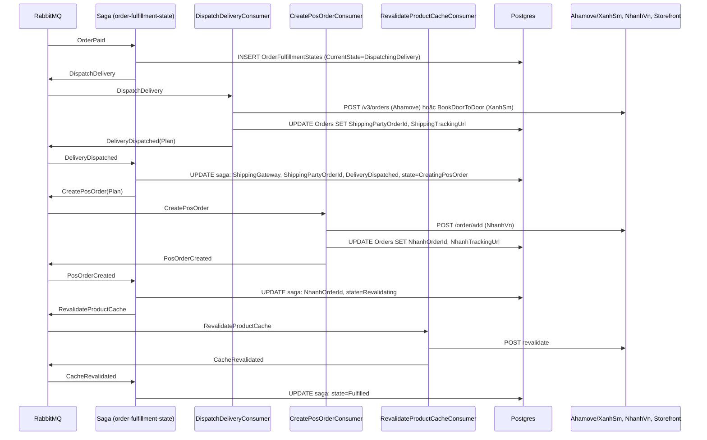
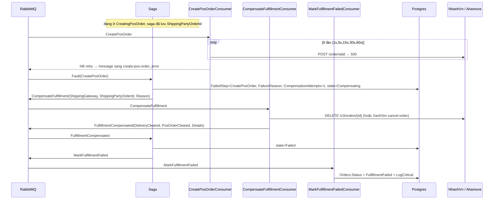
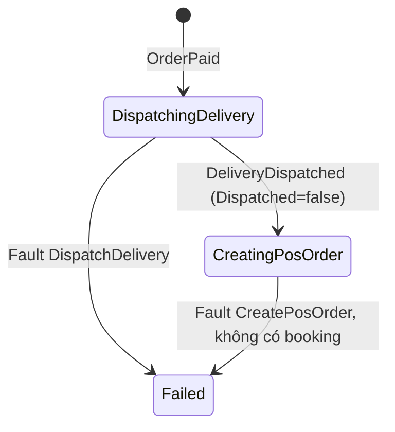
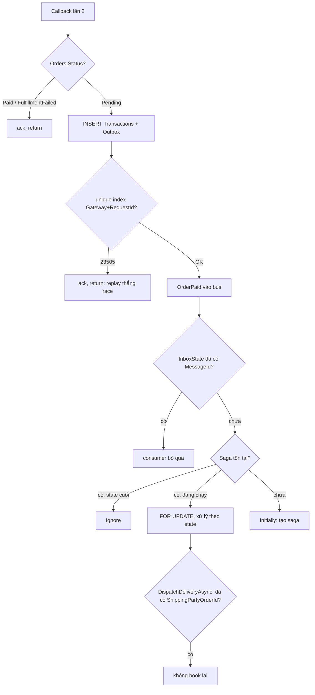

# Saga pattern & MassTransit — hướng dẫn cho người mới

> Tài liệu học, đi từ **lý thuyết** → **MassTransit** → **từng flow thật** trong `hoatheomua-be`.
> Doc mô tả test case và tham số vận hành của saga nằm ở [[OrderFulfillmentSaga]] — bài này không chép lại, chỉ link tới.

---

## 0. Đọc thế nào

**Dành cho ai:** người đã viết được một controller/service .NET với EF Core, hiểu HTTP request/response, nhưng chưa từng làm việc với message broker hay saga.

**Cần biết trước:** C# (record, async/await, DI), EF Core (`DbContext`, `SaveChangesAsync`, migration), khái niệm transaction của DB.

**Thứ tự đọc đề nghị:**

1. Phần 1 — hiểu *bug thật* đã xảy ra. Không có phần này thì mọi thứ phía sau chỉ là lý thuyết suông.
2. Phần 2 — lý thuyết saga, chỉ những gì repo thật sự dùng.
3. Phần 3 — MassTransit: mỗi khái niệm được nối thẳng vào một dòng code trong repo.
4. Phần 4 — đi từng flow, đây là phần chính. Mở code song song khi đọc.
5. Phần 5 — khi có đơn kẹt thì nhìn vào đâu.
6. Phần 6 — FAQ và bảng thuật ngữ, dùng để tra.

**Bảng tra nhanh khái niệm → file:**

| Khái niệm | Ở đâu trong repo |
|---|---|
| Cấu hình bus (consumer, saga, outbox, retry, serializer, tên queue/exchange) | `HoaTheoMua.Service/DependencyInjection/Extensions/ServiceCollectionExtensions.cs` |
| Đặt tên exchange kebab-case | `HoaTheoMua.Service/DependencyInjection/Extensions/NameFormatterExtensions.cs` |
| Option kết nối RabbitMQ | `HoaTheoMua.Service/DependencyInjection/Options/RabbitMqOptions.cs` |
| Message contract (event / command) | `HoaTheoMua.Service/Fulfillment/Contracts.cs` |
| State machine (bộ não của saga) | `HoaTheoMua.Service/Fulfillment/OrderFulfillmentStateMachine.cs` |
| Consumer (tay chân của saga) | `HoaTheoMua.Service/Fulfillment/Consumers/FulfillmentConsumers.cs` |
| Logic nghiệp vụ từng bước | `HoaTheoMua.Service/Fulfillment/Service.cs`, `IService.cs` |
| Điểm vào: webhook thanh toán | `HoaTheoMua.Service/Webhook/Service.cs` (`FulfillPaidOrder`) |
| Bảng state của saga | `HoaTheoMua.Repository/Entity/OrderFulfillmentState.cs`, `Configurations/OrderFulfillmentStateConfiguration.cs` |
| Bảng outbox/inbox | `HoaTheoMua.Repository/AppDbContext.cs` (3 dòng `Add*Entity()`), migration `20260902090336_AddFulfillmentSagaAndOutbox` |
| Phân loại lỗi retry được / không | `HoaTheoMua.Service/Exceptions/FulfillmentTransientException.cs`, `FulfillmentPermanentException.cs` |
| Endpoint cho ops | `HoaTheoMua.API/Controllers/FulfillmentController.cs` |
| Test saga (không cần RabbitMQ) | `HoaTheoMua.Service.Test/FulfillmentTest/OrderFulfillmentSaga.cs` |
| Test nhánh XanhSm | `HoaTheoMua.Service.Test/FulfillmentTest/DispatchDeliveryXanhSm.cs`, `CompensateXanhSm.cs` |
| Hạ tầng RabbitMQ | `.docker/compose.yaml` (`x-rabbitmq-base`), `HoaTheoMua.API/Program.cs` |

---

## 1. Vấn đề cần giải — tại sao lại cần saga

### 1.1. Chuyện gì xảy ra khi khách thanh toán

Khách chuyển tiền. Cổng thanh toán (BaoKim hoặc SePay) gọi webhook của mình để báo "đã nhận tiền". Lúc đó hệ thống phải làm **4 việc với 3 hệ thống bên ngoài**:

1. Đánh dấu đơn đã thanh toán (`Order.Status = "Paid"`) và lưu dòng `Transactions`.
2. Điều tài xế: gọi Ahamove `POST /v3/orders` (hoặc XanhSm) → nhận về `order_id` của hãng.
3. Tạo đơn trên POS: gọi NhanhVn `POST /order/add` → nhận về `id` đơn NhanhVn.
4. Purge cache storefront (gọi `RevalidateApi`) để tồn kho hiển thị đúng.

### 1.2. Bản cũ làm gì sai

Hàm `FulfillPaidOrder` cũ (nằm trong `Webhook/Service.cs`, ~450 dòng) làm cả 4 việc **tuần tự trong chính HTTP request của cổng thanh toán**, và **chỉ ghi DB một lần ở cuối**:

```
order.Status = "Paid";            // 1. chỉ trong bộ nhớ
POST ahamove /v3/orders           // 2. side-effect thật bên ngoài
POST nhanhvn /order/add           // 3. side-effect thật bên ngoài
await SaveChangesAsync();         // 4. ghi DB lần ĐẦU và DUY NHẤT
await RevalidateApi(...);         // 5.
```

Bất kỳ `throw` nào ở bước 2-3 đều vứt luôn `Status = "Paid"` và dòng `Transactions` chưa kịp ghi. Hậu quả thật:

| Kịch bản | Hậu quả |
|---|---|
| Ahamove OK → NhanhVn fail | Tài xế **đã được điều thật**, nhưng DB vẫn `Pending`, id Ahamove **mất trắng** (chỉ nằm trong change-tracker). BaoKim redeliver webhook 10 lần cách 5 phút → guard `Status == "Paid"` không kích hoạt → **điều thêm một tài xế mới mỗi lần**. |
| NhanhVn OK → `SaveChanges` fail | Cả tài xế lẫn đơn POS đã tồn tại bên ngoài, local không có gì, retry nhân đôi cả hai. |
| Mọi thứ OK → revalidate fail | Response 500 → cổng retry; SePay thì rơi vào `NotFoundException("Order not on Pending")` → 404 vĩnh viễn. |
| Hai redelivery chạy song song | Guard `Status == "Paid"` là read-then-act, không có unique index → cả hai cùng qua. |

Tóm lại: **tiền đã thu nhưng DB có thể không có gì**, và **không có cách nào hủy** đơn Ahamove/NhanhVn đã lỡ tạo.

### 1.3. Vì sao không "bọc transaction" cho xong

Trong DB, một transaction cho phép ghi nhiều bảng rồi commit hoặc rollback tất cả. Nhưng Ahamove, NhanhVn, XanhSm là **API HTTP của bên thứ ba**: không có lệnh "commit", không có "rollback". Gọi xong là tài xế đã lên đường. Distributed transaction / 2PC (two-phase commit) chỉ dùng được khi mọi bên tham gia đều hỗ trợ giao thức chuẩn bị-rồi-commit — API HTTP thương mại không có.

Vậy nên cần một cách tổ chức khác: chấp nhận rằng mỗi bước là **một transaction riêng, commit riêng**, và nếu bước sau hỏng thì phải có **hành động bù trừ** để "hủy về mặt nghiệp vụ" bước trước. Đó chính là saga.

### 1.4. Ba nguyên tắc rút ra

1. **Tách "ghi nhận tiền" khỏi "fulfillment".** Webhook chỉ ghi `Paid` + `Transactions` rồi ack ngay. Mọi lời gọi ra ngoài chạy sau, ở nền.
2. **Mỗi bước tự lưu kết quả của mình ngay** khi API bên ngoài trả về (`ShippingPartyOrderId`, `NhanhOrderId`). Không để id nằm chờ trong bộ nhớ.
3. **Có đường bù trừ.** Bước sau hỏng thì hủy cái bước trước đã tạo, và ghi rõ trạng thái cuối để ops biết đơn nào cần hoàn tiền tay.

Ba nguyên tắc này chính là ba thứ saga pattern hình thức hoá.

---

## 2. Lý thuyết Saga

### 2.1. Định nghĩa

Một saga là **chuỗi các local transaction** `T1 → T2 → … → Tn`. Mỗi `Ti` commit độc lập. Với mỗi `Ti` có một **compensating transaction** `Ci` để "hủy" hiệu ứng của `Ti` về mặt nghiệp vụ. Nếu `Tk` thất bại, saga chạy `C(k-1), …, C1` theo thứ tự ngược lại.



Trong repo:

| Bước | `Ti` | `Ci` |
|---|---|---|
| Điều tài xế | `DispatchDeliveryAsync` (Ahamove `POST /v3/orders` hoặc XanhSm `BookDoorToDoorAsync`) | `CompensateAsync` → `DELETE /v3/orders/{id}` hoặc XanhSm `cancel-order` |
| Tạo đơn POS | `CreatePosOrderAsync` (NhanhVn `POST /order/add`) | `CompensateAsync` → NhanhVn `POST /order/cancelcarrier` (chỉ hủy vận đơn, xem [[OrderFulfillmentSaga]]) |
| Purge cache | `RevalidateOrderProductsAsync` | **không có** — xem 2.6 |

### 2.2. Orchestration vs Choreography

Có hai cách để "ai bảo ai làm bước tiếp theo":

| | Choreography (vũ đạo) | Orchestration (nhạc trưởng) |
|---|---|---|
| Ai quyết định bước tiếp | Mỗi service tự nghe event của service trước rồi tự làm | Một thành phần trung tâm (orchestrator) nhận event, quyết định, phát lệnh |
| Trạng thái tổng thể nằm đâu | Rải rác, phải suy ra từ log/event | Một bảng, một dòng cho mỗi saga |
| Trả lời "đơn X đang kẹt ở bước nào?" | Khó | `SELECT CurrentState FROM OrderFulfillmentStates` |
| Thêm bước mới | Sửa nhiều consumer | Sửa state machine |
| Rủi ro | Luồng ngầm, khó nhìn toàn cảnh | Orchestrator là điểm tập trung |

Repo chọn **orchestration**: `OrderFulfillmentStateMachine` là nhạc trưởng, `OrderFulfillmentStates` là bảng trạng thái. Lý do quyết định: ops cần query được "đơn nào đang kẹt, đã tạo gì bên ngoài, cần hoàn tiền không". Với choreography phải đi đọc log.

### 2.3. "Rollback ngữ nghĩa" khác rollback DB

Rollback DB xoá sạch dấu vết như chưa từng xảy ra. Bù trừ trong saga thì **không**: hủy đơn Ahamove là gửi thêm một lệnh "hủy", tài xế có thể đã nhận đơn, lịch sử bên Ahamove vẫn ghi. Hệ quả:

- Bù trừ **có thể thất bại** (đơn đã giao xong thì không hủy được nữa). Saga phải chấp nhận điều đó và vẫn kết thúc, thay vì lặp mãi.
- Có việc saga **không làm được**: hoàn tiền. Leg thanh toán không nằm trong tay saga. Vì thế trạng thái cuối là `Order.Status = "FulfillmentFailed"` + `LogCritical`, để **người** hoàn tiền tay.

### 2.4. Idempotency — vì sao message đến hai lần là bình thường

Message broker đảm bảo **at-least-once** (ít nhất một lần): nếu consumer nhận message rồi chết trước khi ack, broker gửi lại. Cổng thanh toán cũng vậy: BaoKim redeliver tới khi nhận được ack. Nên **cùng một sự kiện có thể được xử lý ≥ 2 lần**, và code phải chịu được điều đó — gọi là idempotent.

Repo chống trùng ở **ba tầng**, mỗi tầng chặn một loại trùng khác nhau:

| Tầng | Chặn cái gì | Cơ chế |
|---|---|---|
| Webhook | Cổng gửi lại cùng callback, kể cả song song | Unique index `(Gateway, RequestId)` trên `Transactions`; vi phạm `23505` được bắt và coi là replay → ack (`Webhook/Service.cs`, `IsDuplicateGatewayEvent`) |
| Consumer | Broker gửi lại cùng message | Bảng `InboxState` (MassTransit inbox) ghi `(MessageId, ConsumerId)` đã xử lý → lần hai bỏ qua |
| Nghiệp vụ | Bất kỳ lý do gì khiến bước chạy lại | `DispatchDeliveryAsync` thấy `order.ShippingPartyOrderId` đã có thì **không** book nữa; `CreatePosOrderAsync` thấy `NhanhOrderId` đã có thì bỏ qua |

Tầng 3 là quan trọng nhất và rẻ nhất: **đọc lại DB trước khi gọi ra ngoài**. Đó là lý do nguyên tắc "mỗi bước tự lưu ngay" ở 1.4 quan trọng — không lưu ngay thì tầng 3 mù.

### 2.5. Lỗi tạm thời vs lỗi vĩnh viễn

Retry chỉ có ích với lỗi **tạm thời** (transient): mạng rớt, timeout, 5xx, 429. Retry lỗi **vĩnh viễn** (permanent) — 4xx, NhanhVn trả `code != 1` vì đơn sai — chỉ tốn thời gian và làm bù trừ đến muộn hơn.

Repo mã hoá phân biệt này thành hai exception (`HoaTheoMua.Service/Exceptions/`):

```csharp
public class FulfillmentTransientException : AppException   // 502 "Bad Gateway"  → retry
public class FulfillmentPermanentException : AppException   // 400 "Bad Request" → fault ngay
```

và retry policy chỉ bỏ qua loại permanent (xem 3.6). `Fulfillment/Service.cs` có hàm `HttpFailure` map status code sang đúng loại, và `MapXanhSmFailure` làm việc tương tự cho exception mà `XanhSm.Service` ném ra.

### 2.6. Pivot transaction — bước không quay đầu

Trong lý thuyết saga có khái niệm **pivot**: bước mà qua nó rồi thì saga chỉ tiến, không lùi. Ở repo, bước purge cache là như vậy: nếu cache hỏng, **không hủy** chuyến giao hàng có thật vì một lỗi cache. Saga chỉ log lỗi rồi vẫn về `Fulfilled`.

```csharp
// OrderFulfillmentStateMachine.cs
During(Revalidating,
    When(CacheRevalidated)
        .TransitionTo(Fulfilled),
    // Deliberately NOT compensating. A failed storefront cache purge is not a reason to
    // cancel a courier who is already on the way; the order really is fulfilled.
    When(RevalidateProductCacheFaulted)
        .Then(context => logger.LogError(...))
        .TransitionTo(Fulfilled));
```

---

## 3. Message broker & MassTransit — khái niệm nối vào code

### 3.1. Message broker là gì, RabbitMQ làm gì

Thay vì service A gọi thẳng HTTP sang service B, A **gửi một message** vào broker rồi đi tiếp; B **nhận** message khi rảnh. Broker (ở đây là RabbitMQ) giữ message bền trên đĩa, gửi lại nếu B chưa ack, và cho phép nhiều B chia nhau xử lý.

Từ vựng RabbitMQ tối thiểu:

| Từ | Nghĩa |
|---|---|
| **Message** | Gói dữ liệu (body JSON + header). |
| **Queue** | Hàng đợi, nơi message nằm chờ consumer. Một queue thường ứng với một consumer type. |
| **Exchange** | "Bưu điện": nơi publisher gửi message vào. Exchange **không giữ** message, nó định tuyến sang queue nào đã **bind** vào nó. |
| **Publish / Subscribe** | Publisher gửi vào exchange; mọi queue bind vào exchange đó đều nhận một bản sao. |
| **Ack / Nack** | Consumer báo "xử lý xong" (ack) → broker xoá message; hoặc "hỏng" (nack) → broker giữ lại / chuyển đi. |
| **At-least-once** | Đảm bảo giao ít nhất một lần; có thể trùng, không bao giờ mất. |
| **`_error` queue** | Quy ước của MassTransit: message hết retry được chuyển sang `{queue}_error` để người xem. |

### 3.2. Topology của repo trên RabbitMQ

MassTransit tạo, cho **mỗi loại message**, một exchange fanout mang tên message; và cho **mỗi consumer/saga**, một queue kèm một exchange cùng tên queue. Exchange loại message → bind → exchange queue → bind → queue.

Repo đặt tên **cả hai** dạng kebab-case (xem 3.3), nên trên RabbitMQ UI sẽ thấy:



Đọc sơ đồ: saga **nghe** mọi event và mọi fault; mỗi consumer nghe đúng **một** command. Đây là hình ảnh trực quan của orchestration.

Tên queue `order-fulfillment-state` lấy từ tên **class state** (`OrderFulfillmentState`), không phải tên state machine — đó là quy ước của MassTransit khi dùng `SetKebabCaseEndpointNameFormatter`.

### 3.3. Đặt tên queue và exchange — hai formatter khác nhau

Đây là chỗ dễ nhầm. `ServiceCollectionExtensions.cs`:

```csharp
cfg.SetKebabCaseEndpointNameFormatter();      // đặt tên QUEUE (endpoint)
...
cfg.UsingRabbitMq((context, bus) =>
{
    ...
    // Đặt tên EXCHANGE. Không có dòng này exchange vẫn là
    // "HoaTheoMua.Service.Fulfillment:OrderPaid".
    bus.MessageTopology.SetEntityNameFormatter(new KebabCaseEntityNameFormatter());
```

`KebabCaseEntityNameFormatter` (`NameFormatterExtensions.cs`) là class tự viết, vì MassTransit không có sẵn. Nó có một đoạn xử lý generic **bắt buộc phải có**:

```csharp
// Generic types have to be unwrapped explicitly. Type.Name for Fault<DispatchDelivery> is the
// literal "Fault`1", so naively sanitizing it collapses Fault<DispatchDelivery>,
// Fault<CreatePosOrder>, ... onto ONE exchange - every fault would then fan out to
// consumers bound for a different fault type.
private static string Format(Type type)
{
    if (!type.IsGenericType) return type.ToKebabCaseString();
    var tickIndex = type.Name.IndexOf('`');
    var baseName = tickIndex < 0 ? type.Name : type.Name[..tickIndex];
    var arguments = string.Join("--", type.GetGenericArguments().Select(Format));
    return $"{KebabCaseEndpointNameFormatter.Instance.SanitizeName(baseName)}--{arguments}--";
}
```

Bug này được phát hiện **lúc chạy thật**, không thấy được khi đọc code: cả 4 kiểu `Fault<T>` gộp vào một exchange `` fault`1 ``. Sau khi sửa, mỗi fault có exchange riêng như sơ đồ 3.2.

### 3.4. Consumer

Consumer là class xử lý **một** loại message. Interface `IConsumer<T>`, một method `Consume`. MassTransit resolve consumer từ DI **theo scope** cho mỗi message, nên `AppDbContext` scoped hoạt động như trong một HTTP request.

Repo giữ consumer **mỏng** đúng như controller (`Consumers/FulfillmentConsumers.cs`):

```csharp
public class DispatchDeliveryConsumer : IConsumer<DispatchDelivery>
{
    private readonly IService _fulfillment;
    public DispatchDeliveryConsumer(IService fulfillment) => _fulfillment = fulfillment;

    public async Task Consume(ConsumeContext<DispatchDelivery> context)
    {
        var plan = await _fulfillment.DispatchDeliveryAsync(context.Message.OrderId, context.CancellationToken);

        await context.Publish(new DeliveryDispatched
        {
            OrderId = context.Message.OrderId,
            Plan = plan
        });
    }
}
```

Toàn bộ logic nằm ở `Fulfillment.Service` để test được không cần bus, và để đường inline cũ (kill switch) dùng chung code.

Đăng ký: `cfg.AddConsumers(Assembly.GetExecutingAssembly())` quét toàn bộ assembly `HoaTheoMua.Service` → mọi class `IConsumer<T>` đều được gắn endpoint. Vì thế **consumer và contract phải nằm trong project Service**.

### 3.5. Event vs Command, Publish vs Send

| | Event | Command |
|---|---|---|
| Ngữ nghĩa | "Việc X **đã** xảy ra" (quá khứ) | "Hãy làm Y" (mệnh lệnh) |
| Ai quan tâm | Bất kỳ ai | Đúng một người thực hiện |
| Ví dụ trong repo | `OrderPaid`, `DeliveryDispatched`, `PosOrderCreated`, `FulfillmentCompensated` | `DispatchDelivery`, `CreatePosOrder`, `CompensateFulfillment`, `MarkFulfillmentFailed` |

MassTransit có hai động từ: `Publish` (vào exchange loại message, ai bind thì nhận) và `Send` (vào đúng một queue theo địa chỉ). Chuẩn sách vở là event → `Publish`, command → `Send`. Repo **`Publish` cả command**, lý do ghi trong `Contracts.cs`:

```csharp
// The saga publishes rather than sends these, so it never has to hardcode a queue name. Each has
// exactly one consumer, which makes publish and send equivalent here - and every consumer is
// additionally idempotent (it re-reads the order and skips work already recorded), so even a second
// subscriber could not double-dispatch a courier.
```

### 3.6. Retry policy

Consumer throw → MassTransit áp retry policy của endpoint. Cấu hình trong `ServiceCollectionExtensions.cs`:

```csharp
cfg.AddConfigureEndpointsCallback((context, name, cfg) =>
{
    var intervals = name == "compensate-fulfillment"
        ? new[] { 1000, 5000 }
        : new[] { 1000, 5000, 15000, 30000, 60000 };

    cfg.UseMessageRetry(r =>
    {
        r.Intervals(intervals);
        r.Ignore<FulfillmentPermanentException>();
    });
    cfg.UseEntityFrameworkOutbox<AppDbContext>(context);
});
```

Đọc: gọi lần 1 → hỏng → đợi 1s → lần 2 → 5s → lần 3 → 15s → … tổng 6 lần trong ~2 phút. `Ignore<FulfillmentPermanentException>` = gặp lỗi vĩnh viễn thì **không retry**, fault ngay.

Hai điều cần nhớ:

- Retry chạy **trong RAM của process**, message vẫn chưa ack trên RabbitMQ. Process chết giữa chừng → message quay lại queue → **bộ đếm retry reset**. Vì thế số vòng bù trừ được lưu trong DB (`CompensationAttempts`), không dựa vào bộ đếm retry.
- Endpoint `compensate-fulfillment` cố ý retry **ít hơn** (3 lần/vòng) vì saga còn phát lại tối đa 3 vòng: 3 × 3 = 9 lần gọi API hủy là trần.

### 3.7. `Fault<T>` — cơ chế escalation không cần timer

Khi consumer **hết retry**, MassTransit làm hai việc: chuyển message sang `{queue}_error`, và **publish** một message `Fault<T>` (với `T` là command gốc) chứa danh sách exception. Ai subscribe `Fault<T>` sẽ nhận.

Saga subscribe cả bốn:

```csharp
public Event<Fault<DispatchDelivery>> DispatchDeliveryFaulted { get; private set; } = null!;
public Event<Fault<CreatePosOrder>> CreatePosOrderFaulted { get; private set; } = null!;
public Event<Fault<RevalidateProductCache>> RevalidateProductCacheFaulted { get; private set; } = null!;
public Event<Fault<CompensateFulfillment>> CompensateFulfillmentFaulted { get; private set; } = null!;

// Fault<T>.Message is the original command, so the order id sits one level deeper.
Event(() => CreatePosOrderFaulted, x => x.CorrelateById(context => context.Message.Message.OrderId));
```

Đây là lý do thiết kế **không cần message scheduler, không cần timeout**: "bước này hỏng" được báo về saga bằng chính cơ chế có sẵn của MassTransit. Đổi lại, saga không tự phát hiện được "consumer treo mãi không trả lời" — trường hợp đó phát hiện bằng ops query `UpdatedAt` cũ (phần 5).

### 3.8. State machine saga

MassTransit dùng DSL tên Automatonymous để mô tả saga. Các khối lego:

| Khối | Nghĩa |
|---|---|
| `MassTransitStateMachine<TState>` | Lớp cha. `TState` là class dữ liệu lưu DB (`OrderFulfillmentState`). |
| `State` | Một trạng thái đặt tên (`DispatchingDelivery`, `Failed`…). |
| `Event<T>` | Một loại message saga nghe. |
| `InstanceState(x => x.CurrentState)` | Cột nào lưu tên state. |
| `Event(() => X, x => x.CorrelateById(...))` | Message này thuộc saga nào? Dựa vào field nào để tìm dòng trong DB. |
| `SelectId(...)` | Khi message tạo **saga mới**, `CorrelationId` lấy từ đâu. |
| `Initially(When(E)…)` | Chưa có saga, nhận `E` thì tạo mới và làm gì. |
| `During(S, When(E)…)` | Đang ở state `S`, nhận `E` thì làm gì. |
| `.Then(ctx => …)` | Chạy code đồng bộ, thường là ghi vào `ctx.Saga`. |
| `.Publish(ctx => new …)` | Phát message ra. |
| `.TransitionTo(S2)` | Đổi state. |
| `.IfElse(cond, a => …, b => …)` | Rẽ nhánh. |
| `Ignore(E)` | Ở state này nhận `E` thì bỏ qua (không lỗi). |

Mở màn saga:

```csharp
Event(() => OrderPaid, x =>
{
    x.CorrelateById(context => context.Message.OrderId);   // tìm saga theo OrderId
    x.SelectId(context => context.Message.OrderId);        // saga mới thì CorrelationId = OrderId
});

Initially(
    When(OrderPaid)
        .Then(context =>
        {
            context.Saga.Gateway = context.Message.Gateway;
            context.Saga.TransactionId = context.Message.TransactionId;
            context.Saga.CreatedAt = DateTimeOffset.UtcNow;
            context.Saga.UpdatedAt = DateTimeOffset.UtcNow;
        })
        .Publish(context => new DispatchDelivery { OrderId = context.Saga.CorrelationId })
        .TransitionTo(DispatchingDelivery));
```

Rẽ nhánh khi bước POS hỏng — quyết định quan trọng nhất của saga:

```csharp
During(CreatingPosOrder,
    When(PosOrderCreated)
        .Then(context => context.Saga.NhanhOrderId = context.Message.NhanhOrderId)
        .Publish(context => new RevalidateProductCache { OrderId = context.Saga.CorrelationId })
        .TransitionTo(Revalidating),

    When(CreatePosOrderFaulted)
        .Then(context => RecordFailure(context.Saga, nameof(CreatePosOrder), Describe(context.Message.Exceptions)))
        .IfElse(
            context => HasOutstandingBooking(context.Saga),
            compensate => compensate
                .Then(context => context.Saga.CompensationAttempts++)
                .Publish(context => new CompensateFulfillment
                {
                    OrderId = context.Saga.CorrelationId,
                    ShippingGateway = context.Saga.ShippingGateway,
                    ShippingPartyOrderId = context.Saga.ShippingPartyOrderId,
                    NhanhOrderId = context.Saga.NhanhOrderId,
                    Reason = context.Saga.FailureReason ?? "POS order creation failed"
                })
                .TransitionTo(Compensating),
            // Scheduled order: no courier was booked, so go straight to Failed.
            nothingBooked => nothingBooked
                .Publish(context => ToMarkFailed(context.Saga))
                .TransitionTo(Failed)));
```

Hai điểm thiết kế cần biết:

- `Fulfilled` và `Failed` là state **tự đặt**, không dùng `Final` có sẵn của MassTransit. Dùng `Final` + `SetCompletedWhenFinalized()` thì dòng saga bị **xoá** khi xong; repo muốn giữ lại làm audit trail và để ops query `CurrentState = 'Failed'`.
- Ở hai state cuối, mọi event đều `Ignore`. Không có dòng này, một `OrderPaid` gửi lại sau khi saga xong sẽ fault "not accepted in state" và rơi vào `_error`.

```csharp
During(Fulfilled, Failed,
    Ignore(OrderPaid), Ignore(DeliveryDispatched), Ignore(PosOrderCreated), ...);
```

State machine **không được inject scoped service** (nó là singleton). Vì thế việc "đánh dấu đơn `FulfillmentFailed` trong DB" không làm trong `.Then(...)` mà phát một command `MarkFulfillmentFailed` cho consumer riêng làm.

### 3.9. Saga repository — lưu state ở đâu và khoá thế nào

```csharp
cfg.AddSagaStateMachine<OrderFulfillmentStateMachine, OrderFulfillmentState>()
    .EntityFrameworkRepository(r =>
    {
        r.ConcurrencyMode = ConcurrencyMode.Pessimistic;   // SELECT ... FOR UPDATE
        r.LockStatementProvider = new PostgresLockStatementProvider();
        r.ExistingDbContext<AppDbContext>();
    });
```

- `ExistingDbContext<AppDbContext>()`: dùng chính `AppDbContext` của app (đã đăng ký DI), bảng saga nằm chung DB với `Orders`. Entity `OrderFulfillmentState` được map bằng `IEntityTypeConfiguration` thường như mọi entity khác, không dùng `SagaDbContext` của MassTransit.
- `Pessimistic` + Postgres lock: mỗi lần saga xử lý một message, dòng saga được `SELECT … FOR UPDATE`. Nếu hai message của **cùng một đơn** tới song song (ví dụ `DeliveryDispatched` và một `OrderPaid` replay), chúng **xếp hàng** thay vì cùng sửa một dòng. Không có khoá này sẽ có lost update.

Entity (`Repository/Entity/OrderFulfillmentState.cs`) cố tình **không** kế thừa `BaseEntity<Guid>` — nếu có thì entity có cả `Id` lẫn `CorrelationId`, EF chọn `Id` làm khoá mà MassTransit chỉ ghi `CorrelationId`. Và `CorrelationId` **chính là** `Order.Id`:

```csharp
public class OrderFulfillmentState : SagaStateMachineInstance, IAuditableEntity
{
    public Guid CorrelationId { get; set; }          // == Order.Id
    public string CurrentState { get; set; } = null!;
    public string? Gateway { get; set; }             // "BaoKim" | "SePay"
    public Guid? TransactionId { get; set; }
    public ShippingGateway? ShippingGateway { get; set; }
    public string? ShippingPartyOrderId { get; set; }
    public int? NhanhOrderId { get; set; }
    public bool DeliveryDispatched { get; set; }
    public string? FailedStep { get; set; }
    public string? FailureReason { get; set; }
    public int CompensationAttempts { get; set; }
    public DateTimeOffset CreatedAt { get; set; }
    public DateTimeOffset? UpdatedAt { get; set; }
}
```

`CorrelationId == Order.Id` cho idempotency **tự nhiên**: một đơn chỉ có thể có một saga. `OrderPaid` gửi lại thì `CorrelateById` tìm thấy saga cũ, và ở state cuối nó bị `Ignore`.

### 3.10. Transactional outbox / inbox — bài toán dual-write

Xét webhook: phải (a) ghi `Orders` + `Transactions`, và (b) publish `OrderPaid`. Hai hệ thống khác nhau (Postgres và RabbitMQ), không có transaction chung:

- Ghi DB xong, publish fail → tiền đã ghi `Paid` nhưng **không bao giờ fulfillment**.
- Publish xong, ghi DB fail → saga chạy trên một đơn **chưa `Paid`**.

Đây là bài toán **dual-write**. Lời giải chuẩn là **transactional outbox**: thay vì publish thẳng, **ghi message vào một bảng trong cùng transaction với dữ liệu**; một tiến trình nền đọc bảng đó và gửi ra broker sau khi commit.

MassTransit làm sẵn. Repo bật hai chế độ:

```csharp
cfg.AddEntityFrameworkOutbox<AppDbContext>(o =>
{
    o.UsePostgres();
    o.UseBusOutbox();                          // (1) bus outbox
    o.DuplicateDetectionWindow = TimeSpan.FromMinutes(30);
});

cfg.AddConfigureEndpointsCallback((context, name, cfg) =>
{
    ...
    cfg.UseEntityFrameworkOutbox<AppDbContext>(context);   // (2) consumer outbox + inbox
});
```

**(1) Bus outbox** — dùng ở webhook. `IPublishEndpoint.Publish(...)` **không chạm RabbitMQ**; nó chỉ ghi một dòng `OutboxMessage` (kèm `OutboxState`) vào `AppDbContext`. Khi `SaveChangesAsync()` commit, dòng đó commit cùng `Orders`/`Transactions`. Một hosted service nền của MassTransit quét `OutboxState`, gửi message ra RabbitMQ, đánh dấu đã gửi. RabbitMQ chết thì message nằm chờ trong DB, không mất.

**(2) Consumer outbox + inbox** — dùng ở mọi endpoint consumer/saga. Khi nhận message:
1. Ghi `InboxState(MessageId, ConsumerId)`. Đã có và đã `Consumed` → **bỏ qua** (chống trùng, xem 2.4).
2. Mở transaction trên `AppDbContext`; consumer chạy; mọi `context.Publish` ghi `OutboxMessage` gắn với dòng inbox; `SaveChanges` của chính consumer (`order.ShippingPartyOrderId = …`) cũng nằm trong transaction này.
3. Commit → message trong outbox được gửi → `InboxState.Delivered` được set.

Hệ quả rất đáng giá, ghi ở đầu `FulfillmentConsumers.cs`: *"an order id can never be persisted without its follow-up message, nor the message sent without the id"*.

Ba bảng được tạo bởi ba dòng trong `AppDbContext.OnModelCreating`:

```csharp
modelBuilder.AddInboxStateEntity();
modelBuilder.AddOutboxMessageEntity();
modelBuilder.AddOutboxStateEntity();
```

`DuplicateDetectionWindow = 30 phút`: dòng `InboxState` được giữ ít nhất chừng ấy để nhận diện message trùng; sau đó dọn.

### 3.11. Serializer và hệ quả "tên contract đóng băng"

Bus dùng Newtonsoft với `TypeNameHandling.Objects` (`ServiceCollectionExtensions.cs`, converter `Utils/JsonConverters/TypeNameHandlingConverter.cs`). Nghĩa là body message có nhúng **tên CLR đầy đủ** của class:

```json
{ "$type": "HoaTheoMua.Service.Fulfillment.OrderPaid, HoaTheoMua.Service", "orderId": "…", … }
```

Hệ quả vận hành: **đổi tên hoặc chuyển namespace một class contract sẽ làm hỏng mọi message đang nằm trong queue RabbitMQ và trong bảng `OutboxMessage`** (deserialize không tìm thấy type). Đó là lý do việc đổi `AhamoveOrderId` → `ShippingPartyOrderId` được làm **trước lần deploy đầu tiên**, và từ đây tên trong `Contracts.cs` coi như đóng băng. Muốn đổi sau này phải drain queue + outbox trước khi deploy.

### 3.12. Test saga không cần RabbitMQ

MassTransit lõi có sẵn test harness với transport in-memory. `OrderFulfillmentSaga.cs`:

```csharp
private static ServiceProvider BuildProvider(Mock<IService> fulfillment) =>
    new ServiceCollection()
        .AddSingleton(fulfillment.Object)
        .AddMassTransitTestHarness(cfg =>
        {
            cfg.AddConsumersFromNamespaceContaining<DispatchDeliveryConsumer>();
            cfg.AddSagaStateMachine<OrderFulfillmentStateMachine, OrderFulfillmentState>()
                .InMemoryRepository();
        })
        .BuildServiceProvider(true);
```

Chạy **state machine thật + consumer thật**, chỉ mock `Fulfillment.IService` (tức mock HTTP ra ngoài). Một test tiêu biểu:

```csharp
// TC02: NhanhVn hỏng sau khi Ahamove đã đặt xe -> phải bù trừ rồi mới Failed
fulfillment.Setup(x => x.CreatePosOrderAsync(...)).ThrowsAsync(new FulfillmentPermanentException("NhanhVn rejected the order"));

await harness.Bus.Publish(PaidFor(orderId));

var saga = harness.GetSagaStateMachineHarness<OrderFulfillmentStateMachine, OrderFulfillmentState>();
Assert.NotNull(await saga.Exists(orderId, x => x.Failed));
Assert.True(await harness.Published.Any<CompensateFulfillment>(x => x.Context.Message.ShippingPartyOrderId == "AHA-123"));
fulfillment.Verify(x => x.CompensateAsync(orderId, ShippingGateway.Ahamove, "AHA-123", null, It.IsAny<string>(), It.IsAny<CancellationToken>()), Times.Once);
Assert.Equal(1, saga.Sagas.Contains(orderId).CompensationAttempts);
```

`saga.Exists(id, x => x.Failed)` chờ (có timeout) tới khi saga với id đó vào state `Failed`. `harness.Published.Any<T>()` kiểm tra message đã được phát.

---

## 4. Đi từng flow trong repo

Quy ước: mỗi flow có sơ đồ, code theo thứ tự chạy, và "nhìn thấy gì" trong DB/RabbitMQ.

### 4.1. Flow 0 — Ghi nhận tiền và kill switch (webhook)

**Mục đích:** webhook chỉ làm đúng một transaction rồi ack. Không gọi API ngoài nào.



Code (`Webhook/Service.cs`):

```csharp
private const string UseSagaConfigKey = "fulfillment.use_saga";

private async Task FulfillPaidOrder(Repository.Entity.Order order, Transaction transaction)
{
    var fulfillmentConfigs = await ConfigHelper.GetConfigsByGroupsAsync(_dbContext, "fulfillment");
    var useSaga = fulfillmentConfigs.GetValue(UseSagaConfigKey, true);

    if (!useSaga)
    {
        await FulfillPaidOrderInline(order, transaction);   // đường cũ, giữ 1 release để rollback
        return;
    }

    order.Status = PaidStatus;
    order.UpdatedAt = DateTimeOffset.UtcNow;
    _dbContext.Orders.Update(order);
    _dbContext.Transactions.Add(transaction);

    // Bus outbox: this does not touch RabbitMQ. It stages an OutboxMessage row inside the very
    // same SaveChanges below ...
    await _publishEndpoint.Publish(new OrderPaid { OrderId = order.Id, TransactionId = transaction.Id,
        Gateway = transaction.Gateway, RequestId = transaction.RequestId, Amount = transaction.TransferAmount });

    try
    {
        await _dbContext.SaveChangesAsync();
    }
    catch (DbUpdateException exception) when (IsDuplicateGatewayEvent(exception))
    {
        // A concurrent redelivery won the race and already recorded this exact gateway event. Ack and drop.
        return;
    }
}
```

**Kill switch:** config key `fulfillment.use_saga` (bảng `Config`, group `fulfillment`). Đặt `false` → webhook chạy `FulfillPaidOrderInline`, tức gọi tuần tự `DispatchDeliveryAsync` → `CreatePosOrderAsync` → `SaveChanges` → `RevalidateOrderProductsAsync` ngay trong request như bản cũ (nhưng đã có idempotency guard). Rollback không cần deploy.

**Nhìn thấy gì:** ngay sau 200, `Orders.Status = 'Paid'`, 1 dòng `Transactions`, 1 dòng `OutboxMessage` với `MessageType` chứa `OrderPaid`. Vài trăm ms sau, `SentTime` có giá trị và trên RabbitMQ queue `order-fulfillment-state` nhận 1 message.

### 4.2. Flow 1 — Happy path



**Điểm tinh tế 1 — `DeliveryDispatchResult` (cái "plan").** Bản cũ tính `delayTime = now + ahamove.idle_time` **một lần** rồi dùng cho cả Ahamove (`order_time`) lẫn NhanhVn (`DeliveryTime`). Khi tách thành hai consumer chạy lệch thời điểm, nếu mỗi bên tự tính lại thì giờ giao trên NhanhVn sẽ **lệch** với giờ Ahamove thật sự tới lấy. Giải pháp: bước 1 tính xong, **nhét vào message**, bước 2 dùng nguyên xi.

```csharp
// Contracts.cs
public record DeliveryDispatchResult
{
    public bool Dispatched { get; init; }              // false = đơn hẹn giờ / có tag / tắt giao ngay
    public ShippingGateway ShippingGateway { get; init; }
    public string? ShippingPartyOrderId { get; init; }
    public string? ShippingTrackingUrl { get; init; }
    public long DelayTimeUnix { get; init; }           // tính MỘT lần, bước POS dùng lại
    public List<long> TagIds { get; init; } = [];      // đã gồm vatTagId / fastTagId
    public string PrivateDescription { get; init; } = string.Empty;
}
```

`DeliveryDispatched` mang `Plan`, saga chuyển tiếp nguyên `Plan` vào `CreatePosOrder`.

**Điểm tinh tế 2 — rẽ nhánh theo đơn vị giao hàng.** `DispatchDeliveryAsync` (`Fulfillment/Service.cs`):

```csharp
var isAhamove = order.ShippingGateway == ShippingGateway.Ahamove;

// The instant-delivery kill switch and the idle_time delay are Ahamove settings. XanhSm has
// neither: it is always allowed and collects "now".
var allowInstantDelivery = !isAhamove || ahamoveConfigs.GetValue("ahamove.instant_delivery", true);
var delayTime = isAhamove
    ? (delayCallAhamove > 0 ? DateTimeOffset.UtcNow.ToUnixTimeSeconds() + delayCallAhamove : 0L)
    : DateTimeOffset.UtcNow.ToUnixTimeSeconds();

var shouldDispatch = order.OrderTime == 0 && tags.Count == 0 && allowInstantDelivery;
...
var (shippingPartyOrderId, shippingTrackingUrl) = isAhamove
    ? await BookAhamoveAsync(order, companyAddress, ahamoveConfigs, delayTime, cancellationToken)
    : await BookXanhSmAsync(order, companyAddress, delayTime, cancellationToken);

// Persisted before anything else can fail. ...
order.ShippingPartyOrderId = shippingPartyOrderId;
order.ShippingTrackingUrl = shippingTrackingUrl;
await _dbContext.SaveChangesAsync(cancellationToken);
```

Dòng `SaveChangesAsync` ngay sau khi có id là **nguyên tắc 2** ở 1.4 — chính là thứ bản cũ thiếu.

**Điểm tinh tế 3 — đơn không giao ngay.** Nếu `OrderTime > 0` (khách chọn ngày), có tag giờ giao, hoặc `ahamove.instant_delivery = false` → `Dispatched = false`, **không** gọi hãng xe, saga vẫn đi tiếp tạo đơn POS. Sau này POS hỏng thì không có gì để bù trừ (Flow 4).

**Nhìn thấy gì:** `OrderFulfillmentStates.CurrentState` đi `DispatchingDelivery → CreatingPosOrder → Revalidating → Fulfilled`; `Orders.ShippingPartyOrderId` và `NhanhOrderId` xuất hiện **ngay sau từng bước**, không đợi tới cuối. Trên RabbitMQ mọi queue về 0.

### 4.3. Flow 2 — Bù trừ: NhanhVn hỏng sau khi đã đặt xe

Đây là **kịch bản chính** mà toàn bộ thiết kế nhắm tới.



Bước quyết định "có gì để hủy không" (`OrderFulfillmentStateMachine.cs`):

```csharp
// "Outstanding" means a real booking exists on someone else's system that we are responsible
// for clearing up.
private static bool HasOutstandingBooking(OrderFulfillmentState saga)
    => (saga.DeliveryDispatched && !string.IsNullOrWhiteSpace(saga.ShippingPartyOrderId))
       || saga.NhanhOrderId.HasValue;
```

Bù trừ chọn đúng hãng để hủy (`Fulfillment/Service.cs`, `CompensateAsync`):

```csharp
var courier = shippingGateway ?? ShippingGateway.Ahamove;
var outcome = courier == ShippingGateway.XanhSm
    ? await CancelXanhSmDeliveryAsync(shippingPartyOrderId, reason, cancellationToken)
    : await CancelAhamoveOrderAsync(shippingPartyOrderId, reason, cancellationToken);
deliveryCleared = outcome.Cleared;
retryable |= outcome.Retryable;
```

Quy tắc ném/không ném của `CompensateAsync` rất đáng nhớ vì nó khác một hàm bình thường:

```csharp
// Throw ONLY for transport-level failures, so the endpoint retry policy gets another go at
// both legs - each cancel is idempotent, so re-running is safe. A business rejection must
// never throw: it would loop forever instead of reaching ops.
if (retryable) throw new FulfillmentTransientException(...);

if (!deliveryCleared || !posOrderCleared)
    _logger.LogCritical("... Manual cleanup required.", ...);

return new CompensationOutcome { DeliveryCleared = deliveryCleared, PosOrderCleared = posOrderCleared, Details = ... };
```

- Hủy bị **từ chối** (Ahamove 406 vì đơn đã giao, XanhSm 400): trả `DeliveryCleared = false`, **không throw** → saga vẫn về `Failed`, `FailureReason` ghi "compensation incomplete: …".
- Hủy bị lỗi **hạ tầng** (5xx, timeout): throw transient → endpoint retry (3 lần) → nếu vẫn hỏng, `Fault<CompensateFulfillment>` → Flow 3.

**Kết quả đo được thật** khi chạy kịch bản này trên hạ tầng thật với NhanhVn ép trả 500:

| | |
|---|---|
| Webhook | HTTP 200 **ngay**, `Order.Status=Paid` + 1 dòng `Transactions` đã commit trước khi gọi bên ngoài |
| `POST /v3/orders` | **1** lần |
| `POST /order/add` | **6** lần = 1 + 5 retry |
| `DELETE /v3/orders/{id}` | **1** lần — hủy đúng chuyến đã đặt |
| Saga | `Failed`, `FailedStep=CreatePosOrder`, `CompensationAttempts=1` |
| Order | `Status=FulfillmentFailed`, `ShippingPartyOrderId` **còn nguyên** (bản cũ mất trắng) |
| Queue | chỉ `create-pos-order_error` có 1 message |

### 4.4. Flow 3 — Bù trừ cũng hỏng: hai tầng retry

Endpoint `compensate-fulfillment` retry 3 lần/vòng. Hết → `Fault<CompensateFulfillment>` → saga quyết định phát lại hay bỏ cuộc:

```csharp
private const int MaxCompensationRounds = 3;

During(Compensating,
    When(CompensateFulfillmentFaulted)
        .Then(context => context.Saga.FailureReason = Truncate($"{...} | compensation round {context.Saga.CompensationAttempts} faulted: ..."))
        .IfElse(
            context => context.Saga.CompensationAttempts < MaxCompensationRounds,
            retry => retry
                .Then(context => context.Saga.CompensationAttempts++)
                .Publish(context => new CompensateFulfillment { ... }),
            // Stays in Compensating implicitly - no TransitionTo, so no self-transition.
            giveUp => giveUp
                .Then(context => logger.LogCritical("Compensation gave up after {Max} rounds ...", ...))
                .Publish(context => ToMarkFailed(context.Saga))
                .TransitionTo(Failed)));
```

Vì sao cần tầng saga khi endpoint đã retry: bộ đếm của endpoint nằm trong RAM, process chết là mất; `CompensationAttempts` nằm trong Postgres nên vòng lặp sống qua restart. Sơ đồ đầy đủ 3 vòng × 3 lần và bảng ý nghĩa từng giá trị `CompensationAttempts` ở [[OrderFulfillmentSaga]] mục "Ghi chú: CompensationAttempts".

Cap là tuyệt đối: chạm `MaxCompensationRounds` luôn về `Failed`, và `Failed` `Ignore` mọi fault sau đó. Không có đường nào lặp vô hạn — test `CompensationKeepsFaulting_StopsAtTheRoundCap` khoá tính chất này.

### 4.5. Flow 4 — Hỏng ở bước đầu, hoặc đơn hẹn giờ

Hai trường hợp **chưa tạo gì bên ngoài**, nên không có gì để bù trừ:

- `Fault<DispatchDelivery>` khi đang `DispatchingDelivery`: hãng xe không đặt được. Saga ghi `FailedStep = DispatchDelivery`, phát `MarkFulfillmentFailed`, về `Failed`.
- `Fault<CreatePosOrder>` nhưng `HasOutstandingBooking == false` (đơn hẹn giờ, `Dispatched = false`): nhánh `nothingBooked` ở 3.8, về `Failed` thẳng, `CompensationAttempts = 0`.



### 4.6. Flow 5 — Purge cache hỏng: vẫn Fulfilled

Xem 2.6. Saga về `Fulfilled`, chỉ `LogError`. Message `RevalidateProductCache` hết retry nằm ở `revalidate-product-cache_error` để ops purge tay nếu cần.

### 4.7. Flow 6 — Replay và trùng

Cùng một callback bắn lại 3 lần, kể cả song song, đi qua các chốt theo thứ tự:



Kết quả đo thật: 3 lần replay đều 200, đúng **1** `Transactions`, **1** saga, **0** lời gọi ngoài thêm.

### 4.8. Flow 7 — Process restart giữa chừng

Giả sử API bị kill khi consumer `CreatePosOrder` đang gọi NhanhVn:

1. Message `CreatePosOrder` chưa ack → RabbitMQ đưa lại vào queue → instance mới nhận.
2. `InboxState` chưa `Consumed` (transaction cũ rollback) → không bị coi là trùng.
3. `CreatePosOrderAsync` đọc `Orders.NhanhOrderId`: nếu lần trước NhanhVn **đã** tạo nhưng chưa kịp lưu thì đây là lỗ hổng duy nhất (đơn POS trùng) — chấp nhận, vì NhanhVn không có idempotency key; nếu chưa tạo thì gọi bình thường.
4. Saga state nằm trong Postgres, không mất. Khi `PosOrderCreated` tới, `SELECT … FOR UPDATE` dòng saga rồi xử lý.

Kịch bản này là điểm khác biệt cốt lõi giữa saga bền vững và một `Task.Run` chạy nền: `Task.Run` chết là mất, message trong RabbitMQ thì không.

---

## 5. Vận hành & debug cho người mới

### 5.1. Dựng local

```bash
docker compose -f .docker/compose.yaml --profile dev up -d hoatheomua-postgres-dev hoatheomua-rabbitmq-dev
dotnet run --project HoaTheoMua.API      # migration tự apply lúc boot
```

- RabbitMQ management UI: `http://localhost:15672` (user/pass theo `RABBITMQ_USERNAME/PASSWORD` trong `.docker/.env.dev`). Prod publish cổng 15673.
- `GET /health` phải trả `Healthy` — `AddMassTransit` tự đăng ký health check cho bus, nên `/health` phản ánh cả kết nối RabbitMQ.
- Trong docker network API luôn dùng `RabbitMqOptions__Port: 5672`; `RABBITMQ_PORT` chỉ là cổng publish ra host.

### 5.2. Đọc RabbitMQ UI

| Tab | Nhìn gì |
|---|---|
| Queues | 6 queue ở 3.2 phải tồn tại sau khi API boot. Không thấy queue nào = thiếu `bus.ConfigureEndpoints(context)` (bẫy đã gặp). |
| Queues → `*_error` | Message hết retry. Có message ở đây = có `Fault<T>` đã phát về saga. Bấm vào queue → *Get messages* để xem body (thấy `$type`, `orderId`). Muốn chạy lại: *Move messages* về queue gốc (cần plugin shovel) hoặc xử lý tay. |
| Queues → `*_skipped` | Message tới queue mà không có consumer nào nhận kiểu đó. Thường do lệch tên contract sau deploy. |
| Exchanges | Phải kebab-case. Thấy `HoaTheoMua.Service.Fulfillment:OrderPaid` = thiếu `SetEntityNameFormatter`. Thấy `` fault`1 `` = formatter không unwrap generic. |
| Connections | 1 connection từ API. Mất connection → `/health` Unhealthy, outbox delivery tạm dừng nhưng **webhook vẫn 200** (message nằm trong DB). |

### 5.3. SQL hay dùng

```sql
-- Đơn cần hoàn tiền / dọn tay
SELECT "CorrelationId", "ShippingGateway", "ShippingPartyOrderId", "NhanhOrderId",
       "FailedStep", "FailureReason", "CompensationAttempts", "UpdatedAt"
FROM "OrderFulfillmentStates"
WHERE "CurrentState" = 'Failed'
ORDER BY "UpdatedAt" DESC;

-- Đơn kẹt: chưa về state cuối mà im hơn 15 phút (thiết kế không có timer, đây là cách duy nhất phát hiện)
SELECT "CorrelationId", "CurrentState", COALESCE("UpdatedAt", "CreatedAt") AS last_touch
FROM "OrderFulfillmentStates"
WHERE "CurrentState" NOT IN ('Fulfilled', 'Failed')
  AND COALESCE("UpdatedAt", "CreatedAt") < now() - interval '15 minutes';

-- Outbox: message đã ghi nhưng chưa gửi được ra RabbitMQ
SELECT "SequenceNumber", "MessageType", "EnqueueTime", "SentTime", "DestinationAddress"
FROM "OutboxMessage"
WHERE "SentTime" IS NULL
ORDER BY "EnqueueTime";

-- Inbox: message nào đã được consumer nào xử lý (chống trùng)
SELECT "MessageId", "ConsumerId", "Received", "ReceiveCount", "Consumed", "Delivered"
FROM "InboxState"
ORDER BY "Received" DESC
LIMIT 50;

-- Đối chiếu với đơn
SELECT o."Id", o."Status", o."ShippingGateway", o."ShippingPartyOrderId", o."NhanhOrderId", s."CurrentState"
FROM "Orders" o LEFT JOIN "OrderFulfillmentStates" s ON s."CorrelationId" = o."Id"
WHERE o."Status" IN ('Paid', 'FulfillmentFailed')
ORDER BY o."UpdatedAt" DESC LIMIT 50;
```

Cùng thông tin có qua API cho ops: `GET /api/v1/admin/fulfillments?state=Failed&stuckForMinutes=15&limit=100` (policy `StaffOrAdminPolicy`, `FulfillmentController.cs`).

### 5.4. Log cần tìm

| Log | Ai ghi | Nghĩa |
|---|---|---|
| `Order {OrderId} parked as FulfillmentFailed after {Step}: {Reason}. Payment WAS taken - manual refund required.` (Critical) | `MarkFulfillmentFailedAsync` | Dòng duy nhất ops thật sự cần: tiền đã thu, hoàn tay. Kèm `shippingGateway`, `shippingPartyOrderId`, `nhanhOrderId`. |
| `Compensation ... left a real booking outstanding (...)` (Critical) | `CompensateAsync` | Hủy bị từ chối, có booking thật còn sống. |
| `Compensation gave up after 3 rounds ...` (Critical) | State machine | Chạm cap. |
| `Consumer faulted for {MessageType}` (Error) | `FulfillmentConsumeObserver` | Mọi exception consumer ném, sau khi retry xong. |
| `{ShippingGateway} order {ShippingPartyOrderId} booked and persisted` (Info) | `DispatchDeliveryAsync` | Đây là id mà bản cũ làm mất. |
| Category `MassTransit` | thư viện | Kết nối, retry, fault — bật `Debug` khi cần soi. |

### 5.5. Checklist khi thêm một bước mới vào saga

Ví dụ thêm bước "gửi SMS cho khách" sau khi tạo POS:

1. `Contracts.cs`: thêm command `SendCustomerSms { OrderId }` và event `CustomerSmsSent { OrderId }`. Tên đặt xong là **đóng băng** (3.11).
2. `Fulfillment/IService.cs` + `Service.cs`: thêm `SendCustomerSmsAsync`, idempotent (đọc DB trước khi gửi), ném `FulfillmentTransientException` / `FulfillmentPermanentException` đúng loại.
3. `Consumers/FulfillmentConsumers.cs`: thêm `SendCustomerSmsConsumer` mỏng, `Publish(CustomerSmsSent)`. Không cần đăng ký — `AddConsumers(assembly)` tự quét.
4. State machine: thêm `State SendingSms`, `Event<CustomerSmsSent>`, `Event<Fault<SendCustomerSms>>` với `CorrelateById(m => m.Message.Message.OrderId)`; sửa `During(CreatingPosOrder, When(PosOrderCreated))` để `Publish(SendCustomerSms)` và `TransitionTo(SendingSms)`; thêm `During(SendingSms, …)`; quyết định fault ở đây có bù trừ không (SMS hỏng có nên hủy tài xế? — không, giống revalidate); **thêm `Ignore` cho hai event mới ở `During(Fulfilled, Failed, …)`**.
5. Nếu cần lưu gì trên saga (ví dụ `SmsMessageId`): thêm property vào `OrderFulfillmentState`, cấu hình độ dài ở `OrderFulfillmentStateConfiguration`, tạo migration.
6. Test harness: thêm case happy path đi qua bước mới và case fault của bước mới.
7. Boot local, mở RabbitMQ UI xác nhận queue `send-customer-sms` và exchange `fault--send-customer-sms--` xuất hiện.

### 5.6. Bẫy đã gặp thật (đừng dẫm lại)

| Bẫy | Triệu chứng | Sửa |
|---|---|---|
| Thiếu `bus.ConfigureEndpoints(context)` | Log "Bus started" bình thường nhưng **không queue nào được tạo**, message publish đi vào hư không | Thêm dòng đó cuối `UsingRabbitMq` |
| `KebabCaseEntityNameFormatter` không unwrap generic | 4 kiểu `Fault<T>` chung một exchange `` fault`1 ``, fault của bước này fan-out sang handler bước khác | Đoạn `Format(Type)` ở 3.3 |
| `RabbitMqOptions__Port` nối vào `${RABBITMQ_PORT}` | API trong docker network không kết nối được | Hardcode 5672 trong network, `RABBITMQ_PORT` chỉ để publish ra host |
| Đặt tên record `CompensationResult` | Trùng `MassTransit.CompensationResult` (API Courier) → lỗi biên dịch mơ hồ | Đổi thành `CompensationOutcome` |
| Migration saga tạo lúc nhánh chưa merge | Timestamp chen giữa migration của origin, snapshot lệch | Xoá, lấy snapshot origin, `migrations add` lại |
| `OrderFulfillmentState : BaseEntity<Guid>` | Entity có cả `Id` lẫn `CorrelationId`, EF chọn nhầm khoá | Không kế thừa `BaseEntity` |
| State machine inject scoped service | Không resolve được (state machine là singleton) | Phát command cho consumer làm (`MarkFulfillmentFailed`) |

---

## 6. FAQ & thuật ngữ

### 6.1. FAQ

**Saga có phải là distributed transaction không?**
Không. Distributed transaction (2PC) hứa "tất cả hoặc không gì cả" bằng cách khoá mọi bên tới khi commit. Saga chấp nhận trạng thái trung gian nhìn thấy được (tài xế đã được điều, POS chưa có) và sửa bằng bù trừ. Với API bên thứ ba chỉ có lựa chọn thứ hai.

**Vì sao orchestration mà không phải choreography?**
Ops cần trả lời "đơn nào kẹt ở bước nào, đã tạo gì bên ngoài" bằng một câu SQL. Xem 2.2.

**Vì sao không dùng message scheduler / timeout cho bước treo?**
Escalation đã có sẵn qua `Fault<T>` khi consumer hết retry (3.7). Scheduler cần plugin `rabbitmq_delayed_message_exchange` (đã bị gỡ khỏi RabbitMQ 4.3) hoặc Quartz job store — thêm hạ tầng cho một lợi ích nhỏ. Bước "treo mãi không trả lời" phát hiện bằng query `UpdatedAt` cũ.

**Vì sao `Fulfilled`/`Failed` không phải `Final`, không xoá dòng saga?**
Giữ làm audit trail và để ops query `CurrentState = 'Failed'`. Xem 3.8.

**Vì sao `Publish` command thay vì `Send`?**
Mỗi command đúng một consumer nên hai cách tương đương; `Publish` khỏi hardcode địa chỉ queue. Consumer còn idempotent nên kể cả có subscriber thứ hai cũng không điều trùng xe. Xem 3.5.

**Vì sao `CorrelationId = Order.Id` mà không sinh Guid mới?**
Một đơn = một saga, tự nhiên chống trùng. Replay `OrderPaid` chỉ correlate vào saga cũ rồi bị `Ignore`. Xem 3.9.

**Message đến hai lần thì sao?**
Bình thường. Ba tầng chống trùng ở 2.4 và Flow 6.

**Consumer ném exception thì chuyện gì xảy ra?**
Retry theo policy (trừ `FulfillmentPermanentException`) → hết retry → message sang `_error`, `Fault<T>` về saga → saga quyết định bù trừ hay `Failed`. Xem 3.6, 3.7.

**Retry đếm ở đâu?**
Retry của endpoint trong RAM (mất khi restart). Vòng bù trừ đếm ở `CompensationAttempts` trong DB. Xem 4.4.

**Revalidate hỏng vì sao không bù trừ?**
Purge cache hỏng không phải lý do hủy chuyến giao hàng thật. Pivot transaction, 2.6.

**Hoàn tiền có tự động không?**
Không. Saga không chạm leg thanh toán. `FulfillmentFailed` + `LogCritical` để người hoàn tay. Xem 2.3.

**Vì sao lưu `ShippingGateway` trên saga, không đọc lại từ `Orders`?**
Bước bù trừ phải biết hủy bằng API nào. Saga state là nguồn sự thật về "đã book gì" — không phụ thuộc vào việc `Orders` có bị sửa tay sau đó.

**Vì sao nói "tên contract đóng băng"?**
Body message nhúng `$type` (Newtonsoft `TypeNameHandling.Objects`). Đổi tên class = message trong queue/outbox không deserialize được. Xem 3.11.

**Lỡ phải đổi tên contract thì làm gì?**
Drain: tắt webhook (kill switch) → đợi mọi queue và `OutboxMessage WHERE SentTime IS NULL` về 0 → deploy → bật lại.

**Kill switch hoạt động ra sao?**
Config `fulfillment.use_saga = false` → webhook chạy `FulfillPaidOrderInline`. Không cần deploy. Xoá đường inline sau khi saga chạy sạch trên prod một thời gian.

**RabbitMQ chết thì webhook có chết theo không?**
Không. `Publish` chỉ ghi `OutboxMessage`, webhook vẫn 200. Message nằm chờ trong DB, outbox delivery gửi khi bus lên lại. `/health` sẽ Unhealthy để cảnh báo.

**API restart giữa chừng có mất đơn không?**
Không. Flow 7.

**Chạy nhiều instance API được không?**
Về thiết kế có: saga khoá pessimistic, inbox chống trùng, outbox dùng khoá hàng Postgres. Chưa kiểm chứng trên hạ tầng thật (hiện deploy 1 instance) — cần test trước khi scale.

**Test saga có cần RabbitMQ không?**
Không, test harness in-memory. Xem 3.12.

**Vì sao MassTransit 8.4.1 mà không phải bản mới nhất?**
MassTransit v9 chuyển sang license thương mại; v8 Apache 2.0, còn security patch tới hết 2026. Trong v8, từ 8.5.0 package EF đòi EF Core 9 trong khi repo pin 8.0.x, nên 8.4.1 là bản cao nhất khớp.

**Đơn NhanhVn có được hủy khi bù trừ không?**
Chỉ hủy **vận đơn** (`/order/cancelcarrier`), bản ghi đơn NhanhVn vẫn còn và phải hủy tay. Xem [[OrderFulfillmentSaga]].

### 6.2. Thuật ngữ

| Tiếng Anh | Tiếng Việt / giải nghĩa |
|---|---|
| Saga | Chuỗi local transaction có bù trừ |
| Compensating transaction / Compensation | Giao dịch bù trừ: hành động "hủy về nghiệp vụ" một bước đã làm |
| Orchestration | Điều phối tập trung, có nhạc trưởng (state machine) |
| Choreography | Điều phối phân tán, mỗi service tự nghe và tự làm |
| Pivot transaction | Bước qua rồi thì saga chỉ tiến, không bù trừ |
| Local transaction | Transaction của một bước, commit riêng |
| Distributed transaction / 2PC | Giao dịch phân tán hai pha; không dùng được với API HTTP bên thứ ba |
| Idempotent | Làm nhiều lần cho cùng kết quả như làm một lần |
| At-least-once | Đảm bảo giao ít nhất một lần, có thể trùng |
| Message broker | Trung gian nhận và giao message (RabbitMQ) |
| Queue / Exchange / Binding | Hàng đợi / bưu điện định tuyến / liên kết exchange → queue |
| Ack / Nack | Xác nhận đã xử lý / báo hỏng |
| Dead-letter, `_error` queue | Nơi chứa message hết retry |
| Consumer | Class xử lý một loại message (`IConsumer<T>`) |
| Event / Command | Sự kiện đã xảy ra / mệnh lệnh cần làm |
| Publish / Send | Gửi tới mọi subscriber / gửi tới một địa chỉ |
| `Fault<T>` | Message MassTransit tự phát khi consumer của `T` hết retry |
| State machine | Máy trạng thái: state + event + transition |
| Correlation / CorrelationId | Cách nối message với đúng saga instance; ở đây = `Order.Id` |
| Saga repository | Nơi lưu state saga (EF Core → Postgres) |
| Pessimistic concurrency | Khoá hàng khi đọc (`SELECT … FOR UPDATE`) |
| Transactional outbox | Ghi message vào bảng cùng transaction, gửi sau |
| Inbox | Bảng ghi message đã xử lý để chống trùng |
| Dual-write problem | Ghi hai hệ thống không có transaction chung |
| Transient / Permanent failure | Lỗi tạm thời (retry được) / lỗi vĩnh viễn (retry vô ích) |
| Retry policy | Quy tắc thử lại: số lần, khoảng cách, loại bỏ qua |
| Kill switch | Công tắc tắt tính năng bằng config, không cần deploy |
| Test harness | Bộ khung test in-memory của MassTransit |
