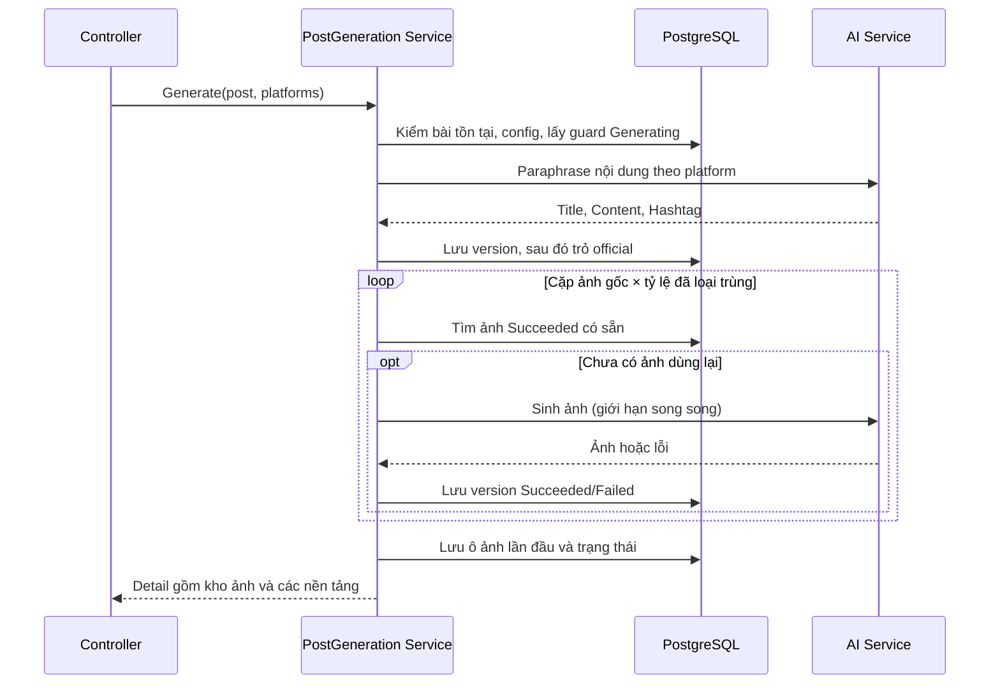

# PostGen — Contract AI Service (đề xuất, chưa xác nhận)

## Contract với AI Service

Đăng ký theo tiền lệ `XanhSm`: typed `HttpClient` (`AddHttpClient<AiService.IService, AiService.Service>("AiService", c => c.Timeout = ...)`), option POCO bind bằng `configuration.GetSection(nameof(AiOption)).Bind(...)`.

| Khoá `AiOption` | Mặc định | |
| --- | --- | --- |
| `BaseUrl` | — | bắt buộc |
| `ApiKey` | — | gửi qua `Authorization: Bearer` |
| `TimeoutSeconds` | 120 | |
| `ContentPath` | `/v1/paraphrase` | |
| `ImagePath` | `/v1/image-ratio` | |
| `MaxParallelImageRequests` | 3 | |
| `MaxImagesPerGeneration` | 12 | |
| `ImageRetryCount` | 1 | chỉ áp dụng cho item ảnh |
| `ContentModel` / `ImageModel` | — | |

Trong Docker các khoá này vào bằng env `AiOption__*`. Một số khoá đổi được lúc chạy không cần deploy qua bảng `Config` group `postgen`: `postgen.enabled`, `postgen.max_images_per_generation`, `postgen.content_model`, `postgen.image_model`, `postgen.image_instruction` (dùng `ConfigHelper.GetConfigsByGroupsAsync`).

### Sinh nội dung

`POST {BaseUrl}{ContentPath}`

```json
{ "requestId": "guid",
  "platform": "facebook",
  "systemPrompt": "<SystemPrompt(Post).Content + Config(postgen.platform.{platform}).Value.description>",
  "source": { "title": "…", "content": "…", "hashtag": "#hoa #tet" },
  "previousContent": null,
  "feedback": null,
  "constraints": { "maxLength": 2200, "language": "vi", "model": "…" } }
```

Trả về: `{ "requestId": "…", "title": "…", "content": "…", "hashtag": "…", "model": "…", "usage": { "inputTokens": 0, "outputTokens": 0 } }`

AI sinh **cả ba** phần riêng cho từng nền tảng: title, content, hashtag. Lời gọi **chỉ gửi text**, không đính kèm ảnh.

**Lưu ý khi đăng bài (phase sau)**: Facebook, Instagram, Zalo OA đều không có trường title riêng — bài đăng chỉ là một khối nội dung. Nên lúc đăng phải ghép `Title` vào đầu `Content`. Quy tắc ghép (xuống dòng đơn hay đôi, hashtag đặt ở đâu) chốt ở `PublishingReserved.md`.

### Sinh ảnh

`POST {BaseUrl}{ImagePath}`, mỗi cặp (ảnh nguồn × tỷ lệ) một lời gọi:

```json
{ "requestId": "guid",
  "sourceImageUrl": "https://…/v1.jpg",
  "originalImageUrl": "https://…/original.jpg",
  "targetRatio": { "code": "Portrait4x5", "width": 1080, "height": 1350 },
  "instruction": "<Config: postgen.image_instruction>",
  "preserve": { "product": true, "brandingText": true, "logo": true },
  "feedback": "nền sáng hơn",
  "constraints": { "model": "…" } }
```

Trả về: `{ "requestId": "…", "imageUrl": "https://…", "width": 1080, "height": 1350, "model": "…", "expiresAt": null }`

Hai trường ảnh có vai trò khác nhau:

- `sourceImageUrl` — **tấm cần dựng lại**. Bằng ảnh gốc ở lần sinh đầu, bằng ảnh của version cha khi paraphase tiếp lên một version.
- `originalImageUrl` — **mốc nhận diện**, luôn là `BasePostImage.ImageUrl`. Để AI đối chiếu sản phẩm khi đã qua nhiều đời dựng lại. Ở lần sinh đầu hai trường bằng nhau.

Không có trường `platform`: theo quyết định #11 ảnh dùng chung mọi nền tảng nên lời gọi này không được mang thông tin riêng của nền tảng nào.

### Xử lý lỗi và rủi ro của việc gọi đồng bộ

Xử lý lỗi theo đúng `XanhSm/Service.cs`: một hàm `SendAsync<T>` tập trung, non-2xx / `JsonException` / thiếu field bắt buộc (`content`, `imageUrl`) → `BadGatewayException`.

Mỗi lời gọi ghi **log ứng dụng** kèm `requestId`, `HttpStatus`, `DurationMs` và mã lỗi của provider — không ghi vào bảng nào (quyết định #14). **Không log `ApiKey`**, và không log nguyên văn payload chứa dữ liệu khách hàng ở mức log mặc định.

Một lần sinh 3 nền tảng × 4 ảnh × 2 tỷ lệ là 24 lời gọi ảnh trong một HTTP request. Biện pháp:

- **Chặn cứng ở validator**: `MaxImagesPerGeneration = 12` — đếm trên **số cặp `(ảnh gốc, tỷ lệ)` thực sự phải sinh sau khi đã gom và loại trùng toàn bộ nền tảng trong request**, không phải đếm theo từng nền tảng. Cặp nào đã có ảnh `Succeeded` trong kho thì không tính vì không gọi AI. Vượt ngưỡng là 422 ngay, không phải một request chạy lâu rồi chết giữa chừng.
- Gọi ảnh song song có giới hạn bằng `SemaphoreSlim(MaxParallelImageRequests)`.
- **Hai tầng timeout**: mỗi lời gọi dùng `HttpClient.Timeout` 120s (tiền lệ `AddHttpClient<…>("XanhSmService", c => c.Timeout = …)`); cả lượt sinh dùng thêm một tổng ngân sách — `CancellationTokenSource.CreateLinkedTokenSource(HttpContext.RequestAborted)` + `CancelAfter(180s)`. Ảnh nào chưa kịp xong khi hết ngân sách thì ghi `Status = Failed`, `ErrorMessage = "Generation budget exceeded"`, **không** làm hỏng cả request.
- **Lưu ý hạ tầng**: API này chạy sau Cloudflare tunnel — tunnel/reverse proxy phải chịu được thời gian phản hồi lớn hơn tổng ngân sách, nếu không client nhận 524 trong khi backend vẫn đang ghi dữ liệu. Kiểm chứng trước khi bật.
- **Partial failure không rollback**: ảnh lỗi lưu thành một dòng `GeneratedPostImage` với `Status = Failed` + `ErrorMessage`, ô `PlatformPostImage` tương ứng để `SelectedGeneratedPostImageId = null`, lượt gọi trả 200 với `status = Partial`. Chỉ ném `BadGatewayException` khi **lời gọi nội dung lỗi** hoặc **toàn bộ ảnh đều lỗi**. Người dùng sinh lại đúng ô lỗi bằng `POST .../images/regenerate`, không phải chạy lại cả lượt.
- **Không có Polly** trong repo: tự retry đúng **một lần**, chỉ cho item ảnh, chỉ với timeout/429/5xx, không retry 4xx. Lời gọi nội dung không retry (tốn tiền và không idempotent). Hướng nâng cấp sau: `Microsoft.Extensions.Http.Resilience`.
- **Thiết kế sao cho chuyển async không phải viết lại**: response của `generate` và của `GET /api/v1/posts/{id}` đã cùng shape, đều có kho `images` kèm `status` từng tấm. Phase sau chỉ cần đổi `POST generate` trả `202` rồi publish message MassTransit (RabbitMQ + outbox đã wired sẵn) — frontend vẫn poll đúng cái GET nó đang gọi, không đổi DTO.


## Trạng thái

Chưa triển khai `AiService/` hoặc endpoint gọi AI. Cần bên làm AI xác nhận endpoint/auth và request/response trước mốc 3. Các đường dẫn và model trong tài liệu là contract đề xuất.


