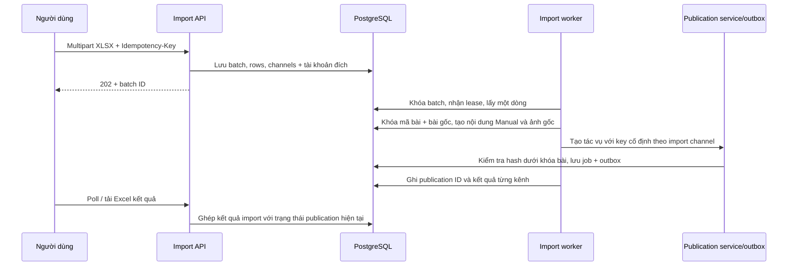

# Đăng hàng loạt từ Excel v2

Ngày kiểm tra: 23/10/2026. Backend `hoatheomua-be`, frontend quản trị `taskcoper-fe`, nhánh `feature/bulk-post-import-v2`.

## Cách sử dụng

1. Trong danh sách bài đăng, chọn **Đăng hàng loạt**, tải mẫu Excel v2.
2. Chọn và lưu tài khoản mặc định cho từng kênh cần dùng. Thiết lập thuộc người dùng đang đăng nhập; mỗi đợt nhập giữ nguyên tài khoản đích đã chụp tại thời điểm nhận file.
3. Điền hai sheet dữ liệu, giữ nguyên tên sheet và tiêu đề cột.
4. Chọn file, bấm **Nhập & đăng**. Sau khi hệ thống báo đã nhận file, có thể đóng trình duyệt.
5. Theo dõi các đợt nhập ở danh sách bài đăng hoặc tải Excel kết quả để sửa dòng lỗi. Giữ nguyên mã bài khi nhập lại các bài bị lỗi.

| Sheet | Cột | Ý nghĩa |
|---|---|---|
| Bai_dang | Mã bài | Bắt buộc, tối đa 100 ký tự; trim, Unicode FormKC, chữ hoa khi so trùng |
| Bai_dang | Tiêu đề | Bắt buộc, tối đa 500 ký tự; kênh có thể áp dụng giới hạn thấp hơn |
| Bai_dang | Nội dung | Nội dung hoàn chỉnh, giữ nguyên khi đăng |
| Bai_dang | Hashtag | Không bắt buộc |
| Bai_dang | Kênh đăng | Zalo OA, Facebook, Instagram; có thể kết hợp nhiều kênh |
| Bai_dang | Ngày giờ đăng | Trống: đăng ngay; có giá trị: hẹn giờ Việt Nam UTC+7 |
| Anh | Mã bài | Liên kết với mã trong Bai_dang |
| Anh | Thứ tự | Số nguyên dương, duy nhất trong một bài; số nhỏ nhất là ảnh bìa |
| Anh | Đường dẫn ảnh | URL HTTP(S) công khai, trỏ trực tiếp tới ảnh |

Không có số cột ảnh cố định. Thêm bao nhiêu dòng ảnh cần thiết vào sheet Anh, trong giới hạn 10.000 dòng ảnh/file. Mỗi kênh vẫn kiểm tra giới hạn ảnh của adapter hiện hành; hệ thống báo lỗi nếu vượt, không tự cắt bỏ ảnh. Import không gọi AI, không sửa nội dung và không tạo/crop ảnh. URL ảnh phải tiếp tục truy cập được tới lúc đăng.

Giới hạn: `.xlsx`, 10 MB, 500 bài, 10.000 dòng ảnh, 512 thành phần ZIP, tổng dung lượng giải nén 64 MB. Không nhận macro, công thức hoặc ô lỗi. Có hỗ trợ shared/inline strings và ngày Excel hệ 1900/1904. Ngày dạng chuỗi dùng `dd/MM/yyyy HH:mm` hoặc `yyyy-MM-dd HH:mm`. Lịch tuân thủ PublishingOptions: mặc định ít nhất 60 giây và tối đa 30 ngày, được kiểm tra lại lúc tạo tác vụ.

Sheet Huong_dan, Vi_du và Danh_muc trong mẫu chỉ hỗ trợ nhập liệu, không phải dữ liệu đăng. Link ảnh minh họa cần được thay bằng link thật.

## API

Tất cả endpoint yêu cầu `AdminPolicy`. Lịch sử, thiết lập và mã chống trùng được giới hạn theo UserId trong token; đây chưa phải cấu hình dùng chung theo tổ chức.

Frontend gọi qua gateway `/ecommerce-api`; backend nhận `/api`.

| Method | Backend path | Request / response |
|---|---|---|
| GET | /api/v1/post-imports/defaults | Envelope `value.accounts` |
| PUT | /api/v1/post-imports/defaults | `{ "accounts": [{ "platform": "zalo", "accountId": "UUID" }] }`; tối đa một tài khoản Connected cho mỗi kênh |
| POST | /api/v1/post-imports | Multipart trường `file`, header `Idempotency-Key`; trả 202, Location và summary |
| GET | /api/v1/post-imports | 10 đợt gần nhất của người dùng |
| GET | /api/v1/post-imports/{id} | `pageIndex` mặc định 1, `pageSize` mặc định 50; summary, issues, rows, thông tin phân trang |
| GET | /api/v1/post-imports/{id}/export | File XLSX sheet Ket_qua, toàn bộ dòng/kênh/lỗi và ID/link kết quả |

Platform API dùng `zalo`, `facebook`, `instagram`. Response JSON sử dụng camelCase, nằm trong envelope ApiResponseFactory hiện có. Đợt của người khác trả 404, không lộ dữ liệu.

Frontend giữ nguyên Idempotency-Key khi thử lại lần upload lỗi. Cùng người dùng + key + nội dung file trả lại đợt cũ; cùng key nhưng khác file trả 409. File mới dùng key mới. Sai cấu trúc toàn file từ chối request; lỗi dữ liệu từng bài và ảnh không tìm thấy mã bài được lưu để hiển thị trong kết quả, các bài hợp lệ vẫn xử lý.

## Xử lý nền và chống trùng

Import worker nhận lease 2 phút và xử lý từng dòng bằng DI scope riêng. Quét mỗi 5 giây, tối đa 10 batch mỗi lượt và 20 dòng/batch. Lỗi hạ tầng thử tối đa 3 lần; việc chờ lease refresh token không tiêu hao số lần thử. Lease hết hạn được tiến trình sau tiếp quản. Không phụ thuộc HTTP request hoặc việc trình duyệt còn mở.

Khóa PostgreSQL theo `(RequestedBy, Code)` cùng khóa bài gốc bảo vệ các batch chạy đồng thời. Mã bài liên kết bền vững với một BasePost. Publication ở trạng thái Queued, Scheduled, Publishing, NeedsReview, Succeeded hoặc Closed được dùng lại; không tự tạo lệnh đăng mới. Với bài thất bại và không có publication cần bảo vệ, nhập lại có thể sửa nội dung/ảnh. Nếu sửa nội dung trong khi đã có tác vụ được bảo vệ, dòng trả `IMPORT_CONTENT_CHANGED`; người dùng xử lý bài hiện có hoặc dùng mã khác cho bài mới.

Nội dung đầu vào có fingerprint. Publication service kiểm tra lại fingerprint dưới khóa bài ngay trước khi tạo job để tránh hai batch khác nội dung vô tình đăng nội dung của nhau. Key `bulk:{channelId}` cố định giúp phục hồi khi job đã commit nhưng worker chưa lưu kết quả channel. Đơn vị chống trùng là mã bài + người dùng + kênh; đổi tài khoản mặc định không tự đăng lại bài đã thành công sang tài khoản khác.

Nội dung được lưu thành GeneratedPost `Source=Manual`, ảnh `StorageProvider=ImportedUrl`, không có model AI. Kích thước/tỷ lệ ảnh thực được adapter kiểm tra trước khi gửi. OAuth, kiểm tra quyền, giới hạn kênh, media SSRF, retry và đối soát kết quả chưa rõ dùng lại luồng publishing hiện có.

## Trạng thái

- `Processing`: còn dòng import hoặc publication đang xử lý; poll mỗi 5 giây.
- `Scheduled`: còn lịch đăng, kể cả có kênh khác lỗi/cần đối soát; poll mỗi 30 giây.
- `NeedsReview`: cần kiểm tra kết quả trên nền tảng; không tự đăng lại.
- `CompletedWithErrors`: không còn việc đang chạy/hẹn giờ nhưng có lỗi dữ liệu/kênh.
- `Completed`: đã xử lý xong và không có lỗi.

`processedRows` là số dòng đã kiểm tra/tạo tác vụ, không phải số bài đã đăng thành công. Kết quả thành công/lỗi/hẹn giờ được đếm riêng theo kênh; `invalidRows` là số bài sai dữ liệu. UI hiển thị tối đa 5 lỗi mỗi dòng và 50 lỗi liên kết ảnh; file kết quả chứa toàn bộ lỗi.

## Database và triển khai

Migration `20261023080042_AddPostBulkImports` bổ sung 5 bảng; không chỉnh sửa dữ liệu/bảng nghiệp vụ cũ:

| Bảng | Vai trò / ràng buộc |
|---|---|
| PostImportBatch | Người yêu cầu, key/hash file, trạng thái, lease; unique người dùng + key; index phục hồi và lịch sử |
| PostImportRow | Dòng Excel, mã, payload JSONB bất biến, lỗi JSONB, số lần thử, BasePostId; unique batch + row |
| PostImportChannel | Kênh, tài khoản chụp lúc upload, publication ID, kết quả; unique row + platform |
| ImportedPostIdentity | PK người dùng + mã bài, BasePostId unique, content hash |
| PostImportAccount | PK người dùng + platform, FK tài khoản mặc định |

Foreign key, state check constraints và index được khai báo trong PostImportConfigurations. Không tự xóa lịch sử hoặc identity: xóa identity có thể mất bảo vệ chống trùng. Chưa có endpoint xóa batch hoặc chính sách TTL. Không lưu byte file upload hay credential trong payload; payload chứa nội dung và URL ảnh nên cần bảo vệ cùng mức với dữ liệu bài đăng.

Deploy backend/migration trước frontend. Cần PostgreSQL, worker/outbox/scheduler hiện có hoạt động, cấu hình publishing và OAuth của kênh được bật. Migration Down từ chối khi có batch/identity để tránh xóa lịch sử; rollback ứng dụng nên giữ lại bảng và dữ liệu. Đánh giá/xuất dữ liệu riêng trước khi chủ động gỡ schema.

## Bằng chứng kiểm tra

- Bộ backend đầy đủ trước khi thêm API regression test: **1.551 passed, 46 skipped**, không lỗi. Các test skip phụ thuộc môi trường tích hợp.
- Bộ import cuối cùng: **25 passed, 0 skipped**, gồm API regression và PostgreSQL.
- PostgreSQL thật: chạy migration, upload đồng thời cùng key, worker đồng thời cùng mã bài; xác nhận đúng một bài, một publication, một transactional outbox message; rollback guard giữ lịch sử.
- Test import bao phủ 15 ảnh không cắt, thứ tự ảnh, ngày Excel/giờ Việt Nam, mã trùng, link ảnh lỗi, công thức, default snapshot, idempotency, reimport, crash recovery, token refresh và phạm vi người dùng.
- HTTP localhost + PostgreSQL riêng: 401 anonymous, 403 non-admin; PUT defaults; multipart 202; replay cùng ID; 1 lịch Zalo + 1 kênh thiếu account + 1 dòng sai tiêu đề + 1 ảnh không có mã; reimport không tạo lịch trùng; XLSX export đọc được; người dùng khác 404.
- Frontend: `yarn check`, `yarn build` đạt; kiểm tra thủ công component thật trong Vite với API localhost. Upload file gọi API thật, điều hướng tới batch, polling đổi Processing sang Scheduled, lỗi hiển thị theo dòng/kênh. Viewport 390px: document/dialog không tràn ngang, bảng có vùng cuộn riêng. Có kiểm tra giao diện desktop.
- Môi trường HTTP kiểm thử chặn outbound provider và không chạy publication consumers. Chưa kiểm tra đăng bài thật trên OA/Facebook/Instagram; chưa push/deploy feature này.

Code kiểm thử bền vững: `HoaTheoMua.Service.Test/PostImportTest/{Imports,Postgres,Api}.cs`. Chạy `dotnet test HoaTheoMua.Service.Test --filter FullyQualifiedName~PostImportTest` với `POSTGEN_TEST_CONNECTION_STRING` trỏ PostgreSQL localhost để bật cả test database.
