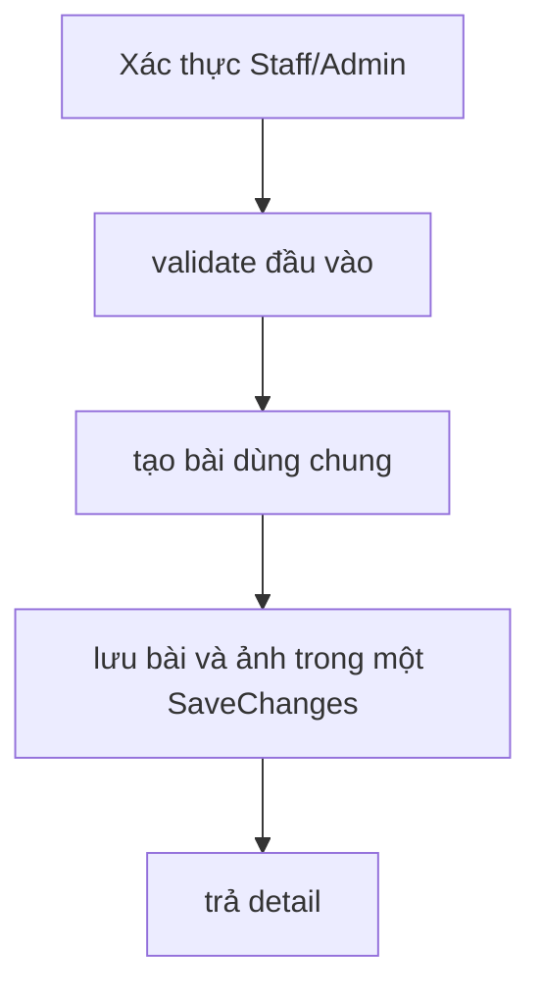

# CreatePostCore

Kiểm chứng ngày 2026-09-12 bằng HTTP cục bộ, JWT kiểm thử và PostgreSQL 16 riêng.

#### Request

`POST /api/v1/posts`

Policy: `StaffOrAdminPolicy`.

```json
{
  "title": "Hoa mùa thu",
  "content": "Nội dung gốc",
  "hashtag": "#hoa",
  "images": [
    {
      "imageUrl": "https://example.com/2.jpg",
      "sortOrder": 2
    },
    {
      "imageUrl": "https://example.com/1.jpg",
      "sortOrder": 1
    },
    {
      "imageUrl": "https://example.com/3.jpg",
      "sortOrder": 3
    }
  ]
}
```

#### Response

HTTP 200; payload và traceId ghi nhận từ lần chạy thực tế.

```json
{
  "value": {
    "baseImages": [
      {
        "id": "faa6efc9-5bcc-4f1d-81b5-2e391f2d3f91",
        "imageUrl": "https://example.com/1.jpg",
        "sortOrder": 1,
        "width": null,
        "height": null
      },
      {
        "id": "660b4417-732a-42cb-a5a1-cf7cd51be5ce",
        "imageUrl": "https://example.com/2.jpg",
        "sortOrder": 2,
        "width": null,
        "height": null
      },
      {
        "id": "160b023f-da2c-44a7-b032-fa2d2896d53e",
        "imageUrl": "https://example.com/3.jpg",
        "sortOrder": 3,
        "width": null,
        "height": null
      }
    ],
    "platforms": [],
    "basePostId": "e8e5bc6d-d39a-4588-bb19-5fa4ad426665",
    "title": "Hoa mùa thu",
    "content": "Nội dung gốc",
    "hashtag": "#hoa",
    "createdAt": "2026-09-14T08:10:57.971964+00:00",
    "updatedAt": null
  },
  "isSuccess": true,
  "isFailed": false,
  "error": null,
  "traceId": "0HNOI6UQF96NF:00000004",
  "timestampUtc": "2026-09-14T08:10:58.230164Z"
}
```

#### Flow diagram



#### Test case

- Tạo bài có 3 ảnh: 200, ảnh trả đúng thứ tự.
- Không có ảnh: 422; URL không phải HTTP(S), trùng thứ tự, title/content/hashtag quá dài: validator từ chối.
- BasePost không lưu UserId; không ghi PostHistory/ClientHistory.

Test tự động: `HoaTheoMua.Service.Test/PostGenTest/CreatePostCore.cs`; kiểm DB thật tại `PostGenPostgres.cs`.
