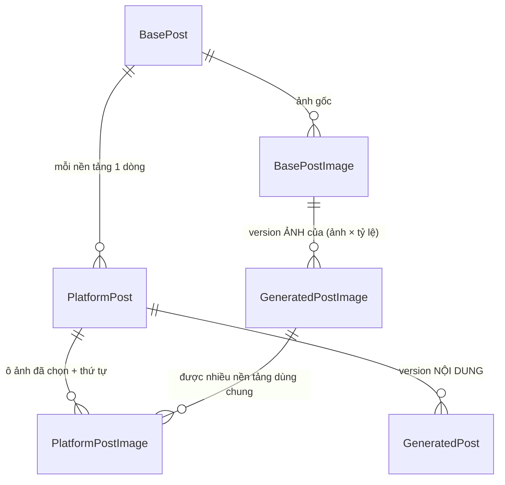

# PostGen — Mô hình dữ liệu

### Mô hình tổng thể



**Nội dung và ảnh có hai trục version hoàn toàn tách rời**, vì hai thứ này được tạo lại với nhịp khác nhau:

| | Đơn vị được đánh version | Thuộc về | Bảng |
| --- | --- | --- | --- |
| Nội dung | một bài nền tảng | `PlatformPost` | `GeneratedPost` |
| Ảnh | **một cặp (ảnh gốc × tỷ lệ)** | `BasePost` — **dùng chung mọi nền tảng** | `GeneratedPostImage` |

Điểm mấu chốt: **ảnh không thuộc về nền tảng nào.** "Ảnh A dựng lại theo tỷ lệ 4:5" là một thứ duy nhất trong phạm vi bài gốc. Facebook và Instagram cùng cần A@4:5 thì dùng chung đúng một tấm — gọi AI một lần, và hai nền tảng chắc chắn giống nhau. Nền tảng chỉ **chọn** dùng version nào.

Việc chọn bản chính thức vì vậy có hai phần độc lập:

- `PlatformPost.OfficialGenerationId` → **nội dung** chính thức (version nào của `GeneratedPost`).
- `PlatformPostImage` → mỗi **ô ảnh**: ảnh gốc nào, tỷ lệ nào, đang dùng version ảnh nào, xếp thứ mấy.

### Ví dụ đi hết một vòng

Post Core có 2 ảnh **A**, **B**. Facebook chọn `Portrait4x5` → [A], `Landscape16x9` → [A, B].

Bấm tạo, AI sinh 3 tấm — đây là 3 dòng `GeneratedPostImage`, mỗi cặp mới có đúng một version nên đọc ra đều là v1:

```
(A, Portrait4x5)   v1
(A, Landscape16x9) v1
(B, Landscape16x9) v1
```

Facebook có 3 dòng `PlatformPostImage`, mỗi dòng trỏ vào một tấm ở trên.

Giờ Instagram cũng chọn `Portrait4x5` → [A]. Cặp đó **đã có rồi** → không gọi AI lần nữa, Instagram trỏ thẳng vào `(A, Portrait4x5) v1`. Hai nền tảng dùng đúng một tấm ảnh.

Người dùng thấy `(A, Portrait4x5)` chưa ưng, bấm paraphase lại **riêng ô đó** với feedback "nền sáng hơn" → sinh ra `(A, Portrait4x5) v2`. Hai tấm còn lại không đụng tới, không tốn thêm lời gọi AI nào.

Sinh xong, v2 **chỉ nằm trong kho** — không ô nào tự đổi sang nó. Việc gán "ô này dùng version nào" là **một bước riêng ở cuối**, khi người dùng chốt nội dung và ảnh cho từng nền tảng.

Ở bước chốt đó, người dùng đặt ô `(A, Portrait4x5)` của Facebook sang v2 và để Instagram ở v1 — hai dòng `PlatformPostImage` trỏ vào hai version khác nhau của cùng một cặp. Đó chính là tình huống "Facebook xài A@4:5 phiên bản 1, Instagram xài A@4:5 phiên bản 2".

Tách như vậy có lý do: sinh ảnh là **thử nghiệm**, chốt ảnh là **quyết định**. Bấm paraphase lại vài lần để xem thử không nên làm thay đổi thứ đang hiển thị trên bài, chừng nào người dùng chưa nói "tôi lấy cái này".

### Hệ quả bắt buộc

Vì ảnh dùng chung giữa các nền tảng, **lời gọi sinh ảnh không được mang thông tin riêng của nền tảng**. Prompt sinh ảnh chỉ gồm: ảnh nguồn, tỷ lệ đích, kích thước pixel, yêu cầu giữ nguyên sản phẩm, chỉ dẫn chung lấy từ `Config: postgen.image_instruction`, và feedback của người dùng. Không ghép chuẩn nền tảng, không ghép `SystemPrompt`.

Nếu sau này nghiệp vụ cần ảnh khác nhau theo nền tảng thì tính dùng chung mất, phải đưa `Platform` xuống `GeneratedPostImage` và chấp nhận gọi AI nhiều lần cho cùng một cặp.

### BasePost — mở rộng

Bài Post Core dùng chung cho mọi Staff/Admin, không thuộc một user cụ thể.

| Cột | Kiểu | Ghi chú |
| --- | --- | --- |
| `Id` | uuid PK | giữ nguyên |
| `Title` | varchar(500) NOT NULL | **mới** |
| `Content` | text NOT NULL | giữ nguyên |
| `Hashtag` | varchar(1000) NULL | **mới**, lưu nguyên chuỗi người dùng nhập (`#hoa #tet`) |
| `ImageUrl` | — | **BỎ CỘT**. Ảnh chuyển hết sang `BasePostImage`; giữ lại sẽ sinh lỗi ghi hai nơi. Bảng đang là dead code nên bỏ cột không tốn gì |
| `CreatedAt` / `UpdatedAt` | timestamptz | **mới**, theo `IAuditableEntity` |
| `IsDeleted` | boolean DEFAULT false | **mới**, soft delete thủ công |

Entity chuyển sang `BaseEntity<Guid>, IAuditableEntity`. Index: `(CreatedAt DESC)`, filtered `IsDeleted = false`. BasePost dùng chung và không có cột UserId.

### BasePostImage — bảng mới

| Cột | Kiểu | Ghi chú |
| --- | --- | --- |
| `Id` | uuid PK | |
| `BasePostId` | uuid NOT NULL | FK → `BasePost`, `Cascade` |
| `ImageUrl` | varchar(2048) NOT NULL | frontend upload sẵn rồi gửi URL |
| `SortOrder` | int NOT NULL | thứ tự trong bài gốc |
| `Width` / `Height` | int NULL | client gửi lên, chuyển tiếp cho AI |
| `IsDeleted` | boolean DEFAULT false | |
| `CreatedAt` | timestamptz DEFAULT now() | |

Index: unique `(BasePostId, SortOrder)` filtered `IsDeleted = false`. Bài gốc được có 0–20 ảnh nguồn; validation không yêu cầu ít nhất một ảnh. POST cho phép bỏ images/null/[]; PUT vẫn gửi mảng đầy đủ, được phép rỗng. Không cần đổi schema.

### PlatformPost — bảng mới

Bài của **một nền tảng**, mỗi `BasePost` × `Platform` đúng một dòng.

| Cột | Kiểu | Ghi chú |
| --- | --- | --- |
| `Id` | uuid PK | |
| `BasePostId` | uuid NOT NULL | FK → `BasePost`, `Cascade` |
| `Platform` | `PlatformType` | native PG enum sẵn có, không thêm giá trị |
| `Status` | varchar(20) NOT NULL | `Draft`/`Generating`/`Generated`/`Failed`/`Ready` (+ `Scheduled`/`Publishing`/`Published`/`PublishFailed` chừa sẵn) |
| `OfficialGenerationId` | uuid NULL | FK → `GeneratedPost`, `Restrict` — version được chọn cho **nội dung** (kể cả version sửa tay) |
| `SelectedAt` | timestamptz NULL | |
| `LastError` | text NULL | |
| `UserId` | uuid NOT NULL | người thực hiện tạo, không dùng phân quyền sở hữu bài |
| `IsDeleted` / `CreatedAt` / `UpdatedAt` | | |
| `PlatformAccountId` | uuid NULL | FK → `PlatformAccount.Id`, Restrict từ mốc 11; chưa có API gán account cho bài trong mốc này |
| `ScheduledAt` | timestamptz NULL | **chừa sẵn** |
| `PublishedAt` | timestamptz NULL | **chừa sẵn** |
| `ExternalPostId` | varchar(200) NULL | **chừa sẵn** — id bài viết bên nền tảng |
| `PublishError` | text NULL | **chừa sẵn** |
| `PublishAttemptCount` | int NOT NULL DEFAULT 0 | **chừa sẵn** |

Index: unique `(BasePostId, Platform)` filtered `IsDeleted = false`; `(Status, ScheduledAt)` filtered `Status = 'Scheduled'` (rẻ, và scheduler phase sau cần đúng index này).

Các cột "chừa sẵn" **chỉ tạo cột, không endpoint nào ghi vào** ở đợt này.

### GeneratedPost — mở rộng thành "một version NỘI DUNG"

Chỉ lo nội dung. Không còn dính dáng gì tới ảnh.

| Cột | Kiểu | Ghi chú |
| --- | --- | --- |
| `Id` | uuid PK | giữ nguyên |
| `PlatformPostId` | uuid NOT NULL | **mới**, FK → `PlatformPost`, `Cascade` |
| `Source` | varchar(20) NOT NULL | **mới**, `Ai` / `Manual` |
| `ParentGeneratedPostId` | uuid NULL | **mới**, FK → `GeneratedPost`, `Restrict` — version mà lần này làm tiếp lên; `null` khi làm lại từ bài gốc |
| `Title` | varchar(500) NULL | **mới** — title AI sinh riêng cho nền tảng này |
| `Content` | text NOT NULL | giữ NOT NULL — mọi version nội dung đều có nội dung |
| `Hashtag` | varchar(1000) NULL | **mới** — hashtag AI sinh riêng cho nền tảng này |
| `FeedbackInput` | text NULL | **mới**, câu feedback khi paraphase lại |
| `SystemPromptId` | uuid NULL | Hiện có, FK → SystemPrompt; giữ cho lịch sử, không dùng cho version AI mới đọc prompt Config |
| `SystemPromptConfigId` | uuid NULL | **Đã migration** `20260914065606_AddPostGenSystemPromptConfigs`, FK → Config, Restrict; version AI mới tham chiếu prompt riêng theo nền tảng, Manual để null |
| `PromptSnapshot` | text NULL | **mới**, prompt thực tế đã gửi, lấy nguyên `Config(postgen.system-prompt.{platform}).Value.content` |
| `AiModel` | varchar(100) NULL | **mới**; null với version `Manual` |
| `AiRequestId` | varchar(200) NULL | **mới**, id đối soát với AI Service |
| `ErrorMessage` | text NULL | **mới** |
| `DurationMs` | int NULL | **mới** |
| `ImageUrl` | — | **BỎ CỘT** |
| `UserId` | uuid NOT NULL | giữ nguyên (index `(UserId, CreatedAt DESC)` sẵn có vẫn đúng nghĩa) |
| `CreatedAt` | timestamptz DEFAULT now() | giữ nguyên |

Index: `(PlatformPostId, CreatedAt, Id)` — phục vụ đánh số version lúc đọc; giữ `(UserId, CreatedAt DESC)`.

**Không có cột `VersionNo`** — số thứ tự phiên bản được tính lúc đọc, xem mục "Đánh số version lúc đọc".

Không cần cột `Status`: một version nội dung chỉ tồn tại khi AI đã trả về nội dung. Lời gọi thất bại thì không ghi dòng nào — ghi log ứng dụng và ném lỗi ra ngoài.

`GeneratedPost` không có `IsDeleted` — bảng append-only phục vụ audit.

### Sửa tay nội dung cũng là một version

Bản sửa tay **không** được để thành một cột `ContentOverride` trên `PlatformPost`. Lý do thấy ngay khi chạy kịch bản: tạo → paraphase lại → sửa tay → paraphase lại nữa. Nếu nội dung hiệu lực là `COALESCE(ContentOverride, …)` thì lần paraphase cuối sinh ra nội dung mới nhưng màn hình vẫn hiện bản sửa tay; còn nếu xóa `ContentOverride` đi thì công gõ tay của người dùng bốc hơi không dấu vết. Đằng nào cũng sai.

Cách làm: `Source = Manual`, bản sửa tay là một dòng `GeneratedPost` như mọi version khác.

| Version (tính lúc đọc) | Source | Parent | Content | AiModel |
| --- | --- | --- | --- | --- |
| v1 | `Ai` | — | A | gemini-… |
| v2 | `Ai` | v1 | B | gemini-… |
| **v3** | **`Manual`** | v2 | **B'** | `null` |
| v4 | `Ai` | v3 | C | gemini-… |

- Version `Manual` có `AiModel`, `PromptSnapshot`, `SystemPromptId`, `SystemPromptConfigId`, `DurationMs` đều null — không có lời gọi AI nào xảy ra.
- **Sửa tay xong tự động thành bản chính thức**: `OfficialGenerationId` trỏ ngay vào version `Manual` vừa tạo. Người dùng đã gõ tay thì hiển nhiên là muốn dùng nó.
- Muốn quay lại bản sửa tay sau này thì trỏ `OfficialGenerationId` về v3, y hệt cách quay về mọi version khác — không có đường đi riêng.
- **Chống đẻ version rác**: nếu version mới nhất đang là `Manual`, đồng thời là bản official hiện tại **và** chưa có version nào trỏ vào nó (`ParentGeneratedPostId`) thì ghi đè `Title`/`Content`/`Hashtag` tại chỗ, giữ nguyên dòng và `CreatedAt` nên số thứ tự đọc ra không đổi; ngược lại tạo version mới. Vừa giữ lịch sử sạch khi người dùng gõ vài chữ rồi lưu liên tục, vừa không phá tính bất biến của version đã bị tham chiếu.

### Nguồn của lần paraphase tiếp theo

Request `regenerate` mang đúng **một** trường `sourceGenerationId`, không dùng cờ nhị phân:

| `sourceGenerationId` | Nghĩa | `ParentGeneratedPostId` | `previousContent` gửi AI |
| --- | --- | --- | --- |
| `null` | làm lại từ bài gốc | `null` | `null` — AI nhận `BasePost.Content` + feedback |
| id của version đang chọn | sửa tiếp bản hiện tại (trường hợp thường gặp nhất) | id đó | nội dung của version đó, **kể cả bản sửa tay** |
| id của version cũ bất kỳ | **rẽ nhánh từ bản cũ** | id đó | nội dung của version cũ đó |

Một trường thay cho hai, và nó diễn đạt được nhiều hơn: cờ nhị phân chỉ trỏ được vào version đang chọn, trong khi thực tế người dùng hay muốn "v2 v3 đi sai hướng rồi, quay lại v1 sửa theo hướng khác". Giá trị nhận vào cũng chính là giá trị ghi thẳng vào `ParentGeneratedPostId`, không phải dịch qua lại.

Validate: `sourceGenerationId` phải là version thuộc đúng `PlatformPost` đang thao tác, nếu không → `BadRequestException`.

**Lệch tên giữa hai tầng là cố ý, đừng "sửa" lại**: request dùng `sourceGenerationId` / `sourceGeneratedPostImageId` (góc nhìn người dùng — "paraphase dựa trên cái này"), cột DB dùng `ParentGeneratedPostId` / `ParentGeneratedPostImageId` (góc nhìn dữ liệu — quan hệ cha con để dựng cây lịch sử). Cùng một giá trị, hai cách gọi đúng với tầng của nó.

`feedback` là **tùy chọn** ở cả nội dung lẫn ảnh: bỏ trống nghĩa là "cho tôi một bản khác". Nếu sau này thấy người dùng bấm liên tục không feedback rồi nội dung trôi xa bài gốc thì siết lại thành bắt buộc khi `sourceGenerationId != null` — đây là thay đổi một dòng validator, không đụng schema.

**Hệ quả lên giao diện**: lịch sử version không còn là một đường thẳng mà là **cây** — `sourceGenerationId = null` tạo một gốc mới, rẽ nhánh từ version cũ tạo một nhánh con. Màn hình lịch sử nên hiển thị theo cây, hoặc tối thiểu hiện nhãn "làm lại từ bài gốc" / "rẽ nhánh từ v1", nếu không người dùng sẽ không hiểu tại sao v4 chẳng liên quan gì tới v3.

Số thứ tự version vẫn đánh phẳng theo `CreatedAt` trong phạm vi `PlatformPost` — cây chỉ là quan hệ cha con để hiển thị, không đổi cách đánh số.

### GeneratedPostImage — bảng mới: một version ẢNH của cặp (ảnh gốc × tỷ lệ)

Thuộc `BasePost`, **không thuộc nền tảng nào**. Đây là kho ảnh dùng chung.

| Cột | Kiểu | Ghi chú |
| --- | --- | --- |
| `Id` | uuid PK | |
| `BasePostId` | uuid NOT NULL | FK → `BasePost`, `Cascade` — denormalize để truy vấn "mọi ảnh của bài gốc này" |
| `SourceBasePostImageId` | uuid NOT NULL | FK → `BasePostImage`, `Restrict` |
| `RatioCode` | varchar(20) NOT NULL | + `CHECK` theo enum trong code |
| `ParentGeneratedPostImageId` | uuid NULL | FK → self, `Restrict` — version mà lần này làm tiếp lên |
| `SourceImageUrl` | varchar(2048) NOT NULL | snapshot ảnh **thực sự đã gửi cho AI** — ảnh gốc khi `ParentGeneratedPostImageId = null`, ảnh của version cha khi có cha |
| `PixelWidth` / `PixelHeight` | int NOT NULL | snapshot — AI cần pixel, không phải chuỗi "4:5" |
| `ImageUrl` | varchar(2048) NULL | null khi sinh lỗi |
| `ImageExpiresAt` | timestamptz NULL | **chừa sẵn**, phòng khi URL của AI là link hết hạn |
| `StorageProvider` | varchar(50) NULL | **chừa sẵn**, `ai` hôm nay, `cloudinary`/`s3` sau này |
| `FeedbackInput` | text NULL | câu feedback khi paraphase lại đúng ô này |
| `Status` | varchar(20) NOT NULL | `Succeeded` / `Failed` |
| `ErrorMessage` | text NULL | |
| `AiModel` | varchar(100) NULL | |
| `AiRequestId` | varchar(200) NULL | |
| `DurationMs` | int NULL | |
| `CreatedAt` | timestamptz DEFAULT now() | |

Index: **`(SourceBasePostImageId, RatioCode, CreatedAt, Id)`** — trục version của ảnh, phục vụ đánh số lúc đọc; `(BasePostId, CreatedAt DESC)`.

**Không có cột `VersionNo`** — xem mục "Đánh số version lúc đọc".

CHECK: `("Status" = 'Succeeded' AND "ImageUrl" IS NOT NULL) OR "Status" <> 'Succeeded'` — không để lọt dòng "thành công nhưng không có ảnh".

Không có `IsDeleted` — append-only như `GeneratedPost`.

**Hiện thực tái sử dụng:** generate chỉ gom cặp trùng trong cùng request; chưa tự tìm và dùng lại giữa các request. Từ mốc 6, FE đọc kho bằng GET images và PUT chọn một version Succeeded đã có cho nền tảng khác, không gọi AI. POST images/regenerate luôn chủ động sinh một version mới và không đổi ô chốt.

### Hai tình huống paraphase ảnh

Giống hệt logic bên nội dung — `sourceGeneratedPostImageId` quyết định **ảnh nào được gửi cho AI**:

| `sourceGeneratedPostImageId` | Ảnh gửi cho AI | `ParentGeneratedPostImageId` |
| --- | --- | --- |
| `null` | **ảnh gốc** `BasePostImage.ImageUrl` | `null` |
| id của một version | **ảnh của version đó** | id đó |

Đối chiếu hai bên cho dễ nhớ:

| | Nội dung | Ảnh |
| --- | --- | --- |
| Đơn vị | bài nền tảng | cặp (ảnh gốc × tỷ lệ) |
| Trường request | `sourceGenerationId` | `sourceGeneratedPostImageId` |
| `null` | AI nhận `BasePost.Content` | AI nhận `BasePostImage.ImageUrl` |
| có id | AI nhận nội dung của version đó | AI nhận ảnh của version đó |
| Feedback | chỉ câu mới nhất | chỉ câu mới nhất |

**Feedback không cộng dồn** ở cả hai bên. Vì đầu vào đã là kết quả của lần trước, gửi lại feedback cũ sẽ áp hai lần — bảo "nền sáng hơn" trên tấm vốn đã được làm sáng thì ra tấm cháy sáng.

**Rủi ro cần biết khi paraphase nhiều đời liên tiếp**: mỗi lần dựng lại trên một tấm đã dựng là một lần nhòe thêm và sản phẩm lệch dần, trong khi yêu cầu nghiệp vụ là giữ nguyên sản phẩm và chi tiết nhận diện của ảnh gốc. Giảm thiểu bằng cách gửi kèm **ảnh gốc làm mốc nhận diện** trong cùng lời gọi (`originalImageUrl`, xem mục contract AI) để AI đối chiếu sản phẩm, chứ không chỉ đưa tấm đang sửa. Nếu sau vài đời ảnh vẫn lệch thì đường lùi luôn có sẵn: gửi `sourceGeneratedPostImageId = null` để dựng lại sạch từ ảnh gốc.

### PlatformPostImage — bảng mới: ô ảnh của một nền tảng

Một dòng = "nền tảng này cần ảnh gốc X ở tỷ lệ Y, hiện đang dùng version nào, xếp thứ mấy". Bảng này gộp cả ba việc: **cấu hình** (bước 3 của luồng), **lựa chọn chính thức**, và **thứ tự hiển thị**.

| Cột | Kiểu | Ghi chú |
| --- | --- | --- |
| `Id` | uuid PK | |
| `PlatformPostId` | uuid NOT NULL | FK → `PlatformPost`, `Cascade` |
| `SourceBasePostImageId` | uuid NOT NULL | FK → `BasePostImage`, `Restrict` — ảnh gốc nào |
| `RatioCode` | varchar(20) NOT NULL | tỷ lệ nào |
| `SelectedGeneratedPostImageId` | uuid NULL | FK → `GeneratedPostImage`, `Restrict` — version đang dùng; null khi chưa sinh xong hoặc sinh lỗi |
| `SortOrder` | int NOT NULL | thứ tự xuất hiện trên nền tảng |
| `CreatedAt` / `UpdatedAt` | timestamptz | |

- unique `(PlatformPostId, SourceBasePostImageId, RatioCode)` — một nền tảng không cấu hình trùng một ô
- index `(PlatformPostId, SortOrder)` **không unique** — cả tập được thay thế trong một `SaveChanges`, mà EF không đảm bảo DELETE chạy trước INSERT trong cùng một bảng; để unique thì thao tác đảo thứ tự vỡ giữa chừng. Tính duy nhất của `SortOrder` kiểm ở service và ném `BadRequestException`.
- CHECK: `SelectedGeneratedPostImageId` phải trỏ vào version có đúng `(SourceBasePostImageId, RatioCode)` — DB không diễn đạt được ràng buộc này bằng FK thường, nên **kiểm ở service**.
- Không có `IsDeleted` — bỏ ô thì xóa hẳn dòng.

Hai nền tảng cùng dùng một tấm ảnh thì là hai dòng `PlatformPostImage` cùng trỏ vào **một** `GeneratedPostImage.Id`. Muốn tách ra thì chỉ cần đổi `SelectedGeneratedPostImageId` của một bên sang version khác — không sinh thêm dữ liệu ảnh nào.

**Khi nào ô được điền**: chỉ **lượt sinh đầu tiên** tự điền `SelectedGeneratedPostImageId` bằng version vừa sinh — lúc đó mỗi cặp chỉ có đúng một version nên không có gì để chọn, bắt người dùng chốt thủ công là thừa. Từ đó về sau, **mọi lần sinh thêm đều không đụng tới ô nào**; đổi version là việc của bước chốt `PUT .../platforms/{platform}/images` (quyết định #19).

### Đánh số version lúc đọc

Không bảng nào lưu `VersionNo`. Lý do: số thứ tự là tài nguyên tranh chấp — muốn cấp số phải đọc `MAX + 1`, mà lời gọi AI kéo dài vài chục giây, nên hai người bấm cùng lúc sẽ cùng đọc ra `1` và cùng ghi `2`. Với ảnh thì chuyện này còn dễ xảy ra hơn vì cặp (ảnh gốc × tỷ lệ) dùng chung mọi nền tảng. Không lưu số nên không cấp MAX(versionNo)+1. Phần lưu ảnh dùng khóa BasePost ngắn và timestamp tăng dần; không giữ khóa trong lúc AI chạy, không tự retry AI.

Số thứ tự được tính lúc đọc, và **ổn định** nhờ đúng một bất biến: **`CreatedAt` và `Id` của một dòng không bao giờ thay đổi, và dòng không bao giờ bị xóa.** Chỉ cần giữ bất biến đó thì thứ tự không đổi, hôm nay là v2 thì mai vẫn là v2.

Lưu ý bất biến này nói về `CreatedAt`/`Id`, không cấm cập nhật các cột khác — chẳng hạn thao tác ghi đè version `Manual` cuối chỉ đổi `Content`/`Hashtag`, không đụng `CreatedAt`, nên số thứ tự vẫn nguyên. Ngược lại, **không được** xóa dòng version hay chỉnh `CreatedAt` để "sắp lại lịch sử" — làm vậy là đánh số lại toàn bộ phía sau.

**Phạm vi đánh số:**

| Đối tượng | `PARTITION BY` | `ORDER BY` |
| --- | --- | --- |
| Version nội dung | `PlatformPostId` | `CreatedAt, Id` |
| Version ảnh | `SourceBasePostImageId, RatioCode` | `CreatedAt, Id` |

```sql
-- Version ảnh của một bài gốc
SELECT  i.*,
        ROW_NUMBER() OVER (
            PARTITION BY i."SourceBasePostImageId", i."RatioCode"
            ORDER BY     i."CreatedAt", i."Id"
        ) AS "VersionNo"
FROM    "GeneratedPostImage" i
WHERE   i."BasePostId" = @basePostId;
```

**Bắt buộc có `Id` trong `ORDER BY`.** Cột `CreatedAt` mặc định `now()`, mà trong Postgres `now()` trả về thời điểm **bắt đầu transaction**, nên mọi dòng ghi trong cùng một `SaveChanges` sẽ có `CreatedAt` giống hệt nhau. Thiếu vế `Id` thì thứ tự trở nên không xác định và số version nhảy loạn giữa hai lần gọi API. Nếu muốn mốc thời gian thật sự khác nhau trong cùng transaction thì dùng `clock_timestamp()` thay cho `now()`, nhưng vế `Id` vẫn nên giữ.

**Cách hiện thực trong EF Core.** EF Core không dịch được `ROW_NUMBER()` từ LINQ. Hai lối đi:

1. **Đánh số trong bộ nhớ ở tầng service** — lối mặc định. Các API danh sách version luôn nạp trọn vẹn một phạm vi (mọi version nội dung của một bài nền tảng, hoặc mọi version ảnh của một bài gốc), số lượng vài chục dòng, nên nạp về rồi `OrderBy(CreatedAt).ThenBy(Id)` và đánh số bằng index là đủ.
2. **`FromSql` với câu SQL ở trên** — chỉ dùng khi thật sự cần phân trang bên trong một phạm vi.

**Ràng buộc phải tuân thủ:** nếu đánh số trong bộ nhớ thì **không được phân trang** danh sách version, vì trang 2 sẽ đánh số lại từ 1. Muốn phân trang thì bắt buộc dùng lối 2.

**Những chỗ không cần đánh số:**

- Lấy version mới nhất: `ORDER BY "CreatedAt" DESC, "Id" DESC LIMIT 1`.
- Kiểm tra cặp (ảnh gốc, tỷ lệ) đã có ảnh chưa: `EXISTS(... AND "Status" = 'Succeeded')`.
- Mọi API tham chiếu tới một version cụ thể đều dùng `Id`, không dùng số thứ tự. `VersionNo` chỉ là nhãn hiển thị.

### Hai cái bẫy khi hiện thực hóa

1. **FK vòng**: `PlatformPost.OfficialGenerationId → GeneratedPost` và `GeneratedPost.PlatformPostId → PlatformPost` trỏ lẫn nhau. `OfficialGenerationId` nullable + `Restrict`; `GeneratedPost.PlatformPostId` NOT NULL + `Cascade`, và service phải `SaveChanges` `GeneratedPost` trước, rồi mới gán `OfficialGenerationId` và lưu lần hai. Đây là chỗ dễ vấp nhất.
2. **Chống chạy song song**: generate hiện khóa dòng BasePost trong transaction ngắn (cùng khóa với PostCore update/delete), kiểm trạng thái các PlatformPost đích rồi đặt Generating trước khi commit và gọi HTTP. Trùng nền tảng đang sinh trả ConflictException; không giữ khóa trong lúc gọi AI. `content/regenerate` mốc 5 cần dùng cùng guard. `images/regenerate` không đổi trạng thái cả bài.

Một cái bẫy thứ ba từng có — hai nền tảng cùng paraphase lại một ô rồi giành nhau `VersionNo` — đã được **loại bỏ bằng thiết kế**: không lưu số thứ tự thì không có gì để giành.

### Cấu hình nền tảng — một Config prompt

Đã bỏ bảng PlatformStandard, các API riêng và namespace `postgen.platform.*`. Mỗi nền tảng dùng Config prompt để lưu bật/tắt và hướng dẫn biên tập; ratio preset vẫn riêng. Xem [PlatformConfig.md](PlatformConfig.md).

### System prompt riêng theo nền tảng — thiết kế cập nhật

Mỗi nền tảng có một prompt hoàn chỉnh trong Config: `postgen.system-prompt.facebook`, `postgen.system-prompt.instagram`, `postgen.system-prompt.zalo`. Dùng `Group = postgen`, `Kind = Setting`, `IsPublic = false`, `Value = {"isActive": true, "content": "..."}`. Không có prompt dùng chung tại runtime, không có Config chuẩn thứ hai. isActive=false chặn sinh nội dung; thiếu hoặc sai kiểu isActive cũng bị từ chối trước khi gọi AI. Backend chọn đúng key và chụp `value.content` vào `PromptSnapshot` trước khi gọi AI.

API Config hiện có đã lưu được các payload này. Migration `20260914065606_AddPostGenSystemPromptConfigs` đã thêm seed, unique index cho ba key active và SystemPromptConfigId. Generate đã đọc nguyên prompt Config và lưu snapshot khi tạo version AI. Ba payload đầy đủ ở [ParaphrasePromptData.md](ParaphrasePromptData.md).

Bảng SystemPrompt và dòng Type=Post do migration cũ tạo được giữ lại cho tương thích. GeneratedPost.SystemPromptId hiện trỏ bảng đó; migration mới đã bổ sung SystemPromptConfigId nullable FK tới Config, Restrict, dành cho version AI mới. Không đổi đích FK cũ hay gán Config.Id vào SystemPromptId. Version Manual không có tham chiếu prompt.

Sinh ảnh vẫn dùng `postgen.image_instruction`, không dùng ba system prompt sinh nội dung.

### PostHistory và ClientHistory — KHÔNG dùng

Không đụng tới hai bảng này: không thêm cột, không sửa index, không ghi dòng nào. Chúng tiếp tục nằm trong DB ở trạng thái chưa ai dùng như hiện nay.

Lý do bỏ `PostHistory`: mọi thứ nó định lưu thì **chính dòng version đã lưu rồi** — `PromptSnapshot`, `SystemPromptId`, `AiModel`, `AiRequestId`, `DurationMs`, `FeedbackInput`, `ErrorMessage` đều nằm sẵn trên `GeneratedPost` và `GeneratedPostImage`. Thêm một bảng nữa chỉ để chép lại là trùng lặp không đổi lấy được gì.

Cái mất đi, và cách bù:

| Mất | Bù bằng |
| --- | --- |
| Dấu vết lời gọi sinh **nội dung** thất bại | Log ứng dụng. Lời gọi nội dung lỗi làm hỏng cả request, người dùng nhận 502 ngay nên không cần bản ghi lâu dài |
| Payload thô gửi/nhận AI | Log ứng dụng khi bật mức chi tiết; `PromptSnapshot` đã giữ phần quan trọng nhất |
| Đếm tổng số lời gọi AI để đối soát hóa đơn | Chưa có. **Nếu sau này cần đối soát chi phí thì đây là lý do chính đáng để bật lại bảng này** |

Ảnh sinh lỗi **vẫn được lưu** thành dòng `GeneratedPostImage` với `Status = Failed`, vì đó là lỗi *một phần* nằm trong một lượt sinh thành công — ô ảnh phải hiện được "chỗ này lỗi, bấm sinh lại". Nội dung thì khác: lỗi là hỏng cả lượt, không có gì để hiển thị. Sự bất đối xứng này là cố ý. Giữ nội dung lỗi ra ngoài bảng còn một lợi ích: số thứ tự version tính lúc đọc không đếm phải những lần thử hỏng, nên người dùng thấy v1 → v2 liền mạch chứ không nhảy cóc.

`ClientHistory` là bảng feed sản phẩm dùng chung với Flower/Card; PostGen chưa có yêu cầu nào cần feed đó. Khi nào cần màn hình "những gì tôi đã tạo" gộp cả ba thì ghi **một dòng cho mỗi version nội dung sinh xong**: `Type = Post`, `RootId = BasePost.Id`, `BaseId = PlatformPost.Id`, `OutputId = GeneratedPost.Id`. Unique `(Type, OutputId)` sẵn có khi đó vẫn đúng.

### Enum mới (khai báo trong `Enum/AiContentTypes.cs`)

```csharp
public enum AspectRatioType    { Square1x1, Portrait4x5, Portrait3x4, Story9x16, Landscape16x9 }
public enum PlatformPostStatus { Draft, Generating, Generated, Failed, Ready, Scheduled, Publishing, Published, PublishFailed }
public enum ContentSource      { Ai, Manual }
public enum ImageStatus        { Succeeded, Failed }
```

- Lưu xuống DB dạng `varchar` + `CHECK constraint`, **không** dùng native PG enum → thêm giá trị mới chỉ cần sửa check constraint, không phải `ALTER TYPE` + đồng bộ `MapEnum` trong `Program.cs`.
- AI cần **kích thước pixel**, không phải chuỗi `"4:5"` → map cố định trong code:

| AspectRatio | Pixel | Cấu hình mặc định |
| --- | --- | --- |
| `Square1x1` | 1080 × 1080 | Mọi nền tảng |
| `Portrait4x5` | 1080 × 1350 | Mọi nền tảng |
| `Portrait3x4` | 1080 × 1440 | Mọi nền tảng |
| `Story9x16` | 1080 × 1920 | Instagram, Facebook, Zalo |
| `Landscape16x9` | 1920 × 1080 | Mọi nền tảng |

Tỷ lệ chọn cho từng nền tảng chỉ lưu tại **Config → postgen.ratio-preset**. Mọi nền tảng có thể chọn bất kỳ mã nào trong 5 tỷ lệ của enum. Không có danh sách tỷ lệ cho phép riêng trong Config chuẩn nền tảng và không có ForPlatform. Shape dự kiến: mã hợp lệ, danh sách 1–5 phần tử và không trùng; API Config chung hiện không validate các quy tắc ratio này. Pixels vẫn ánh xạ tỷ lệ sang kích thước cố định.

### Cấu hình tái sử dụng

Preset dùng **bảng `Config` sẵn có**, group `postgen`, key `postgen.ratio-preset`, `Value` là jsonb. Cấu hình dùng chung cho mọi Staff/Admin, không lọc hay tạo bản riêng theo `UserId`. API Config chung lưu `UserId` của người tạo; trường này không phân tách preset theo user. Bản ghi cũ có `UserId = Guid.Empty` vẫn đọc/sửa được.

Đọc theo `Group`, `Key`, `!IsDeleted`. Partial unique index `IX_Configs_PostGenRatioPreset` trên `(Group, Key)` bảo đảm chỉ một preset còn hiệu lực. Index này có tên riêng để không thay thế index `card_config` có cùng các cột.

Từ 2026-09-14, quản trị qua API Config chung với `AdminPolicy`: GET settings lấy id, POST nếu chưa có, PUT theo id nếu đã có, DELETE theo id để xóa mềm. PUT thay toàn bộ `Value`; không có upsert hay validator ratio riêng. Giữ `IsPublic = false`. Xem [RatioPresetConfig.md](RatioPresetConfig.md).

Preset **không thể** lưu "ảnh nào ra tỷ lệ nào", vì ảnh nguồn thuộc về từng Post Core cụ thể. Nó lưu danh sách tỷ lệ theo nền tảng + một quy tắc chọn ảnh:

```json
{ "facebook":  { "ratios": ["Square1x1", "Landscape16x9"], "imageSelectionMode": "all_images" },
  "instagram": { "ratios": ["Portrait4x5", "Story9x16"],   "imageSelectionMode": "first_n", "imageCount": 3 } }
```

`imageSelectionMode` ∈ `all_images` | `first_n` (quyết định #20). Khi bấm tạo với `usePreset = true`, server khai triển preset thành danh sách cặp `(ảnh gốc, tỷ lệ)` cụ thể theo số ảnh bài đó đang có; `first_n` mà bài ít ảnh hơn `imageCount` thì lấy hết số đang có, không báo lỗi — preset dùng lại cho nhiều bài có số ảnh khác nhau.

### Dữ liệu khởi tạo bắt buộc

Không có mấy dòng này thì `generate` ném lỗi ngay từ lần gọi đầu. **Seed bằng `migrationBuilder.InsertData` trong chính migration**, không để admin nhập tay — feature sẽ chết ngay sau khi deploy nếu quên.

| Bảng | Dòng cần có | Nội dung |
| --- | --- | --- |
| `Config` | 3 key `postgen.system-prompt.facebook`, `postgen.system-prompt.instagram`, `postgen.system-prompt.zalo` | Ba prompt hoàn chỉnh độc lập trong value.content; đã seed trong migration AddPostGenSystemPromptConfigs, giữ bản active đã có |
| `Config` | `postgen.image_instruction` | Chỉ dẫn sinh ảnh dùng chung, group `postgen`, `UserId = Guid.Empty` |
| `Config` | `postgen.enabled` | Cờ bật/tắt, mặc định `true` |

Giới hạn biên tập nằm trong prompt. Giới hạn chính thức của từng nền tảng và kiểm tra trước khi xuất bản sẽ thiết kế ở phase đăng bài; không có Config standard riêng.

### Giới hạn validate

FluentValidation trong `Validate/`, chạy bởi `ValidationActionFilter` → 422. Giới hạn generate nội dung/ảnh đã áp dụng trong mốc 4; feedback dành cho mốc 5/6; không áp dụng validation ratio cho `Value` khi lưu qua API Config chung.

| Trường | Giới hạn |
| --- | --- |
| `BasePost.Title` | bắt buộc, ≤ 500 ký tự |
| `BasePost.Content` | bắt buộc, ≤ 20000 ký tự (bằng mức `SystemPrompt.Content` đang dùng) |
| `BasePost.Hashtag` | ≤ 1000 ký tự |
| Ảnh của Post Core | ≥ 1, ≤ 20 ảnh; mỗi `ImageUrl` phải là http(s) tuyệt đối, ≤ 2048 ký tự |
| Nền tảng mỗi lần `generate` | ≥ 1, không trùng nhau |
| Tỷ lệ mỗi nền tảng | ≥ 1, ≤ 5, mã thuộc AspectRatioType, không trùng; không hạn chế theo nền tảng |
| `basePostImageIds` mỗi tỷ lệ | rỗng nghĩa là "tất cả ảnh của bài"; nếu có thì mọi id phải thuộc bài đó |
| Số cặp phải sinh mỗi lượt | ≤ `MaxImagesPerGeneration` (12) sau khi gom và loại trùng toàn bộ nền tảng |
| `feedback` | tùy chọn, ≤ 2000 ký tự |
| `sortOrder` | ≥ 1, không trùng trong cùng một nền tảng |

Rule URL http(s) hiện bị copy-paste ở `CardTemplate/Validate` và `Mockup/Validate`; PostGen sẽ cần khoảng 6 chỗ nữa nên trích ra `HttpUrl()` dùng chung trong `Common/ValidationRules.cs` ngay từ đầu.


## Ghi chú hiện thực mốc 0–2 (2026-09-12)

- Migration: `20260912053534_AddPostGenCore`. Dùng đúng native enum sẵn có, không thêm giá trị enum; cột mới `PlatformPost.Platform` khai báo kiểu `"PlatformType"` có quote trong DDL để PostgreSQL giữ hoa/thường.
- Migration kiểm tra `BasePost`/`GeneratedPost` rỗng trước khi bỏ cột ảnh cũ. Nếu có dữ liệu ngoài giả định của kế hoạch, migration dừng và rollback; cần thiết kế backfill riêng.
- `SystemPrompt(Post)` có thể đã được admin tạo. Seed dùng `INSERT ... ON CONFLICT ("Type") DO NOTHING` để giữ prompt hiện có. Migration cũ seed PlatformStandard và hai config toàn hệ thống; migration mới chuyển các chuẩn sang Config rồi bỏ bảng.
- Thêm unique index `(Group, Key)` trên `Configs`, chỉ áp dụng cho preset PostGen còn hiệu lực. Index ngăn tạo trùng preset; việc tạo/sửa dùng API Config chung, không có upsert preset. Index `card_config` vẫn giữ nguyên.
- `GeneratedPost.PlatformPostId` là NOT NULL; `PlatformPost.OfficialGenerationId` nullable. Chỉ chiều trỏ về version chính thức nullable. Khi sinh nội dung ở mốc sau, lưu version trước rồi cập nhật con trỏ chính thức.
- `PlatformPost.Platform` xác định key `postgen.system-prompt.{platform}`. GeneratedPost.SystemPromptConfigId lưu tham chiếu prompt đã dùng.
- PUT Post Core nhận toàn bộ tập ảnh hiện tại. Ảnh giữ lại có `id`; ảnh mới không có `id`. Không đổi URL trên ID cũ: thay ảnh bằng dòng mới để giữ nguồn của lịch sử. Ảnh bị bỏ đánh `IsDeleted = true`, version và ô nền tảng cũ được giữ nguyên.
- Khi đảo thứ tự ảnh gốc, service khóa dòng bài gốc, tạm soft delete ảnh trong một lần flush rồi lưu tập cuối, tất cả nằm trong một transaction. Đọc bên ngoài transaction không thấy trạng thái tạm.
- DELETE khóa bài gốc, soft delete bài, ảnh gốc và bài nền tảng; không xóa version. PUT/DELETE từ chối bài có nền tảng đang `Generating`.
- Ràng buộc phải kiểm ở service của các mốc sau: version thuộc đúng bài/cặp ảnh, ảnh được chọn phải `Succeeded`, thứ tự ô không trùng, chuyển `Ready` và guard sinh đồng thời.

## Kiểm chứng và rollback

Chạy migration trên PostgreSQL riêng, kiểm tra seed, index, FK vòng và CHECK. Không áp dụng vào DB dùng chung để kiểm thử. `Down` của AddPostGenSystemPromptConfigs giữ toàn bộ Config và từ chối bỏ cột nếu có SystemPromptConfigId khác null. `Down` của migration AddPostGenCore cũ bỏ schema PostGen và chỉ xóa các seed có ID cố định của migration; việc downgrade sau khi đã dùng feature sẽ mất dữ liệu PostGen, cần sao lưu trước. Kiểm chứng thực tế ghi tại `Implementation.md`.

Mapping EF của bốn native enum sẵn có cũng dùng tên có quote (`\"PlatformType\"`, `\"SystemPromptType\"`, `\"CardFormType\"`, `\"ClientHistoryType\"`). Đây là sửa metadata để câu SQL so sánh enum không bị PostgreSQL đổi tên type thành chữ thường; không đổi schema hay giá trị enum.


## Migration chuẩn nền tảng sang Config (2026-09-14)

`20260914055741_MovePlatformStandardsToConfig` chuyển dữ liệu trước khi drop bảng, giữ ID/metadata/xóa mềm và chặn xung đột key hoặc ID. Index `IX_Configs_PostGenPlatforms` từng áp dụng cho ba key; đã bị migration ConsolidatePostGenPlatformConfigs bỏ. Down khôi phục bảng từ Config trong transaction và từ chối JSON không biểu diễn được hoặc nhiều bản ghi cùng nền tảng.

## Migration gộp Config (2026-09-14)

`20260914073414_ConsolidatePostGenPlatformConfigs` bổ sung isActive vào prompt còn hiệu lực, giữ prompt/ID/FK/snapshot, xóa toàn bộ postgen.platform.* trong group postgen và bỏ index của các key đó. JSON không hợp lệ làm Up dừng nguyên transaction. Down bị chặn vì các mô tả/giới hạn đã loại bỏ; muốn quay lại phải khôi phục backup trước migration. Chi tiết quy tắc chuyển trạng thái ở [PlatformConfig.md](PlatformConfig.md).

## Response nội dung chốt (cập nhật 2026-09-14)

GeneratedPost tiếp tục lưu lịch sử các lần sinh. Response generate/GET PostCoreDetail chỉ trả một `platforms[].content` theo OfficialGenerationId (hoặc null), không trả `platforms[].versions`. VersionNo vẫn tính theo lịch sử và không đổi khi chọn bản cũ. API lịch sử riêng nằm ở mốc 5; thay đổi response này không cần migration.

Response `PostCoreDetail` không trả `value.images`. `platforms[].images` chỉ chứa ảnh thành công đang được chọn, kèm URL và kích thước theo `SortOrder`; `baseImages` vẫn là ảnh nguồn. Kho ảnh và slot chưa chọn vẫn giữ trong database, không đổi schema. API lịch sử ảnh riêng dự kiến ở mốc 6.

Mốc 4: PixelWidth/PixelHeight của GeneratedPostImage là kích thước mục tiêu theo AspectRatios; proxy chỉ trả Markdown URL, chưa có kích thước thực hoặc expiresAt. Không download/rehost ảnh. Chỉ dẫn ảnh đọc từ Config postgen.image_instruction. HTTP 200 vẫn có thể chứa nền tảng Failed khi mọi ảnh yêu cầu lỗi; nội dung thành công vẫn được lưu.

## Hiện thực version nội dung mốc 5

Không đổi schema. Mọi mutation mốc 5 khóa BasePost FOR UPDATE như generate/CRUD; regen claim nền tảng rồi nhả transaction trước gọi AI. Sửa/chốt bị chặn khi Generating, nên nguồn Manual không thể bị ghi đè lúc AI đang sử dụng. Persist version + official cùng transaction; rollback không để version rác hoặc thay đổi Manual dở dang.

Sửa tay mới có parent là official hiện tại. Chỉ ghi đè Manual mới nhất nếu chính nó đang official và chưa có child; giữ Id/CreatedAt/parent, cập nhật UserId người sửa cuối. Chọn lại bản cũ rồi sửa tạo nhánh mới. API history chứa phiên bản theo thứ tự cũ → mới và officialId; detail không trả mảng lịch sử. Manual/select giữ trạng thái và ảnh, regenerate thành công chốt mới và Generated, lỗi giữ con trỏ cũ và Failed.

## Hiện thực mốc 6 — version và lựa chọn ảnh

Ba API mới không đổi schema. Image history trả groups/version, bao gồm Failed và nguồn soft delete; selectedPlatforms lấy từ ô của nền tảng còn hiệu lực. Không có lịch sử ảnh lồng trong GET detail. Regenerate không thay các version cũ hoặc con trỏ nào. Khi caller hủy hoặc nguồn/bài bị xóa trong lúc AI chạy, không lưu kết quả mới; lỗi provider bình thường lưu Failed với URL null. Config instruction dùng chung, không trộn prompt từng nền tảng.

Để số version ảnh không đổi khi hai AI hoàn tất khác thứ tự, generate/regenerate khóa BasePost ngay trước insert, gán CreatedAt lớn hơn timestamp ảnh cuối của bài (độ chính xác microsecond PostgreSQL), rồi lưu/commit nguyên tử. ID/CreatedAt không đổi sau lưu. Không có trạng thái pending hoặc job durable cho lượt regenerate; client không tự retry.

PUT ảnh kiểm toàn bộ request trước mutation: tối đa 100 ô, source còn hiệu lực, cặp/thứ tự không trùng, selected version đúng bài/cặp và Succeeded có URL. Bỏ ô xóa PlatformPostImage, giữ lịch sử; ô cùng cặp được cập nhật tại chỗ. Một transaction khóa root bảo vệ cả cập nhật/xóa/thêm ô và readiness. GET history không khóa dài, là trạng thái đọc tại thời điểm request; chưa phân trang, chưa có ETag cho PUT.

## Hiện thực mốc 7 — đọc payload official

Không đổi schema. GetOfficialVersion đọc bài/nền tảng, chính xác content được OfficialGenerationId trỏ tới (scoped PlatformPost), và các ảnh SelectedGeneratedPostImageId hợp lệ cùng bài/cặp, Succeeded có URL. Dùng transaction Repeatable Read + AsNoTracking/projection để cả mutable Manual và tập ảnh cùng thuộc một snapshot; GET không ghi gì.

Readiness tính từ payload thật: có content không rỗng và ít nhất một ảnh thành công được chọn, không Generating hoặc trạng thái publish. Response có status/isReady/notReadyReasons; status ở đây là trạng thái payload, không cập nhật PlatformPost.Status. Ảnh nguồn bị soft delete không làm mất snapshot ảnh kết quả đã chốt. Mốc này không đóng băng payload cho tương lai; phase publish cần snapshot/idempotency riêng.


## Hiện thực mốc 11 — tài khoản và phiên OAuth

Migration `20260914120000_AddPostGenPlatformAccounts` thêm hai bảng, index và FK từ `PlatformPost.PlatformAccountId`. Dùng lại native `PlatformType`, không thêm giá trị enum hoặc thay schema SystemPrompt/Config. Chi tiết API: [PlatformAccounts.md](PlatformAccounts.md).

| Bảng | Cột và ràng buộc |
| --- | --- |
| PlatformAccount | Id uuid PK; Platform native PlatformType; ExternalAccountId varchar(128) NOT NULL; PageId varchar(128) NULL; DisplayName varchar(300) NOT NULL |
| PlatformAccount | Status varchar(20) CHECK Connected/ReauthRequired/Disabled; GrantedScopes text[] NOT NULL; ProtectedCredentials text NULL (AES-GCM); Connected bắt buộc có ciphertext |
| PlatformAccount | AccessTokenExpiresAt/RefreshTokenExpiresAt/LastValidatedAt timestamptz NULL; LastErrorCode varchar(80) NULL; ConnectedBy uuid NOT NULL (claim, không FK sang bảng User) |
| PlatformAccount | CreatedAt timestamptz NOT NULL; UpdatedAt timestamptz NULL; Revision bigint NOT NULL làm concurrency token; IsDeleted boolean NOT NULL |
| PlatformAccount | RefreshLeaseId uuid NULL; RefreshLeaseUntil timestamptz NULL; unique (Platform, ExternalAccountId) cho cả Disabled; index (Status, AccessTokenExpiresAt) |
| PlatformOAuthSession | Id uuid PK; Platform native PlatformType; StateHash varchar(64) NOT NULL unique; BrowserHash varchar(64) NOT NULL; ProtectedVerifier text NULL |
| PlatformOAuthSession | RequestedBy uuid NOT NULL; TargetAccountId uuid NULL FK → PlatformAccount Restrict; TargetRevision bigint NULL; CreatedAt/ExpiresAt timestamptz NOT NULL; UsedAt timestamptz NULL; index ExpiresAt và TargetAccountId |

Account dùng chung cho Admin, không có bảng User local. Disconnect giữ row/ID, chuyển Disabled và xóa ciphertext; không đặt IsDeleted để FE còn reconnect và lịch sử còn tham chiếu. Không xóa hard account đang được bài/phiên OAuth tham chiếu.

State được claim bằng khóa hàng trong transaction ngắn rồi ghi UsedAt/xóa verifier trước HTTP. Lưu callback nhiều account cùng transaction; advisory lock theo nền tảng/external ID chống insert trùng và khóa account bảo vệ revision. Reconnect chỉ cập nhật đúng ID/revision ban đầu. General connect không kích hoạt lại account Disabled.

Refresh claim lease trong transaction, gọi provider ngoài transaction, lưu với kiểm lease mới nhất. Crash/timeout của refresh Zalo cần reconnect vì token một lần có thể đã bị tiêu thụ. Disconnect/reconnect thắng kết quả refresh cũ. Khi tích hợp job mốc 12–14, writer gán account/lập lịch phải khóa cùng row account và kiểm Connected để không đua với disconnect.

Nâng cấp có guard: nếu cột PlatformAccountId dành sẵn đang có giá trị từ ngoài API PostGen thì migration dừng, không tự xóa hoặc sửa giá trị; cần đối soát trước. Down bỏ FK/index trên PlatformPost rồi bỏ hai bảng mới, mất dữ liệu account/session nên chỉ dùng trên DB thử hoặc theo quy trình rollback có backup. Upgrade/downgrade/guard đã được kiểm bằng PostgreSQL local.
