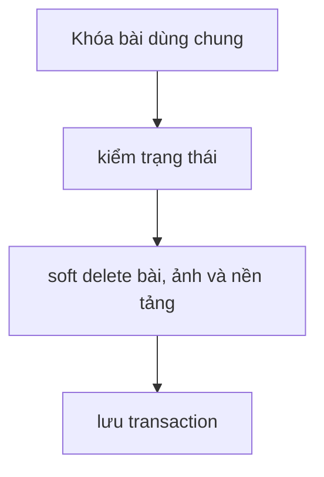

# DeletePostCore

Kiểm chứng ngày 2026-09-12 bằng HTTP cục bộ, JWT kiểm thử và PostgreSQL 16 riêng.

#### Request

`DELETE /api/v1/posts/8a99eb32-6df5-458e-aa2a-27e1bb45087a`

Policy: `StaffOrAdminPolicy`.

#### Response

HTTP 200; payload và traceId ghi nhận từ lần chạy thực tế.

```json
{
  "value": {
    "basePostId": "8a99eb32-6df5-458e-aa2a-27e1bb45087a",
    "isDeleted": true
  },
  "isSuccess": true,
  "isFailed": false,
  "error": null,
  "traceId": "0HNOGJJRTDS8B:00000017",
  "timestampUtc": "2026-09-12T07:10:48.215459Z"
}
```

#### Flow diagram



#### Test case

- Staff/Admin khác cũng xóa được bài dùng chung.
- DB vẫn giữ bài, ảnh gốc và version; bài/ảnh/nền tảng được soft delete.
- Danh sách và detail không trả bài đã xóa; đang Generating: 409.

Test tự động: `HoaTheoMua.Service.Test/PostGenTest/DeletePostCore.cs`; kiểm DB thật tại `PostGenPostgres.cs`.
