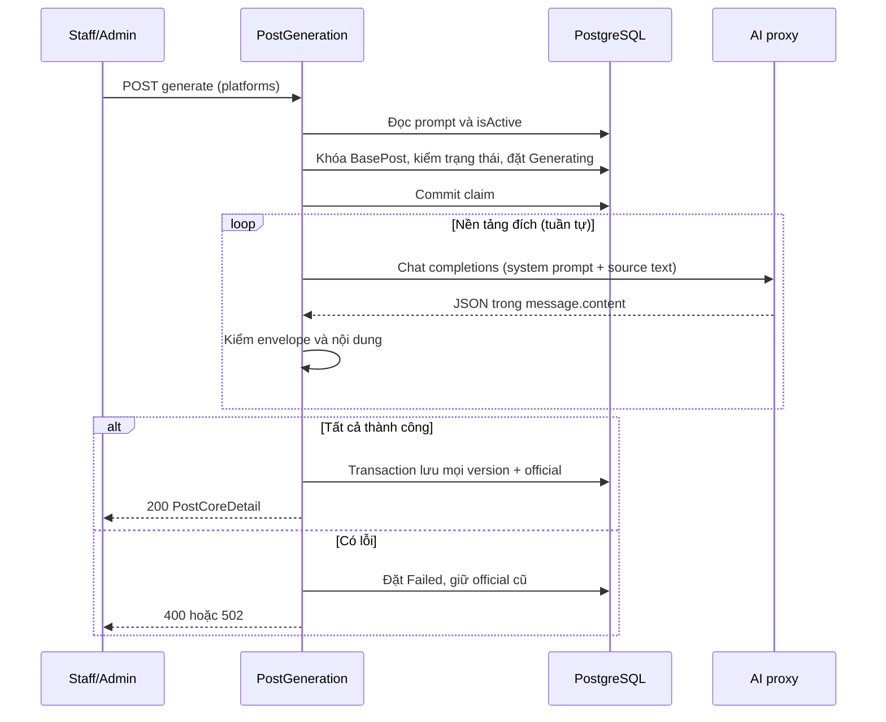

# GeneratePlatformPosts

Mốc 3 đã hiện thực ngày 2026-09-14. Endpoint chỉ sinh nội dung; sinh ảnh là mốc 4.

#### Request

`POST /api/v1/posts/{id:guid}/generate` — JWT Staff/Admin, rate policy `heavy`.

```json
{"platforms":[{"platform":"facebook"},{"platform":"instagram"}]}
```

Một đến ba nền tảng, không trùng; platform bắt buộc là facebook/instagram/zalo. `usePreset=true` hoặc `ratios` có giá trị trả 422 để tránh bỏ qua yêu cầu sinh ảnh. Có thể gửi usePreset=false hoặc bỏ trường này.

Bài phải tồn tại và chưa xóa. Mỗi nền tảng chỉ cần Config prompt private, Kind=Setting, value.content không rỗng và value.isActive=true. Không đọc postgen.platform.* hoặc maxContentLength nữa. Không dùng prompt Post cũ làm fallback. Config.enabled=false chặn trước khi gọi AI.

#### Response

HTTP 200, cùng shape với GET chi tiết bài. Mỗi platform chỉ có một object content chốt hoặc null; không có mảng versions. Lịch sử vẫn giữ trong database, API đọc lịch sử riêng sẽ triển khai ở mốc 5. Payload thực tế từ HTTP probe dùng PostgreSQL và fake AI response:

```json
{
  "value": {
    "baseImages": [
      {
        "id": "160b023f-da2c-44a7-b032-fa2d2896d53e",
        "imageUrl": "https://example.com/3.jpg",
        "sortOrder": 1,
        "width": null,
        "height": null
      },
      {
        "id": "660b4417-732a-42cb-a5a1-cf7cd51be5ce",
        "imageUrl": "https://example.com/2.jpg",
        "sortOrder": 2,
        "width": null,
        "height": null
      },
      {
        "id": "faa6efc9-5bcc-4f1d-81b5-2e391f2d3f91",
        "imageUrl": "https://example.com/1.jpg",
        "sortOrder": 3,
        "width": null,
        "height": null
      }
    ],
    "platforms": [
      {
        "platformPostId": "1c0eeab6-cd4c-4f64-a923-4ab09b875660",
        "platform": "facebook",
        "status": "Generated",
        "lastError": null,
        "content": {
          "generationId": "ee6e7cb3-ce48-4bf4-a0f0-bc7d76364207",
          "parentGeneratedPostId": null,
          "versionNo": 1,
          "source": "Ai",
          "title": "Bó hoa Cảm Ơn",
          "content": "Nội dung AI kiểm thử",
          "hashtag": "#HoaTheoMua",
          "createdAt": "2026-09-14T08:10:58.55794+00:00"
        },
        "images": []
      },
      {
        "platformPostId": "5d61cec9-8836-4a29-814b-5e00b7a5c41e",
        "platform": "instagram",
        "status": "Generated",
        "lastError": null,
        "content": {
          "generationId": "82f6814b-d8bb-4673-a5e8-91f4c95c6600",
          "parentGeneratedPostId": null,
          "versionNo": 1,
          "source": "Ai",
          "title": "Bó hoa Cảm Ơn",
          "content": "Nội dung AI kiểm thử",
          "hashtag": "#HoaTheoMua",
          "createdAt": "2026-09-14T08:10:58.558341+00:00"
        },
        "images": []
      }
    ],
    "basePostId": "e8e5bc6d-d39a-4588-bb19-5fa4ad426665",
    "title": "Title đã sửa",
    "content": "Nội dung gốc",
    "hashtag": "#hoa",
    "createdAt": "2026-09-14T08:10:57.971964+00:00",
    "updatedAt": "2026-09-14T08:10:58.435467+00:00"
  },
  "isSuccess": true,
  "isFailed": false,
  "error": null,
  "traceId": "0HNOI6UQF96NF:0000000F",
  "timestampUtc": "2026-09-14T08:10:58.639553Z"
}
```

Mỗi lần gọi thành công tạo một version Ai mới cho từng nền tảng được chọn, ParentGeneratedPostId=null (nguồn là BasePost), tự chọn official và chuyển Generated. Không sửa version cũ hoặc các nền tảng ngoài request. Chưa tạo ảnh; `platforms[].images` rỗng trên bài mới. Response không có `value.images`; ảnh chốt trả trực tiếp URL và kích thước khi có dữ liệu.

Nếu bất kỳ lời gọi nội dung nào lỗi, không ghi version mới nào của request; giữ official cũ và chuyển các nền tảng đã claim sang Failed. Ví dụ lỗi ở nền tảng thứ hai:

```json
{
  "title": "Bad Gateway",
  "status": 502,
  "detail": "An unexpected error occurred.",
  "messageCode": "BAD_GATEWAY",
  "errors": {
    "detail": "AI service is unavailable"
  },
  "traceId": "0HNOI6FP5HTLF:00000010",
  "timestampUtc": "2026-09-14T07:44:03.555335Z"
}
```

#### Flow diagram



#### Test case

| Trường hợp | Kết quả |
| --- | --- |
| Hai nền tảng hợp lệ | Hai PlatformPost, hai GeneratedPost, official v1 |
| Ba prompt khác nhau, sửa Facebook | Chỉ prompt Facebook thay đổi; snapshot cũ giữ nguyên |
| Thiếu/rỗng/sai JSON/xóa prompt, tắt nền tảng hoặc PostGen | 400 trước khi gọi AI |
| Cùng nền tảng đang sinh | 409; không gọi AI lần hai |
| Sửa/xóa BasePost đang sinh | 409 |
| Nền tảng thứ hai lỗi AI | 502; không thêm version ở cả hai nền tảng |
| Ghi official thất bại | Transaction rollback toàn bộ version mới, official trước giữ nguyên |
| Caller hủy request | Hủy HTTP, cleanup trạng thái bằng token riêng |
| Proxy timeout/5xx, JSON hỏng hoặc hỏi lại | 502, không retry, không tạo version |
| Customer gọi endpoint | 403 |
| Trùng platform hoặc yêu cầu ảnh | 422 |
| Vượt heavy rate limit | 429 kèm Retry-After |

Bộ test Config/PostGen: 108 PASS, gồm 5 PostgreSQL integration test. HTTP probe: 48 request, 89 kiểm tra PASS. Một lời gọi proxy thật riêng đã trả JSON đúng contract; [bằng chứng](Verification/results/proxy-content-smoke.json). [Báo cáo tổng](Verification/results/database-flow-validator.json).

Chưa deploy. Ngân sách gọi và giới hạn vận hành nằm trong [AiServiceContract.md](AiServiceContract.md).
