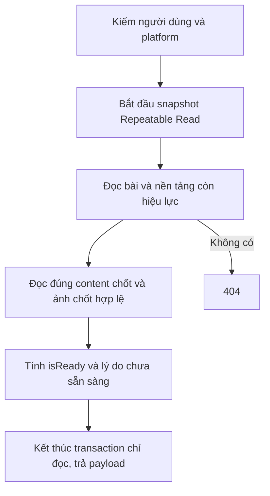

# GetOfficialVersion

`GET /api/v1/posts/{id}/platforms/{platform}/official`

Mốc 7 triển khai trên nhánh `feature/post-gen` (2026-09-14), chưa deploy. JWT Staff/Admin. Không gọi AI/Config, không ghi database, không publish. Không cần migration.

Trả ApiResponse<OfficialVersion> với basePostId/platformPostId/platform, generationId/title/content/hashtag đang chốt, selectedAt, images chốt đúng thứ tự, status/isReady/notReadyReasons. Có thể trả 200 dù thiếu nội dung/ảnh; không fallback sang bài gốc hoặc bản mới nhất. Platform chưa có hoặc bài đã xóa trả 404. Đọc các phần từ cùng snapshot Repeatable Read.

Request, ví dụ JSON, quy tắc readiness và lỗi: [bàn giao FE mốc 7](../FE-API-Handoff-PostGen-Milestone7.md).

Kiểm thử: `GetOfficialVersion.cs` kiểm bản Manual/cũ, đúng thứ tự, thiếu text/ảnh, ảnh lỗi/sai cặp, trạng thái đang sinh/publish, không ghi dữ liệu hoặc gọi AI. `OfficialVersionPostgres.cs` đổi bản Manual và ảnh chốt giữa các truy vấn, xác nhận snapshot nhất quán. `Verification/Program.cs` kiểm qua HTTP thật với PostgreSQL và fake provider.
