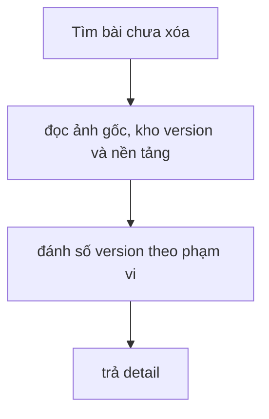

# GetPostCoreDetail

Kiểm chứng ngày 2026-09-12 bằng HTTP cục bộ, JWT kiểm thử và PostgreSQL 16 riêng.

#### Request

`GET /api/v1/posts/8a99eb32-6df5-458e-aa2a-27e1bb45087a`

Policy: `StaffOrAdminPolicy`.

#### Response

HTTP 200; payload và traceId ghi nhận từ lần chạy thực tế.

```json
{
  "value": {
    "baseImages": [
      {
        "id": "2ae66a44-fcd1-4b3e-a99e-aeb3301d2f63",
        "imageUrl": "https://example.com/1.jpg",
        "sortOrder": 1,
        "width": null,
        "height": null
      },
      {
        "id": "53a3d3f2-c1e3-4880-a867-2c5406735805",
        "imageUrl": "https://example.com/2.jpg",
        "sortOrder": 2,
        "width": null,
        "height": null
      },
      {
        "id": "7bb95a8d-bff0-411a-88d0-225f9eb34d96",
        "imageUrl": "https://example.com/3.jpg",
        "sortOrder": 3,
        "width": null,
        "height": null
      }
    ],
    "images": [],
    "platforms": [],
    "basePostId": "8a99eb32-6df5-458e-aa2a-27e1bb45087a",
    "title": "Hoa mùa thu",
    "content": "Nội dung gốc",
    "hashtag": "#hoa",
    "createdAt": "2026-09-12T07:10:47.090101+00:00",
    "updatedAt": null
  },
  "isSuccess": true,
  "isFailed": false,
  "error": null,
  "traceId": "0HNOGJJRTDS8B:00000006",
  "timestampUtc": "2026-09-12T07:10:48.033324Z"
}
```

#### Flow diagram



#### Test case

- Bài dùng chung đọc được bởi mọi Staff/Admin; bài không tồn tại hoặc đã xóa trả 404 Post not found.
- Ảnh gốc đúng SortOrder; các version có số thứ tự ổn định theo (CreatedAt, Id).
- Chỉ ghép version/slot của platform còn hoạt động; giữ nội dung official và trạng thái Partial khi chỉ một phần slot đã chọn ảnh.
- Ảnh nguồn xóa mềm không làm mất lịch sử ảnh sinh; đọc detail không thêm entity vào ChangeTracker.

Test tự động: `HoaTheoMua.Service.Test/PostGenTest/GetPostCoreDetail.cs`; kiểm DB thật tại `PostGenPostgres.cs`.

#### Tối ưu truy vấn (2026-09-12)

- Projection chỉ SELECT các cột cần cho response; bỏ prompt snapshot, feedback, metadata provider và thông tin xuất bản không dùng.
- Trả 404 ngay sau query bài gốc. Bài chưa có platform dùng 4 query; bài có platform dùng 6 query cố định, không tăng theo số platform/version.
- Đọc riêng các collection để tránh nhân bản hàng khi join nhiều collection. Không chạy query đồng thời trên cùng DbContext.
- Gom version/slot bằng lookup theo PlatformPostId một lần, tránh quét lại toàn bộ danh sách cho từng platform.
- Giữ nguyên contract và quy tắc đánh số version; vẫn trả toàn bộ lịch sử nên kích thước response tăng theo lịch sử bài.

Kiểm chứng: 27/27 test PostGen PASS (không skip), gồm PostgreSQL 16 cục bộ. Interceptor kiểm tra SQL thực thi: số query 1/4/6 tương ứng bài không tồn tại/chưa có platform/có platform, không SELECT các cột dư, không tracking entity. Chưa đo mức giảm latency trên dữ liệu production.
