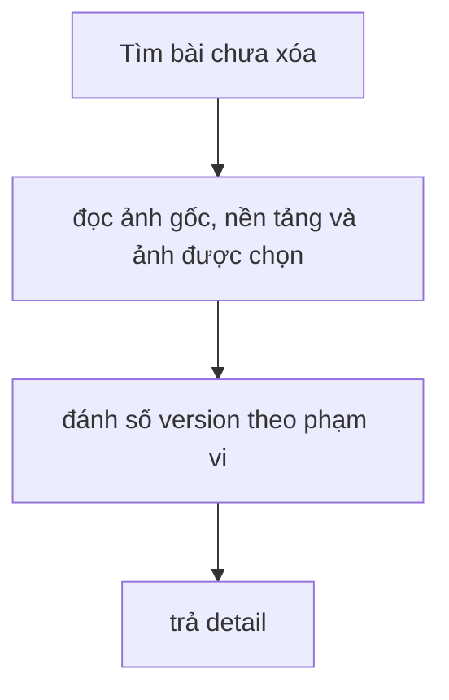

# GetPostCoreDetail

Kiểm chứng ngày 2026-09-12 bằng HTTP cục bộ, JWT kiểm thử và PostgreSQL 16 riêng.

#### Request

`GET /api/v1/posts/8a99eb32-6df5-458e-aa2a-27e1bb45087a`

Policy: `StaffOrAdminPolicy`.

#### Response

HTTP 200; payload và traceId ghi nhận từ lần chạy thực tế.

```json
{
  "value": {
    "baseImages": [
      {
        "id": "faa6efc9-5bcc-4f1d-81b5-2e391f2d3f91",
        "imageUrl": "https://example.com/1.jpg",
        "sortOrder": 1,
        "width": null,
        "height": null
      },
      {
        "id": "660b4417-732a-42cb-a5a1-cf7cd51be5ce",
        "imageUrl": "https://example.com/2.jpg",
        "sortOrder": 2,
        "width": null,
        "height": null
      },
      {
        "id": "160b023f-da2c-44a7-b032-fa2d2896d53e",
        "imageUrl": "https://example.com/3.jpg",
        "sortOrder": 3,
        "width": null,
        "height": null
      }
    ],
    "platforms": [],
    "basePostId": "e8e5bc6d-d39a-4588-bb19-5fa4ad426665",
    "title": "Hoa mùa thu",
    "content": "Nội dung gốc",
    "hashtag": "#hoa",
    "createdAt": "2026-09-14T08:10:57.971964+00:00",
    "updatedAt": null
  },
  "isSuccess": true,
  "isFailed": false,
  "error": null,
  "traceId": "0HNOI6UQF96NF:00000006",
  "timestampUtc": "2026-09-14T08:10:58.337179Z"
}
```

#### Flow diagram



#### Test case

- Bài dùng chung đọc được bởi mọi Staff/Admin; bài không tồn tại hoặc đã xóa trả 404 Post not found.
- Ảnh gốc đúng SortOrder; các version có số thứ tự ổn định theo (CreatedAt, Id).
- Chỉ ghép nội dung chốt/slot của platform còn hoạt động; giữ nội dung official và trạng thái Partial khi chỉ một phần slot đã chọn ảnh.
- Ảnh nguồn xóa mềm không làm mất lịch sử ảnh sinh; đọc detail không thêm entity vào ChangeTracker.

Test tự động: `HoaTheoMua.Service.Test/PostGenTest/GetPostCoreDetail.cs`; kiểm DB thật tại `PostGenPostgres.cs`.

#### Tối ưu truy vấn (2026-09-12)

- Projection chỉ SELECT các cột cần cho response; bỏ prompt snapshot, feedback, metadata provider và thông tin xuất bản không dùng.
- Trả 404 ngay sau query bài gốc. Bài chưa có platform dùng 3 query; bài có platform dùng 6 query cố định, không tăng theo số platform/version.
- Đọc riêng các collection để tránh nhân bản hàng khi join nhiều collection. Không chạy query đồng thời trên cùng DbContext.
- Gom version/slot bằng lookup theo PlatformPostId một lần, tránh quét lại toàn bộ danh sách cho từng platform.
- Mỗi platform chỉ trả content chốt (object hoặc null), không có versions. Giữ quy tắc đánh số version theo (CreatedAt, Id), kể cả khi chốt bản cũ; chỉ lấy text của version được chọn, metadata lịch sử vẫn dùng để tính versionNo. Lịch sử nội dung đọc qua API content/versions riêng đã triển khai ở mốc 5. Lịch sử ảnh đọc riêng qua GET /api/v1/posts/{id}/images (mốc 6). Bỏ `value.images`; chỉ đọc ảnh được chọn, thành công, có URL, thuộc đúng bài gốc và khớp nguồn/tỷ lệ của ô. `platforms[].images` trả URL/kích thước trực tiếp, không có ô chưa chọn hoặc ảnh lỗi.

Kiểm chứng cập nhật 2026-09-14: 53/53 test PostGen PASS (không skip), gồm PostgreSQL 16 cục bộ. Interceptor kiểm tra SQL thực thi: số query 1/3/6 tương ứng bài không tồn tại/chưa có platform/có platform, không SELECT các cột dư, không tracking entity. Chưa đo mức giảm latency trên dữ liệu production.

Từ mốc 4, trạng thái Generated/Ready kèm LastError của lỗi ảnh một phần cũng trả Partial, kể cả khi các ô vẫn giữ ảnh chốt cũ. Mọi ảnh yêu cầu lỗi thì trạng thái lưu là Failed; nội dung và ảnh đã chốt vẫn đọc được.
