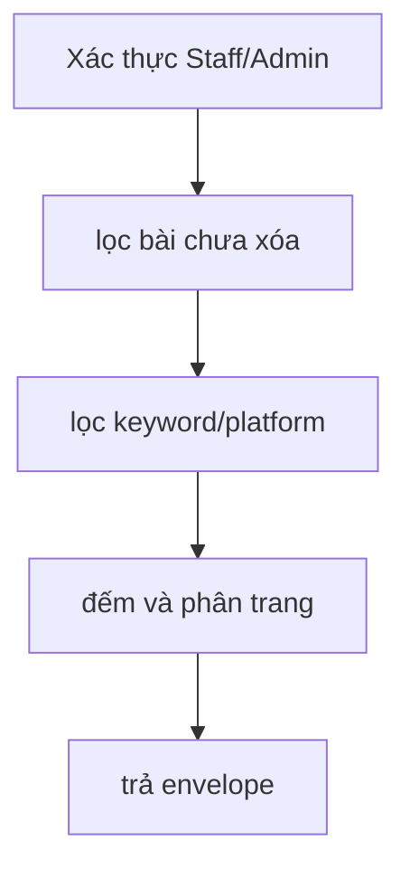

# GetPostCoreList

Kiểm chứng ngày 2026-09-12 bằng HTTP cục bộ, JWT kiểm thử và PostgreSQL 16 riêng.

#### Request

`GET /api/v1/posts?pageSize=200&keyword=hoa`

Policy: `StaffOrAdminPolicy`.

#### Response

HTTP 200; ví dụ dựa trên lần chạy thực tế, cập nhật trường `children` ngày 2026-09-17.

```json
{
  "value": {
    "items": [
      {
        "basePostId": "8a99eb32-6df5-458e-aa2a-27e1bb45087a",
        "title": "Hoa mùa thu",
        "content": "Nội dung gốc",
        "hashtag": "#hoa",
        "createdAt": "2026-09-12T07:10:47.090101+00:00",
        "updatedAt": null,
        "children": []
      }
    ],
    "pageIndex": 1,
    "pageSize": 100,
    "totalCount": 1,
    "hasNextPage": false,
    "hasPreviousPage": false
  },
  "isSuccess": true,
  "isFailed": false,
  "error": null,
  "traceId": "0HNOGJJRTDS8B:00000005",
  "timestampUtc": "0001-01-01T00:00:00"
}
```

#### Các bài theo nền tảng (`children`)

Mỗi bài gốc có `children` gồm cả bài theo nền tảng chưa đăng và đã đăng. Mỗi `platformPostId` xuất hiện một lần; nếu có nhiều publication thì chọn lần tạo mới nhất (CreatedAt giảm dần, Id giảm dần khi trùng thời gian). Không trả PlatformPost đã xóa mềm. Bài gốc chưa có PlatformPost hoặc publication trả `[]`. Sắp xếp bài đã đăng theo publishedAt giảm dần, rồi platform và platformPostId.

Mỗi child trả `publicationId`, `platformPostId`, `platformAccountId`, `platform` (facebook/instagram/zalo), `status` (trạng thái publication mới nhất nếu có; nếu chưa có thì trạng thái PlatformPost: Draft/Generating/Generated/Failed/Ready/...), `title`, `content`, `hashtag`, `imageUrls`, `externalPostId`, `externalPostUrl`, `publishedAt`. Bài đăng thành công lấy nội dung và ảnh từ snapshot tại thời điểm đăng. Bài chưa đăng lấy nội dung official đang được chọn và ảnh selected thành công; chưa chọn nội dung trả title/content/hashtag null, chưa có ảnh trả imageUrls rỗng. Bài chưa tạo publication có publicationId null; platformAccountId cũng có thể null. publishedAt chỉ có giá trị với publication Succeeded, không dùng thời điểm hoàn tất tác vụ lỗi làm ngày đăng. `externalPostUrl` có thể null nếu nhà cung cấp không trả liên kết.

Chỉ với child `status=Succeeded` và có `publicationId`, gọi `GET /api/v1/post-gen/publications/{publicationId}/insights`.

Phân trang và `totalCount` vẫn tính theo bài gốc. Truy vấn publication, platform và các bản nội dung/ảnh được chọn theo lô cho các bài trong trang, không gọi Meta. API chi tiết `GET /api/v1/posts/{id}` cũng trả `children` cùng cấu trúc.

#### Flow diagram



#### Test case

- Mọi Staff/Admin thấy cùng danh sách bài; bài soft delete không xuất hiện.
- Keyword không phân biệt hoa thường; có lọc platform.
- PageIndex 1-based; pageSize clamp 100.
- Children gồm các trạng thái chưa đăng/đã đăng, đúng bài gốc; bài đã đăng giữ snapshot, bài chưa đăng dùng nội dung/ảnh được chọn; retry không tạo child trùng.
- Children không làm thay đổi số bài hoặc phân trang; bài chưa có PlatformPost/publication trả mảng rỗng.

Test tự động: `HoaTheoMua.Service.Test/PostGenTest/GetPostCoreList.cs`; kiểm DB thật tại `PostGenPostgres.cs`.
